# Mathworks《工程与科学计算机视觉（简介、机器学习、目标检测）｜Computer Vision for Engineering and Science》 p38 12_工程与科学计算机视觉总结.zh_en -BV1yJ4m13715_p38-

🎼。

Nice job。Great work。 Well done Congratulations。 by completing this specialization。

 you've gained the skills necessary to succeed in a world where images and videos are increasingly important。

😊。

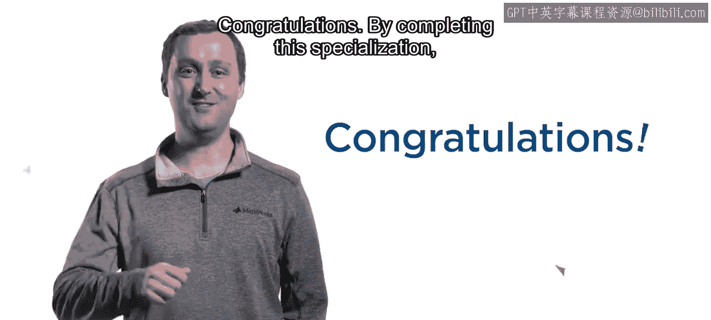

Companies are working on a wide range of computer vision applications。From driver assistance systems。

To smartphone apps and smart appliances。The ability to use and make decisions from images is essential for many careers。

You started with learning how to detect and extract features from images using some of the most widely used algorithms。

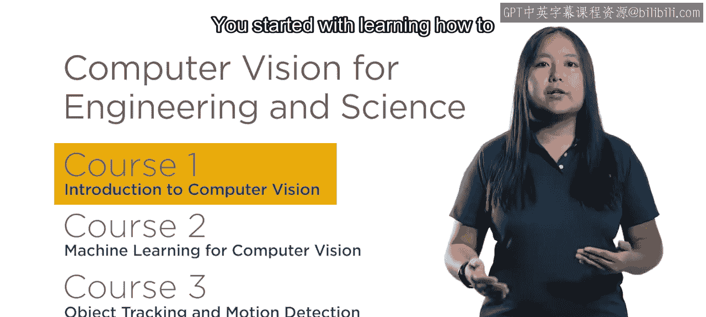

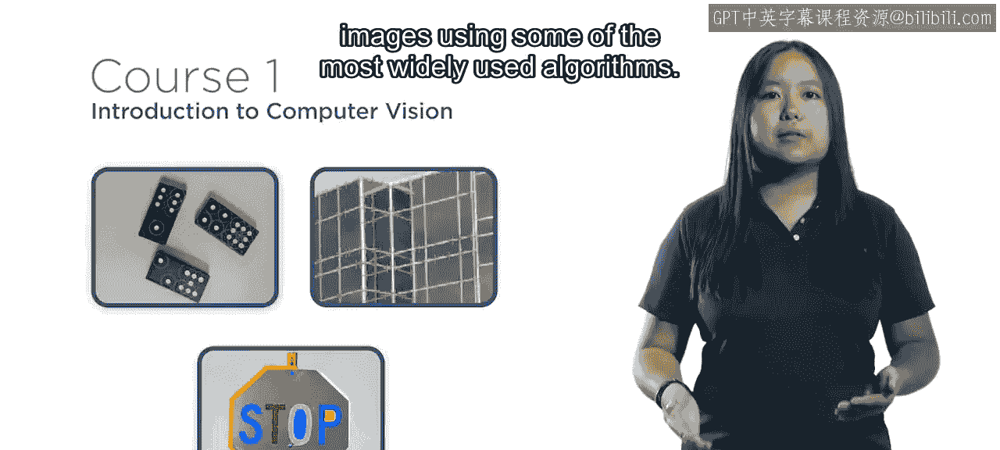

You use these features to estimate geometric transformations。

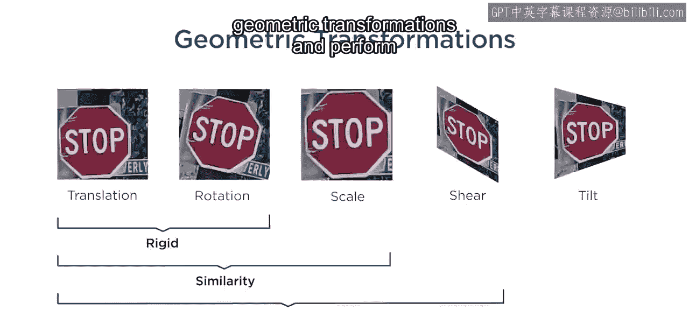

And perform image registration and stitching。With these skills。

 you can accurately compare and analyze images taken at different times or from different perspectives。

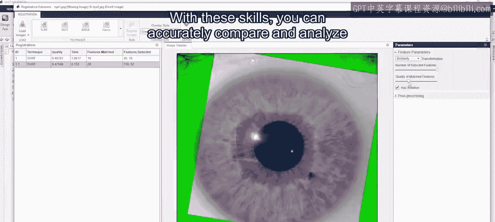

Across industries， companies are looking for people with machine learning experience。In Co two。

 you trained both image classification and object detection models。

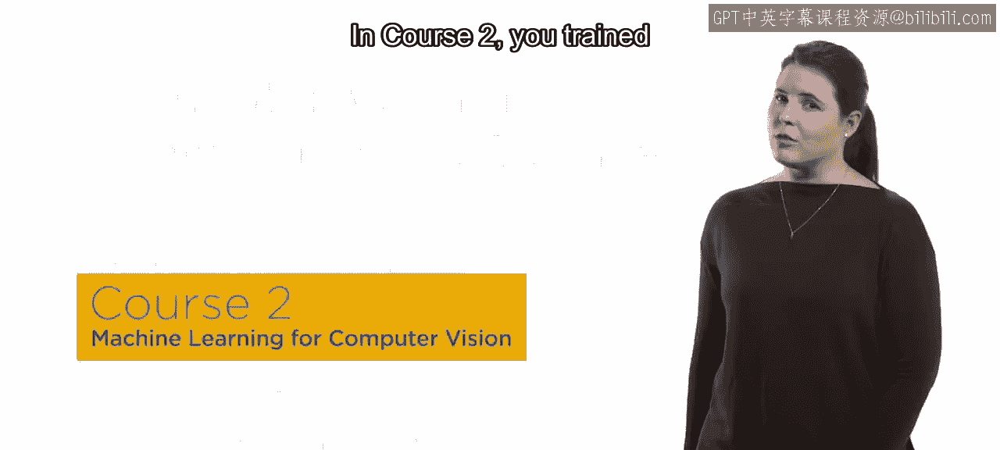

You then evaluated these models using a variety of metrics。And because not all errors are equal。

 you adjusted cost matrices to reflect the importance of specific classes。

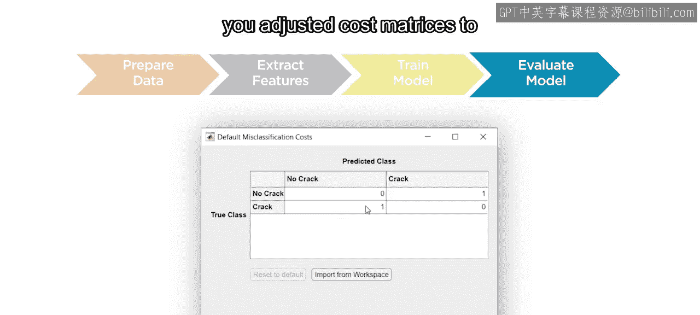

Importantly， you now have a workflow to apply to any machine learning problem。

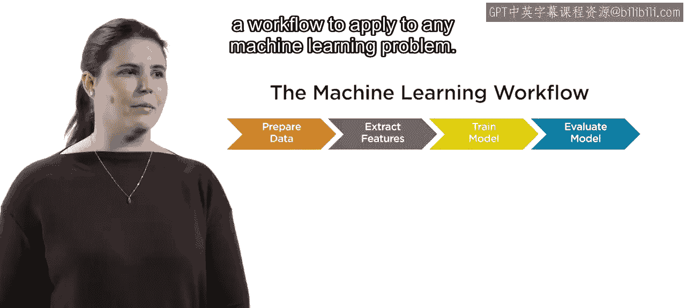

Tracking objects and detecting motion are difficult tasks。

 but are required for applications as varied as microbiology and autonomous systems。

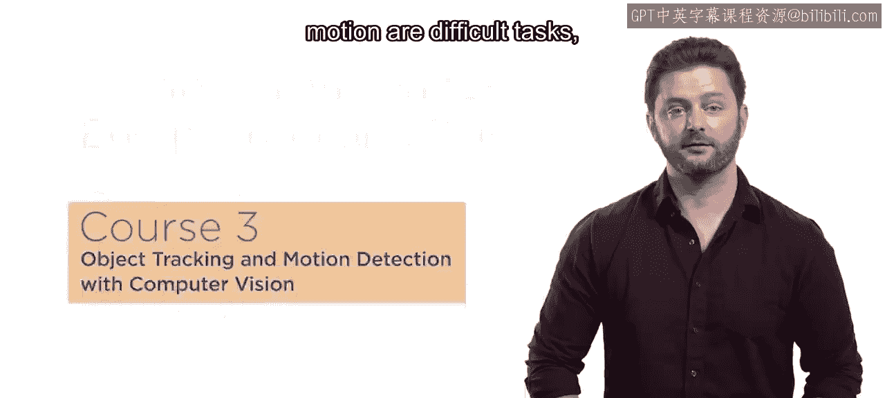

To track an object， you first have to detect it。

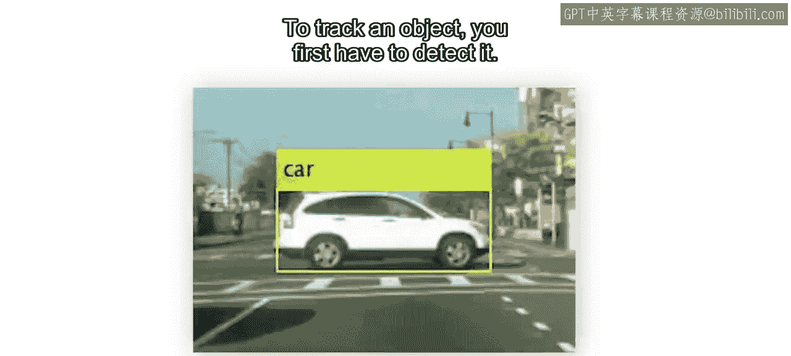

You now have a variety of approaches， such as image segmentation， optical flow。

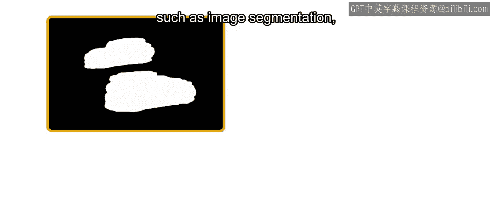

Training your own object detector or using pretrained models like Yolo。

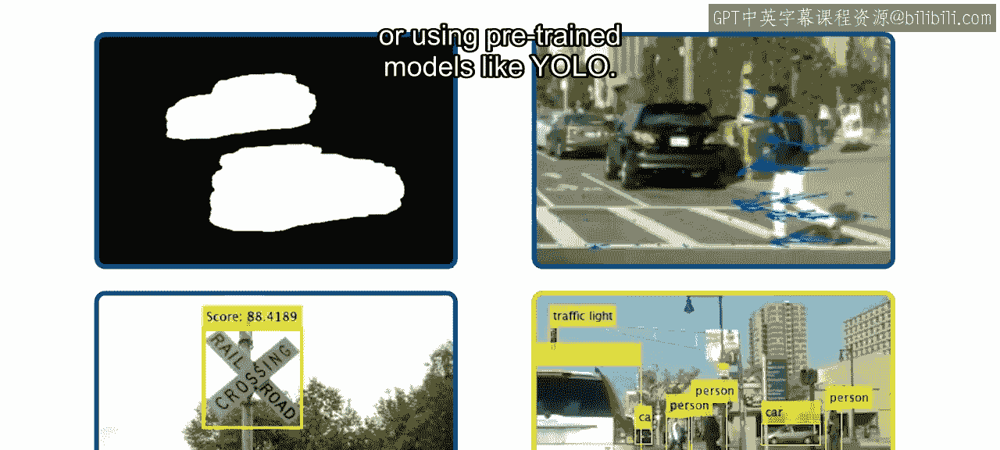

By incorporating tracking。You can identify and follow individual objects。

Even when there is detection noise。Or when objects move out of view。

You're now better prepared to solve challenging problems and computer vision。Good luck。

