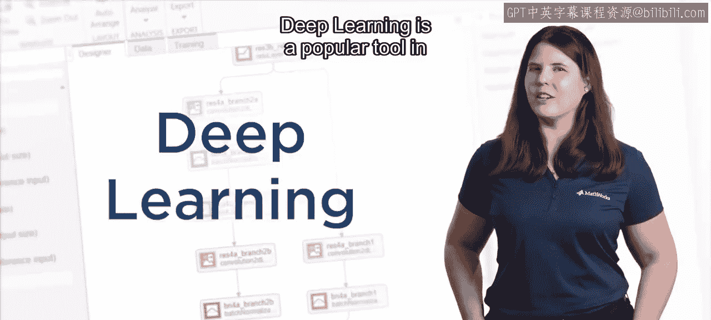
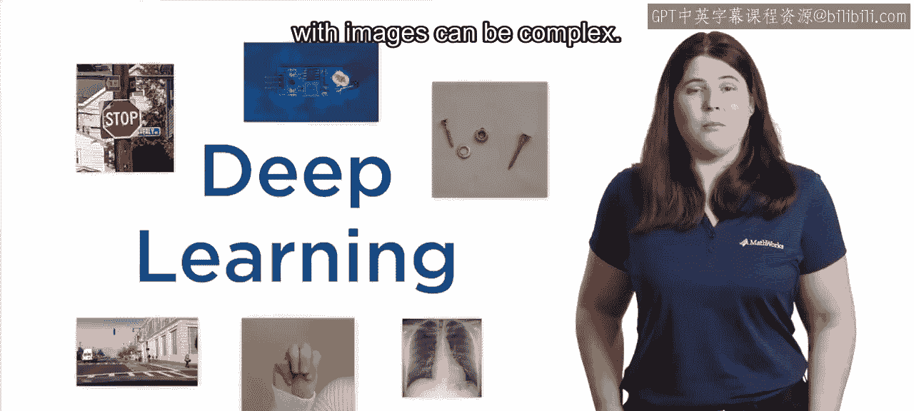
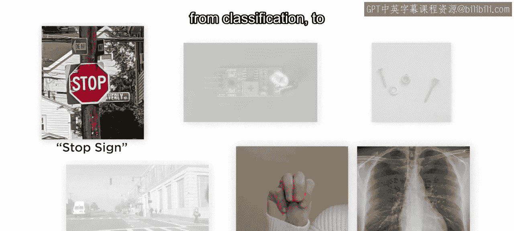
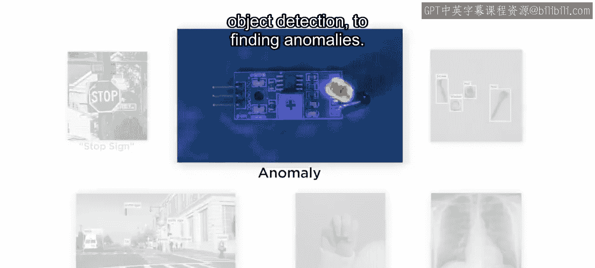
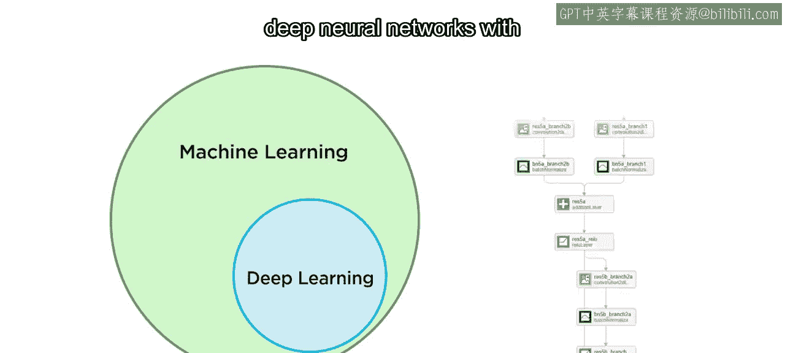
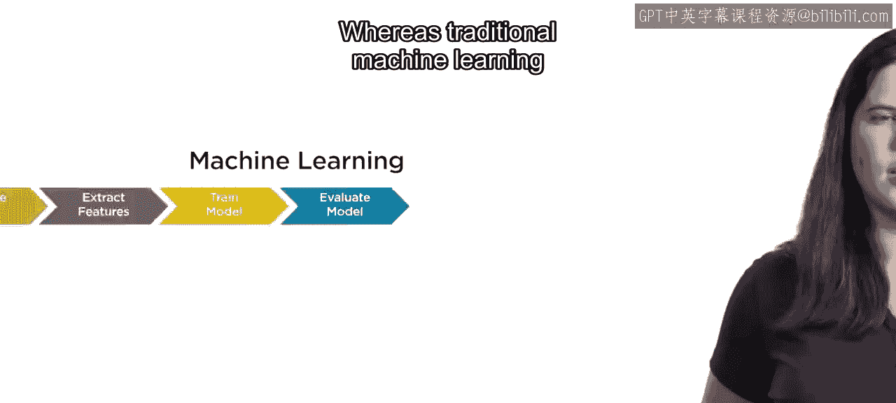
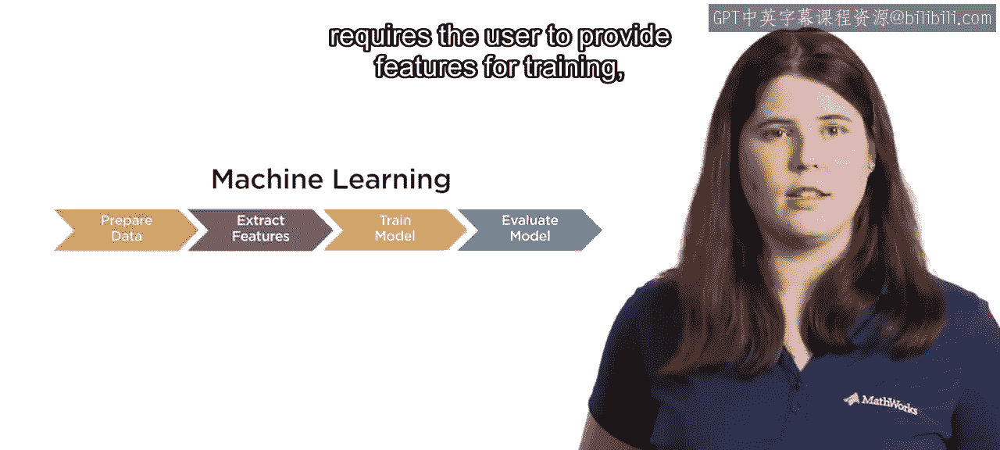
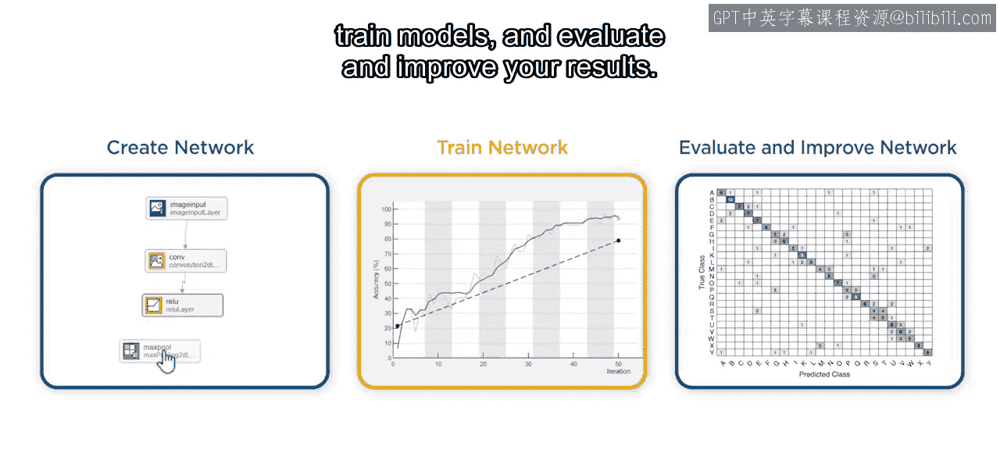
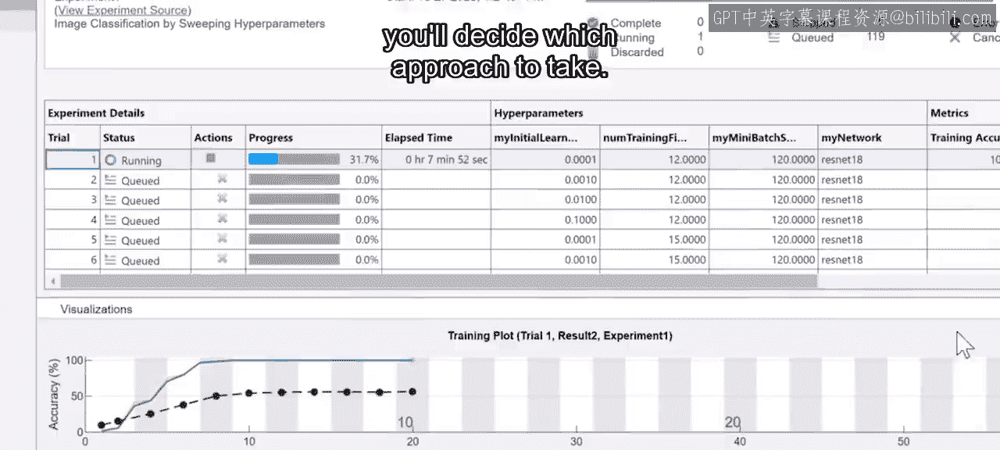

# Mathworks《深度学习在计算机视觉中的应用（简介、目标检测、高级深度学习）｜Deep Learning for Computer Vision》 p02 1_深度学习在计算机视觉中的介绍.zh_en -BV1Rb421v71M_p2-

🎼。

Welcome to Introuction to Deep Learning for Comp Viion。

Deep learning is a popular tool in computer vision， because working with images can be complex。

There are diverse applications from classification。

To object detection。Deeffining anomalies。

Deep learning is a subset of machine learning。That uses deep neural networks with many computational layers to make predictions。

Whereas traditional machine learning requires the user to provide features for training。

 deep learning models find features automatically。

In this course， you'll build a simple convolutional neural network。

 train models and evaluate and improve your results。

Designing large networks usually requires years of experience。

Instead， you'll customize models created by experts。

And apply them to your own applications with a technique called transfer learning。

At the end of the course， you'll have the opportunity to apply and practice your new skills with a final project。

There are many ways to build a successful model， and you'll decide which approach to take。

When you're done， you'll have working code to share with colleagues and employers and the skills to tackle new image classification problems。

Additionally， this course lays a foundation for the later courses in this specialization。

If you're stuck or find interesting results you want to share， please post to the course forums。

Good luck。