# Mathworks《深度学习在计算机视觉中的应用（简介、目标检测、高级深度学习）｜Deep Learning for Computer Vision》 p04 3_为分类准备数据.zh_en -BV1Rb421v71M_p4-

🎼，Preparing your data is a crucial first step towards creating effective deep learning models。

To train a model for image classification， you need three sets of labeled images。Training。Validation。

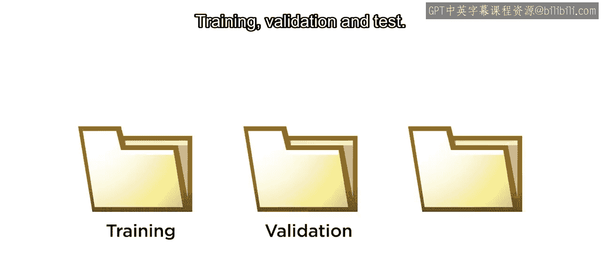

And test。Ideal training sets are large and diverse。

 representing the types of images the final trained model will classify。

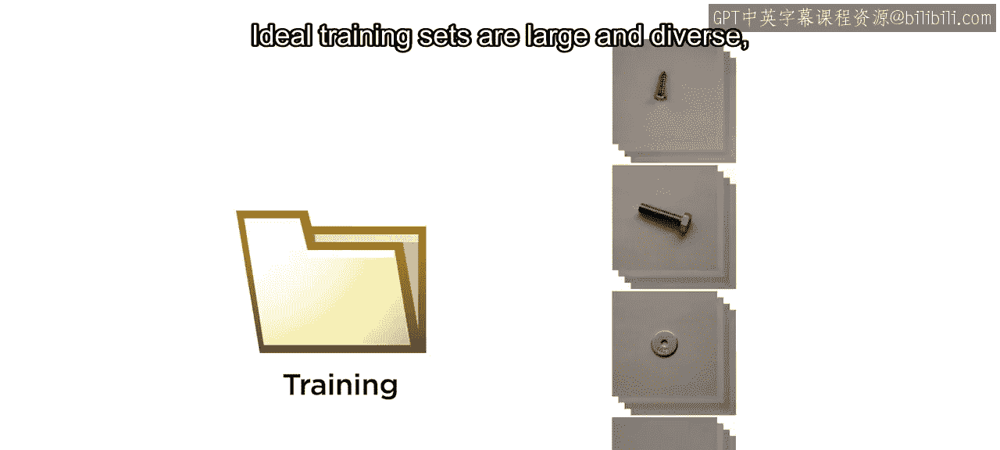

The training set is used to train your model by establishing weights。

Validation data is not used to update weights。

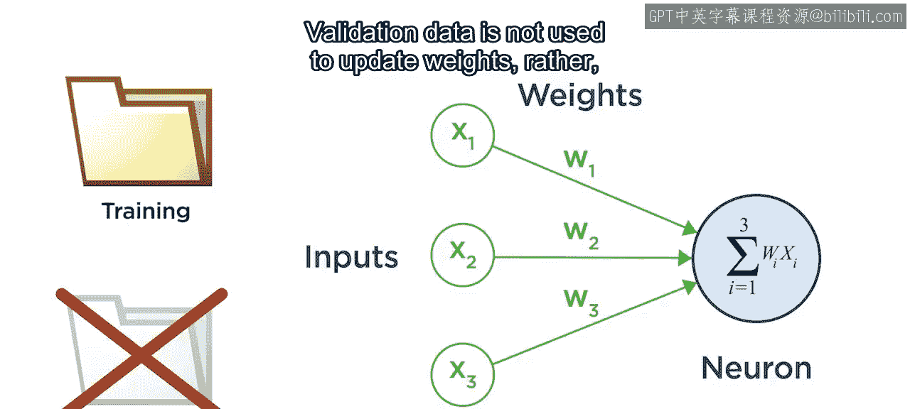

Rather。It's used to periodically evaluate the accuracy during training。Usually。

 the model weights that perform the best on the validation data are used in the final trained model。

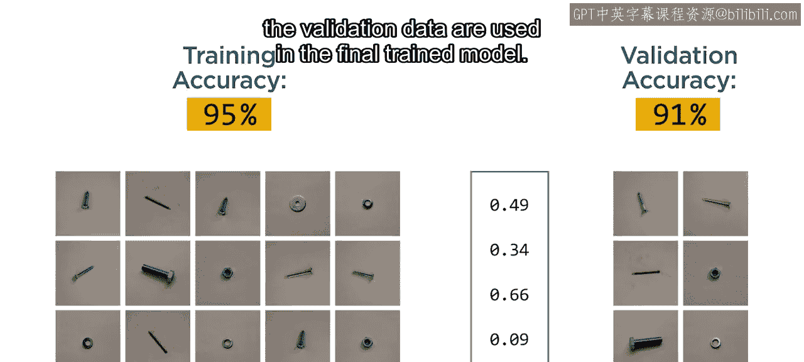

In this way， validation data serves as an outside check to prevent your model from returning weights that are too specific to the training data。

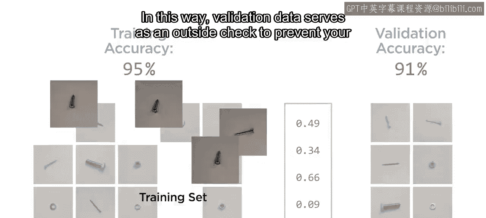

Such weights won't generalize to new data。Which is known as overfitting。

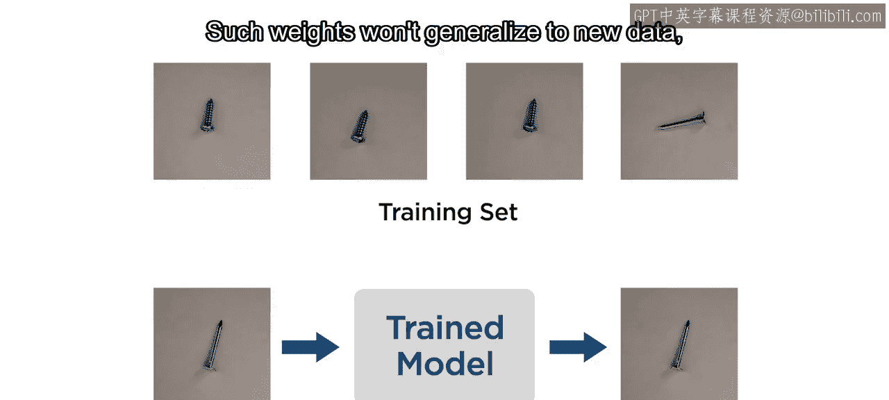

Unlike training and validation data。

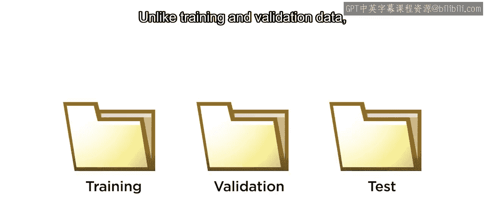

Test data is only used to evaluate the final trained model。

 simulating how it'll perform on new unlabeled data。

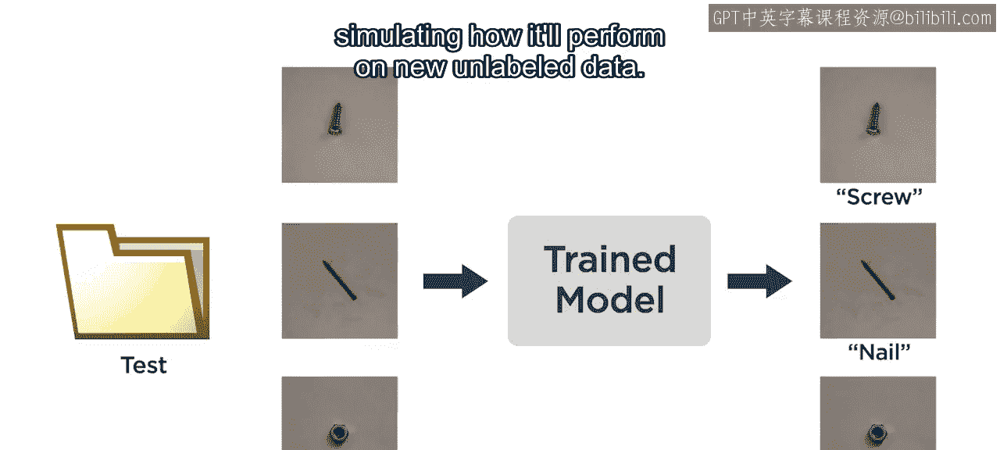

Test images should be kept in a separate folder and left untouched until after training。

Even before you split your data into training， validation and test sets。

 it's a good idea to familiarize yourself with your images。

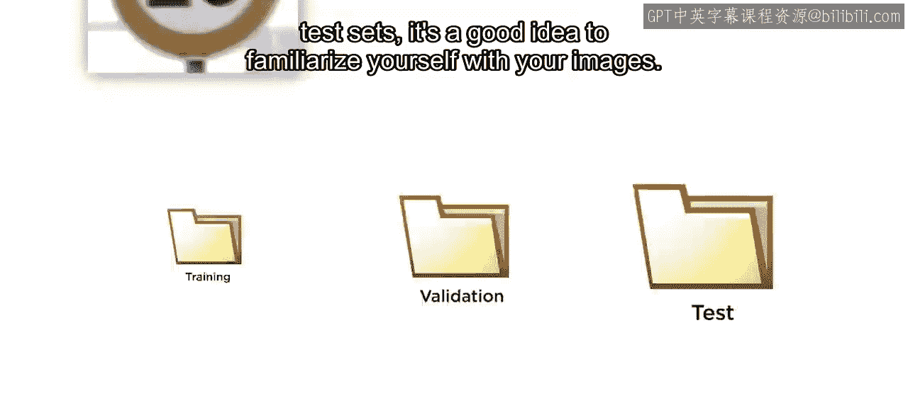

Do you have a good sense of the image's sizes。

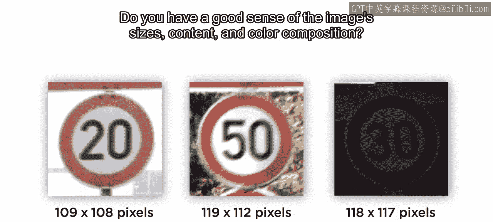

Content。And color composition。

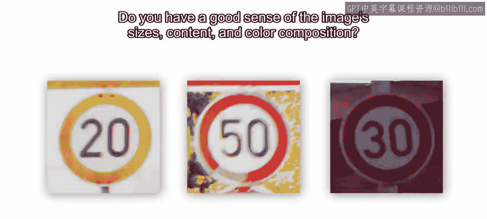

And people make mistakes。 So you might find mislabeled images。

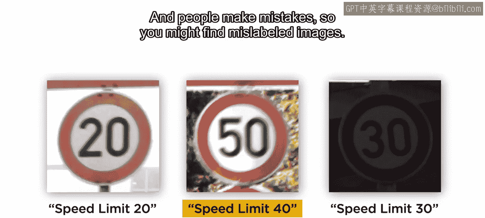

For example， suppose you intend to classify parking spots based on accessibility。

But if the accessible parking images were all taken on a cloudy day and the non accessible parking images on a bright。

 sunny day， you might inadvertently train a model that classifies based on the weather instead of the signage。

😊，Finally， consider the reliability and applicability of your data。

We include a few hundred low resolution images of traffic signs in the course files for educational purposes。

But if you were training a model for self driving cars。

 you would need a much larger and more robust data set。

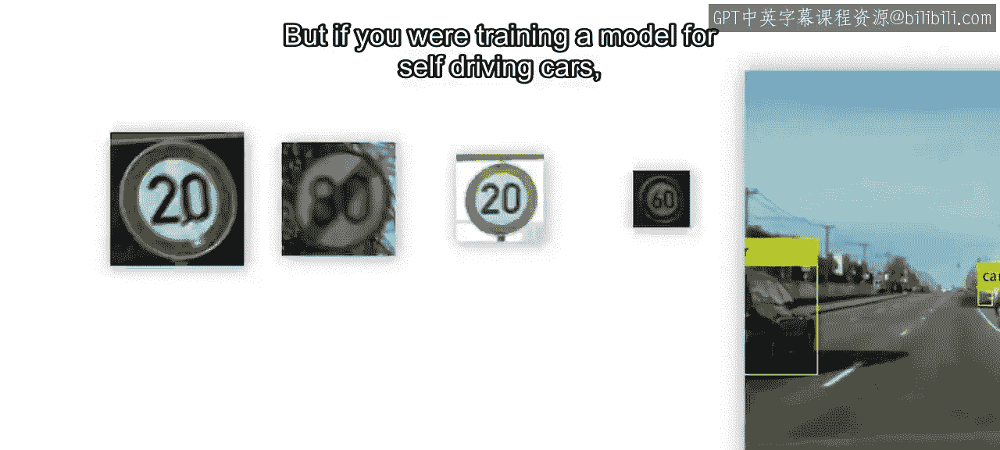

Once you're happy with your images， make sure they're organized into folders based on their classes。

These folders will become the class labels。Then further divide your images to create training。

 validation， and test sets。

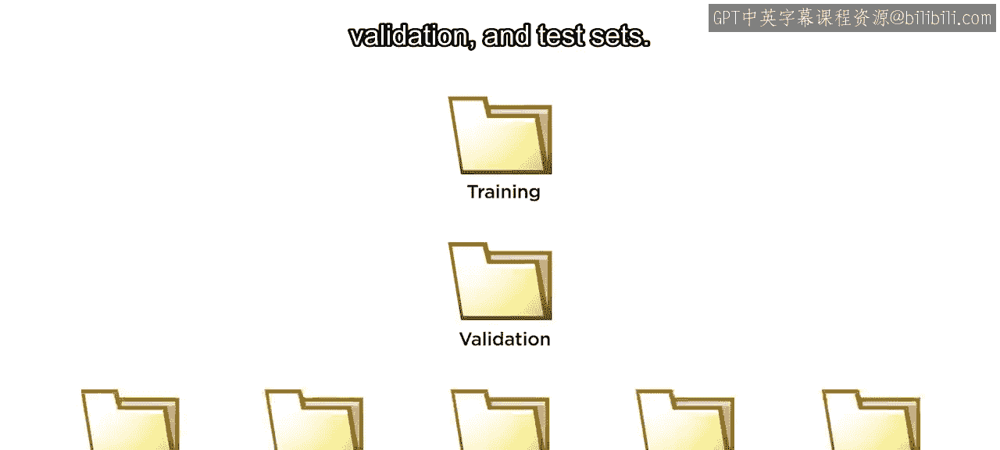

In the course files， a randomized group of images from each class has already been set aside in a test folder。

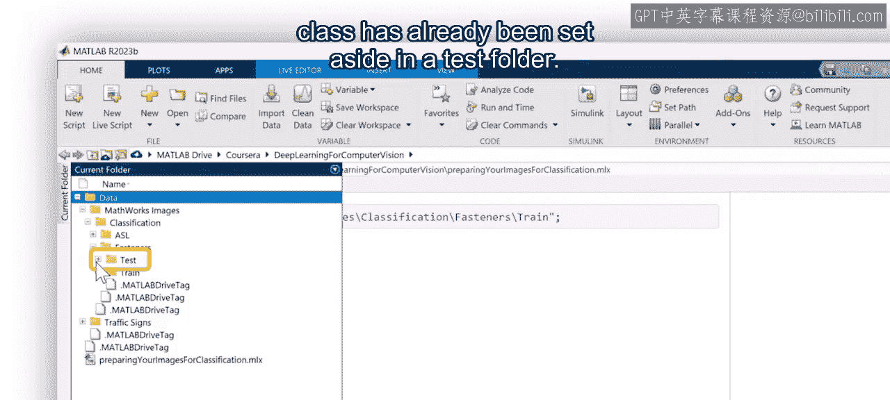

To create training and validation sets in MatTLb。

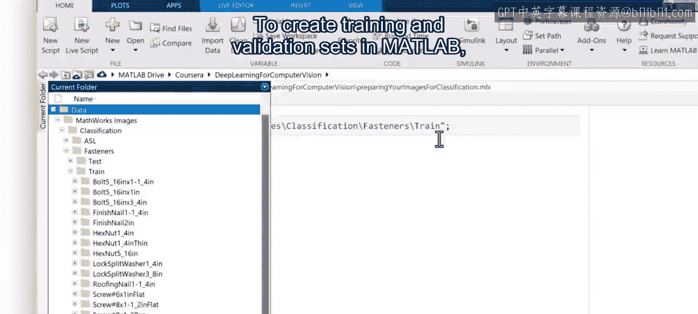

Create a data store from the training images。Including all subfolders。

And specifying the folder names as labels。Then split the data store into training and validation sets using the split each label function。

A common split is 80% for training and 20% for validation。

Make sure to use the randomized option to avoid biasing your validation data。

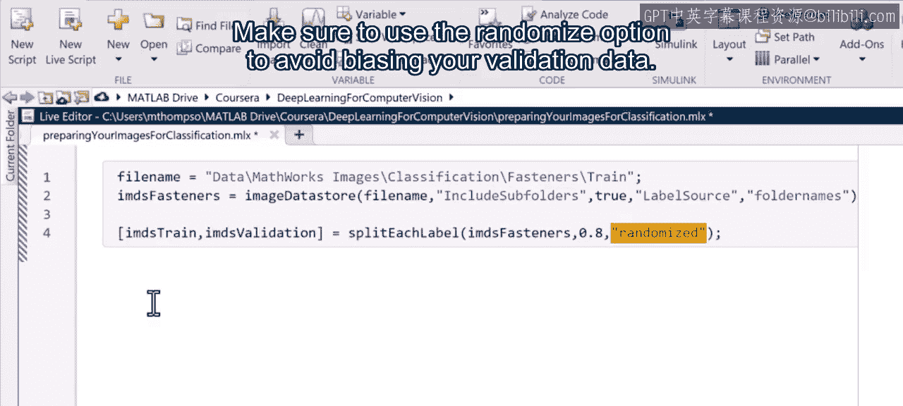

Most deep learning networks have a required image input size。

You'll see how to check this later in the course。To resize your data to the required input size。

 use the augmented image data Store function。This function doesn't create and store new data。

 but instead generates temporary versions of each image resized to fit the network's requirements。

These generated images are used immediately during training。

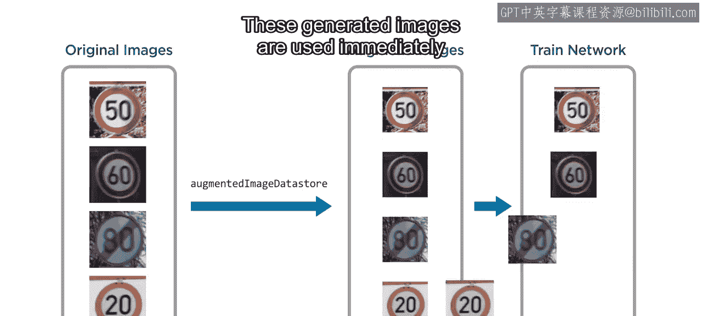

And then， discarded。Here， the function is used to resize our training and validation sets to 224 by 224 pixels。

And that's it。You'll see code like this throughout the course。

The data for each course example has already been organized for you。

Now you're ready to train a deep learning model。

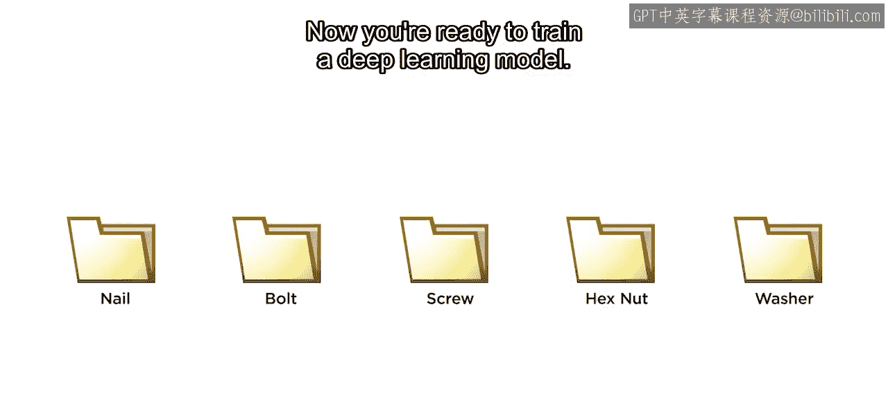

。