# Mathworks《深度学习在计算机视觉中的应用（简介、目标检测、高级深度学习）｜Deep Learning for Computer Vision》 p05 4_创建和训练用于分类的卷积神经网络.zh_en -BV1Rb421v71M_p5-

🎼，Convolutional neural networks are a flexible tool for building deep learning models and are especially useful for image data。

While a growing number of models are available， you may need to train your own model to meet your needs。

In this video， you'll design， train， and apply a basic CNN。

This simple CNN behaves like more complex networks。

 but is small enough to reasonably examine and discuss each layer。

This model works well for the demonstration in this video， but often。

 larger networks are needed to get good results。Later。

 you'll use more complex networks with hundreds of layers。

But you'll notice that these networks contain many of the same layers as the network we build in this video。

In addition to network architecture， to train a CNN， you need data。

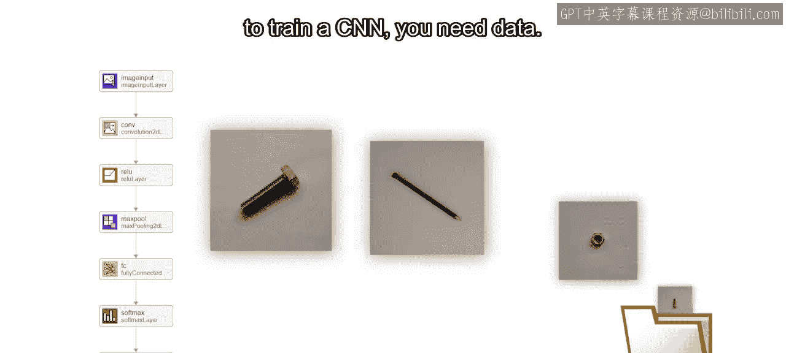

Throughout this course， you'll work with images of fasteners。

The dataset set contains 19 classes of nuts， bolts， washers。

 nails and screws in various shapes and sizes。Training a deep learning classification model capable of identifying each item has applications in robotics。

Quality control。And even household projects。

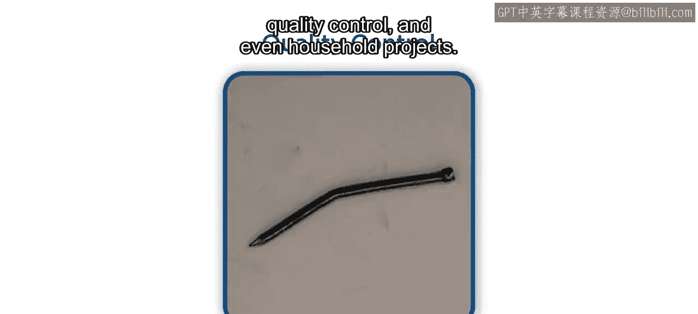

To prepare this data for training， open Matlab。And create an image data store from this collection of images。

Fortunately， your images have already been sorted into folders with names corresponding to each class。

Use these folder names as the labels for training。Test images have already been set aside to evaluate your final model。

However， you do need to split the data store with the training images into training and validation sets。

The split each label function takes a subset of each label and assigns them to a new data store。

The fraction you input determines the size of each subset。Here。

 we chose to use 80% of the images for training and leave the rest for validation。

To avoid biasing which images within a label go into the training and validation sets。

 use the randomized option。Without this option， sequential images will be in the same group。

 leading to dissimilar training and test sets。

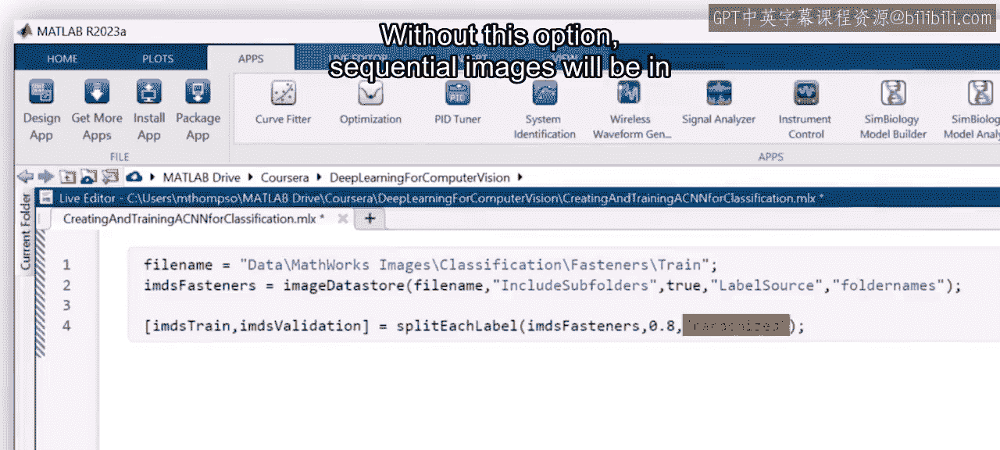

Now， you're ready to build the layers of a convolutional neural network。The Deep network Design app。

Allows you to view and modify existing networks。Or create new networks from scratch。

Here you'll build a new network using some of the key layers discussed earlier in this course。First。

 you need an image input layer。Image input layer takes images of a specific size and passes them to later layers。

To extract features。Set the weights and train the model。

Check the image resolution that the input layer expects。Keep this number in mind。

 you'll need to know it later。Next， add a convolutional layer。

Connect the layers by dragging a line between them。

Because our data consists of two dimensional images， use convolution 2 Dlayer。

This layer uses filters or kernels to identify and extract features that distinguish the classes。

Clicking on the layer， you see that it'll train 32， three by three filters。

Notice how the weights parameter is empty。Because you're building a new model。

 there is no initial guess of what weights might be effective。

This will lead to longer training times than if you had a good initial estimate。Later in this course。

 you'll see how to create a model with predetermined initial weights。Now， add。

And connect an activation layer。Raylu layers are a good choice because they're fast and effective。

This layer will set all negative values to0。The nonlinear activations from this layer are then passed into a pooling layer。

In this case， a two dimensional max pool。This layer reduces the complexity and computational cost of the data。

 while still retaining crucial features。Once features are extracted and simplified by earlier layers。

 they're used to train the model in the fully connected layer。

The fully connected layer will sign a likelihood that the input image belongs to each class。

Since there are 19 classes in the Fastener data set， set the output to 19。

The output of the fully connected layer will be input to a softmax layer。

The Somax layer normalizes these scores to be between 0 and1。With higher scores。

 more likely a member of that class。Finally， add and connect a classification layer。

The classification layer interprets these scores into a prediction like finishing nail or lock split washer。

Now， you can use this network architecture to train your model。Export your model layers。

Choose the generaterate code option。This exports your layers as a live script。

It creates a record of your layers's components and allows you to make changes or reproduce your design without having to build the architecture again。

Copy the layers into your initial script。Remember the image input size variable from the image input layer。

You can see it again in the exported layers。The network expects images with a resolution of 227 by 227。

But if you look at your training data， this doesn't match up。

The training data is composed of 337 by 337 color images。

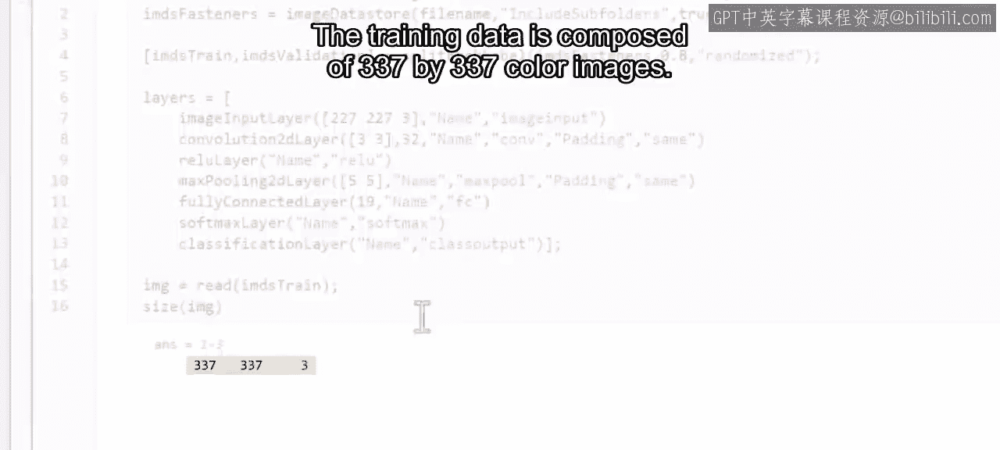

Changing the image input layer isn't usually recommended。

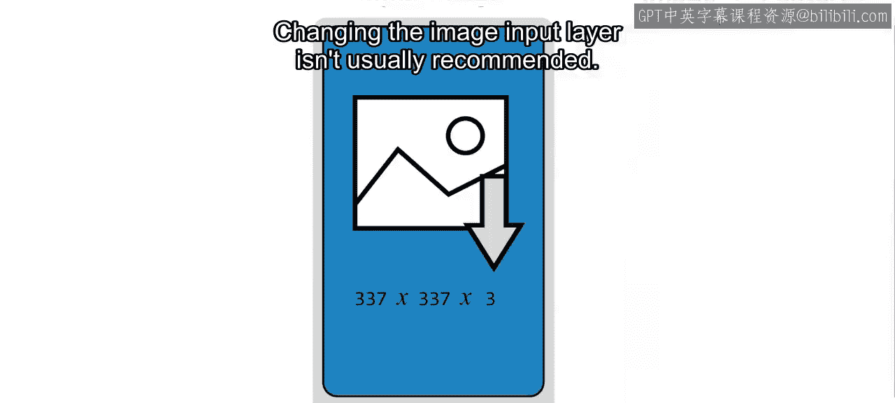

In many cases， this will cause problems with downstream layers。

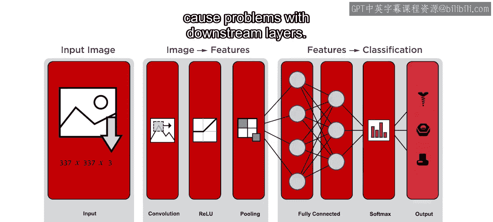

In addition， your images may have different sizes， so it's usually a better idea to resize your input images to fit the network。

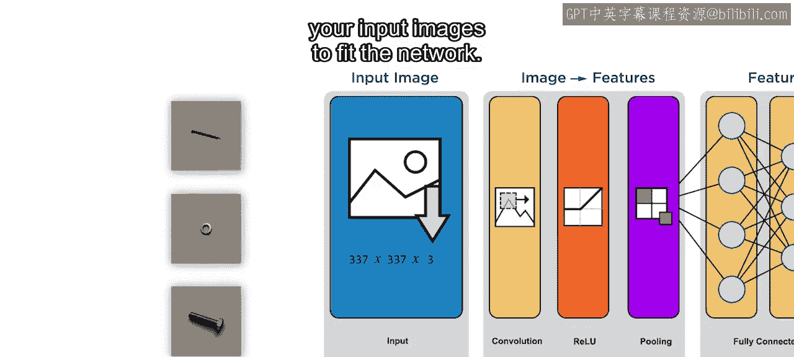

Resize your images using an augmented image data store。

The augmented image data store function transforms batches of images before they are passed into the network without changing the original image files。

Here， use the function to resize the training and validation images to the size expected by the image input layer。

We have the network， we have the data， let's train。The Tra network function requires three inputs。

The network layers， which we created in the app。The data。

 which we have resized and the model options。You can find the many options for training deep learning networks in the documentation。

You'll experiment with some of these in this course。In this video， to keep things simple。

 you'll specify only four options and leave the rest as their defaults。To train。

 every model needs a solver。This algorithm determines how your model is optimized for the best training weights。

In this course， we're going to use adaptive moment estimation or atom。

The next model option is to include the validation data you created earlier。

Now set shuffle to every epoch。To understand how the shuffle affects your data。

 you need to know a little bit about how your images are used during training。

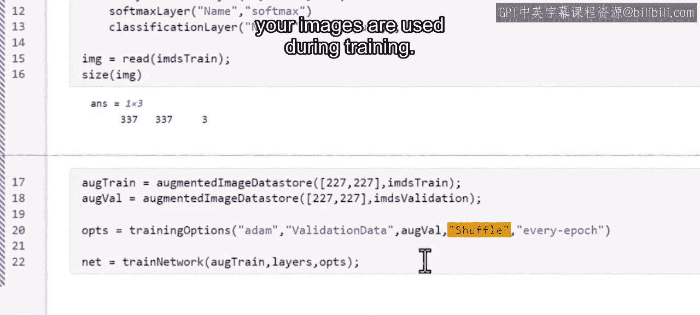

Because deep learning models usually train on massive amounts of data over many training iterations。

 using every image， every iteration would take too long。Instead。

 the data is broken into random subsets or mini batches。

Leftover images that don't fit into a mini batch are discarded。In each iteration。

 the model trains only one mini batch。

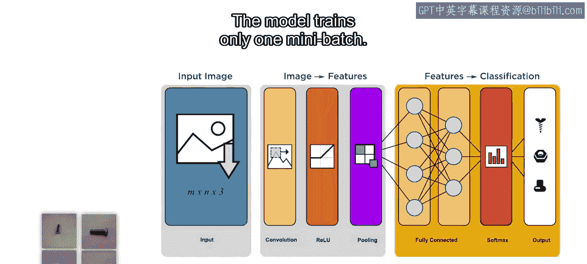

When the model has cycled through all the data， meaning every mini batch。It has completed one epoch。

By default， training lasts for 30 epochs。

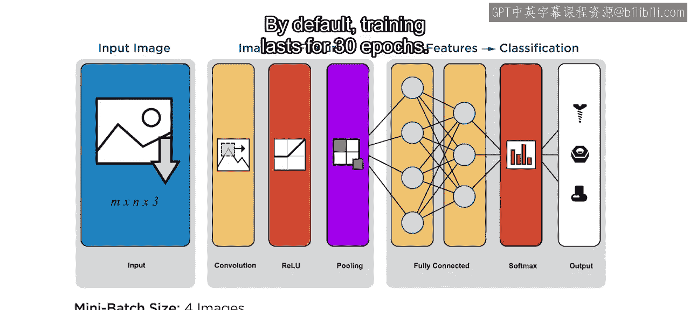

Consider the Fastener data set。There are 783 images in the training set。

And a default mini batch size of 128。That means there will be six mini batches。

With 15 images left over。If you use the default options。

 these 15 images will never be used during training。

That's why it's a good idea to shuffle your data every epoch。

The images are randomly divided into mini batches every epoch instead of just once。

 with different images discarded each epoch。This leads to a more balanced model and reduces the risk of biasing the data towards your initial mini batches。

Now that you've set the shuffle。Turn plotloting on。This way。

 you can watch the training progress and intervene if necessary。Finally， you're ready to train。

Training deep learning networks can take a long time。

 so you'll often need more powerful computational resources， such as a GPU。

This model took about 25 minutes to train on my CPUU。

If you decide to end training before it finishes， the stop button will stop training and return the most recent trained model。

The top plot shows the training accuracy。The smooth train accuracy。And the validation accuracy。

Validation data is not split into many batches。 Instead。

 all of the data is used to calculate validation accuracy every 50 iterations。

The bottom plot portrays training and validation loss。

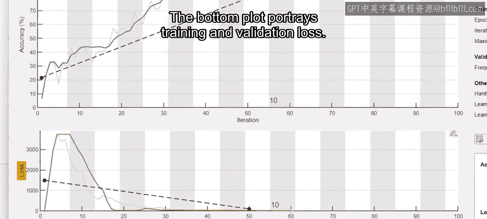

The details of the specific loss algorithm used here are beyond the scope of this course。 However。

 it is helpful to understand what the training loss is telling you。

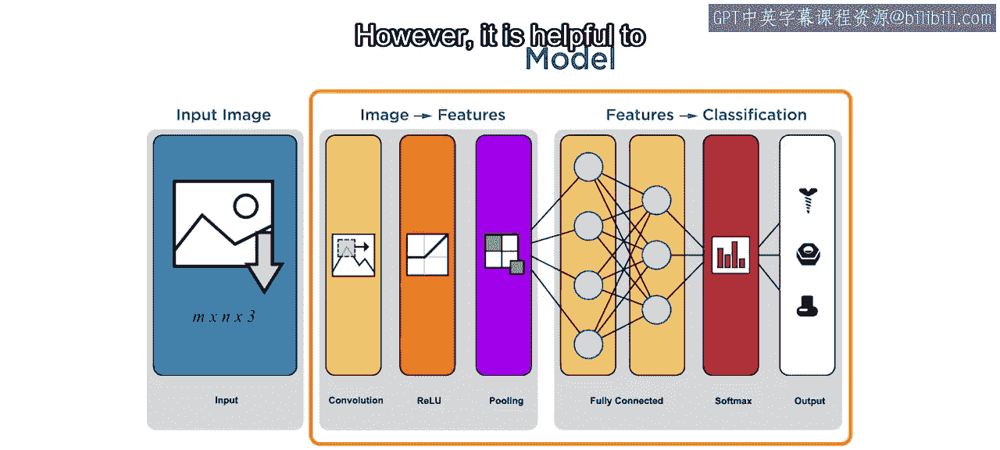

During training， a model takes training data。

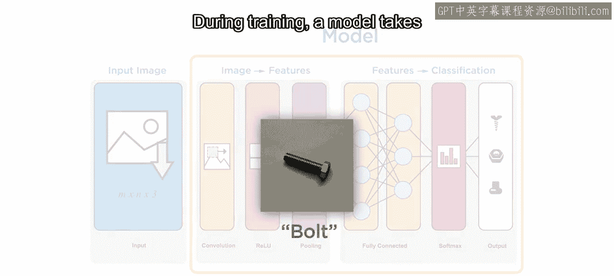

And passes it through model layers。

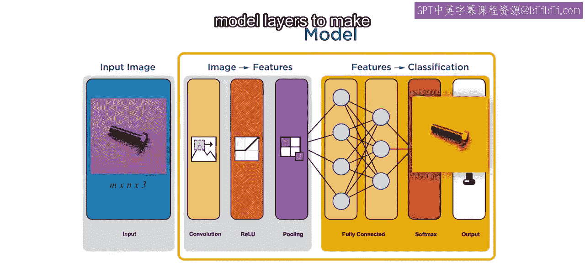

To make a prediction about the training Data class。

It mathematically compares the data's predicted labels to the actual labels。

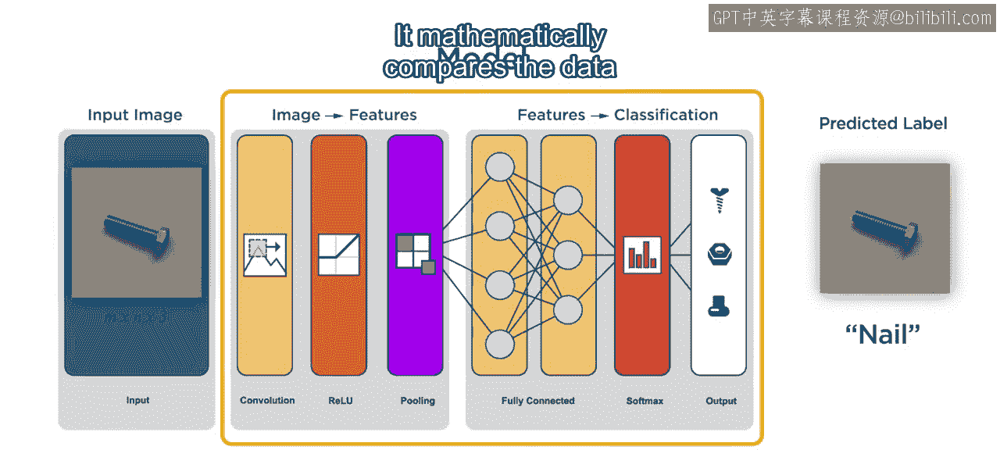

That comparison is the training loss。The network is then updated using the loss。For the sake of time。

 let's jump to the end of training。Remember the empty convolutional weights from earlier in this video？

They're not empty any more。Your model has found through training weights that classify the fasteners in the dataset。

To get a better idea of what the network is doing。Use the activations function to visualize the output of a layer for a given image。

For example， the convolutional layer has 32 filters。

 so the activation function has 322 dimensional outputs。

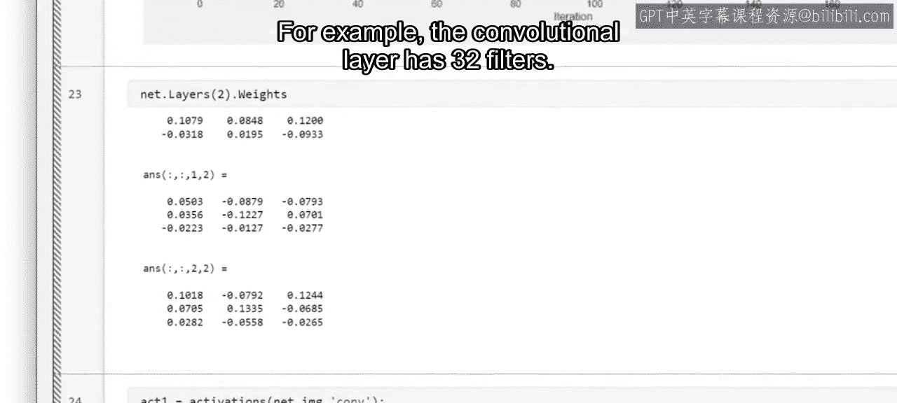

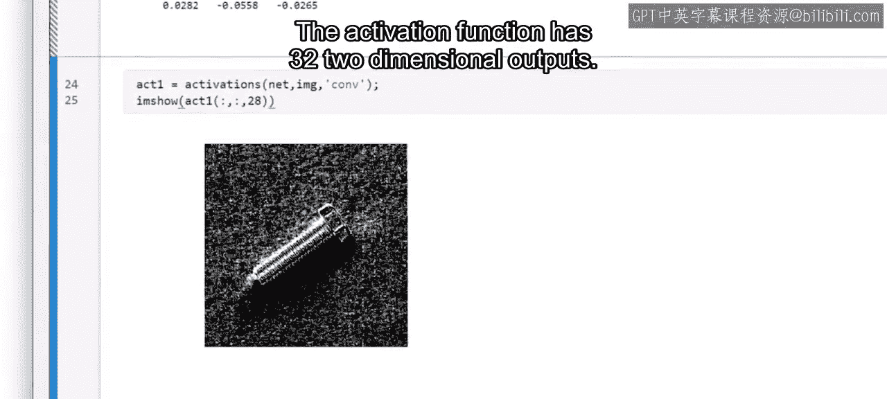

You can visualize some of these outputs to get an idea of what they're doing。

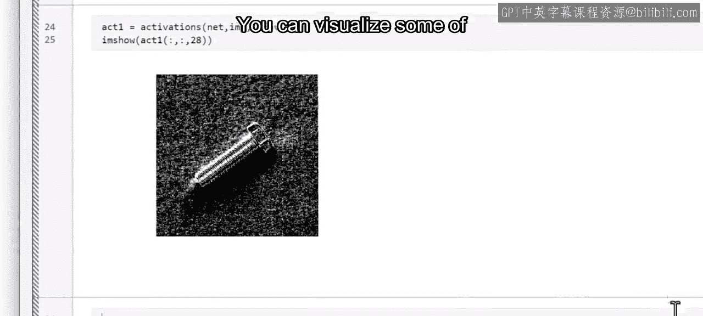

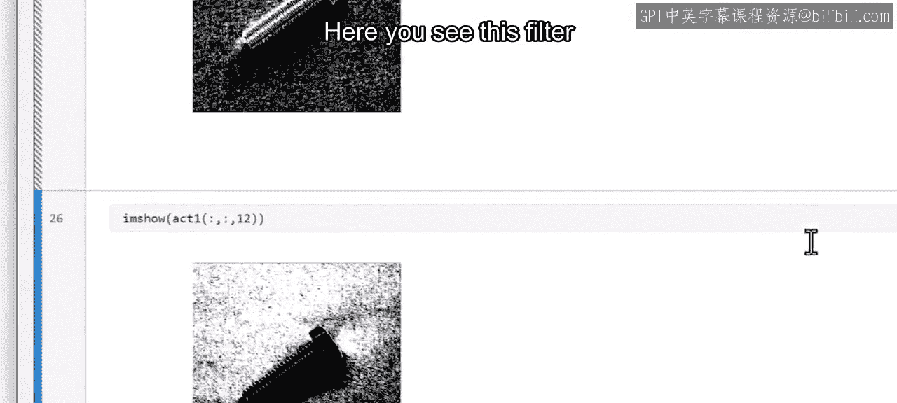

Here you see this filter highlights the bright parts of the image。

While this one seems to focus primarily on the background。

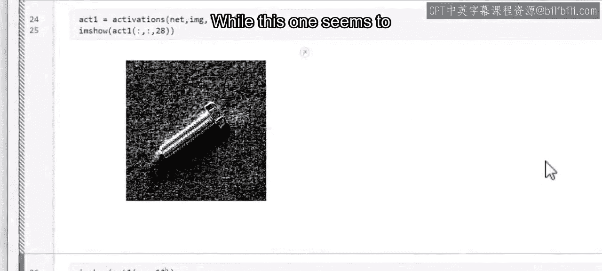

You don't need to visualize every layer or know precisely what features are extracted and used for training to utilize a model effectively。

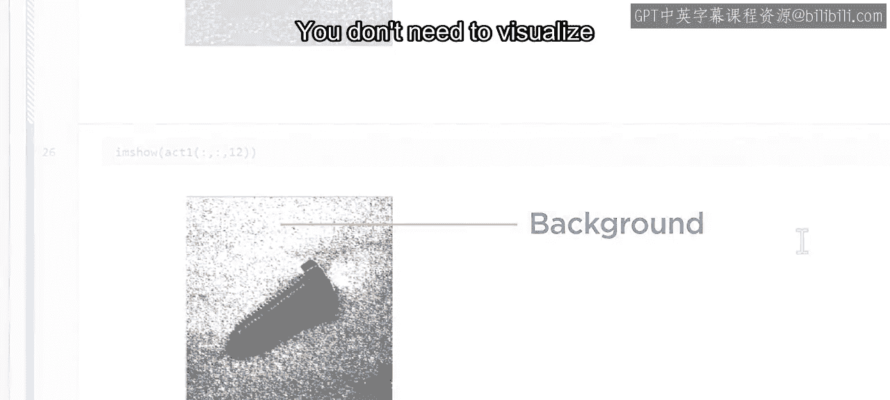

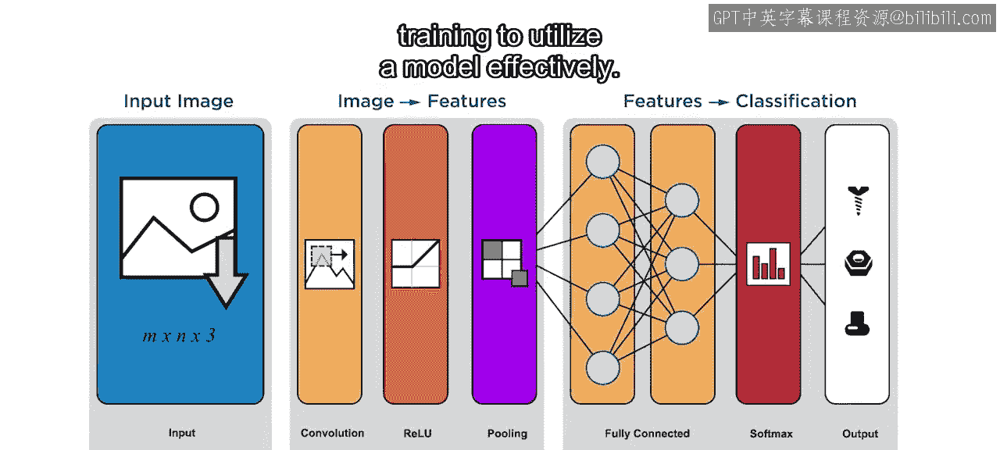

The network will often extract features that aren't visually meaningful to human eyes。Even so。

 you can still use activations to get a sense of what the network is doing。

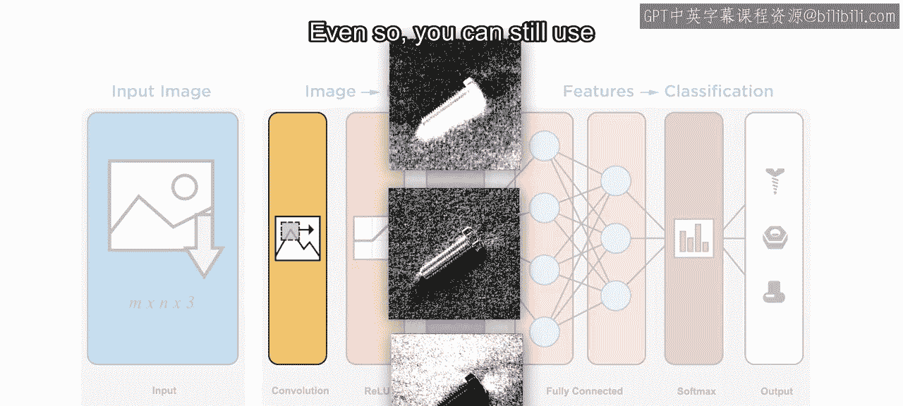

Back in Matlab， remember the test data that was set aside。 Now's the time to use it。

Create a new data store for your test images。And resize the images。

To match your model's image input layer。Now， you can ask your trained model to make predictions and compare them to the true labels to simulate how your model will make predictions on new data that it has never seen before。

84% test accuracy。That's pretty good。Later in this course。

 you'll train more complex and accurate models。But considering the results that even a basic network with a single convolutional layer can produce。

 the power of CNNs is clear。

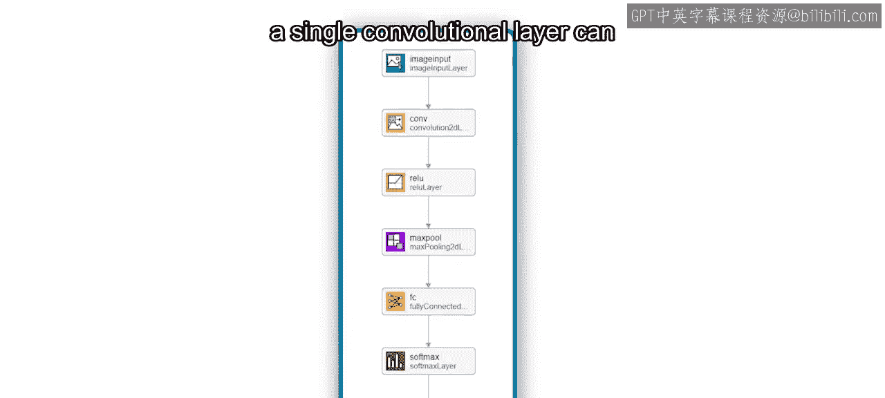

。