# Mathworks《深度学习在计算机视觉中的应用（简介、目标检测、高级深度学习）｜Deep Learning for Computer Vision》 p09 8_使用实验管理器训练和比较模型.zh_en -BV1Rb421v71M_p9-

🎼，There are many options you need to consider when training models。Usually。

 some trial and error needed to find the best model architecture and set of training options。

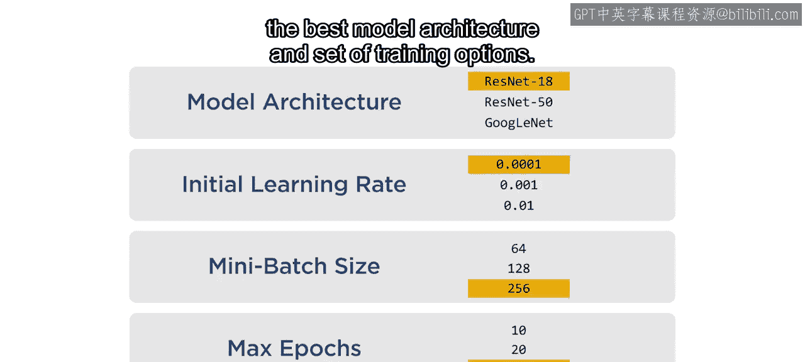

Creating many scripts to train all possible combinations of models and hyperparameters is time consuming and error prone。

So how can you find the best set of hyperparameters while keeping track of all your work？

In this video， you'll use the experimentiment Manager app to train models with different sets of options。

 select appropriate models， and document your work。Suppose that for the Fastener data set。

 you want to test two network architectures with two different initial learning rates。

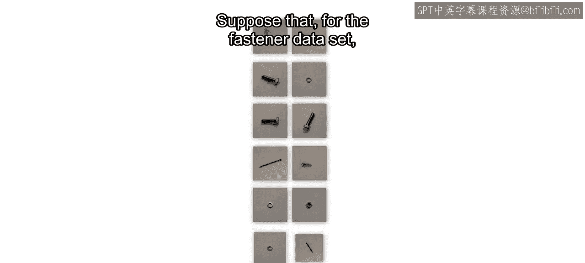

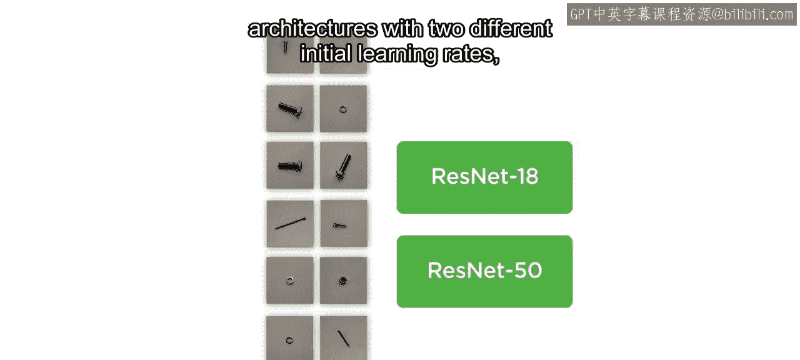

The goal is to train and compare all four combinations of these options。Usually。

 you'll vary additional options and may have many models to compare。

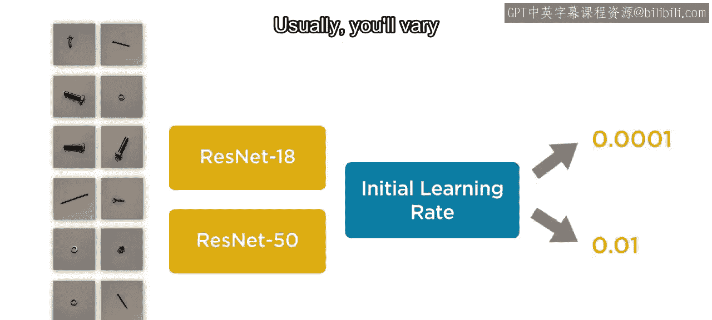

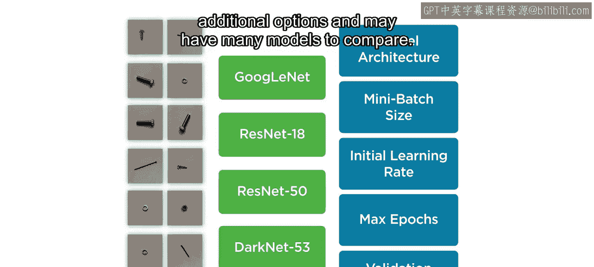

Let's open MatTlab to get started。In the apps tab。Select experimentment Manager。

Then select blank project。You have the option to choose a plank experiment or start from some existing examples。

Here we'll do built in training from the blank experiments so you can see the full workflow。

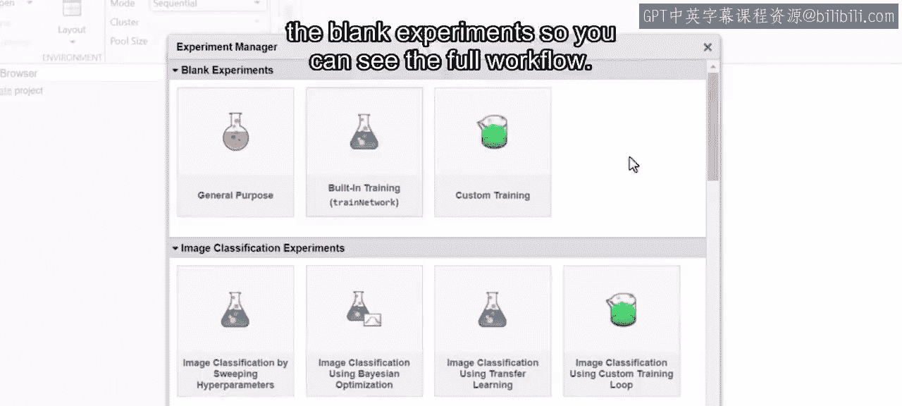

Let's give our project a file name。And choose a folder to save it。

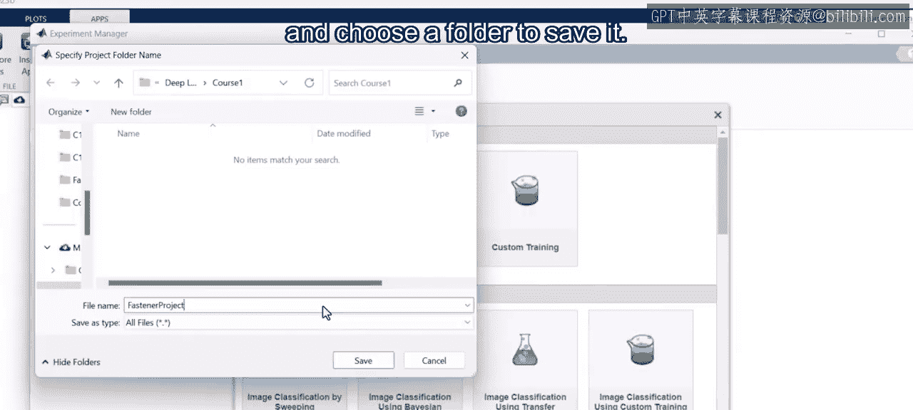

The experiment manager provides an interface where you enter information about your experiment。

Start by providing a description of the models you plan to train。

You'll want to include the options you're going to vary。

Then specify the names and the values for the hyperparameters you want to test。

Here we'll use network name to specify the architectures to test。

And initial learn rate for the learning rate values to try。

Note that name must be a valid matlab variable name。

 and values are the syntax used to define the variable。You'll see how these are used shortly。

Before you can start training models， you need to provide a setup function。

Let's edit the provided template。The template includes an empty function with a description of the required inputs and outputs。

The parameter's input variable is a structure that stores the parameter names and values you entered earlier。

You need to add code to create the training data， the network architecture， and the training options。

To do this， we'll write the code in three parts。 Def the network architecture。

Prepare the training data。And specified the training options。Don't worry。

 you've done all these steps when training a single model。

Here we're just putting it together in a function so you can train many models at once。Remember。

 the goal is to test multiple network architectures。

The parameter variations are stored in the parameter structure variable。

You access the fields of the structure using a dot。And the name you gave earlier， network name。

The Paras variable will be updated for each combination of models。To select a network。

 we use an ifL statement， as shown here。Previously。

 you modified a network in the deep network designer for transfer learning。Now。

 you need to add code to perform those steps。The code here creates the network architecture。

Then it replaces the fully connected and classification layers to adapt the network for the number of classes in the data set。

Next， prepare the images for training。Different networks require different input sizes。

 so get the expected size from the first layer of the network。

Then create an augmented image data store to resize the images。

Make sure you use the same variable name as in the function output。Here， training data。

The last section specifies the training options。We want to test different values of the initial learning rate。

Use the Paras variable as before to specify the initial learn rate。

You can use the same process to vary any number of training options。

You now have all the required outputs for the setup function。Let's save it。

And return to the experiment manager。To test all combinations of parameters。

Make sure to keep the default strategy as exhaustive sweep。

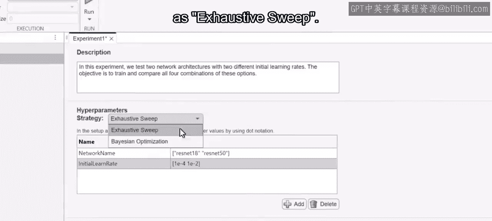

Save the experiment。Now， let's start training。

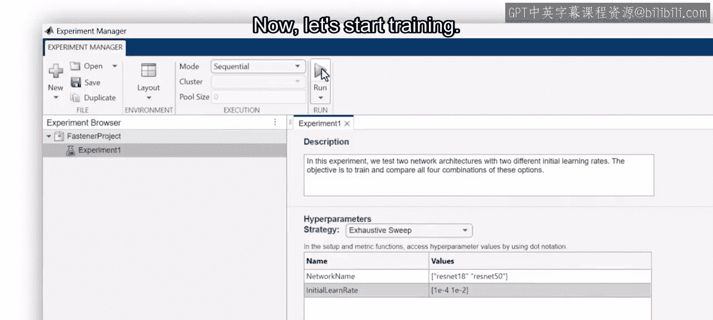

The app provides a monitoring dashboard so you can track the training progress。

It shows common metrics for each trial， as well as the training plots。

Training can take quite a while， depending on your data and available resources。

 So let's jump to the end。All the results and metrics are arranged in a sortable table。

 making it easy to compare models。

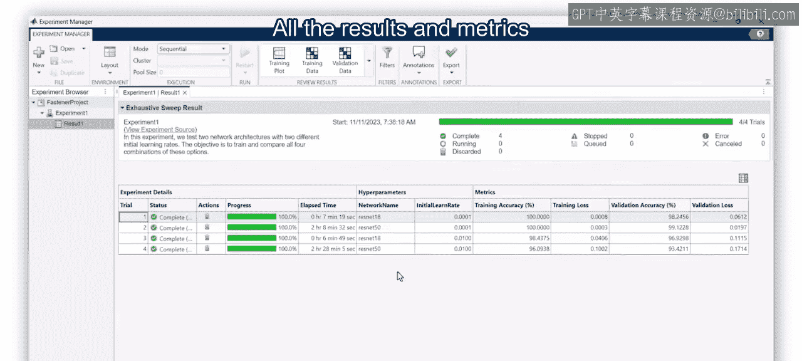

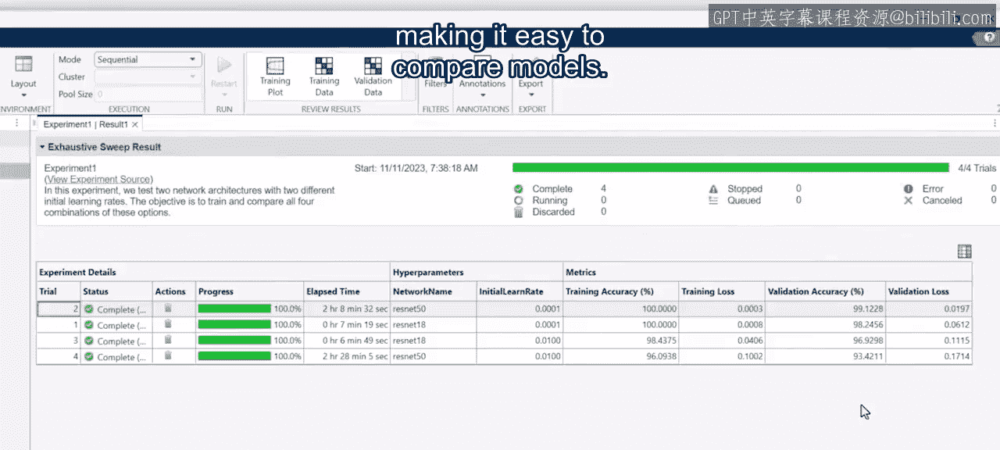

View the confusion matrices for selected models to get more detailed information on model performance。

In this example， all the models have high accuracy。

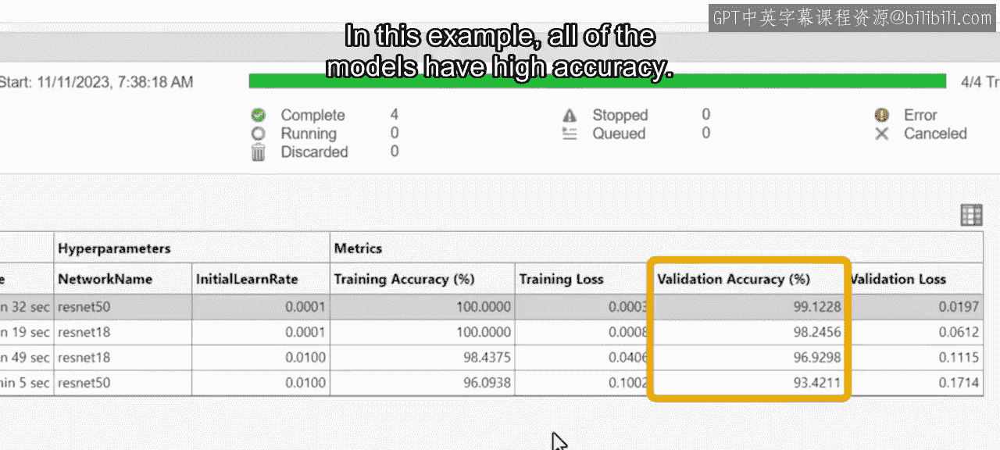

So you might use model size and prediction speed as additional criteria。

Use your domain knowledge and application requirements when deciding which model to use。

Once you've decided on a model， export it to the workspace to save it for future use。And you're done。

The experimenteriment Manager app is a good tool to use when you need to vary several parameters。

It saves all the options and parameter values， so you can more easily compare results and document your work。

You can also export the trained models and results for further use and analysis。

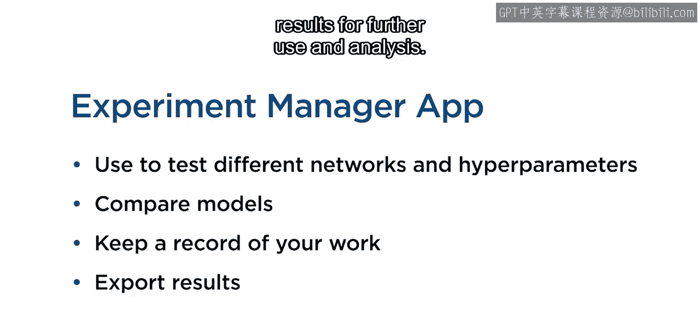

The setup function used in this video is provided with the course files。

Use it as a starting point for training and comparing models。

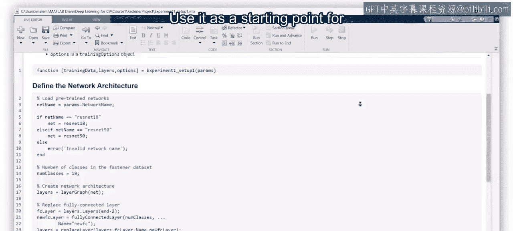

Yeah。