# Mathworks《深度学习在计算机视觉中的应用（简介、目标检测、高级深度学习）｜Deep Learning for Computer Vision》 p12 11_最终项目-美国手语字母分类.zh_en -BV1Rb421v71M_p12-

🎼。

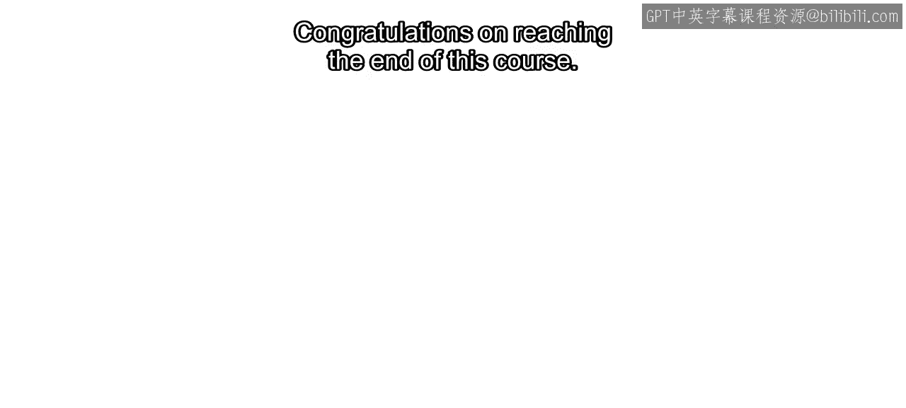

Congratulations on reaching the end of this course。 from fasteners to traffic signs。

 you've seen how CNN Ns are designed， trained and evaluated for image classification。😊。

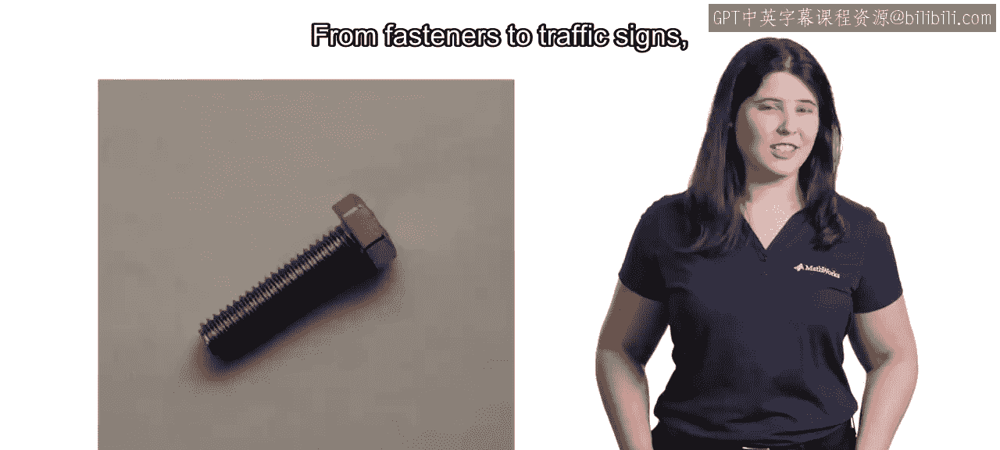

For the final project， you'll perform each of these steps to classify images of the American Sign Language or ASL alphaphabet。

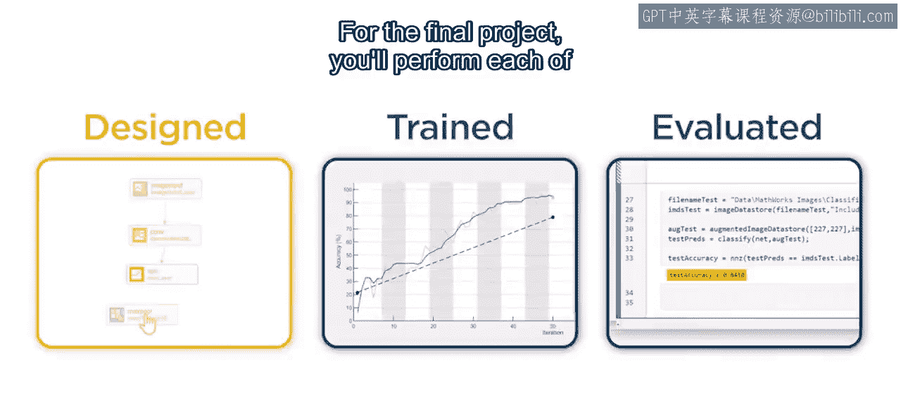

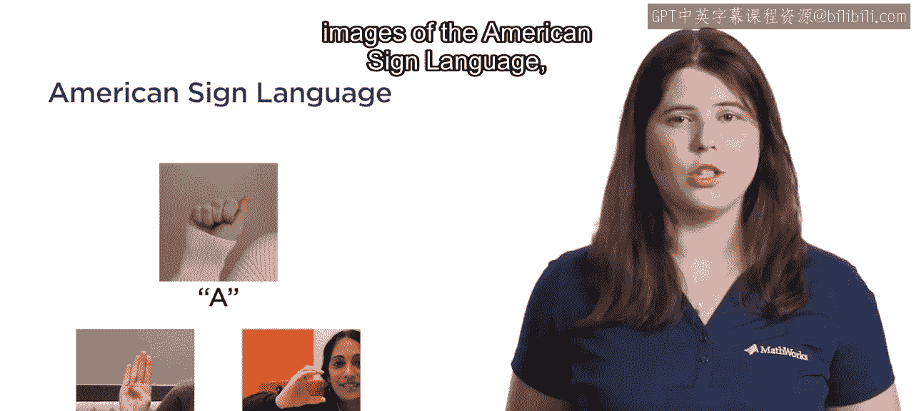

For this project， you'll decide how to prepare your data， Choose the best model options。

 perform training and evaluate your final model。

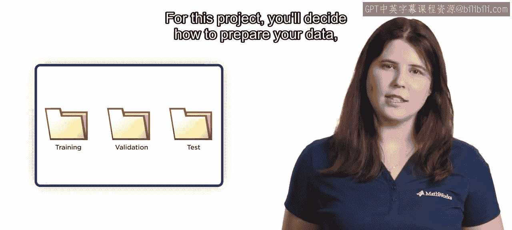

To keep you on track， we've divided this project into three steps with check ins along the way。

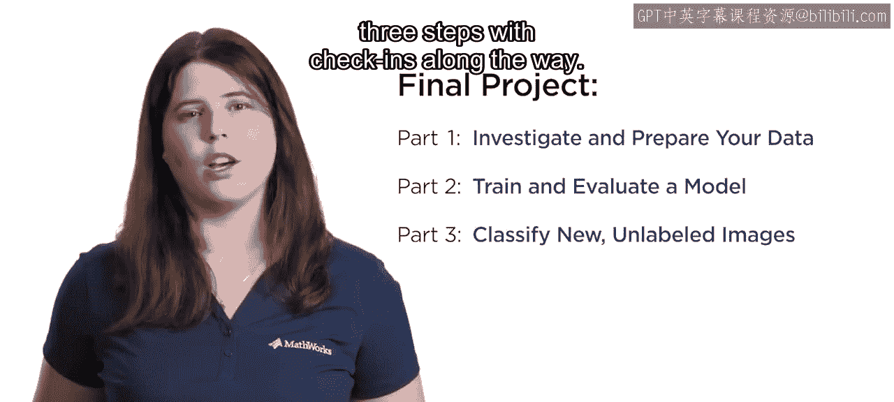

In step one， you'll familiarize yourself with the data and prepare your images for training。

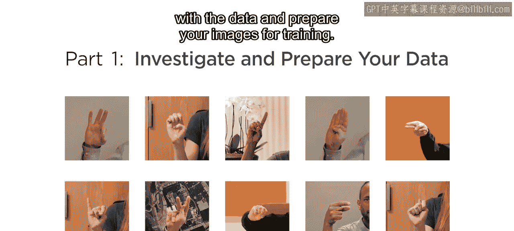

The data has already been labeled and split into training and test sets。

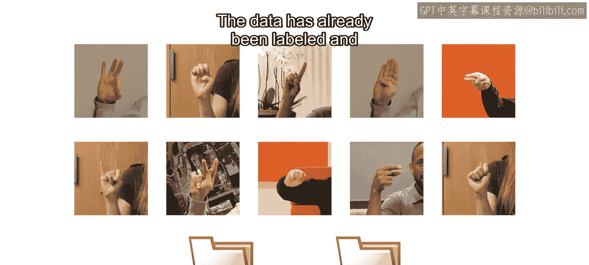

The English alphabet has 26 letters。But there's only 24 classes in the data set。

We have excluded the letters， J and Z。

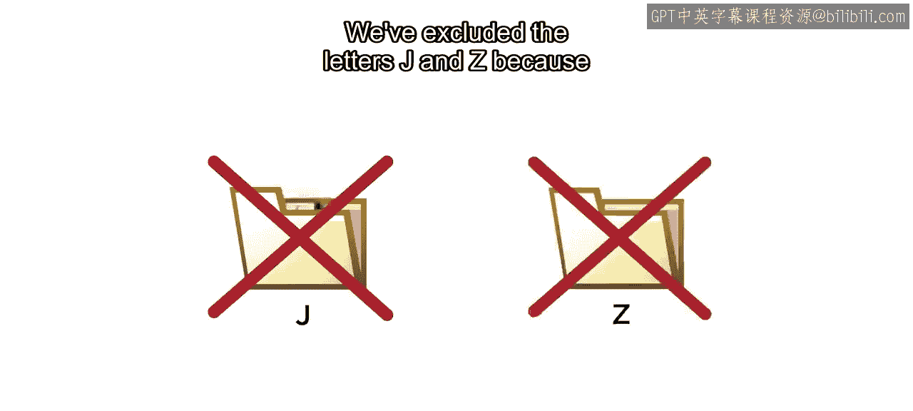

Because they require hand motions。That can't be captured with a single image。

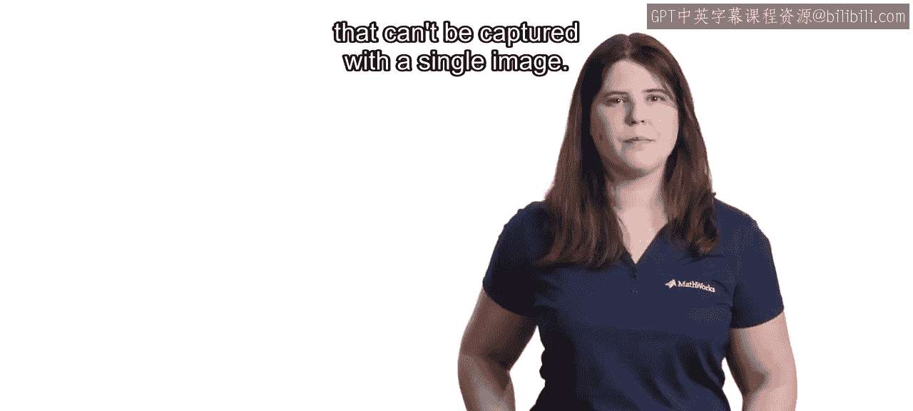

For step two， you'll train a classification model and evaluate your results。

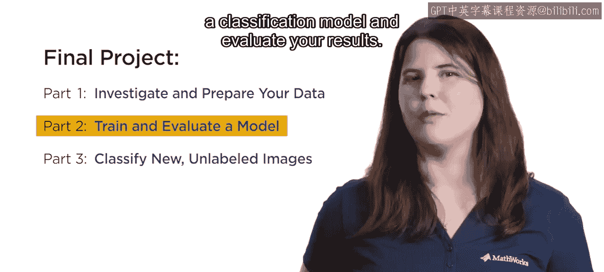

Remember that developing deep learning models is an iterative process。

This project has many possible solutions， and you're encouraged to try a variety of approaches。

You may need to identify and address common training issues。

Be sure to evaluate your final model using the test data that has been set aside。

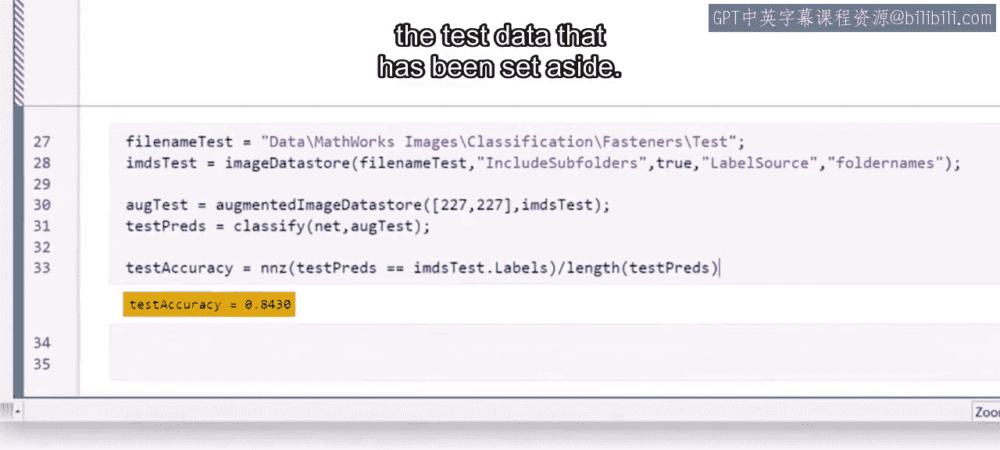

Examining your results can give insight into your model's performance。For example。

 did your model mix up similar letters？

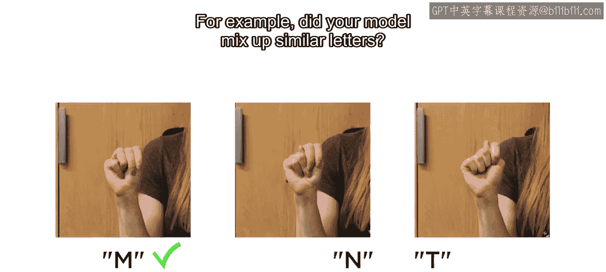

Was it able to classify letters when the speaker used their left hand。

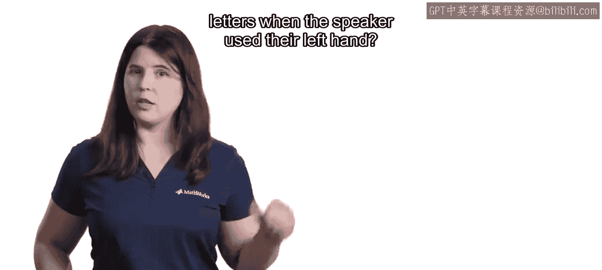

For step 3， you will apply your trained model to translate a series of new， unlabelled images。

 forming a short sentence。

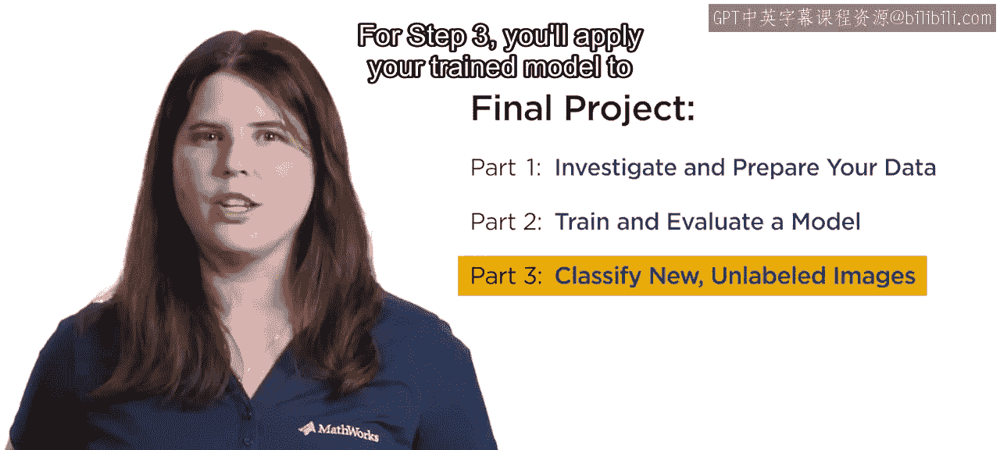

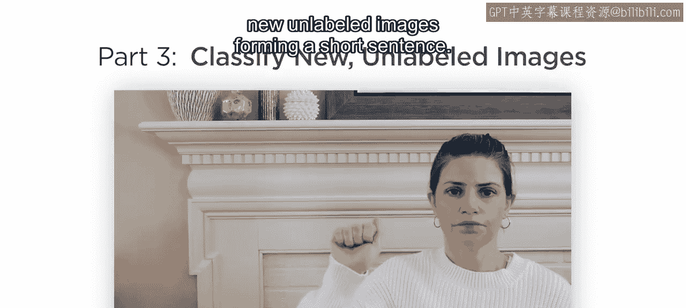

Be sure to complete each Step assessment in order。You're encouraged to take as many attempts as you need to pass。

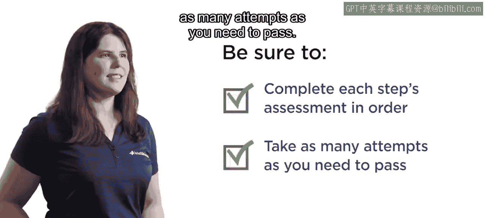

This one ensure that you're on the right track before you move on。As you train models。

 consider the context in which they're most useful。

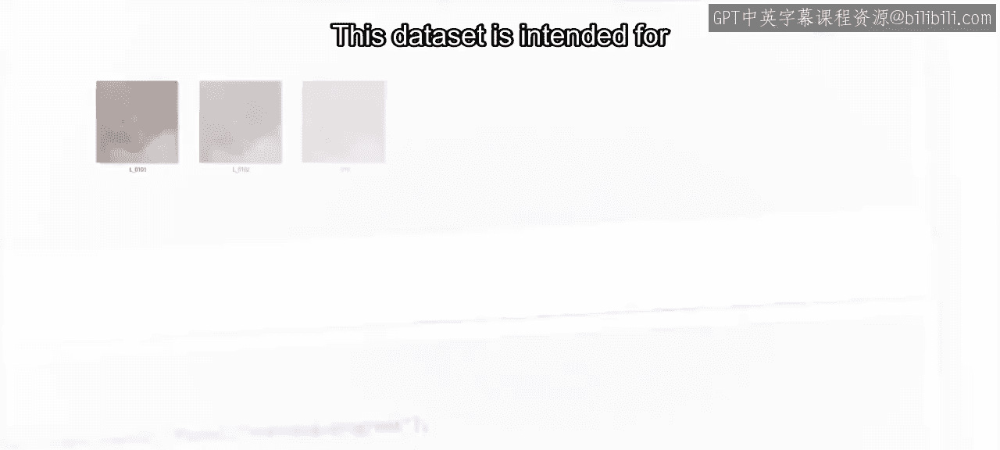

This data set is intended for instructional use and is therefore limited。Consider its applicability。

What might you need to train a more generalizable model？

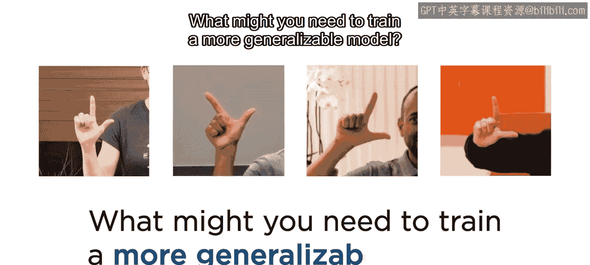

If you have any questions or interesting results， remember to share them in the forums。Good luck。

