# Mathworks《深度学习在计算机视觉中的应用（简介、目标检测、高级深度学习）｜Deep Learning for Computer Vision》 p13 12_课程总结.zh_en -BV1Rb421v71M_p13-

🎼。

Great work reaching the end of this course。You now have the skills to train classification networks for your application。

Here are a few tips to remember as you start your own projects。First。Use transfer learning。

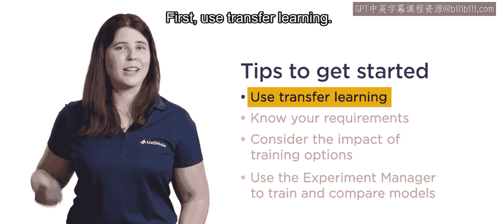

Leveraging pre trained models saves you valuable time and resources。Next。

 know the requirements for your application。

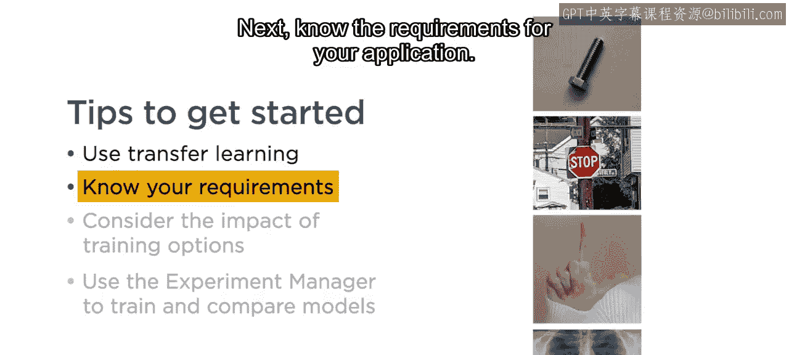

What level of accuracy do you need？How important is prediction speed？

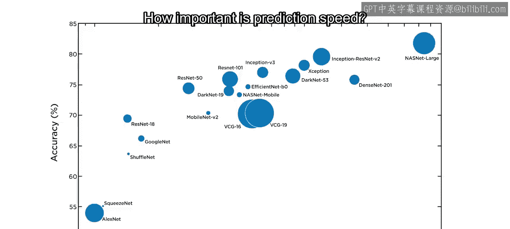

Are there memory constraints？Knowing the requirements will help you make informed decisions when training and evaluating models。

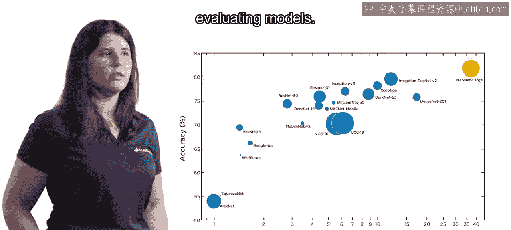

Also， consider the impact of different training options。

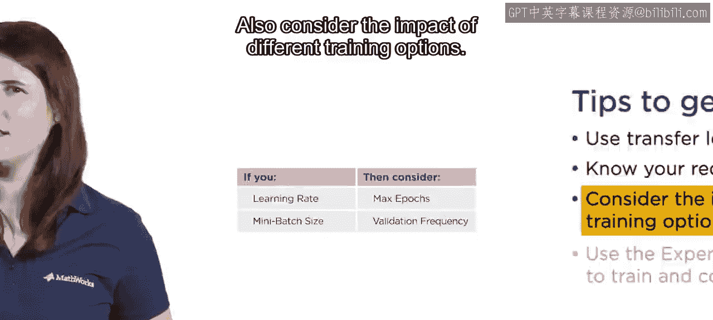

For example， if you decrease the learning rate and many batch size。

 you may need to increase the maximum epochs and validation frequency。

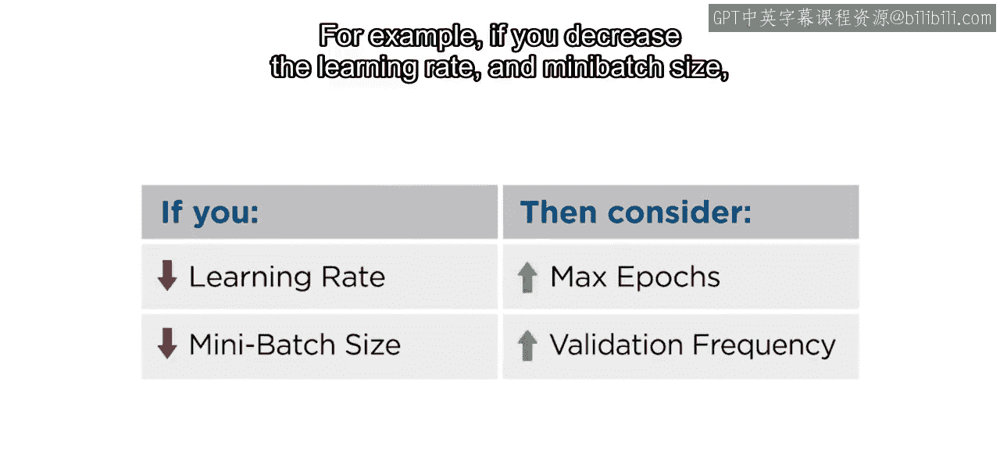

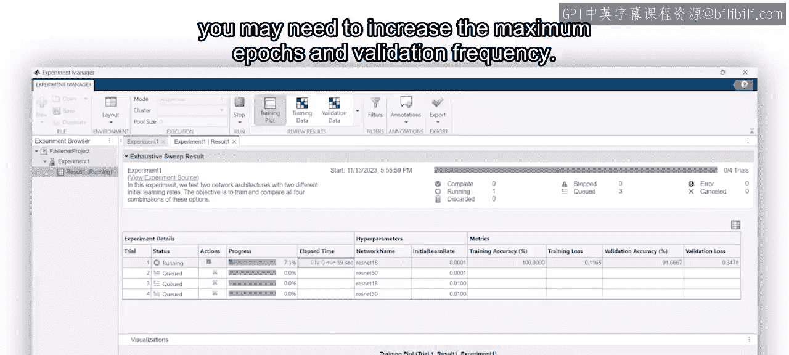

Even for experts， it takes trial and error to find good parameters。

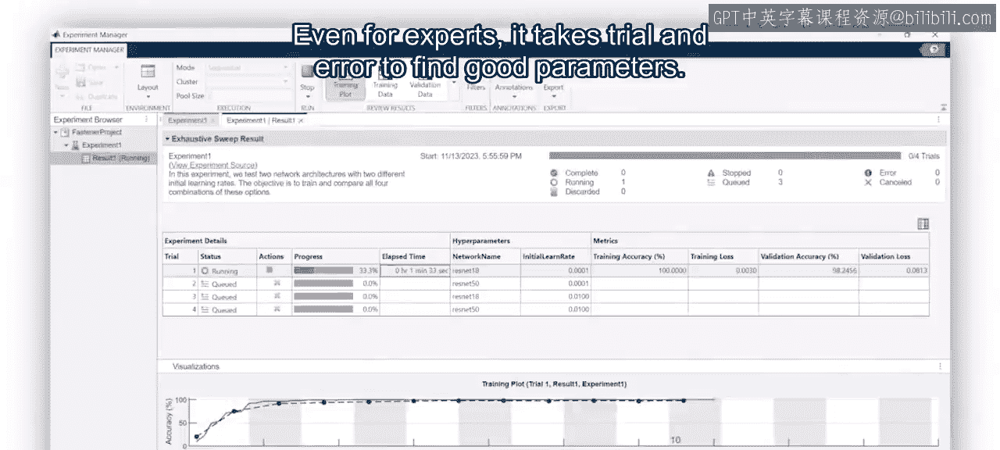

The experiment manager app helps you keep a record of all the models you've trained。 Exp the results。

And export them for further use。

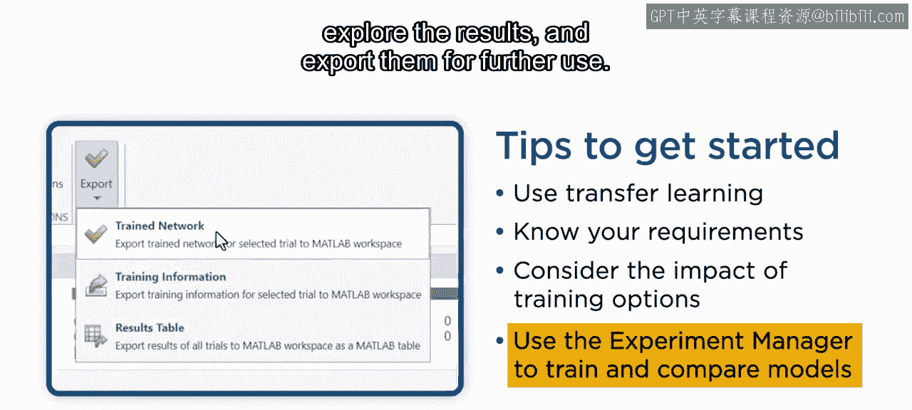

So you've successfully trained image classification models。

 but what if you need to locate objects in images？Matt。

 what can learners expect in course too Thanks Megan？

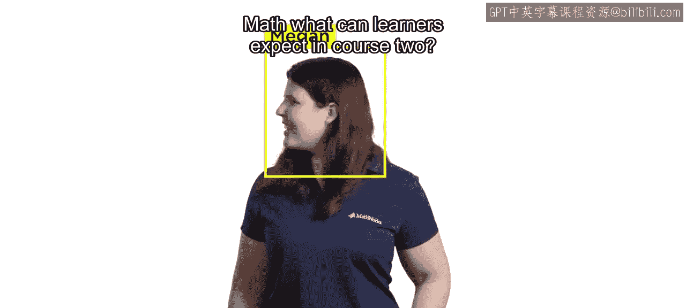

Detecting objects is one of the most common applications in computer vision。

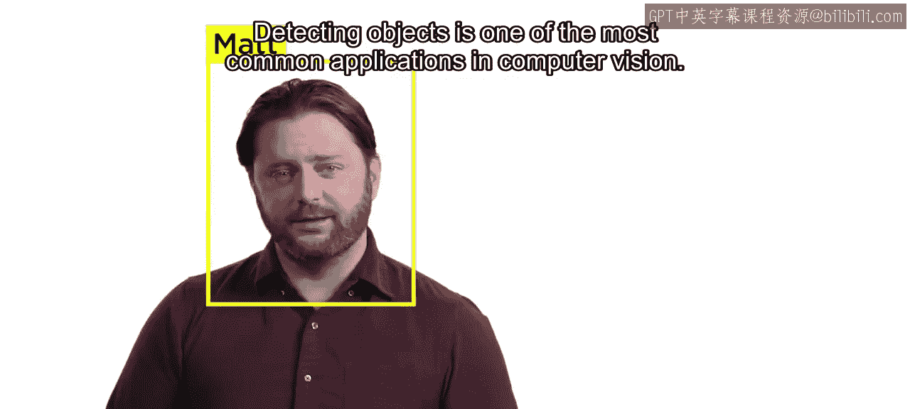

Detection models both locate。And label objects within images。

So now your data set must include images。Bunty boxes and labels for objects。Because of this。

Preparing your data for detection and evaluating results requires extra work。

The good news is you'll still use transfer learning。

 and Matlab includes functions to do most of the heavy lifting for you。😊。

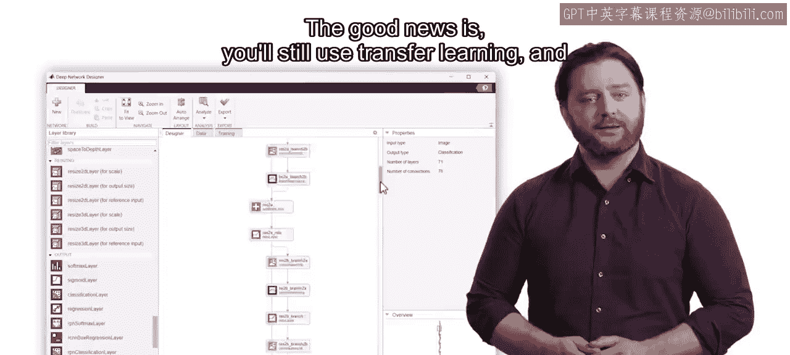

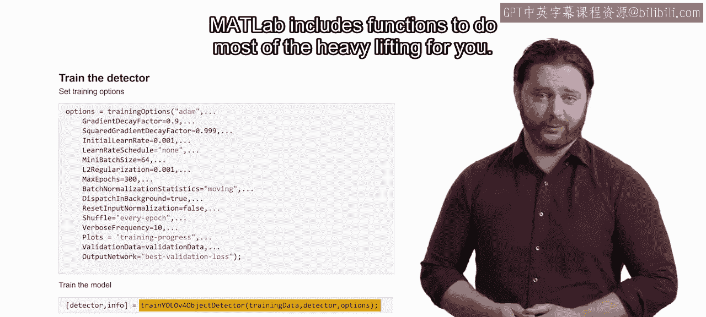

So join us in course 2 to add object detection to your computer vision skill set。Ay。

 who trained this thing？

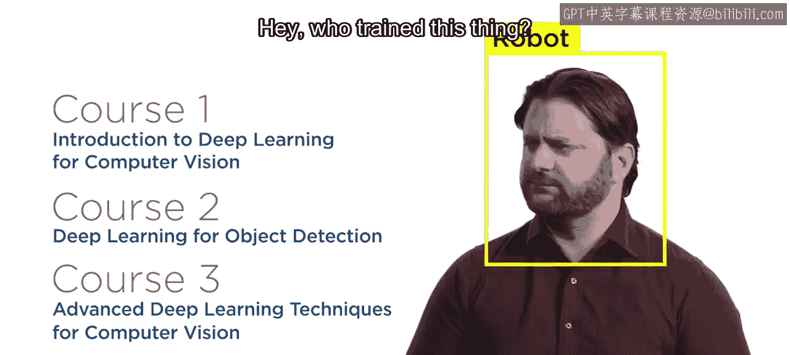

Yeah。