# Mathworks《深度学习在计算机视觉中的应用（简介、目标检测、高级深度学习）｜Deep Learning for Computer Vision》 p14 0_深度学习在计算机视觉中的应用.zh_en -BV1Rb421v71M_p14-

🎼。

Locating cars and pedestrians。Finding defective products。And diagnosing diseases。

Are just a few examples of how engineers and scientists are using deep learning with image and video data。

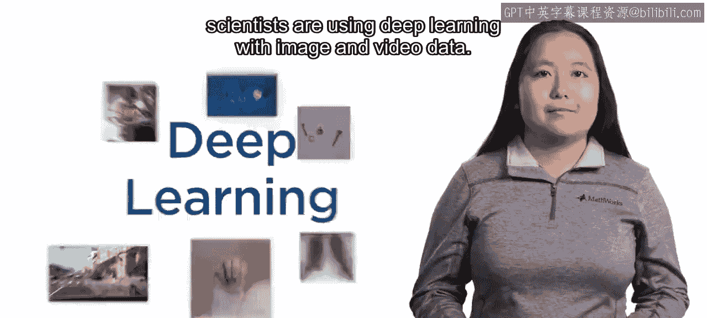

That's why Maworks created deep learning for computer vision。

 a three course series available on Coursera。In Co one。

 you'll start with the basics by creating simple models from scratch。

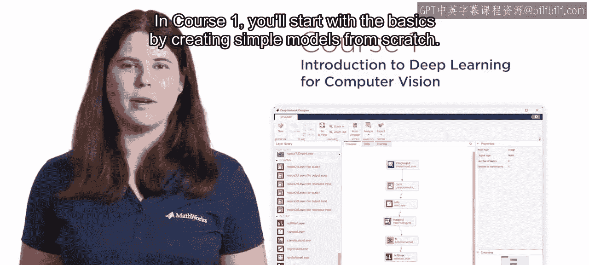

Then you'll take models created by experts and apply a technique called transferfer learning to retrain them for new applications。

You'll also evaluate the performance of your models。And adjust key parameters to improve them。

Finally， you'll apply all these concepts to create your own model to classify images of the American Sign Language alphabet。

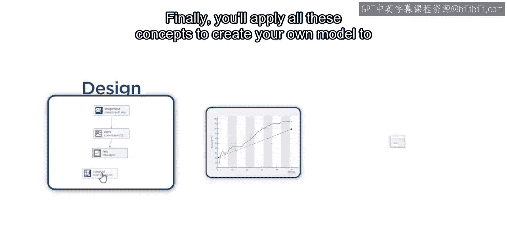

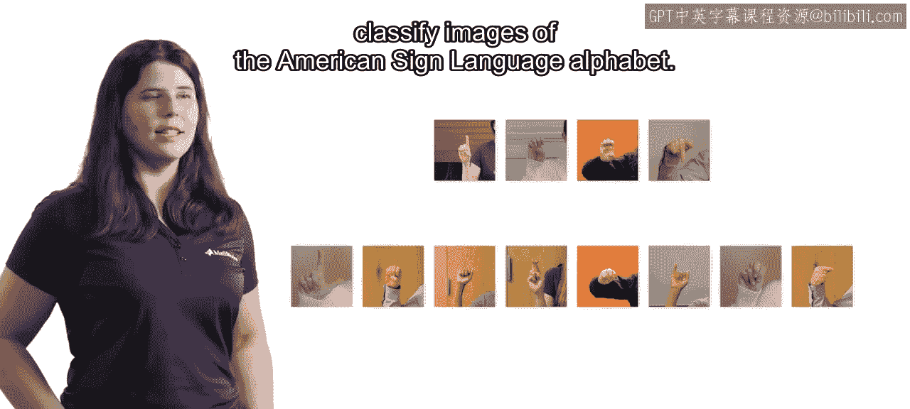

Locating objects within images is an important problem in computer vision。

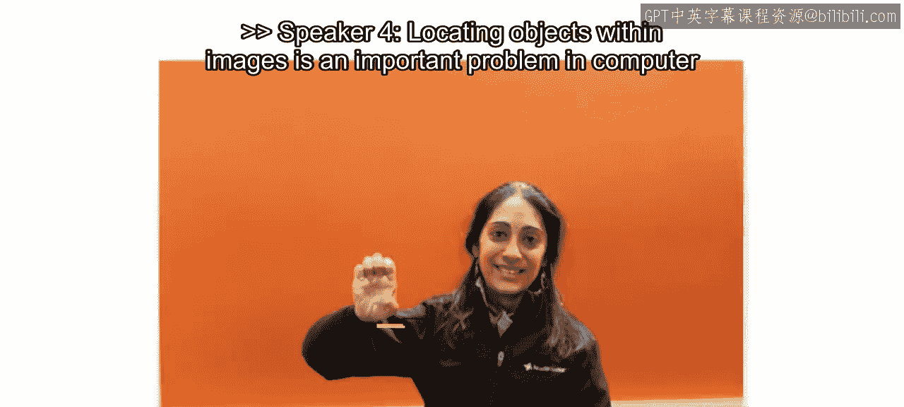

In Co 2， you'll train object detection models like Yolo。

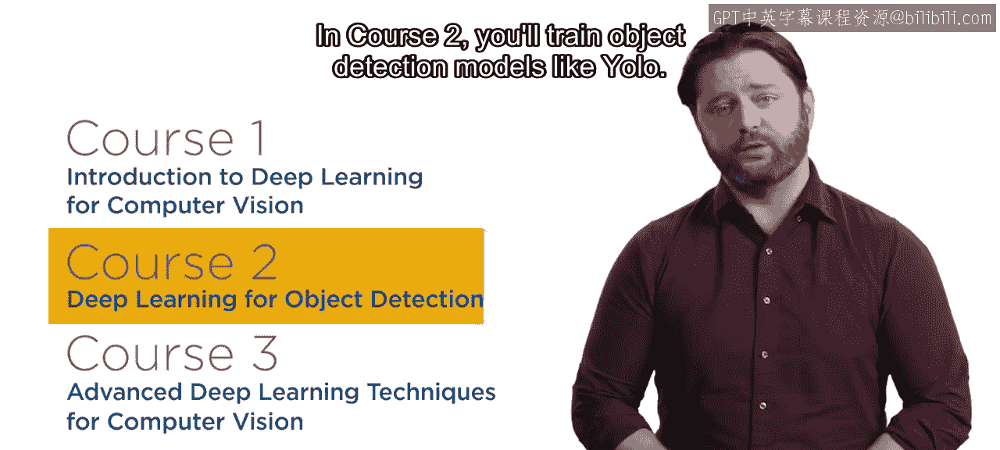

Detection models require label data known as ground truth。

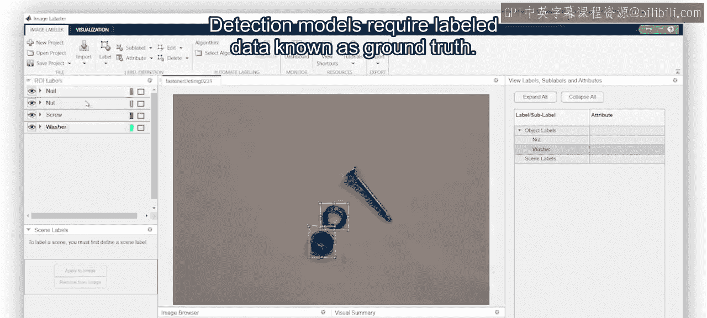

This includes bounding boxes。And labels defining the objects。

You'll label images and analyze the ground truth， helping you make informed decisions before training models。

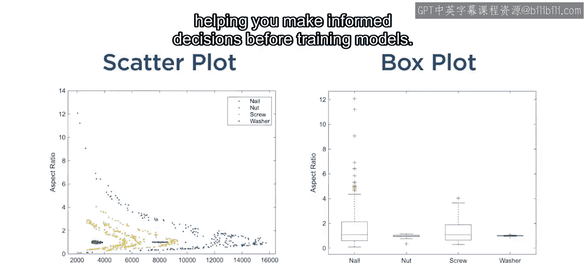

Evaluating detection models is tricky because the model must correctly assign a label and a location for each object。

You'll practice evaluating several models so you can choose the best approach for your application。

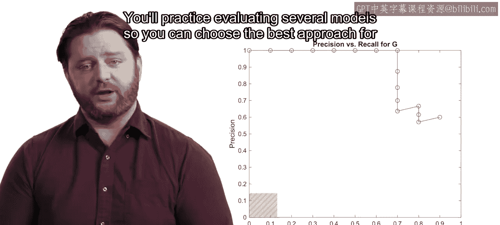

When starting your own deep learning projects， you're likely to encounter several challenges。

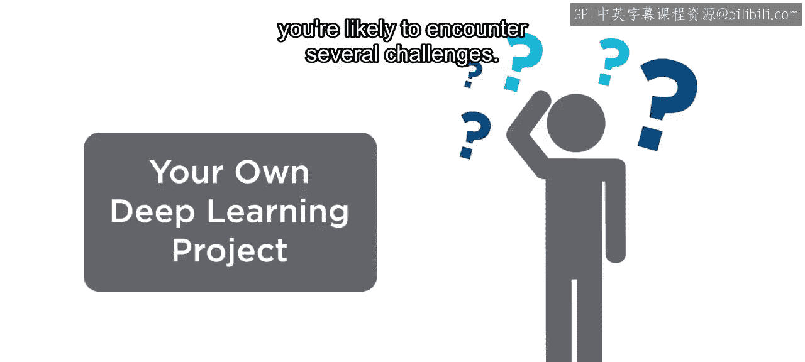

In course 3， you'll learn techniques to address common problems and train specialized models。

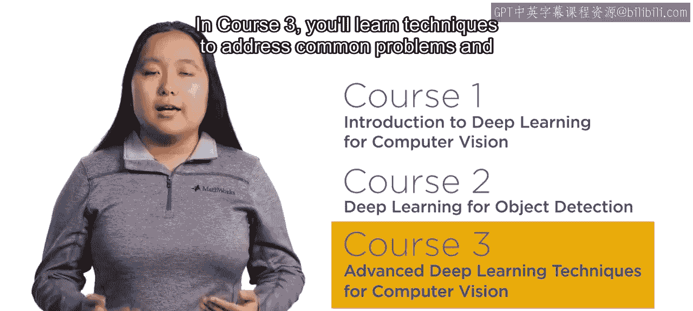

For example， collecting images can be expensive and time consuming。

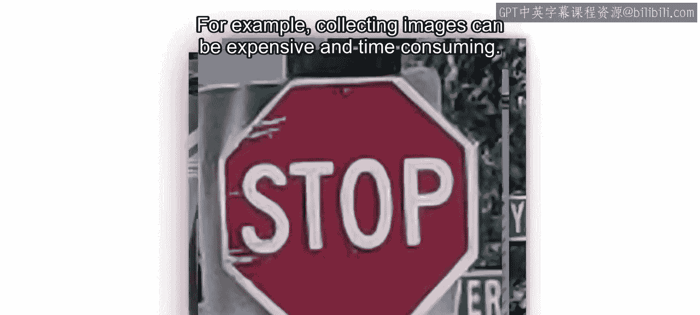

Data augmentation is a powerful tool to improve results when you have limited data。

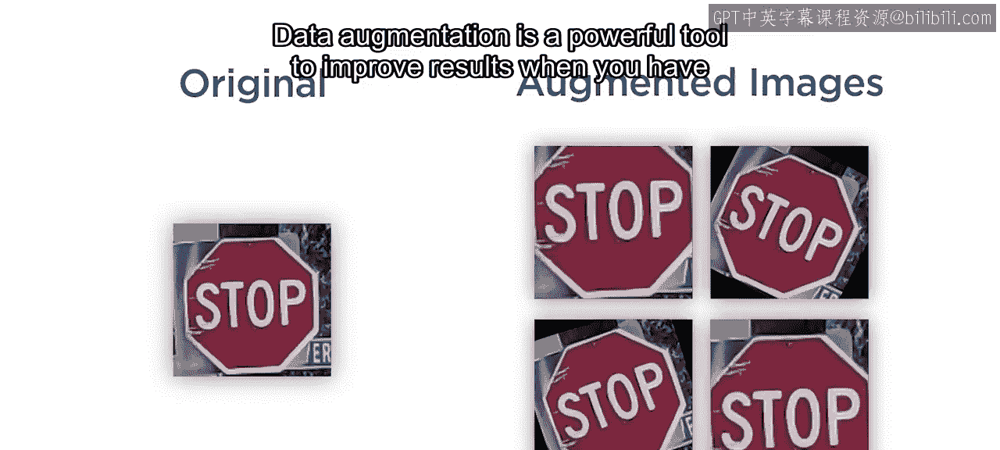

Or maybe you have tens of thousands of images to label。

You will use AI assisted labeling to help you label images， saving many hours of manual labor。

You'll also create anomaly detection models， which are commonly used in manufacturing。

And medical applications。As cameras are added to more devices。

 the demand for computer vision and deep learning skills will continue to grow。

Prepare yourself for this rapidly evolving field by joining us in this three course specialization。😊。

Good luck。