# Mathworks《深度学习在计算机视觉中的应用（简介、目标检测、高级深度学习）｜Deep Learning for Computer Vision》 p15 1_深度学习用于目标检测.zh_en -BV1Rb421v71M_p15-

🎼。

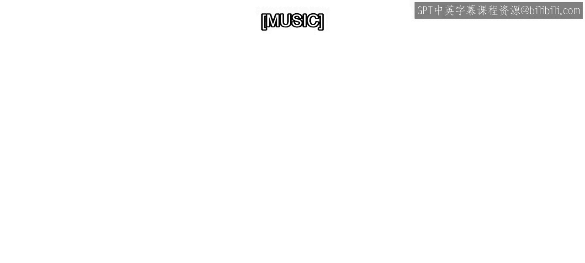

Object detection is a technique for identifying and localizing objects within images or video frames。

With image classification， the focus is on categorizing an image as a whole。

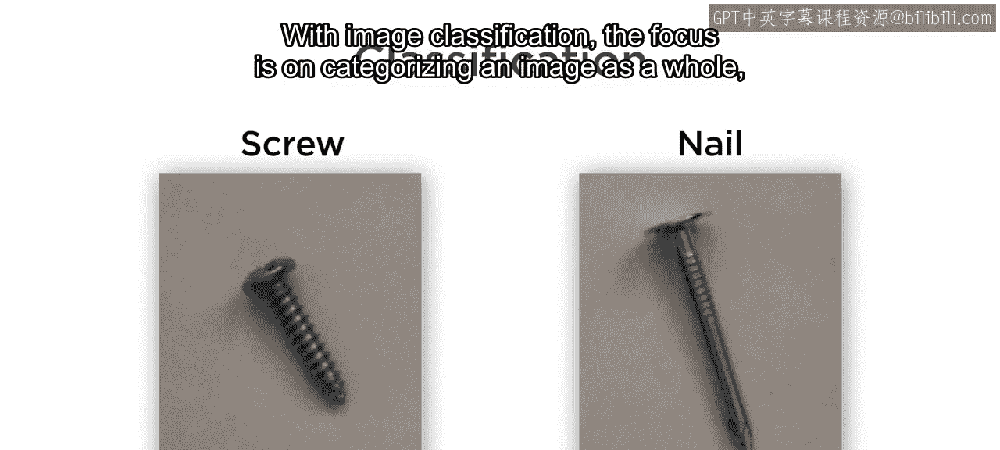

For object detection， the goal is to precisely locate and recognize individual objects in a given image。

This capability is crucial in various applications across industries。

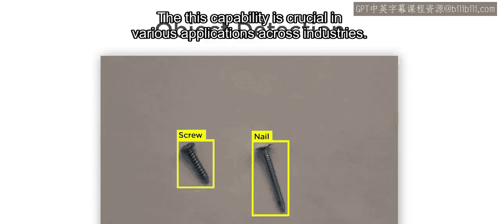

For example。

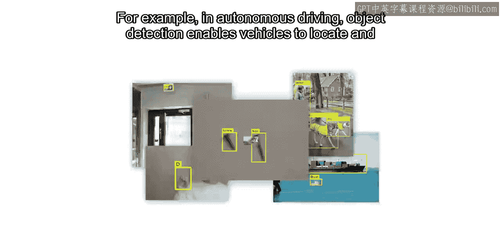

In autonomous driving， object detection enables vehicles to locate and identify pedestrians。

Vehicles and traffic signs。In this course， you'll first learn how to apply deep learning models that have been built and pre traineded by experts on extensive data sets。

This will enable you to tackle both general purpose and many specialized object detection tasks。

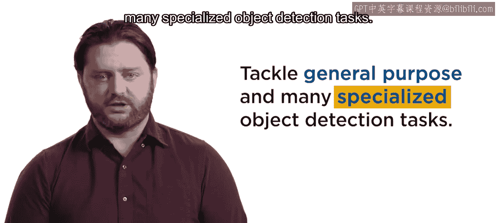

Then you'll learn how to customize such models to your specific needs using transfer learning。

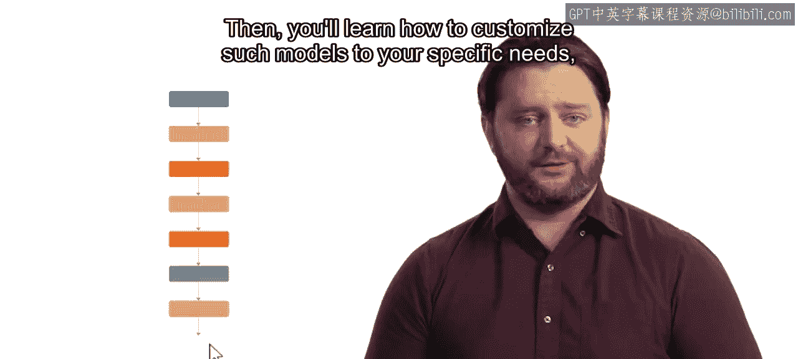

You'll learn how most modern object detectors are structured。And how they work at a high level。

This will provide a foundation for understanding the overall workflow involved in training object detectors using deep learning。

This includes labeling。Analyzing and pre processingcess data。Choosing a network and training it。

And evaluating performance。

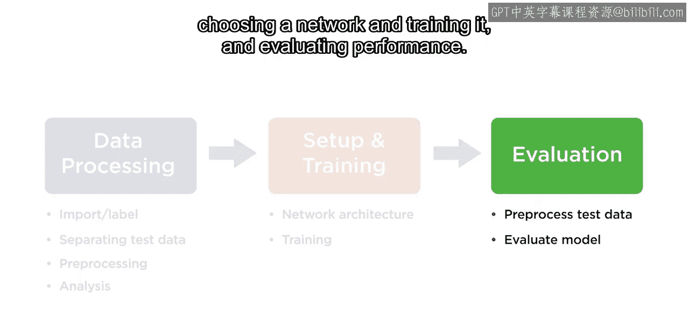

You'll create your own object detection data， also known as ground truth by using an app to efficiently add labeled bounding boxes to images。

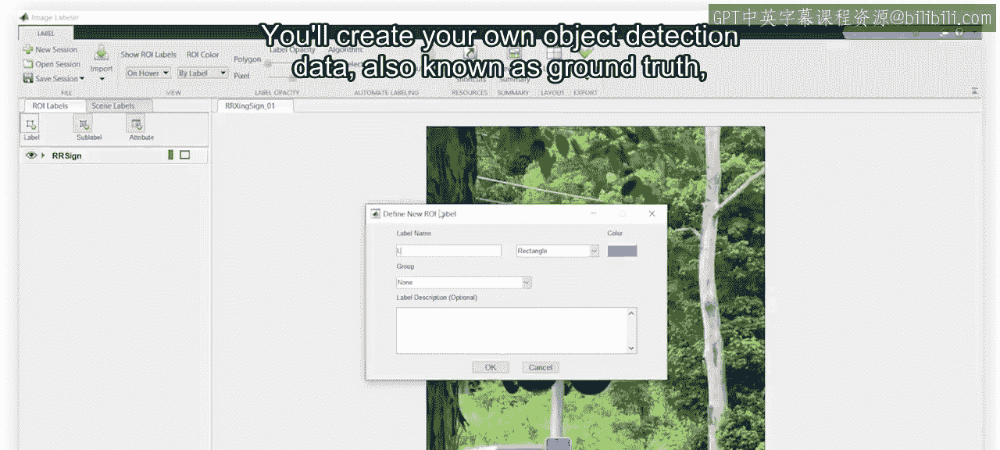

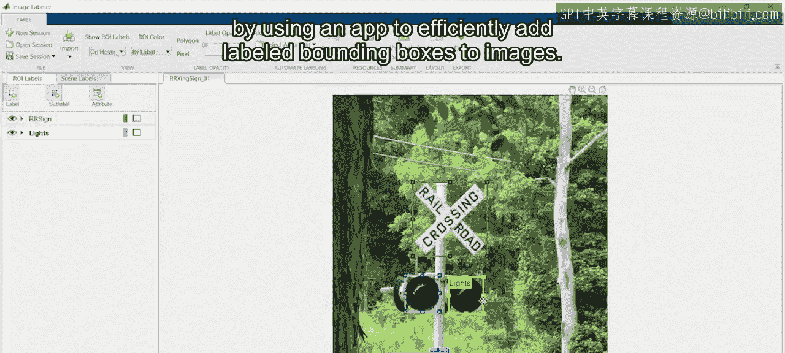

You'll also analyze ground truth data to determine the distributions of object classes， areas。

 and aspect ratios。This information will help inform your choices of a model type， parameters。

 and training options。

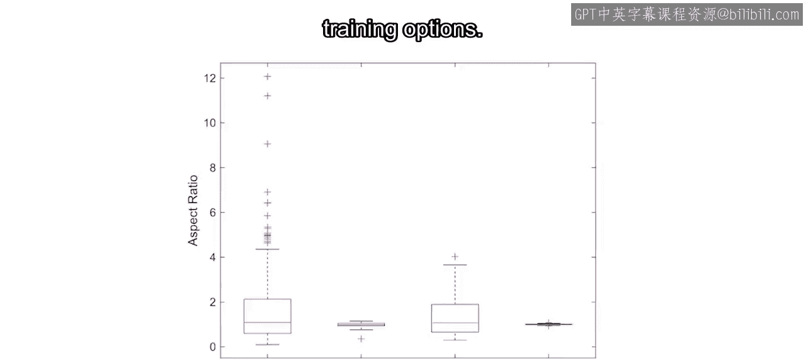

Then you'll practice model setup and transfer learning。

Which will enable you to customize any detection model architecture in MatTLAb to your application。

Of course， it is necessary to check if your results are good enough。

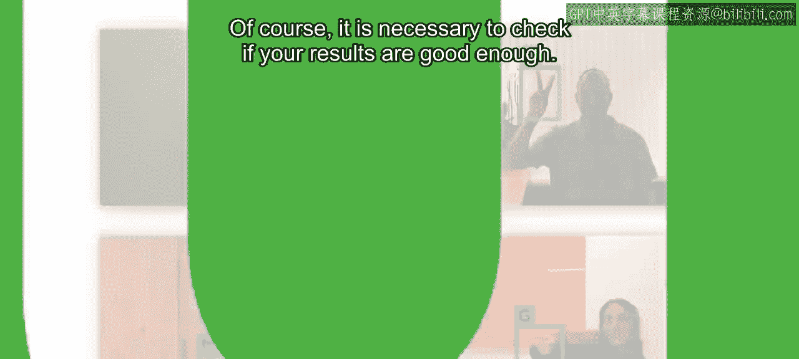

This involves more nuance than classification， since you need to check both object labeling and localization。

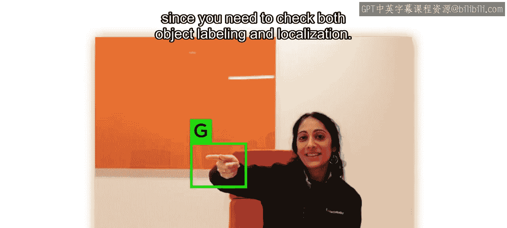

You'll learn the techniques required to evaluate detectors。

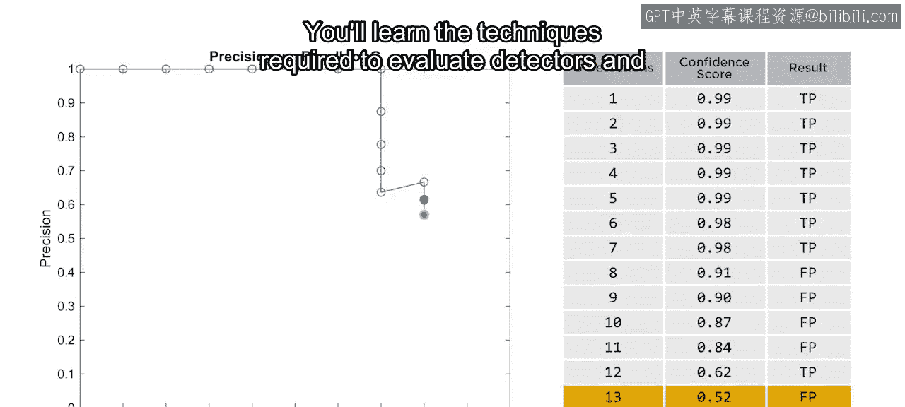

And practice using them to quantify model performance。And for when you do need to make improvements。

You'll learn about common issues and how to address them。Finally。😊。

You'll use all these skills to complete an object detection project。Let's get started。

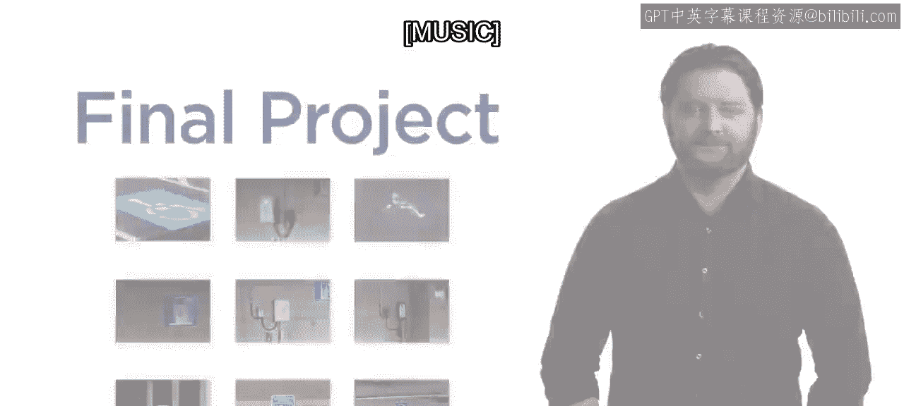