# Mathworks《深度学习在计算机视觉中的应用（简介、目标检测、高级深度学习）｜Deep Learning for Computer Vision》 p16 2_卷积神经网络的目标检测入门.zh_en -BV1Rb421v71M_p16-

🎼，Recall that the goal of an image classification model is to take in unlabelled images and assign a label to each。

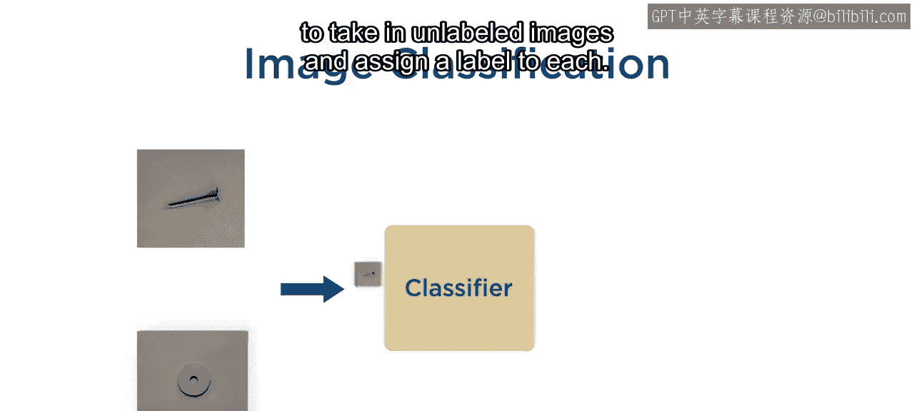

Convolutional neural network or CNN based classifiers。Use a sequence of input layer。

Feature extraction network。And classification layer is to accomplish this。

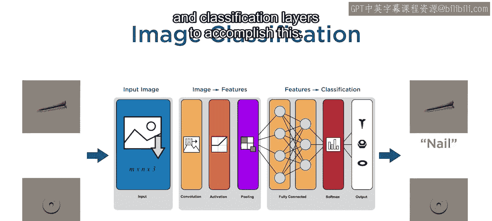

For object detection。The goal is to take in unlabeled images。

Which may have multiple objects of interest。And to determine the size and location。

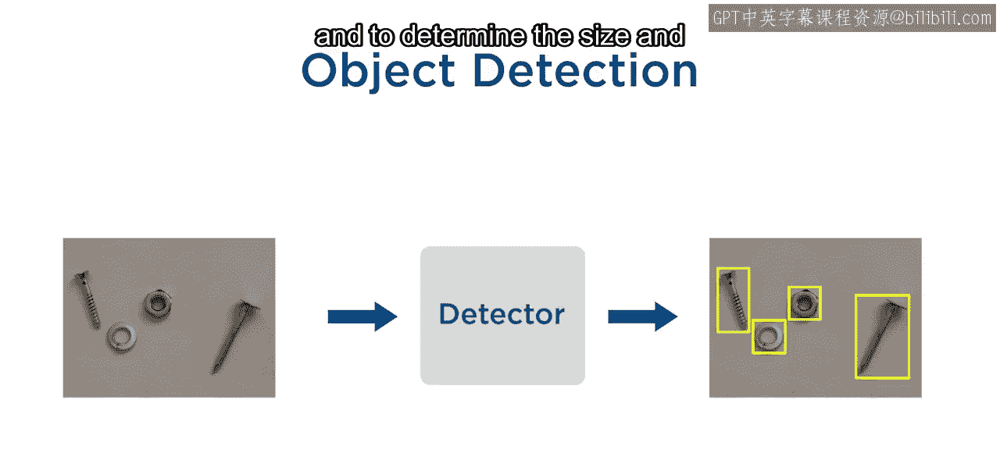

As well as class label for each。

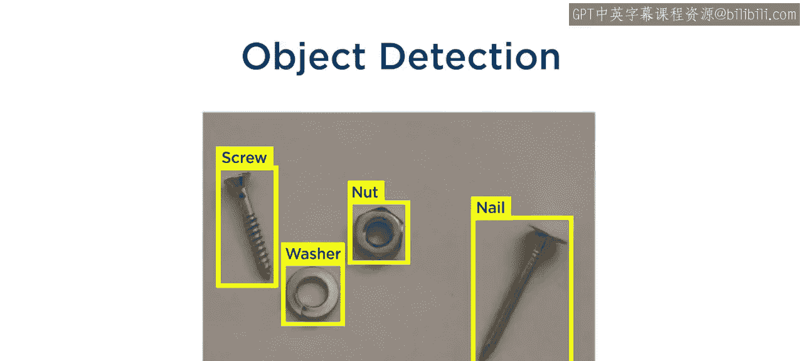

To do this， CNN based object detection models use the same sequence of input layer and feature extraction network as classification models。

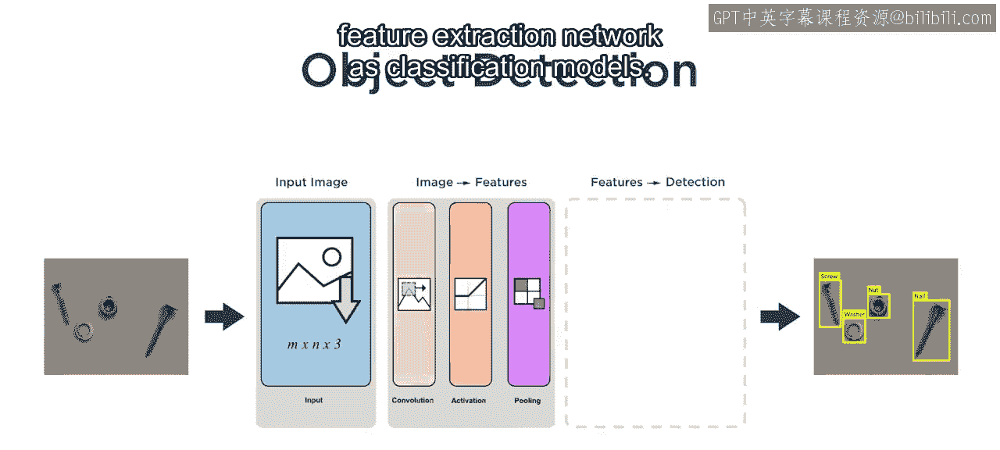

This sequence， which goes from input to features， is referred to as the backbone in object detection models。

In addition to the backbone。Object detection models typically use a pair of networks called a neck and a head。

To move from features to detection results。The neck often involves operations to aggregate features taken from multiple scales within the backbone network。

This helps detect objects over a wider range of sizes。

The head is responsible for producing the object detection results。Namely。

 a bounding box and class label for each object。The exact details of each of these networks can be quite complex and vary widely from one type of detection model to the next。

Don't worry， though， you won't need to know all the details of the neck and head to work with an existing model type or what we'll call a detection framework。

There are instead a few key things you will need to pay attention to。Which backbone network is used。

The number and placement of neck attachments to the backbone network。

And whether or not the framework uses anchor boxes。Who willll explain each of these more now。

Know that it is the neck and head architecture that defines a detection framework。

Different backbone networks can be used within the same framework。

A typical backbone has many layers in the feature extraction network。

Including several that downs sampleble。For example。

 pooling layers where sub areas of feature maps are aggregated。

The neck is often pulling features from the backbone at multiple scales。

These locations within the backbone are often referred to as neck or head attachments。

Due to the down sampling， layers deeper in the backbone are extracting features based on progressively larger areas of the input。

Generally， this means that larger objects will be better detected with head attachments deeper in the backbone。

And similarly， smaller objects will be better detected with head attachments earlier in the backbone。

Having several attachments at different depths can help to improve the range of object sizes that the network can detect effectively。

However， beyond requiring a deeper backbone。This can come at the cost of introducing more complexity in the neck and head and hence。

 greater computational burden。So if you anticipate a narrow range of object sizes。

 a simpler detection framework may be a better choice。

Besides which backbone network is used and the number and position of head attachments。

The other key thing to pay attention to is the use of anchor boxes。

Which many detection frameworks apply to improve speed and efficiency。

Anchor boxes are predefined boxes of various sizes and aspect ratios that act as references for potential objects in an image。

They're based on the available ground truth data。We will cover the process of estimating a set of anchor boxes from ground truth later in this course。

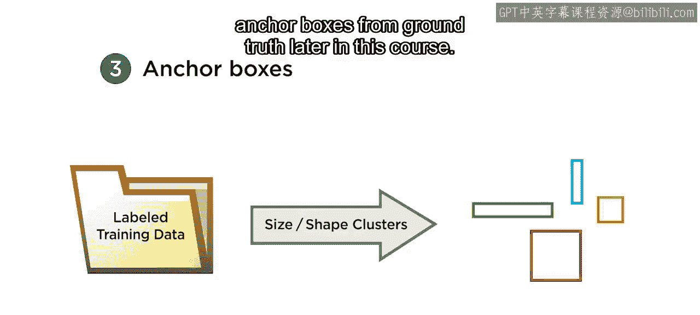

Detteectctors that use anchor boxes do not directly find objects and predict bounding boxes。

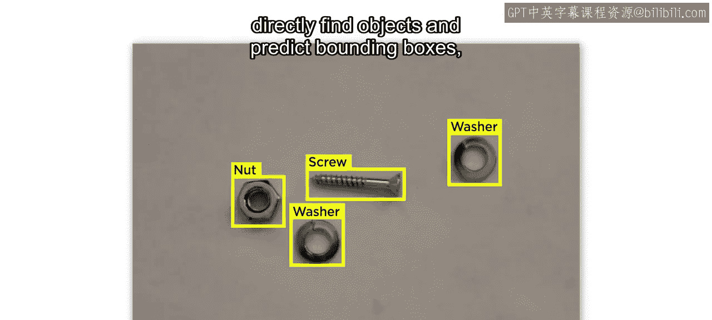

But rather， predict the most likely class labels and coordinate adjustments for grids of anchor boxes。

During object detection， the model places anchor boxes at different positions and scales across the image。

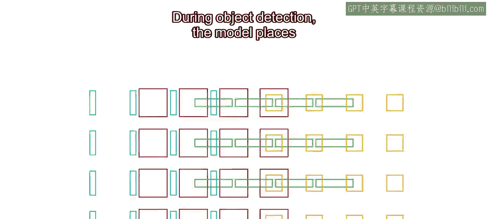

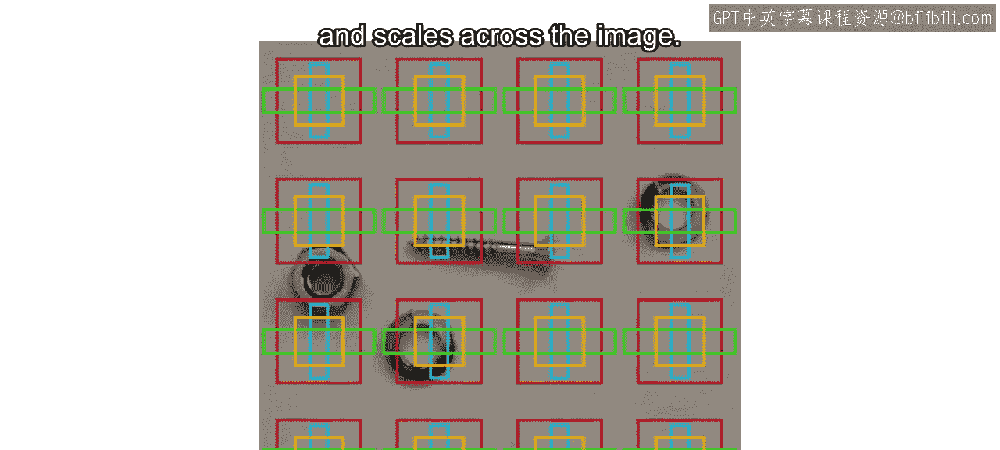

For each anchor box。The model predicts the probability of it containing an object of each class。

And selects the most likely class label。The model also performs bounding by regressionion for each anchor box。

Adjusting the box' is coordinate to better localize the object。

Then post processing steps are applied to remove low detection thresholds。

And redundant or overlapping detections。Now that you know the key technical considerations when choosing and working with object detection frameworks。

 there are a couple other things you may want to think about。

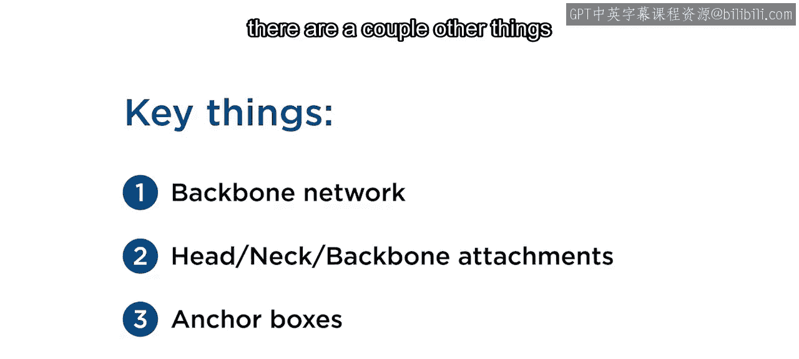

You likely also need to consider what is available and or already in use by colleagues and customers in your industry。

How familiar are others with the framework。

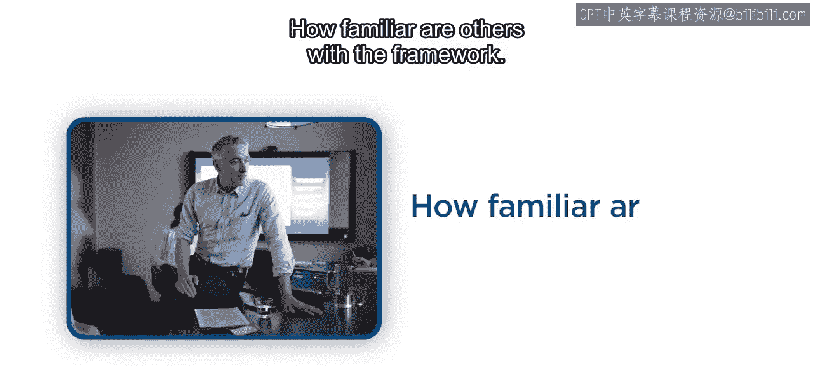

Also， how tested and trusted has it been proven to be in your application area already。

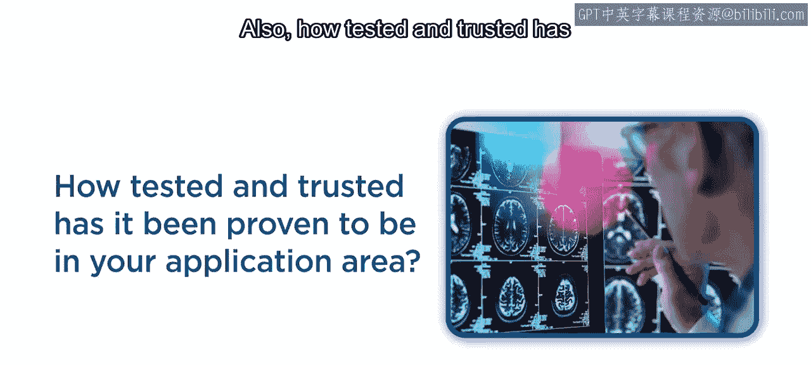

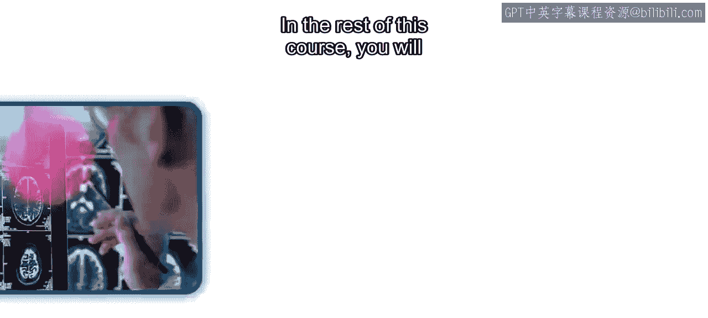

In the rest of this course。You will revisit and expand upon all the concepts， components。

 and trade offs you saw in this video。You will also practice using， evaluating。

 and comparing detection frameworks on several different examples in MATLb。

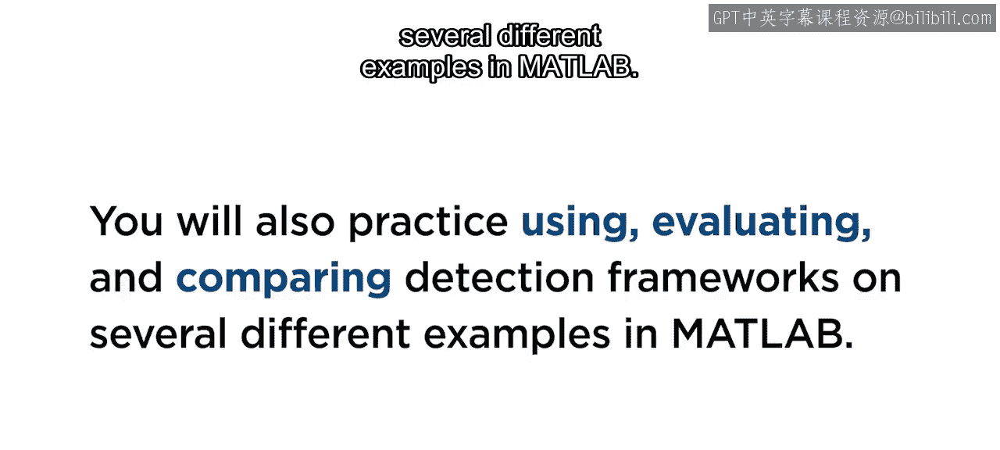

🎼。