# Mathworks《深度学习在计算机视觉中的应用（简介、目标检测、高级深度学习）｜Deep Learning for Computer Vision》 p17 3_使用预训练的目标检测器.zh_en -BV1Rb421v71M_p17-

🎼。

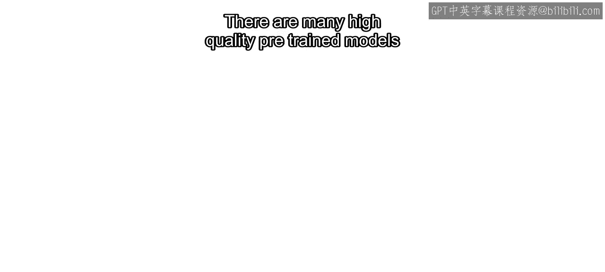

There are many high quality pre trained models available to detect different classes of common objects。

As well as smaller models tailored for specific tasks like people detection and vehicle detection。

These models can save you significant work， since they are trained on very large benchmark data sets such as Coco。

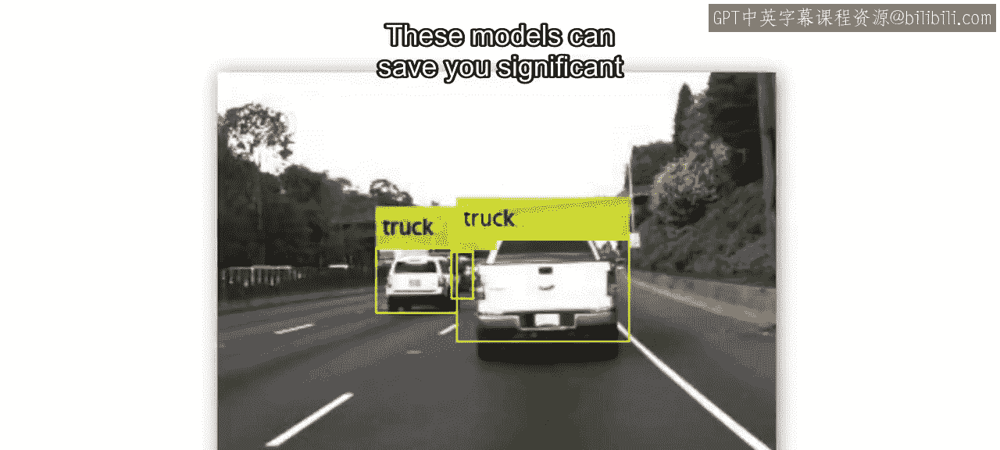

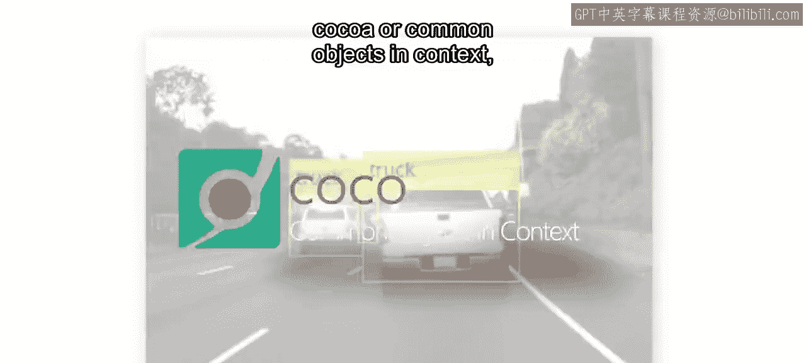

Or common objects in context。Which has over 200，000 images and millions of object instances。

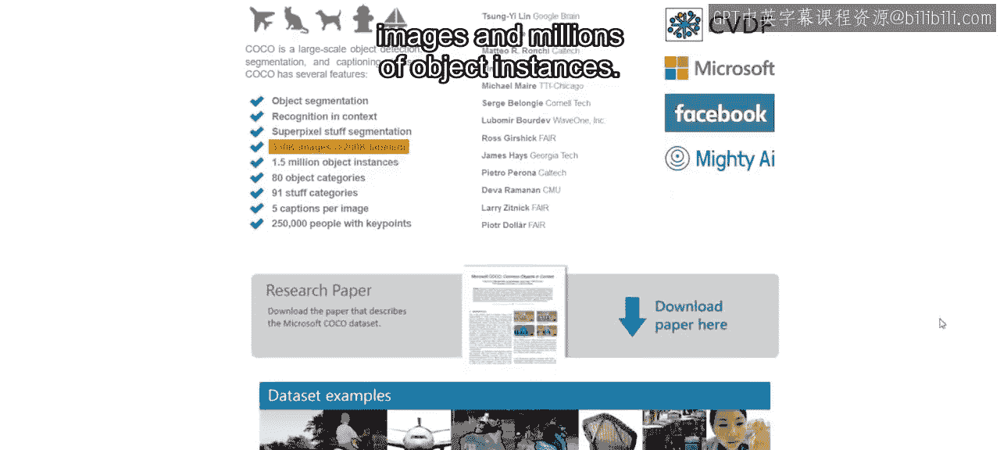

Mathworks has a number of these pre trained models available。

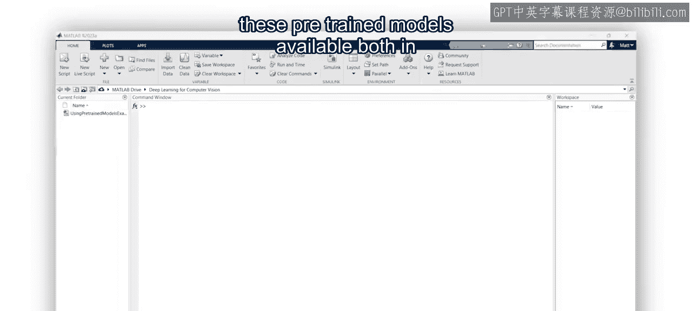

Both in Matlab。Envia adds。

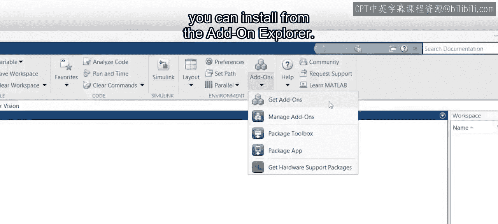

You can install from the add on Explorer。

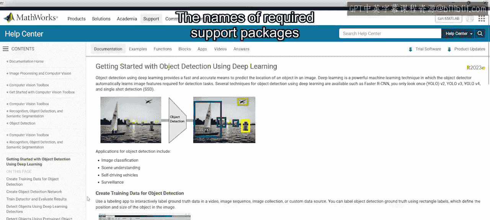

The names of required support packages。Are available in the online documentation。

There are also special purpose and cutting edge pre trained models on the Matlab Deep Learning Model hub。

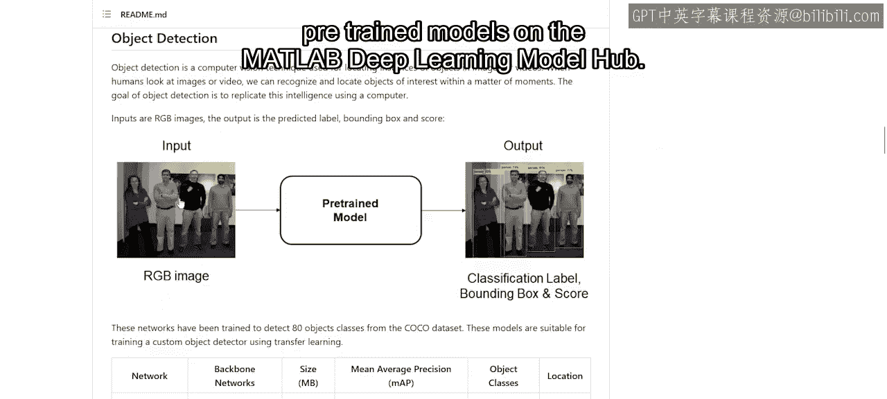

And， in addition。

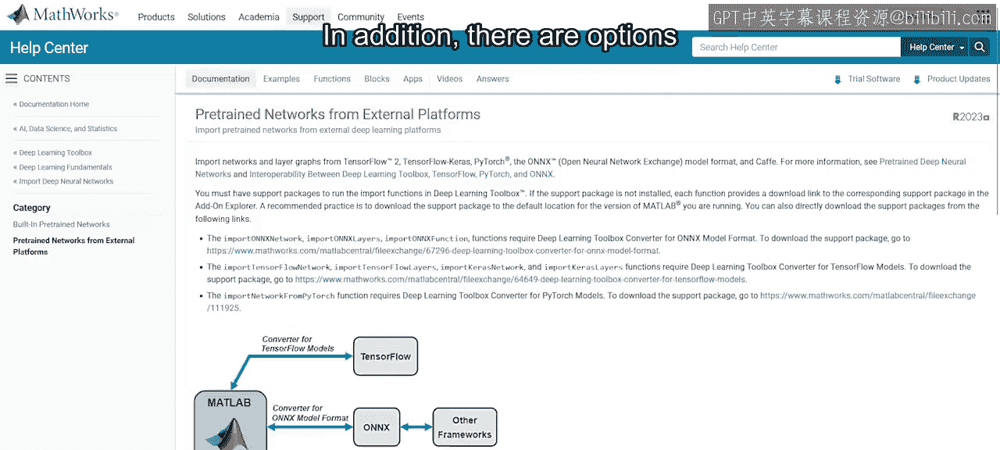

There are options to both import models from and export models to third party platforms like Tensorflowlow and Pytorch。

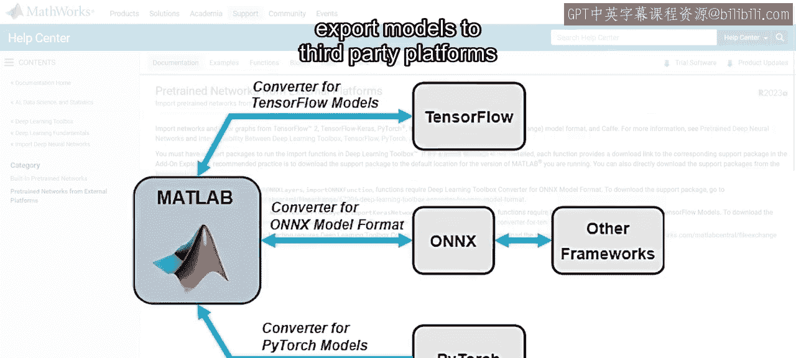

You'll have links to these resources provided in the following reading。

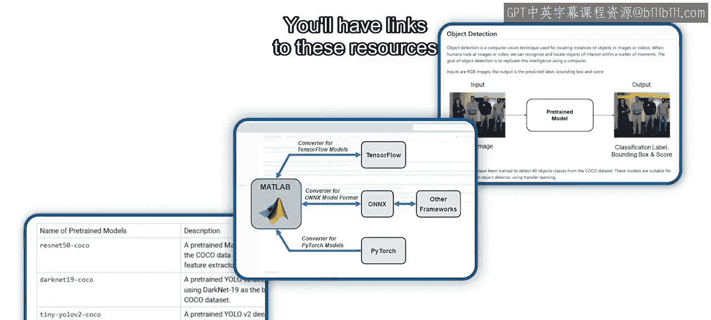

Now， let's walk through how to use one of these models。

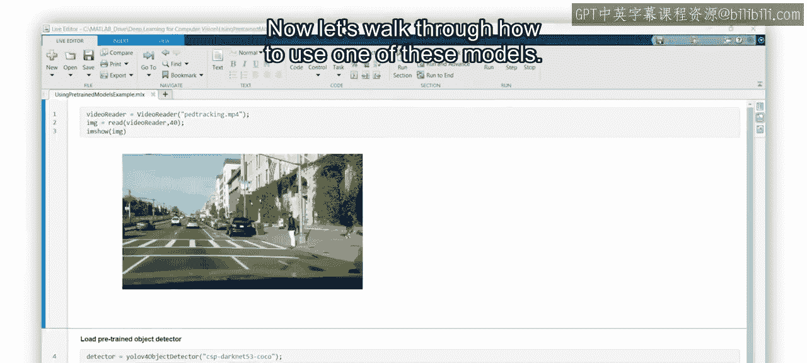

In this case， we'll detect cars and pedestrians in a single video frame。

I'll use a model I've already installed。

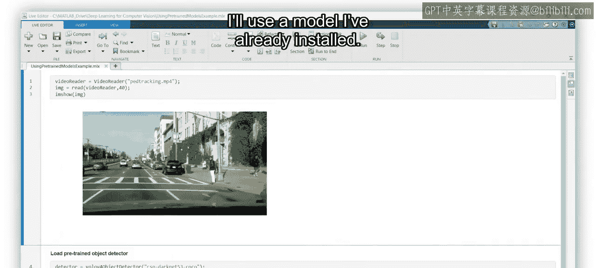

In this case， Yolo V4 with the Dark net 53 backbone。

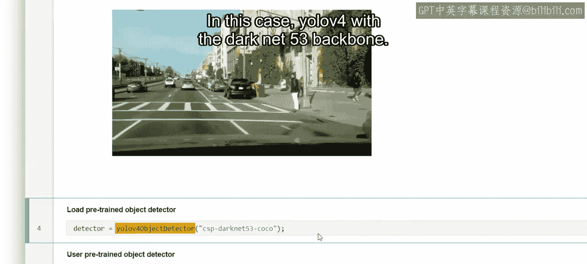

You don't need to know what all that means yet。

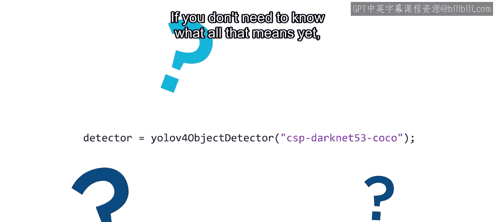

You'll learn all about it in this course。To apply the model。Use the detect function。

With the detector and image， as inputs。

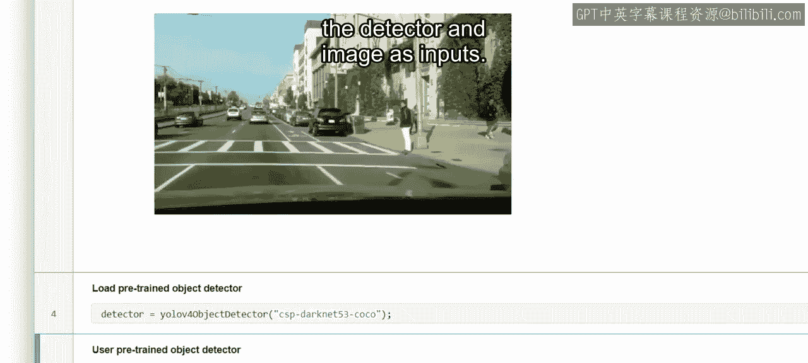

The three outputs here are the bounding boxes。Confidence scores。

And class labels for each detected object。The bounding box is given as the pixel coordinates of the upper left corner。

Withth and height。

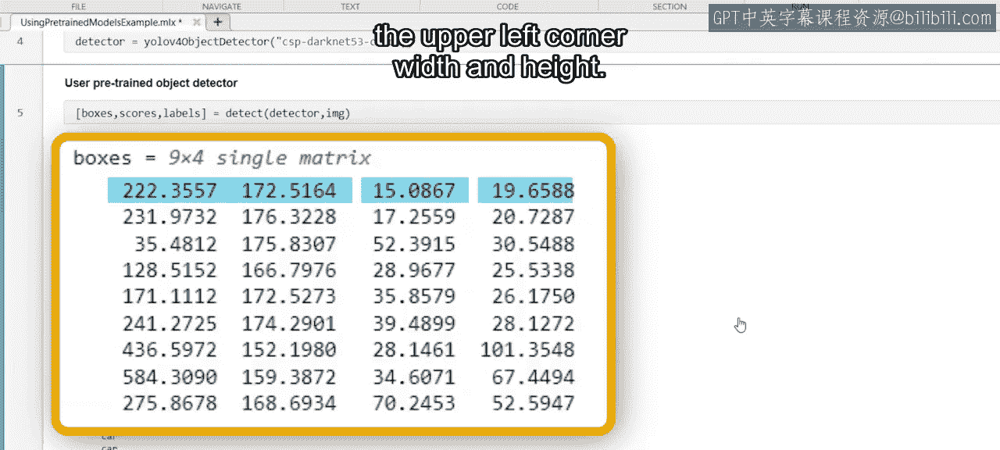

To see how the detector performs， use the insert object annotation function with the image。

Rectangle shape choice。

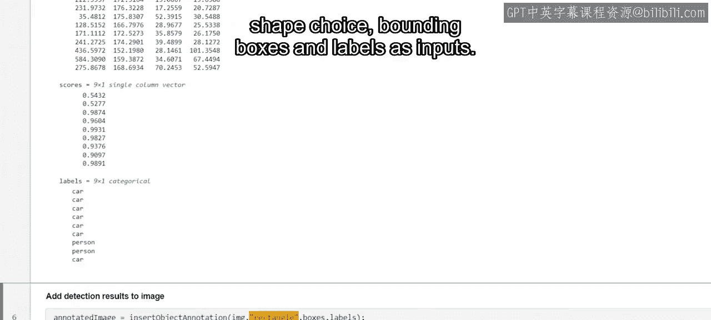

Bounding boxes and labels as inputs。

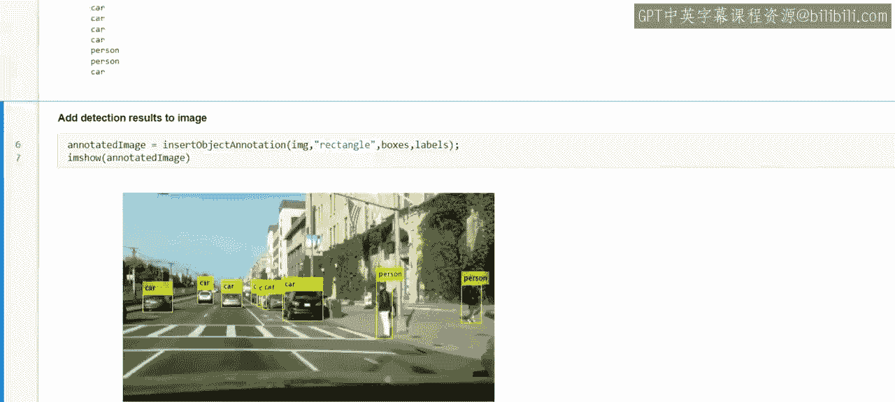

In the following reading。You'll find links to the resources mentioned here。

Practice loading and using pretrain models on collections of images as well as videos。

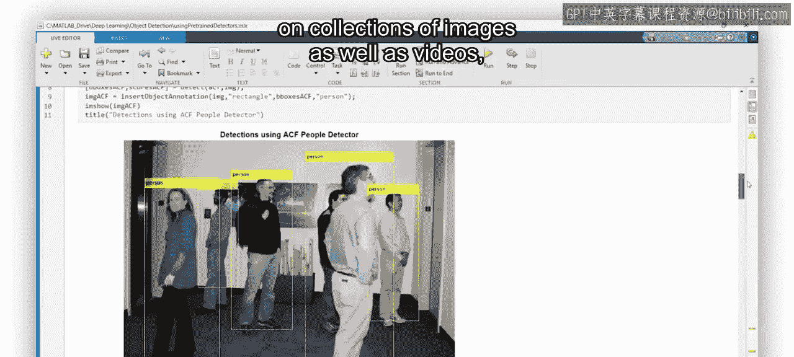

And use several methods to visualize the results。