# Mathworks《深度学习在计算机视觉中的应用（简介、目标检测、高级深度学习）｜Deep Learning for Computer Vision》 p19 5_标记你的图像.zh_en -BV1Rb421v71M_p19-

🎼。

Training a detection model requires images with ground truth labels。

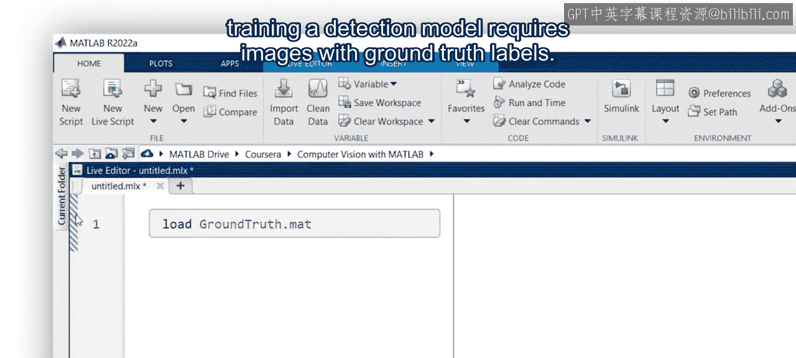

This includes the coordinates of the bounding boxes around the objects of interest。In this video。

 you will use the image labeler app to generate a dataset set's ground truth。

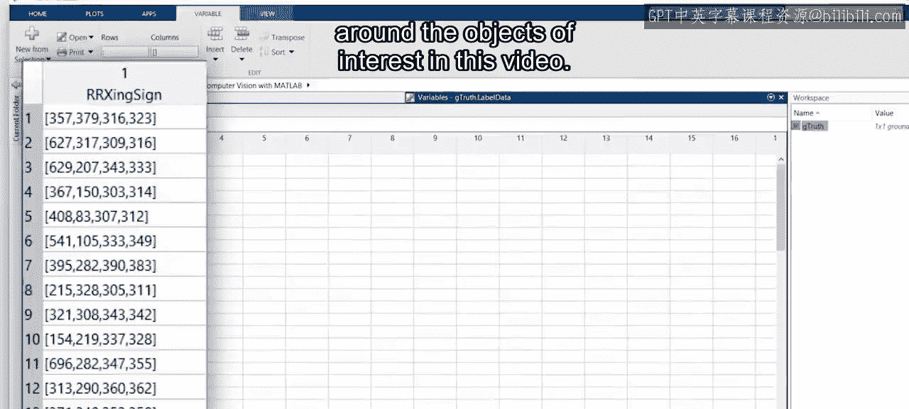

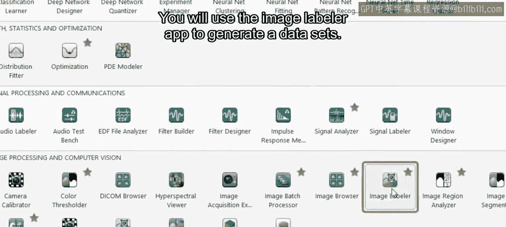

The first step is to import the images from the data set。

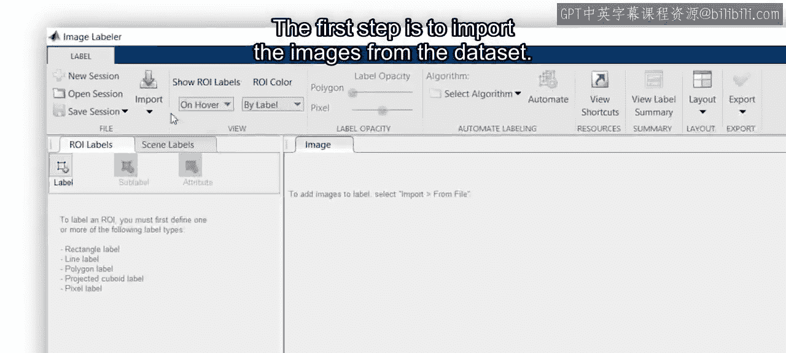

For this example， we'll label these images of railroad crossing signs。

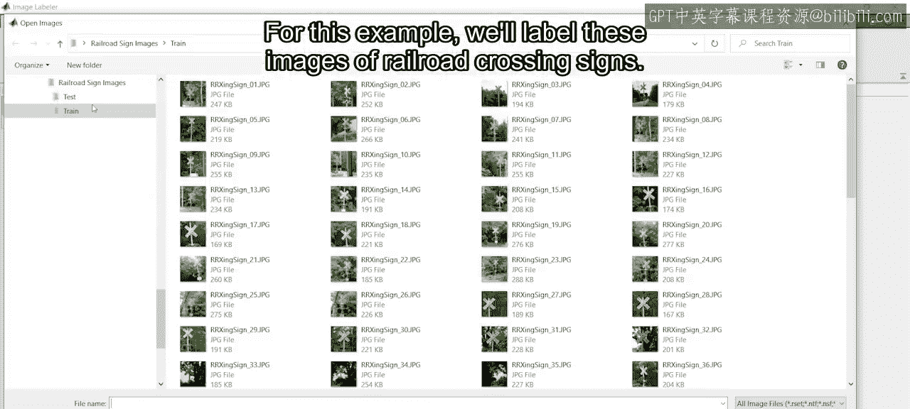

Once in the app。Images appear in the thumbnail strip below。Which can be used for quick navigation。

The selected image from the thumbnails is shown in the centre， ready to be labeled。

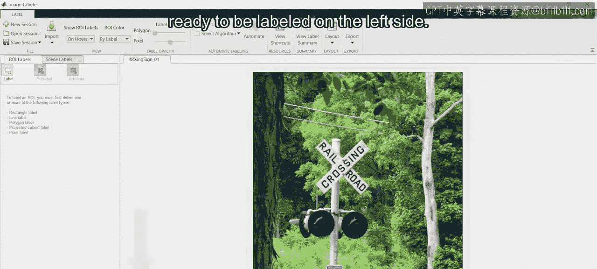

On the left side， you can create R O I or region of interest labels such as a bounding box。

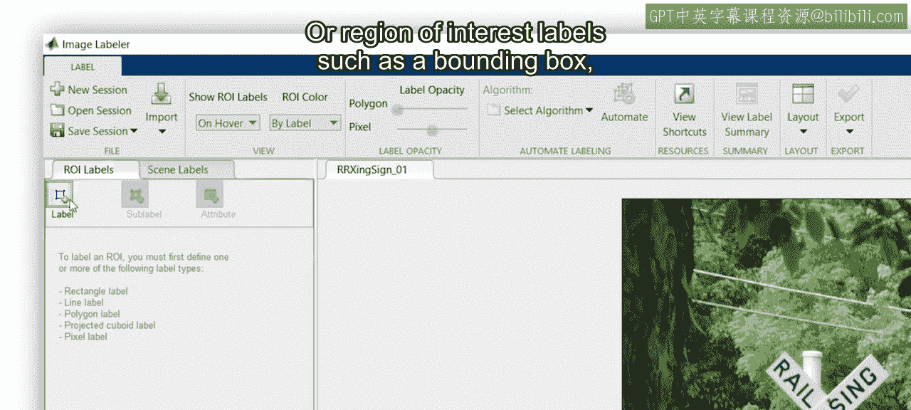

Create a label for the railroad signs。There are a few different types of labels available。

For this example， we'll use rectangles as they are the most common for object detection。

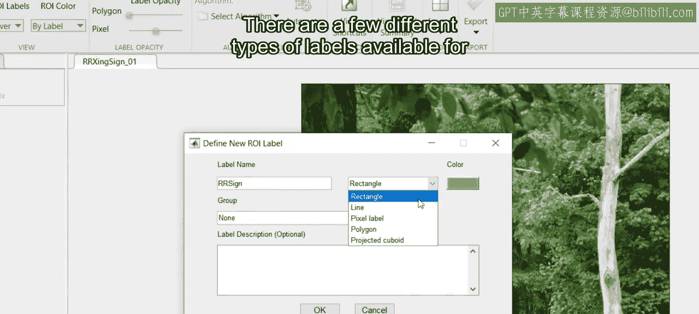

Create your first label。

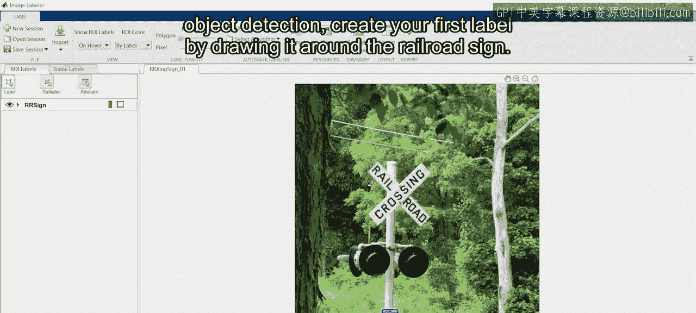

By drawing it around the railroad sign。If you make a mistake。Use control Z to undo the action。

Or make small adjustments to the box as needed。Sometimes you need multiple labels。For example。

 in automated driving， a vehicle may also need to locate the red lights to check if they are flashing。

So。😊。

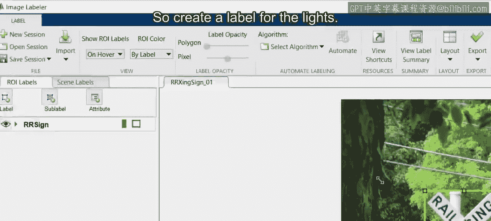

Create a label for the lights， too。In this case， there are two lights to label。

So we'll copy and paste the second bounding box。The imageage labeler app can also be used to verify existing labels for a dataset set。

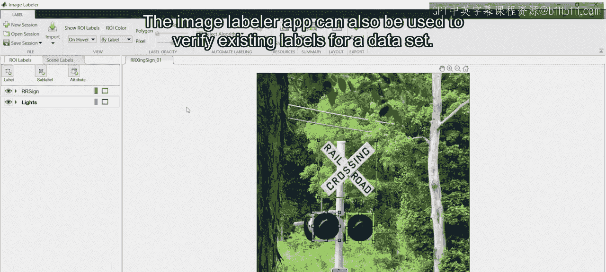

You can import a ground truth using the import button。

Labelling images for classification is also possible。

This is known as scene labeling and is performed using the scene labels tab。

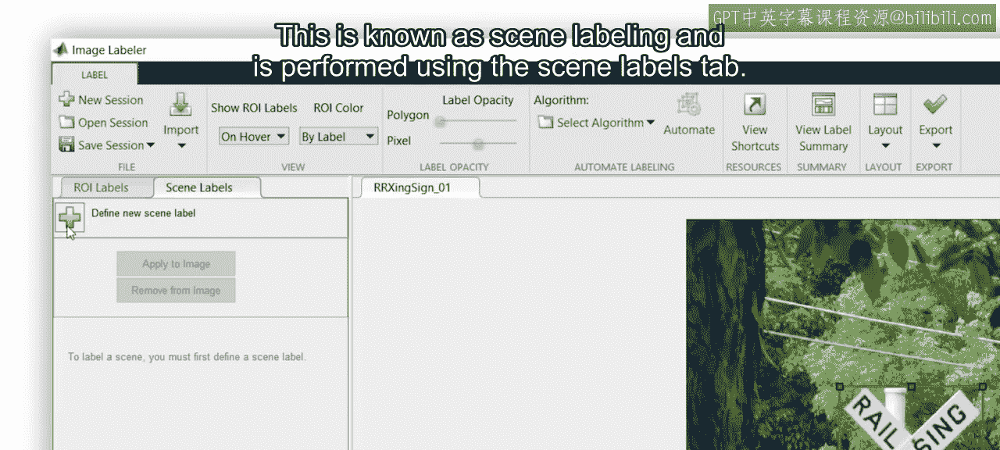

Once you're finished labeling， export the ground truth as a mat file。

Then use the load function to import your ground truth。

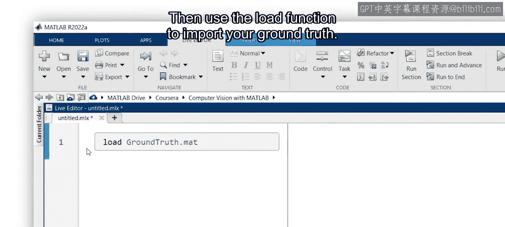

This variable contains a few properties。The label definitions， as defined in the app。

Data source contains the location of image files。While label data stores the bounding box coordinates。

That worked well。 But what if you need to label video frames instead of individual images。

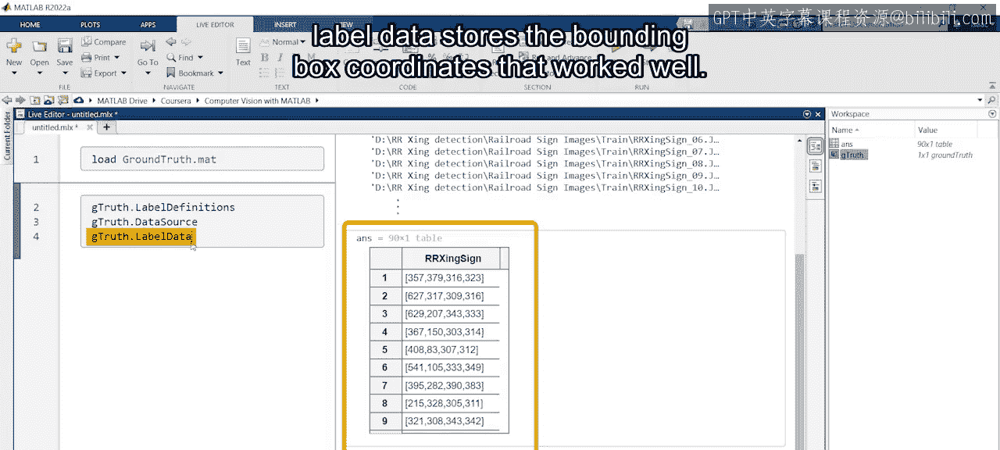

In this case， use the video labeler app instead。The workflow here is very similar to that of the image labeler app。

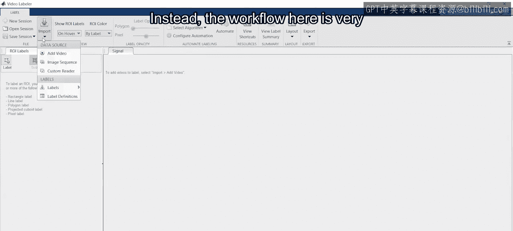

However， one advantage is that objects can be tracked across frames。To do this。

Use an automated labeling algorithm to track a labeled object。

Once you have your first label in place， start the automation to label subsequent frames。Except。

Or adjust the results as needed。

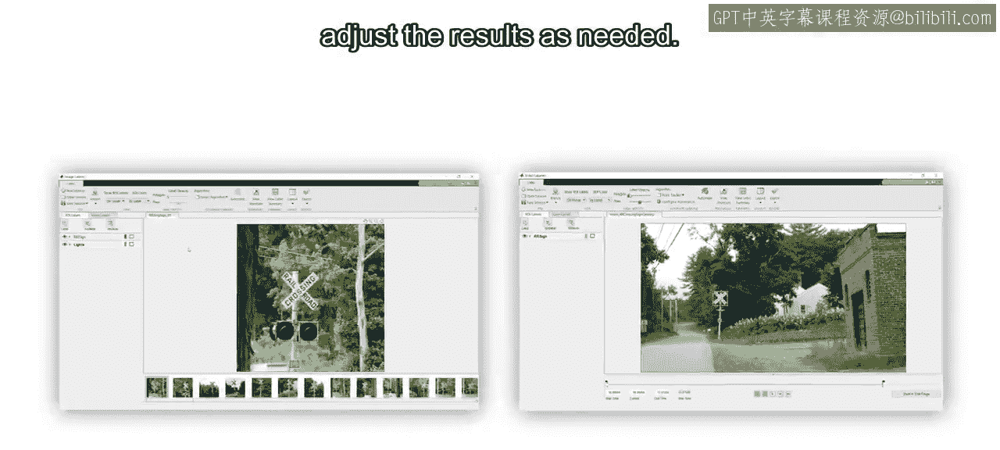

Both the image and video labeler apps allow for quickly generating ground truths for your dataset set。

And remember， even if the labeling is already done。

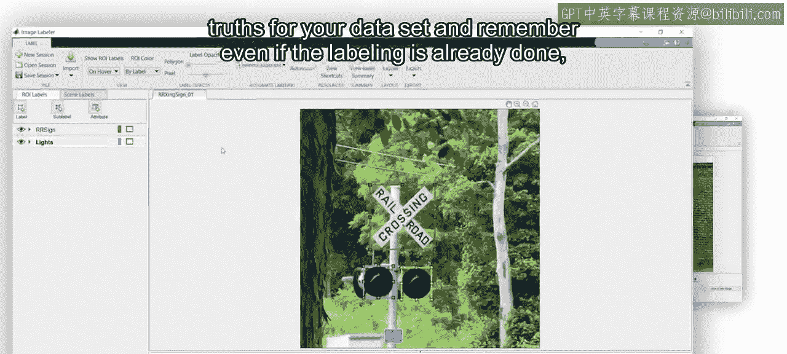

It's often worth using these apps to confirm labels， before training your models。Yeah。

