# Mathworks《深度学习在计算机视觉中的应用（简介、目标检测、高级深度学习）｜Deep Learning for Computer Vision》 p21 7_使用目标检测模型进行迁移学习.zh_en -BV1Rb421v71M_p21-

🎼，In this video， you'll learn how to set up and train an object detection model using transfer learning。

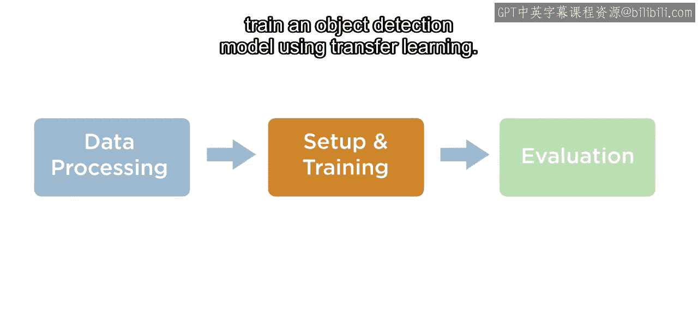

You'll resize detection data。

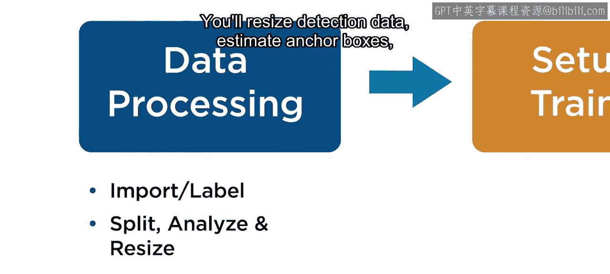

Estimate anchor boxes。Split validation data。Build a model。

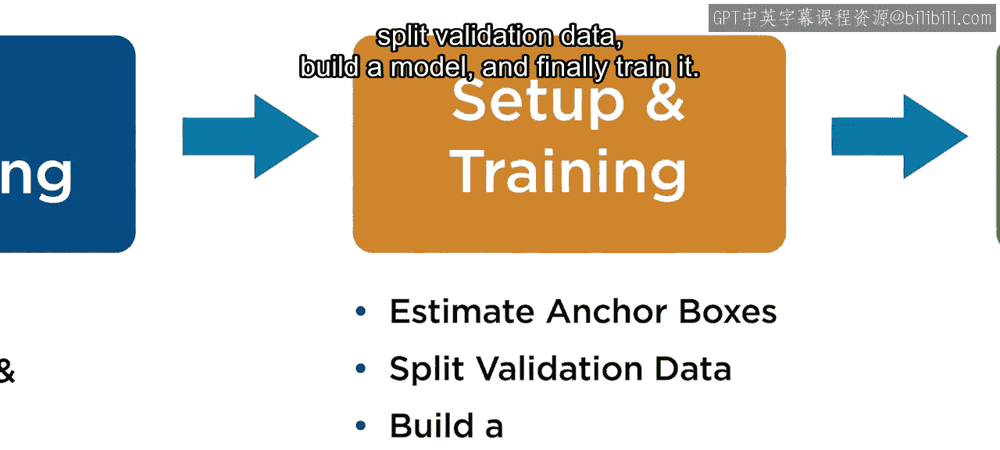

And finally， trained。For completeness， we'll show an example of data resizing。

 since it is one of the most common pre processings tasks in image based deep learning。

 even if it is not always required。Similarly， we'll showho up estimating and using anchor boxes。

 which is another very common task when training object detectors。

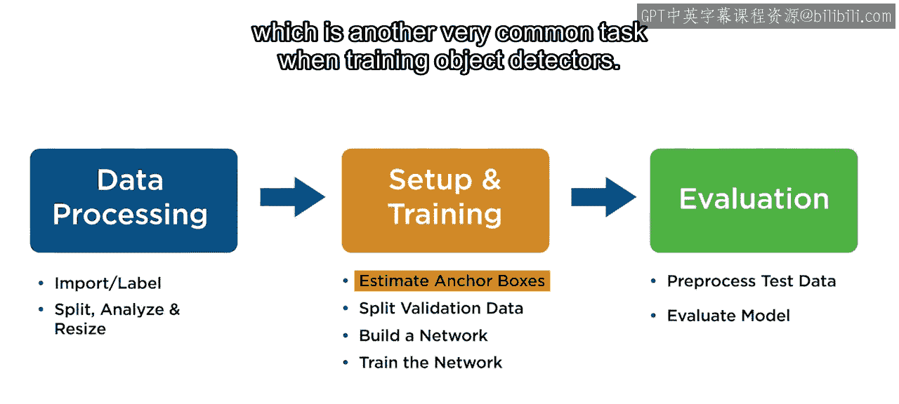

However， depending on the model framework you use， you may not need anchor boxes。Let's get started。

You have already seen how to load saved ground tooth data。

And create image in box labeled data stores。The next step when training is to combine the image and box label ladder stores into one。

Then pass a custom transformation function into transform to resize the data。

A copy of the custom resizing transformation function here is provided in the course files。

Let's look at that now。The first input will be the result of using the read function on the combined data store。

Here， this will be a one by three celet with an image。

The bounding boxes for all objects in that image。And corresponding class labels。

The second input is the desired image size。The function resizes the image using I am resize。

And similarly， adjust the bounding box coordinates using B box3 size。

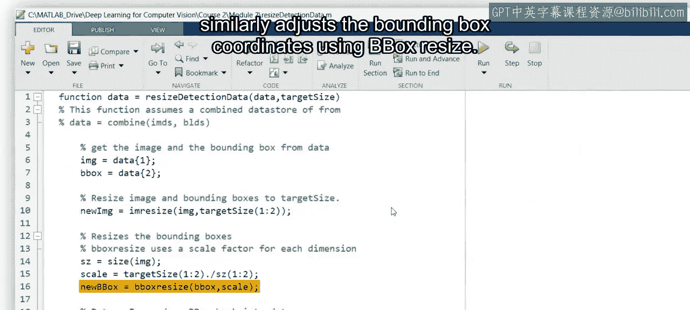

Estimating anchor boxes needs to come after any alterations you make to your ground truth。

 such as resizing it。

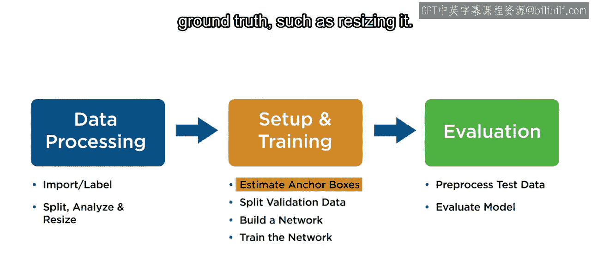

To estimate good anchor boxes， search for clusters in your ground truth bounding box data。

This is usually done using a clustering algorithm， like K means。Here。

 the algorithm has clustered the ground truth bounding box data into five clusters。

Vary the number of clusters or K over a range of values。At each one。

 evaluate the average intersection over union or mean I O U to compare the anchor boxes and the ground truth。

Generally， a higher IOU is better， but this comes with a trade off。

More anchor boxes require a higher computational cost。By visualizing the results。

 you can choose the number of anchors to use。We'll return to this later when we're building a model。

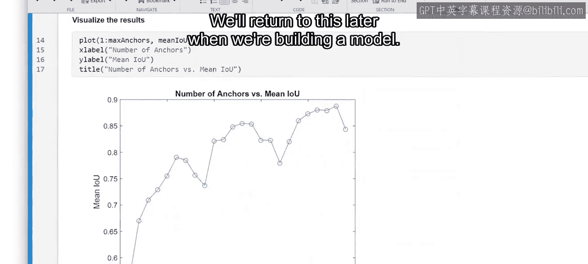

Next， you should split off validation data to use during training。

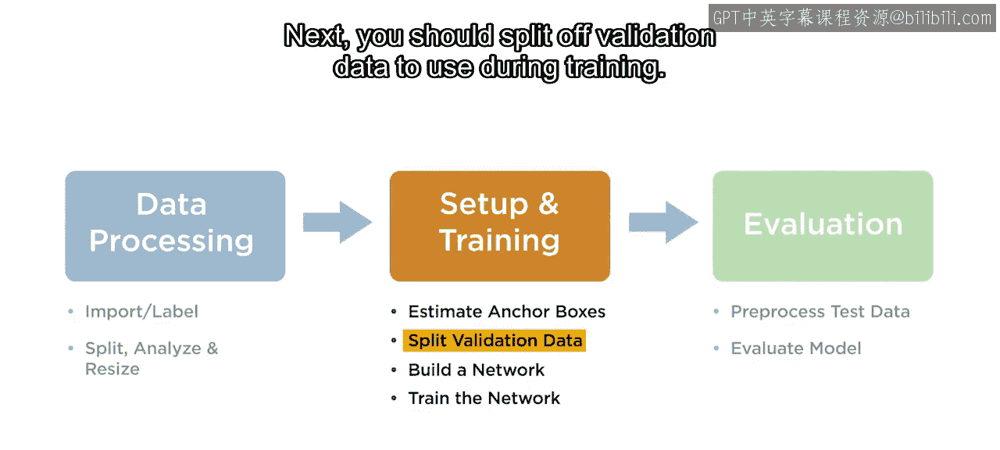

To do this。You need to shuffle the data to help remove any possible order based patterns。

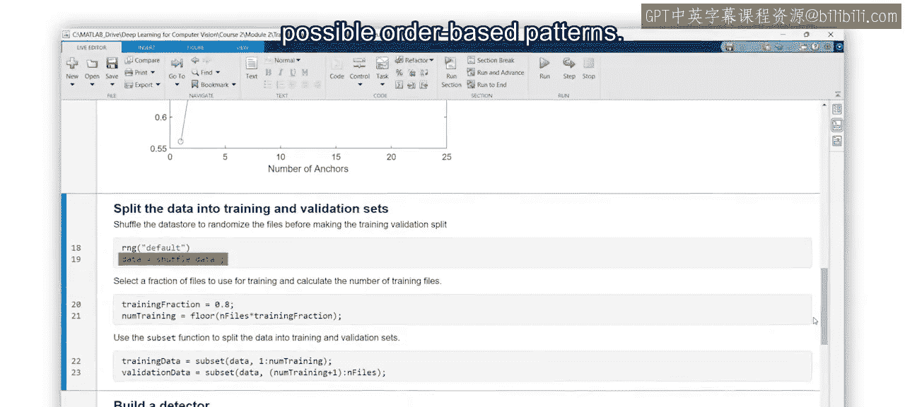

After shuffling， choose what fraction of the data to keep as training and use that to calculate the number of training files。

Then use the subset function to extract that many elements from the shuffle data as training data。

And similarly， to extract the remaining elements as validation data。

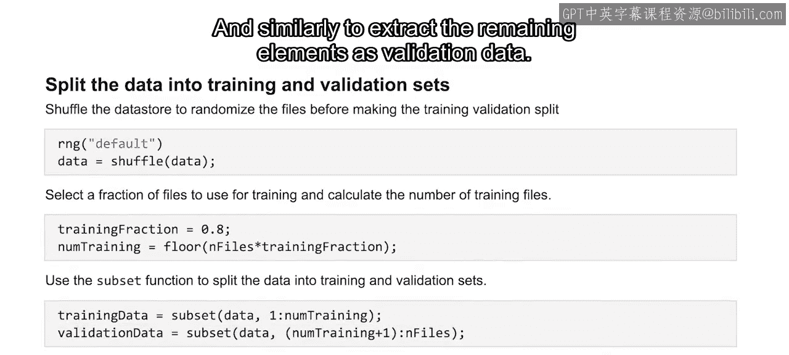

The next step is to build a network。Don't worry， we're doing transfer learning。

 so you don't need to build one from scratch。You won't even manually add the head or neck components。

 A mattelab function does all the heavy lifting。

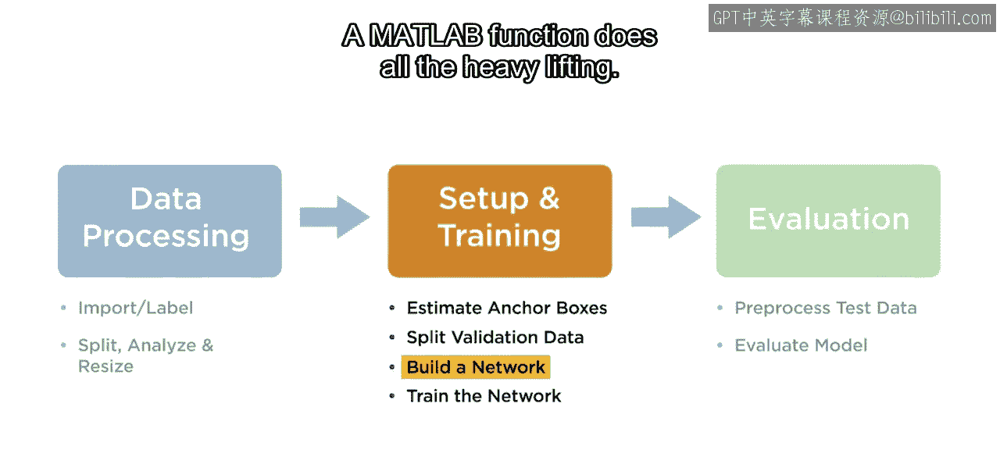

The first thing you need to do is choose the network architecture you anticipate using。Why， well。

 if you need anchor boxes， you now need to sort them by area to assign to the detection heads。

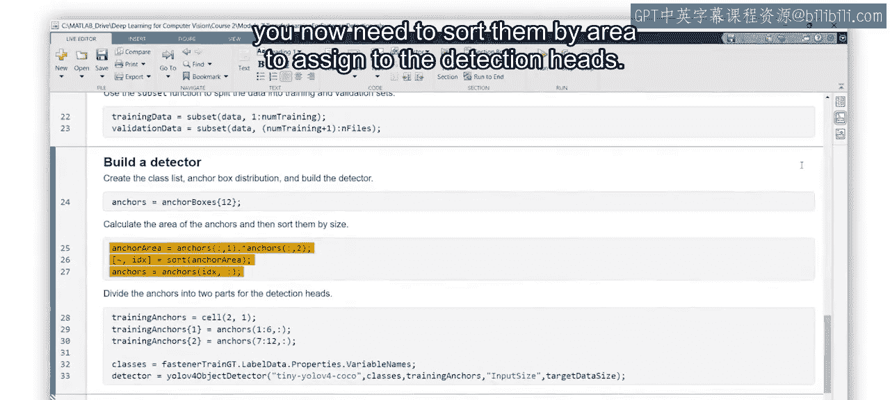

Remember， attachments deeper in the network will be better at detecting larger objects。

So you'll need to sort your anchor boxes by area first before assigning them to your model。

In this example， we plan on using the tiny version of Yolo V 4， which has two heads。Here。

 we'll choose a number of anchors that uses fewer resources。

Is divisible by two so we can create a set for each head and has a decent I O U。

It looks like 12 anchors is promising for a first try。Now， remember you need to sort them。First。

 calculate the areas by taking the product of the dimensions。

Then use the sort function to get the indices in order。Finally。

 use the sortdid indices to rearrange the anchor boxes。Next。

 create ael to hold two groups in this case， one for each head of our network。

And assign the appropriate anchors into each element of the celet。

Then extract the class names from the original ground truth and use all this to build the detector。

You can build detectors in Matlab using dedicated functions。 In this case， Yoo V4 object detector。

When you need to specify a backbone， anchors and head attachments。

 the full syntax is detector function name。With inputs of backbone name。Class names。Anchor boxes。

A name value pair for the layers you wish to attach the heads to。And other optional name value pairs。

However， several detection frameworks have a more streamlined option。For example， with Yolo V 4。

 you can specify a subclass of the network type。 In this case， tiny Yoo V 4， coco class names。

And anchor boxeses。And optionally， provide the network input size to automatically resize your images。

You'll need to consult the documentation for the detector you're using for the specifics in each case。

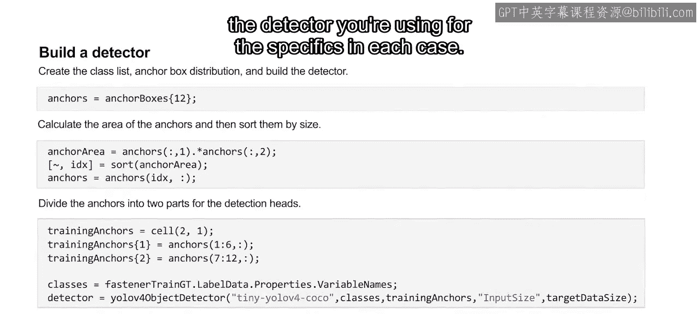

Once you have your detector， you're ready to train it。

There are dedicated training functions for each detector type as well。As with classification。

 you can specify training options。Every detector training function takes the training data。

Detector and training options as inputs。And now you're ready to train an object detection model using transfer learning in MatLb。

You'll get a chance to go through the example in this video。And if you have the hardware resources。

 perform the training yourself in the following reading。

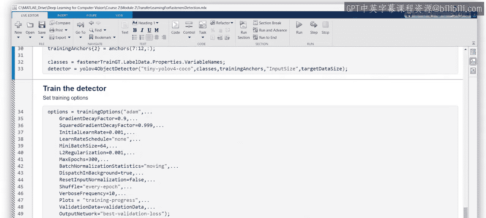

。