# Mathworks《深度学习在计算机视觉中的应用（简介、目标检测、高级深度学习）｜Deep Learning for Computer Vision》 p22 8_评估目标检测模型.zh_en -BV1Rb421v71M_p22-

🎼。

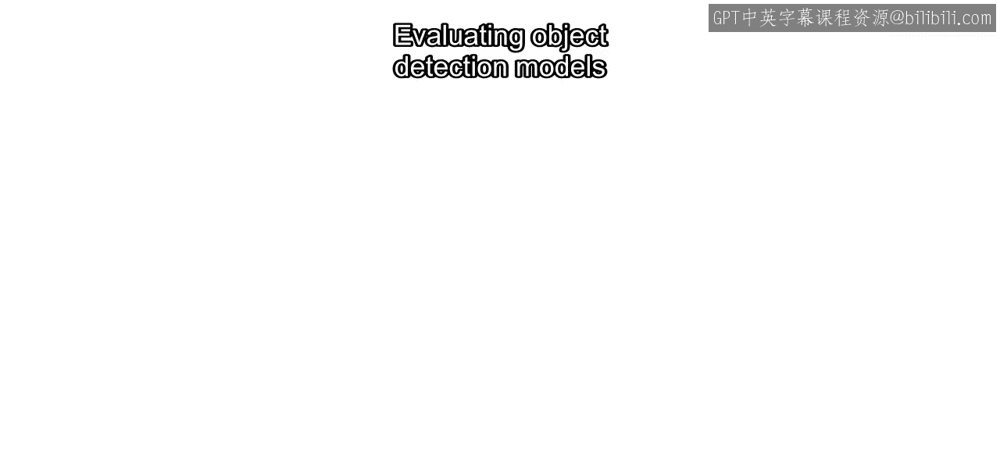

Evaluating object detection models is not as straightforward as image classification。

Because in addition to class。The size and location of objects must be evaluated。

To compare models and choose hyperparameters， you need quantitative metrics to analyze performance。

In this video， we'll use an American Sign Language or ASL detector to illustrate the most common metrics for evaluating detection models。

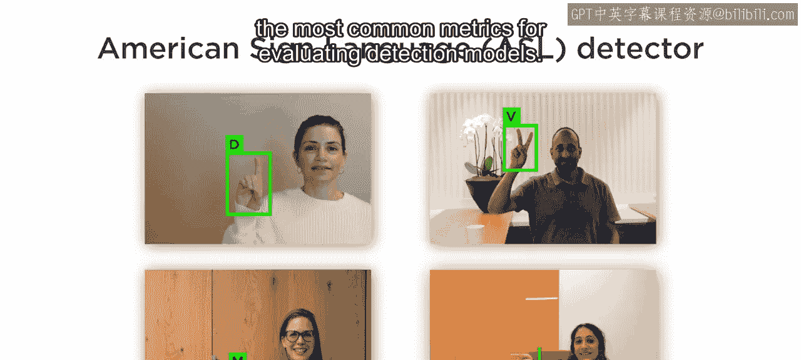

This data set has only one object for image。Making the results easier to interpret。

But the concepts also apply to images with multiple objects。

Let's start by defining what makes a good detection known as a true positive。

In addition to identifying the correct class， the model needs to get the location of the object。

 correct。

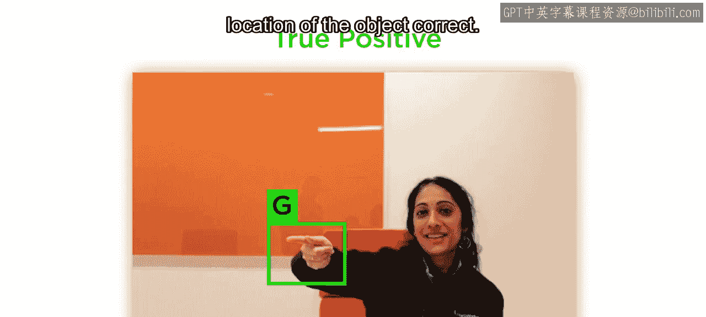

We probably agree that this detection is a true positive。But what about this？Or this。

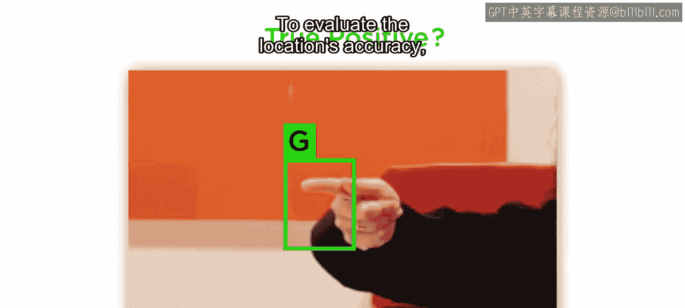

To evaluate the location's accuracy， the intersectional reunion or IOU is commonly used。

IOU is the area where the detected bounduning box overlaps with the ground truth。

Divided by the total area covered by both bounding boxes。Assume that the bedta class is correct。

If the IOU is greater than or equal to a threshold that you set。The detection is a true positive。

If the ratio is less。

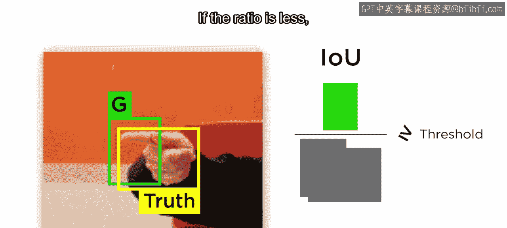

Then the detection is a false positive。Using IOU to distinguish between true and false positives provides a balance between detection。

 location and size。

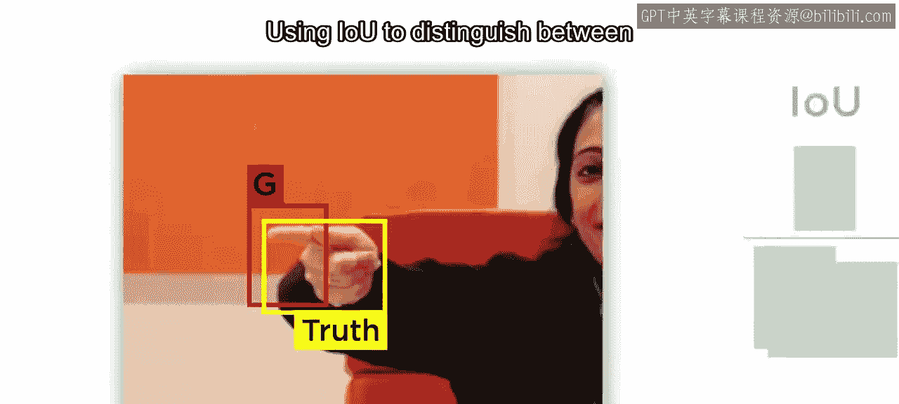

If the detected bounding box is the correct size， but shifted too far from the true location。

 the result is a false positive。Or the centre is correct， but the area is too large。Also。

 resulting in a false positive。Another common error with detection models is a mis detection known as a false negative。

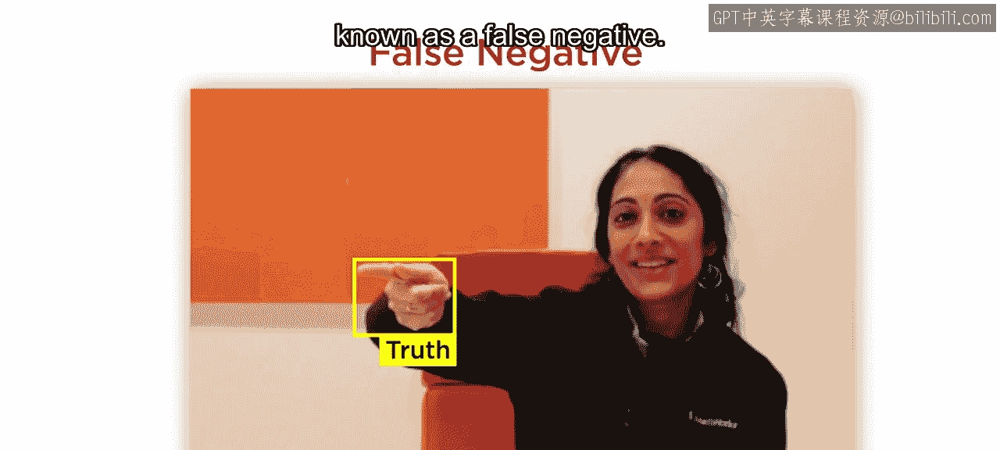

This occurs when an image contains an object。But the detector fails to find it。Or finds the object。

 but assign the wrong class。For example， this image contains letter G。But the detector assigns P。

Thus， this image has a false negative for the letterurg G。And a false positive for the letter P。

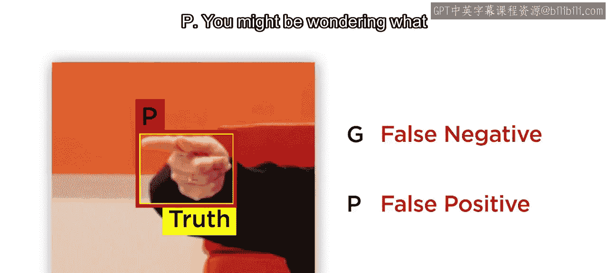

You might be wondering， what I O U threshold should I use。

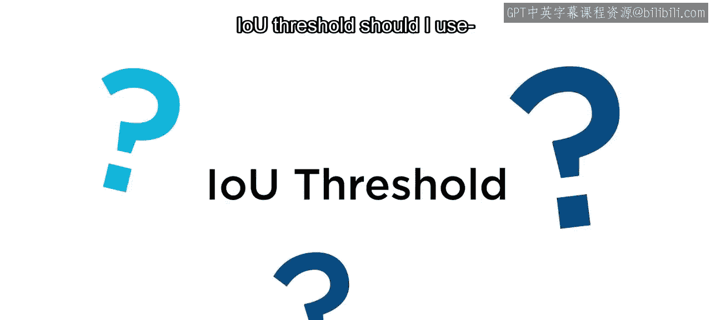

A commonly used value and the default in MAlab is 0。5。

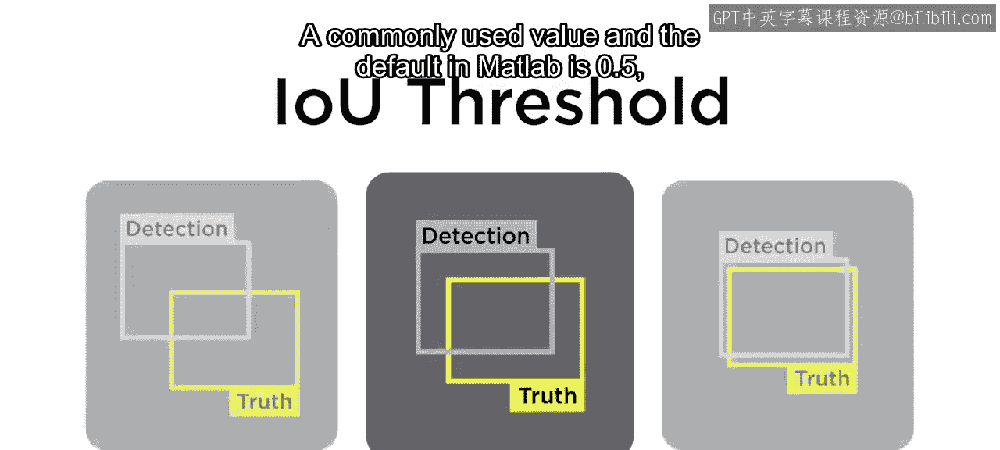

But your application will determine the appropriate value。

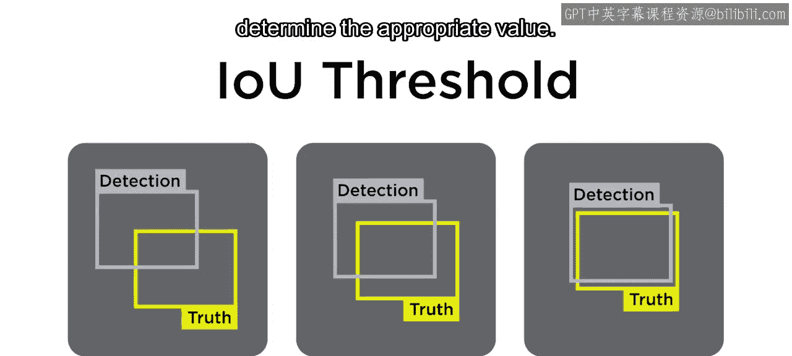

For our ASL model， the exact hand location is not too important。 so you might lower the IO threshold。

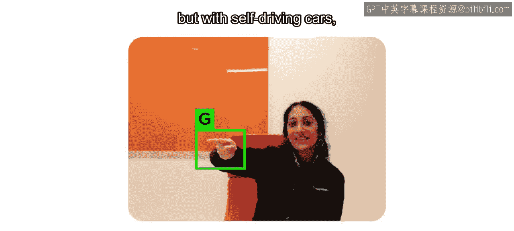

But with self driving cars， you need to know the location with high accuracy。

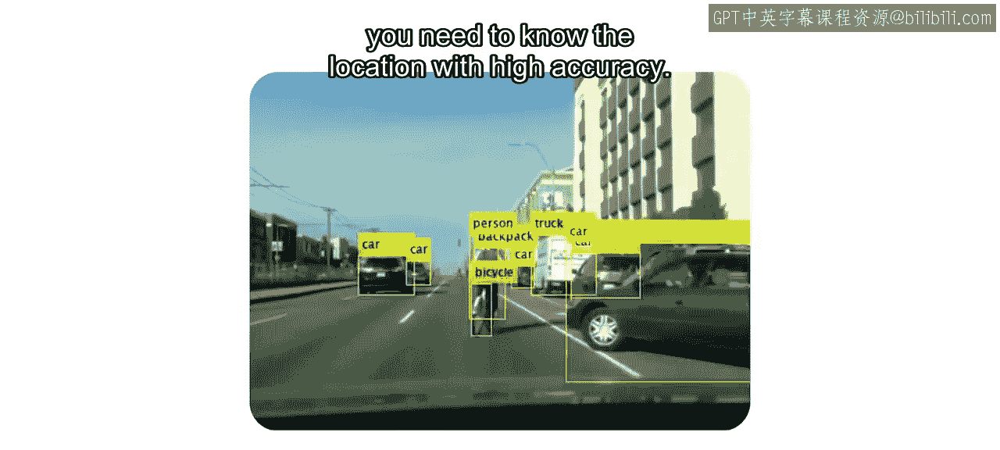

There is a trade off when eliminating false positives or false negatives。

You can reduce false positives by increasing the detector's confidence threshold。

But this usually increases false negatives。Two metrics for evaluating this trade off are precision and recall。

Precision is the fraction of correct detections for a class over all the detections of that class。

In other words。The true positives over the sum of true positives and false positives。

If our A L detector returned 15 detections with a letter G，9 of which were correct。

 the precision for that class is 0。6。Recall is the fraction of all actual positives。

 The model correctly found for a class。That is true positives over the sum of true positives and false negatives。

So if our detector found 9 trueji， but should have found 10。The recall is 0。9。

An important parameter you control is the confidence score threshold used with the detect function。

Loboring the threshold means you're being less picky about getting correct predictions。

You'll get more true positives， but also more false positives。The result is higher recall。

But lower precision。Similarly。Increasing the confidence threshold means you want the detector to be more picky。

You're less likely to have false positives。But will also have fewer true positives。

This increases precision。But because there are more false negatives， recall goes down。

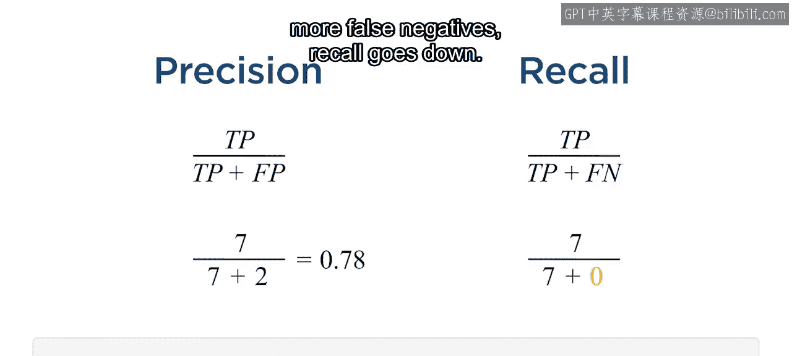

As with IOU， you'll need to decide which of these metrics is more important for your application。

You may prioritize recall in medical applications to avoid missing a diagnosis。

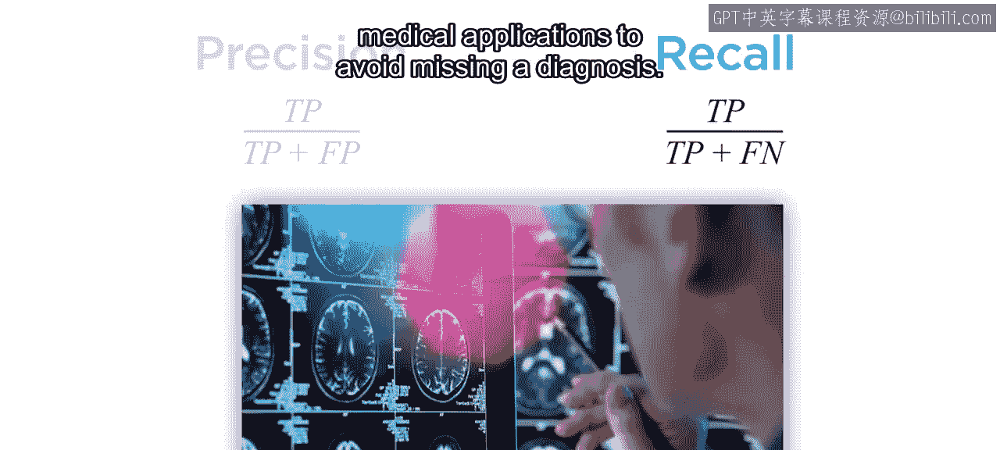

Well， if you're looking for ready to pick fruit， you may want higher precision to avoid harvesting too early。

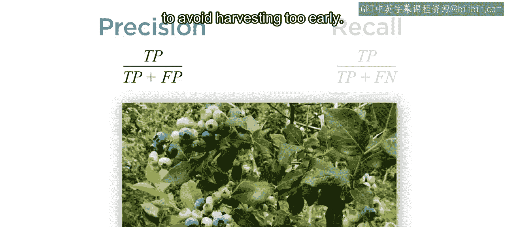

How do you use these metrics to evaluate your model and choose an appropriate threshold？

A common approach is to build a precision versus recall curve for each class shown here for G。

There is one point for each detection， sorted by decreasing confidence。

A few confidence scores are shown。Thus， you can determine the precision and recall for a class and confidence threshold。

A good way to construct these curves is to run your detector on the test images with a low confidence threshold。

 say 0。05。Then for each class， sort the detections by decreasing score。

Here are some results we got for the letter G。The first seven detections have scores near one。

 and are true positives。But notice that even some confident predictions are incorrect。

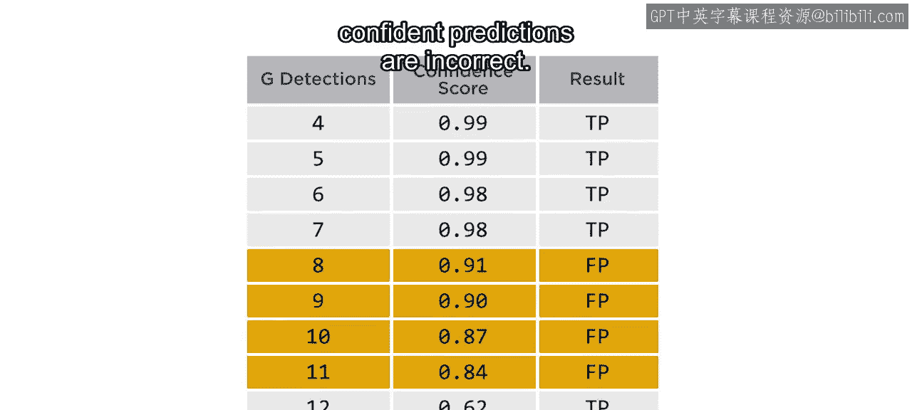

The next step is to build a precision recall curve for each class。By convention。

 the curve always starts at 01。The detection with the highest score is a true positive。So。

 the precision is one。This is one of the 10 expected Gs in the test set。 so the recall so far is 0。1。

The next six detections are also true positives， meaning the precision remains one。

 and the recall has reached 0。7。Since 7 of the 10 objects have been detected。

Detections 8 through 11 are false positives。 So the precision drops each time。

While the recall remains 0。7。Detection 12 is another two positive。

 So the recall and precision both increase。You continue in this fashion until you complete the curve。

This curve helps you visualize the precision recall trade off。Here。

 it is not possible to get a recall of one。To have very high precision。

 you should expect a recall of about 0。7。The area under the curve gives the average precision。

 or A P。Here， the average position is 0。83。The AP is a quantitative metric for evaluating how well a model makes predictions for that class。

Let's look at the AP for a few other classes。For the letter C。

 all objects are detected correctly until the recall is one。Then there are a few false positives。

The average precision is one， meaning you can choose a threshold where the detector is perfect for this class。

However， for the letter X， only half of the objects are correctly found before the detector returns many false positives。

 and the A P is just above 0。5。

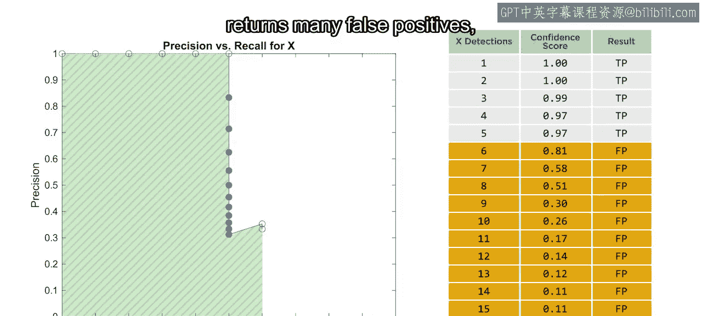

It is common for detectors to have different behaviors for different classes。

Which leads to two questions。How do you evaluate the detector as a whole。

And how do you choose a global threshold to use for detection？To answer the first question。

 you take the mean of the average precisions across all classes。

This is called the mean average precision， or MA。For this A S L detector。

 the mean average precision is 0。8。Another detector with an M A P of 0。85 is on average。

 better than this one。To determine an appropriate confidence threshold。

Run the detector for a range of threshold values and create new precision recall curves for each class。

The area under the curves will decrease， as the threshold increases。

The goal is to see how the area decreases as the threshold increases。

By averaging the area across all classes at each threshold， you construct a curve like this。

Which is the mean remaining area versus detection threshold。This value is largest at low thresholds。

Ideally， the curve decreases slowly。And you'll see a region that is relatively constant。Eventually。

 the threshold becomes too high， increasing false negatives。 So the curve drops rapidly。

Choosing a threshold close to this point offers a good balance between precision and recall across all classes。

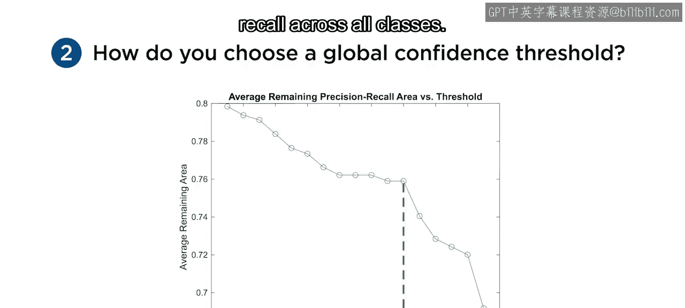

In summary， the I O U of the detected bounding box。

 with the ground truth is used to evaluate location accuracy。An IOU threshold of 0。

5 is commonly used， but you can change this depending on your application。

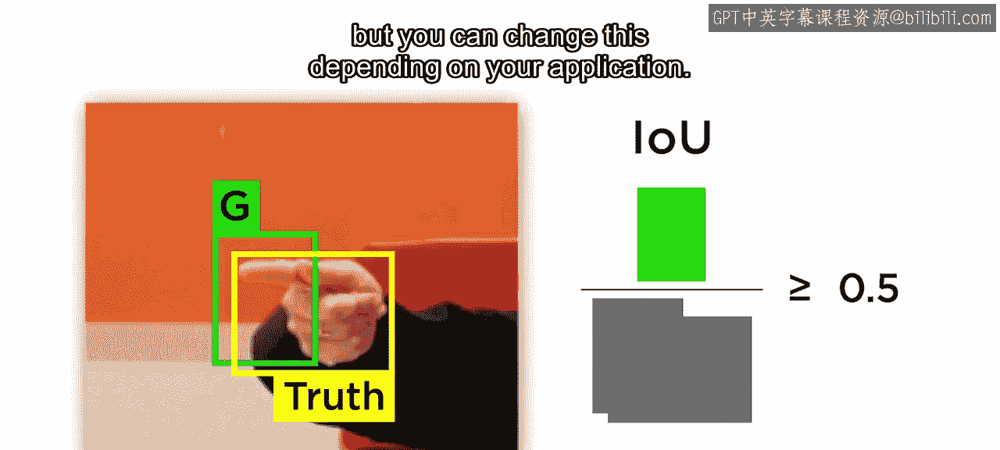

Precision recall curves and the average precision give you class specific metrics to evaluate performance。

This is useful if some classes are more important than others in your application。

Use the mean average precision to evaluate your detector as a whole， and compare models。

If this sounds like a lot。Don't worry。In the following reading。

 you'll calculate these metrics and curves。

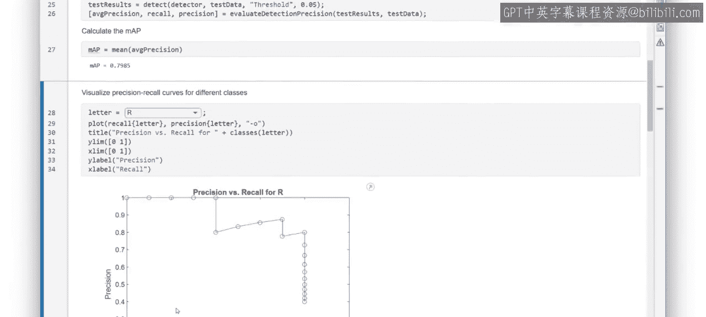

Yeah。