# Mathworks《深度学习在计算机视觉中的应用（简介、目标检测、高级深度学习）｜Deep Learning for Computer Vision》 p23 9_解决检测中的常见问题.zh_en -BV1Rb421v71M_p23-

🎼。

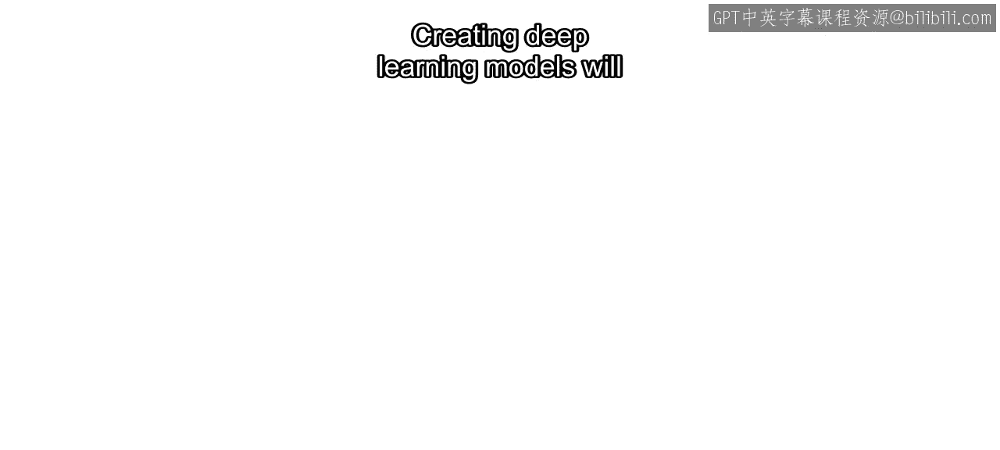

Creating deep learning models will almost always require some trial and error。

Understanding the workflow and common training options will help you iterate and improve results。

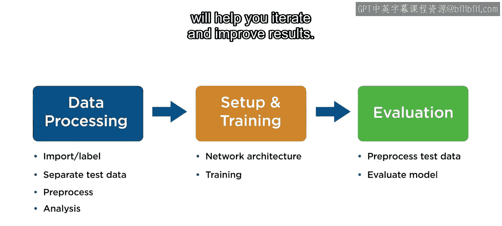

Let's start with the training process itself。The training options work the same way you saw with classification in the first course of this specialization。

For example。

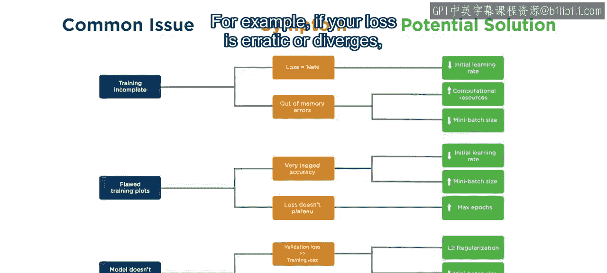

If your loss is erratic or diverges。You'll want to decrease the learning rate。

Or increase the mini batch size。However， the trade offs would be that too low a learning rate will make the training take far longer。

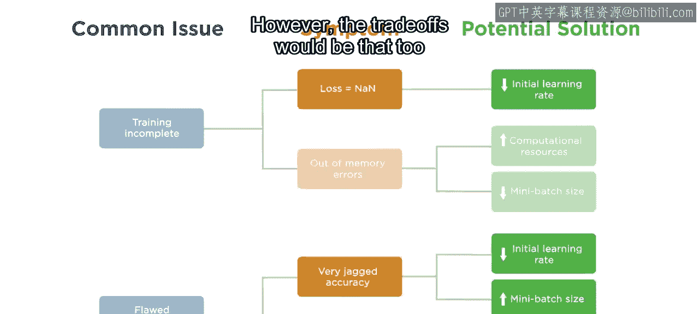

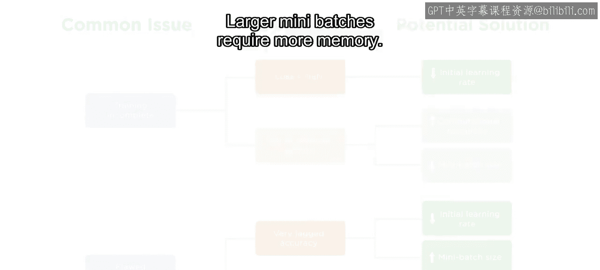

And larger mini batches require more memory。Similarly。

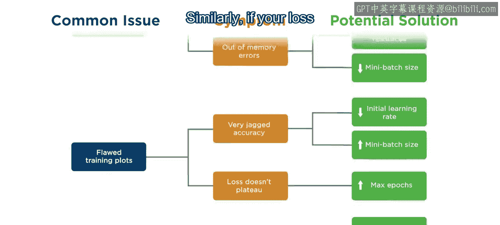

If your loss seems to have room for improvement at the end of training。

You should increase the maximum epochs。

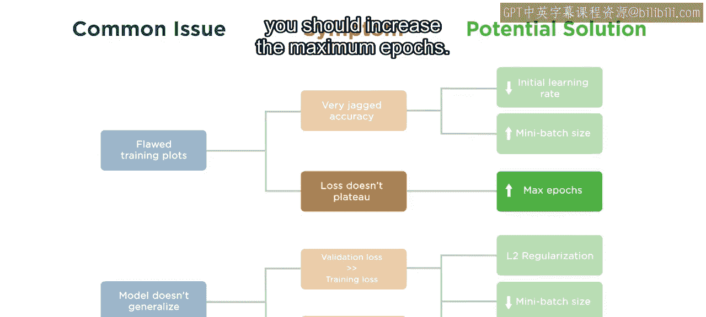

Note that while the training options have the same overall effects。

 both the network and the loss being optimized are more complex with object detection and classification。

Therefore， you will often encounter higher resource requirements and slower training progress。

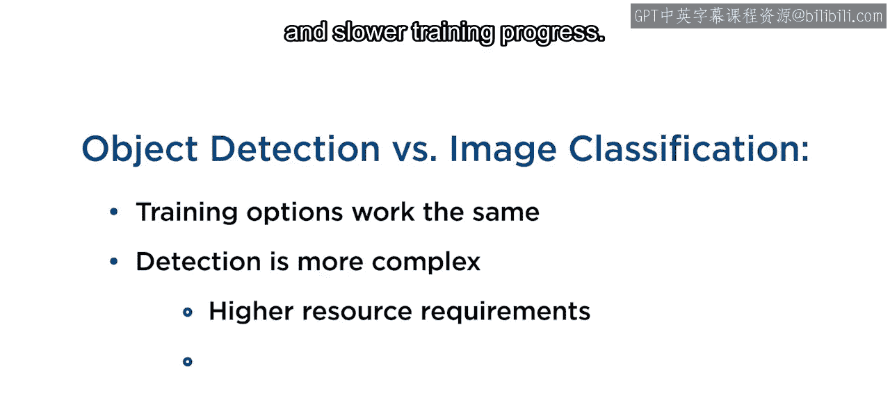

To reduce hardware requirements and training time， you may be tempted to utilize a learning rate that is too high。

A mini batch size that is too low。Or a limited number of epochs。In general。

 be careful not to adjust these parameters too far to save on resources。

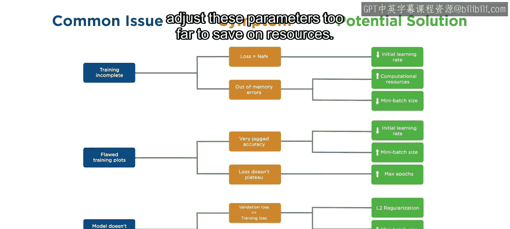

Detection model training will often take a lot longer and require more memory than classification。

 Again， this is expected。

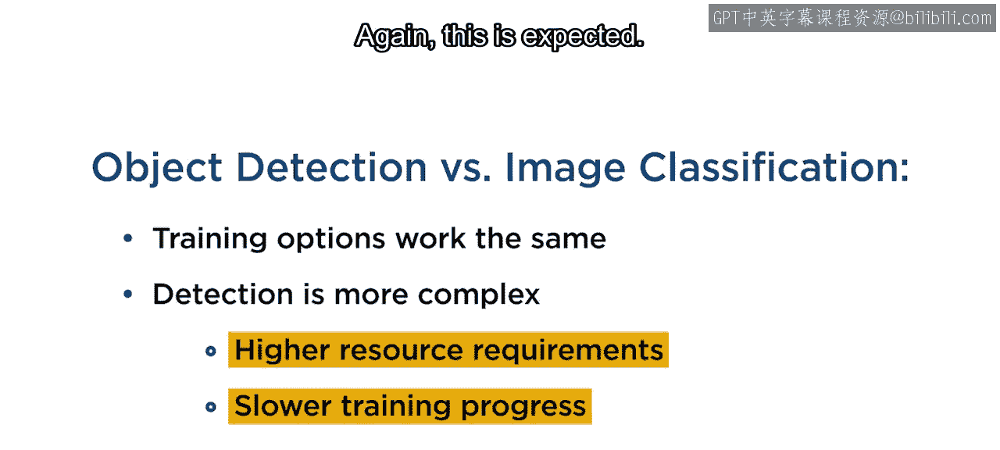

Now let's look at the network structure and parameters。

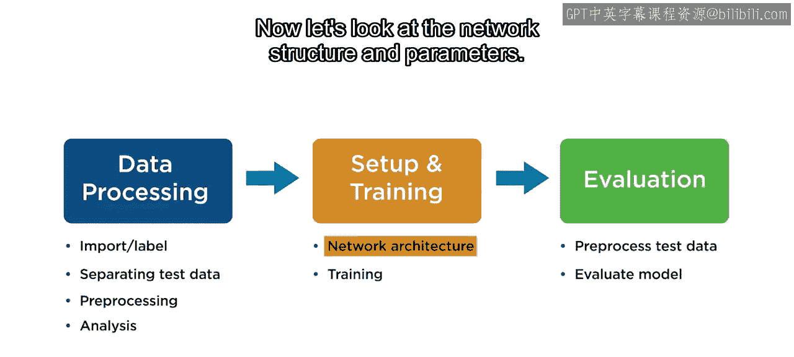

If you're using a detector that employs anchor boxes。

Using a larger number of them can be a good way to improve performance。Remember。

 the number and shapes of the anchor boxes are based on a number of clusters in the ground truth data。

Would you chose based on the mean IOU？Even if a larger number of anchor boxes doesn't increase this mean IOU by much。

The resulting model may still benefit。Remember to be careful， though。

This will increase resource requirements for both training and inference。

If you're using a model with one or more detection heads。Remember。

 the number and depth of head attachments to the backbone affects the ability of the model to detect objects at certain scales。

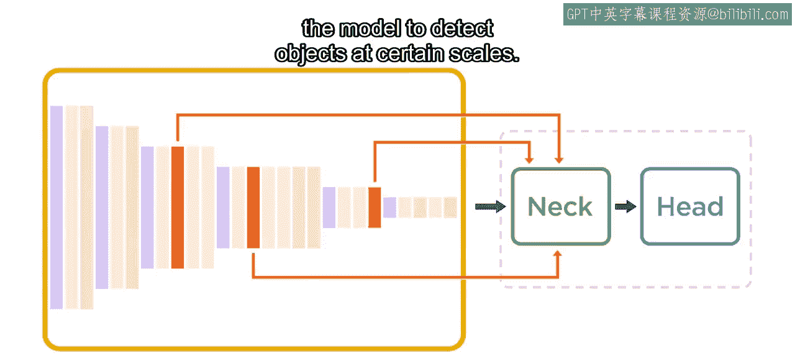

If you notice your model is having more difficulty detecting objects at certain scales。

Using a different model or a version of your model architecture。

 which has a larger number of detection heads。May help。For example。

The Dark net version of Yolo V4 has three heads。Versus the two heads of the tiny version。

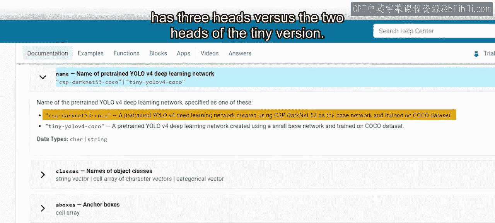

If you can switch to a model type with a larger scale range。

Your best bet may be to assign an existing head to a point earlier。Or later， in the backbone。

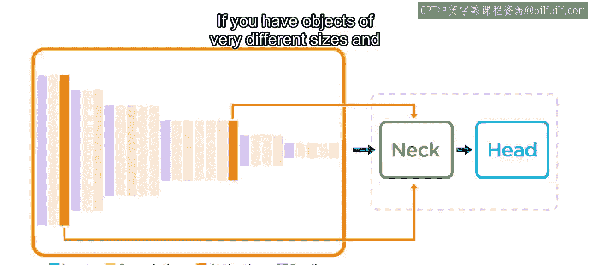

Now， if you have objects of very different sizes and there is no overlap between their size distributions。

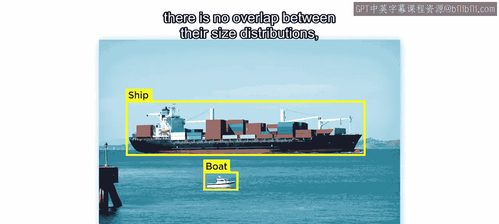

You may be better off training two or more instances of the model。

Each focused on a cluster of your data。

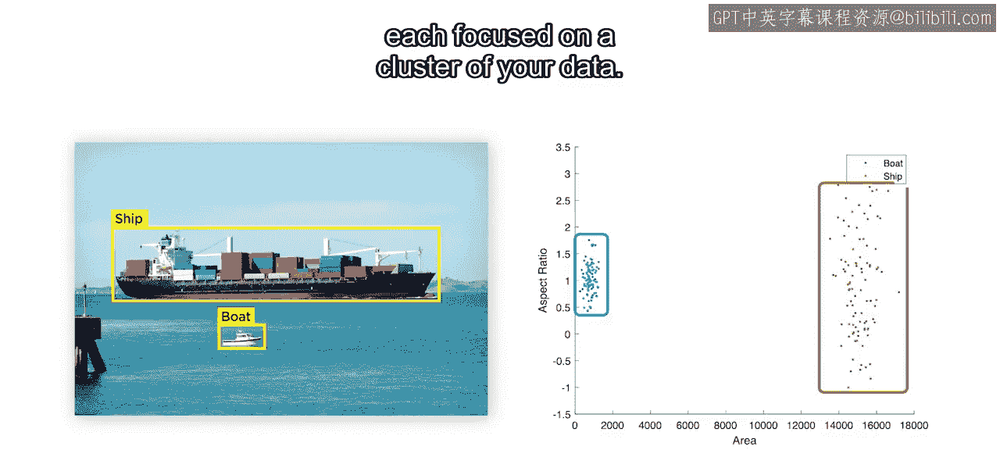

And don't forget。If you have insufficient data overall。Or for a given subset of classes。

 no matter how many options you change， your model will not be able to do well。Often。

 the best way to address this is to collect more data。

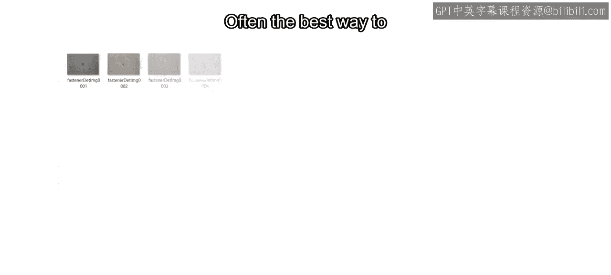

If that is costly or impossible。You'll see how to artificially augment your data in the next course。

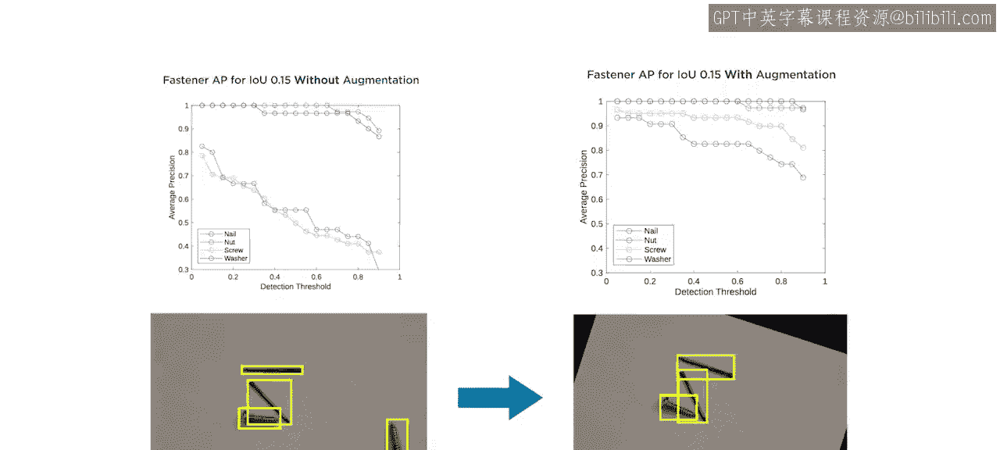

Training object detection models is an iterative process。

You may need to alter the network architecture。Try different training options。

Or gather more data to get the best results。

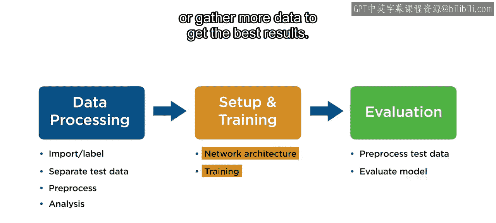

。