# Mathworks《深度学习在计算机视觉中的应用（简介、目标检测、高级深度学习）｜Deep Learning for Computer Vision》 p24 10_最终项目介绍.zh_en -BV1Rb421v71M_p24-

🎼。

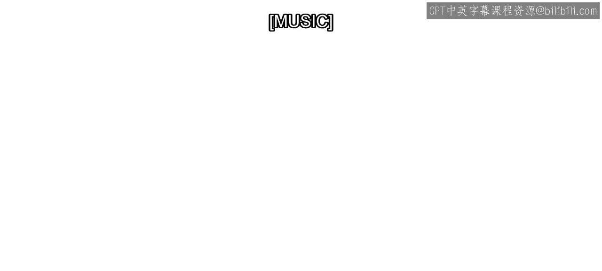

Great work on making it to the end of this course。You've analyzed ground truth data。

 train detection models and evaluated results。

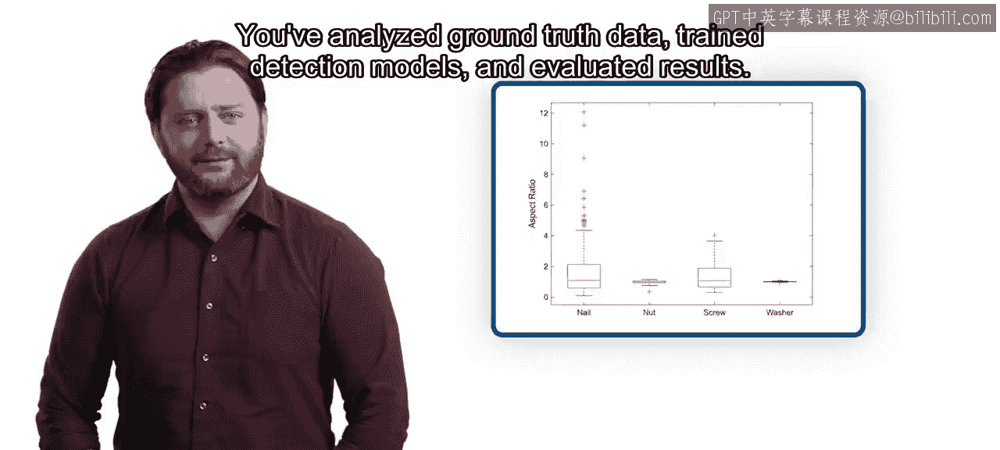

Now it's time to put all these topics together in a final project。

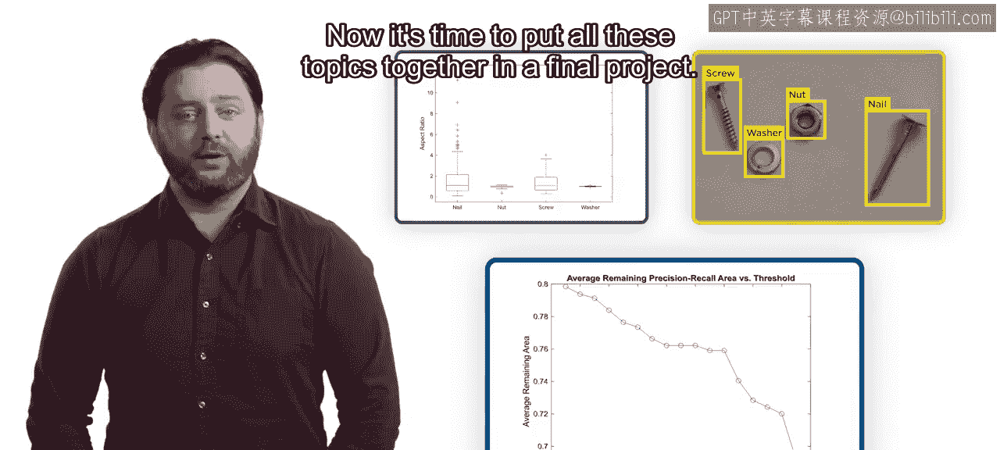

Imagine you work for a company that is building an automated parking system。

They have given you a small sample of images collected from a car。

Some of the images are blurry from the car's motion。And some signs are very worn out。

The company wants to know how a model performs on these images before investing time and money。

 collecting a large data set。

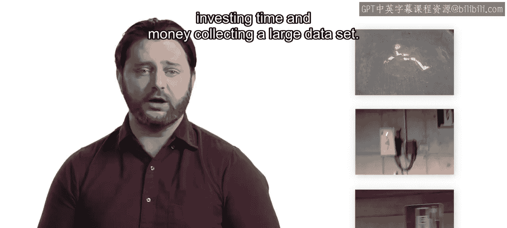

Your task is to train a prototype model and evaluate the results。

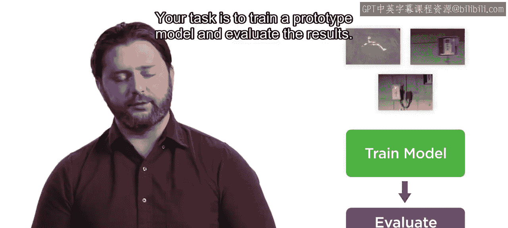

The sample data contains three classes， E V for electric vehicle parking signs。

Charger for EV Chargerrs and accessible for disability parking signs。

By training a model and evaluating the results， you'll help the company make informed decisions when creating a data set。

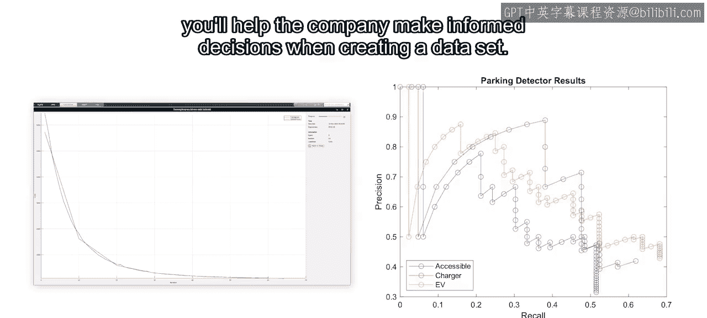

To help you stay on track， weve divided the project into three parts。In part 1。

 you will label images and analyze the ground truth。

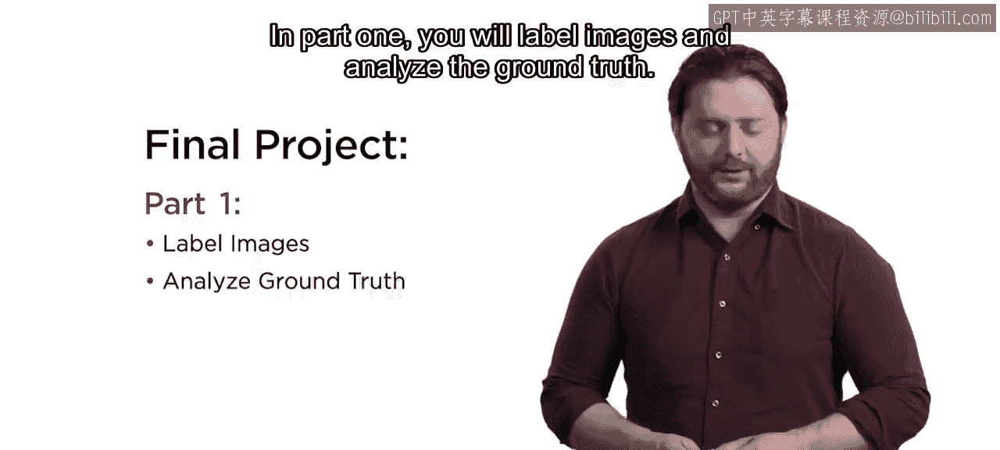

Don't worry， most of the images are already labeled。 so you'll just need to do a few。

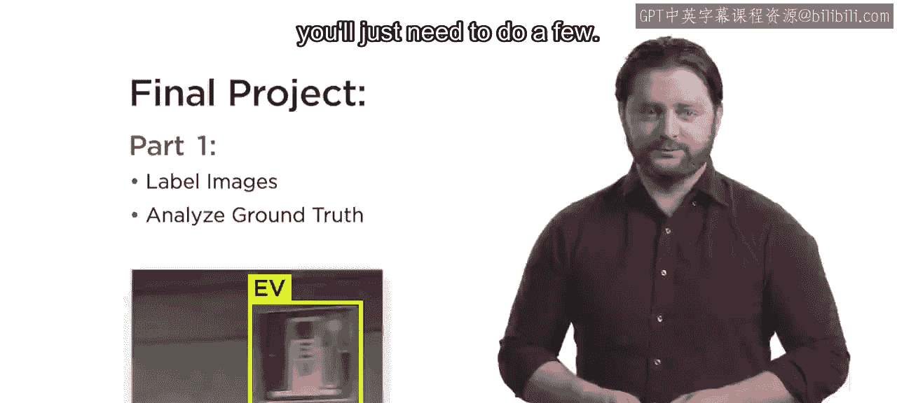

There's a quiz at the end of part 1。 So you'll know if your labels and analysis are correct before moving to part 2。

 training a model。

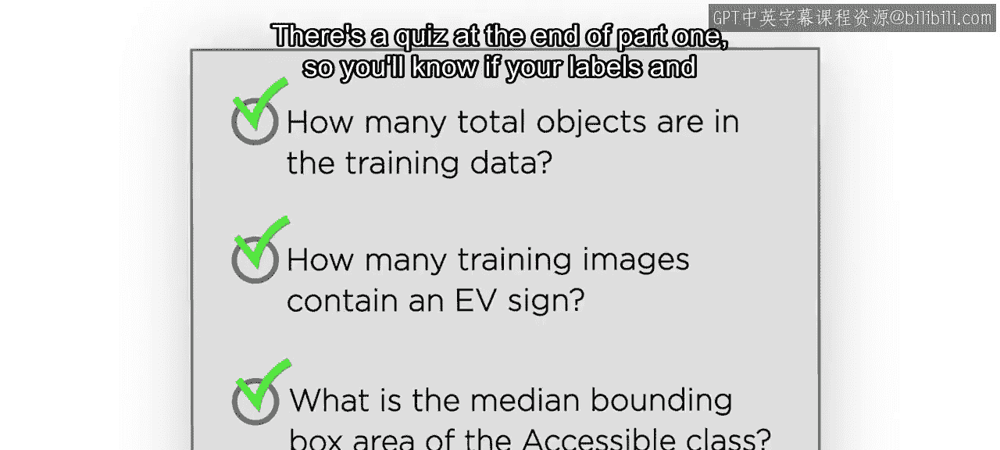

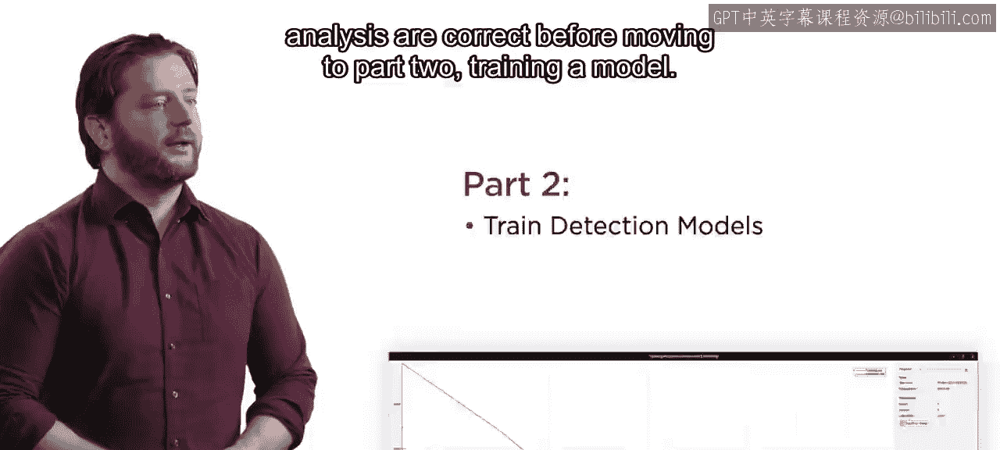

Using my CPU， this took about 30 minutes。We encourage you to try training your own models so that you can apply the full workflow。

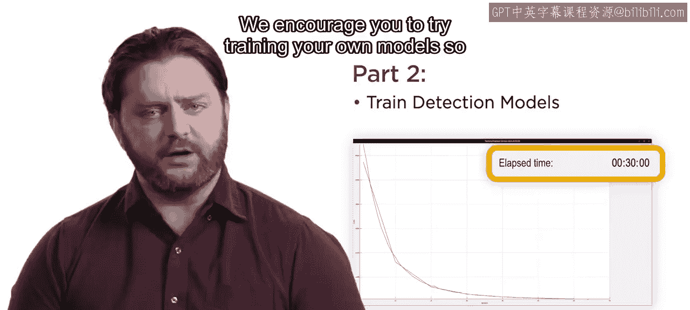

However， if you encounter out of memory errors while training。

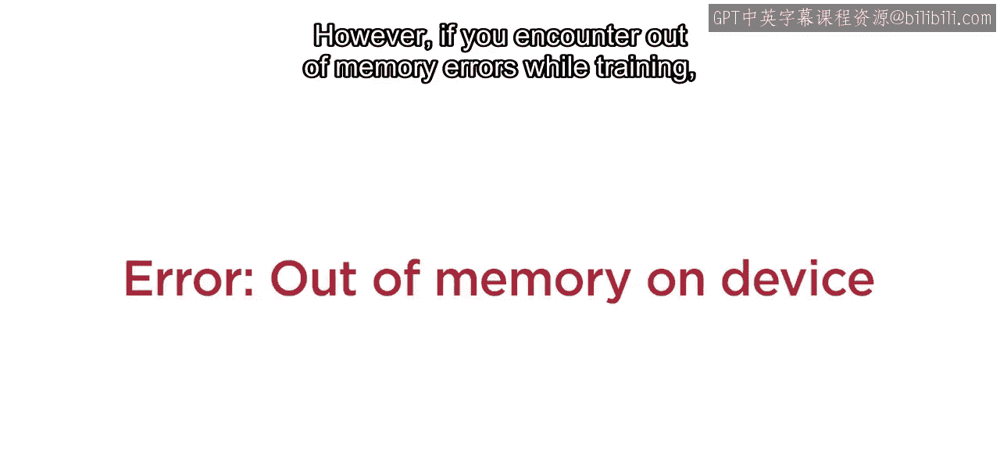

We've also provided a trained model。You'll unlock the model after completing the quiz for part two。

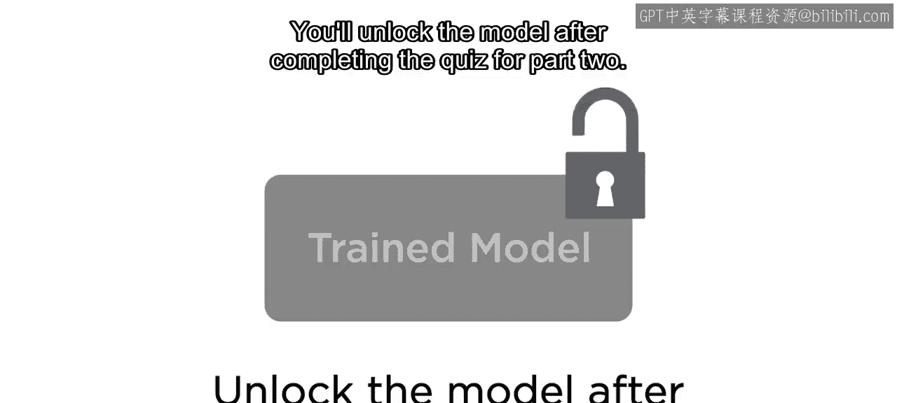

Part 3 is evaluating your model。You'll calculate the average position for each class。

And determine a confidence threshold to use for detection。

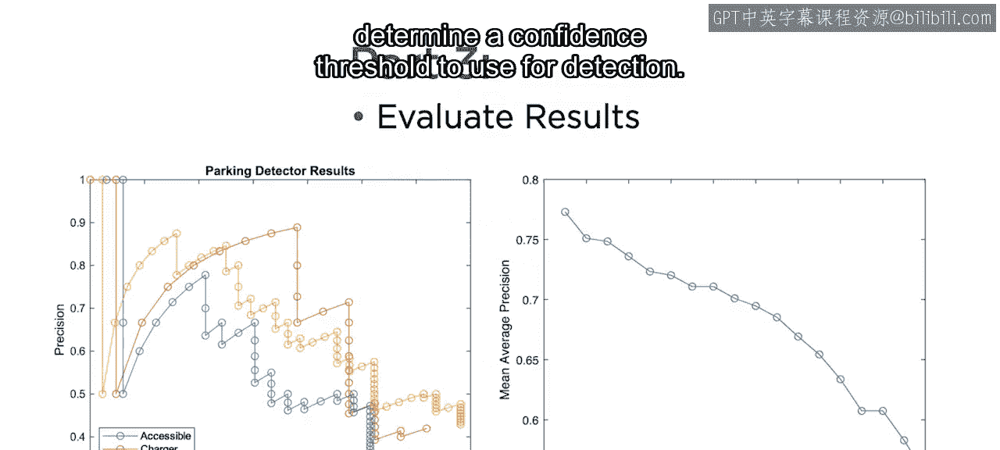

Hopefully， you'll do a little better than these results。

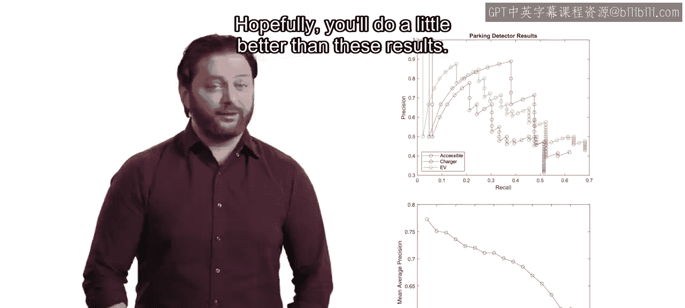

When you're done， you'll have code and results to showcase your skills training object detection models。

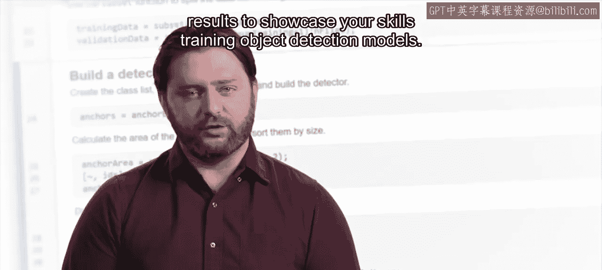

Good luck。🎼。