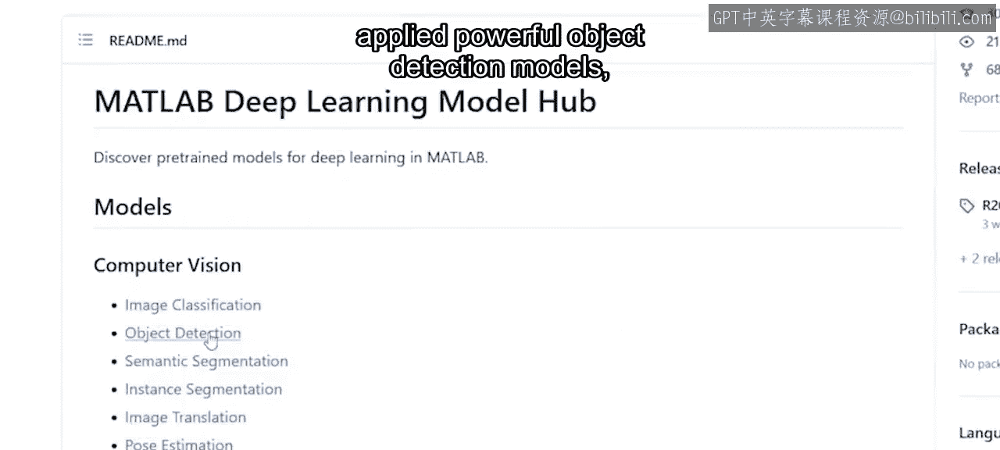
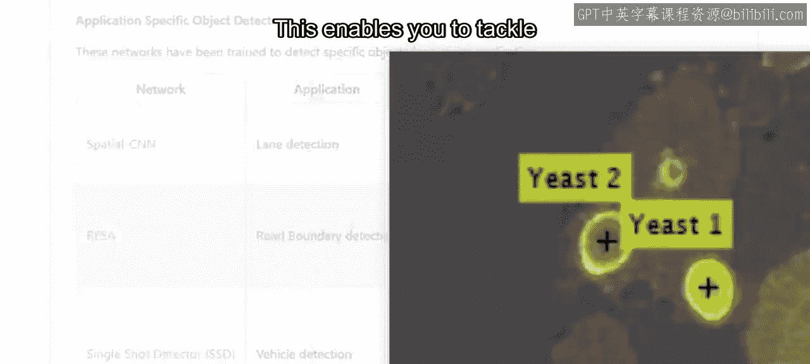
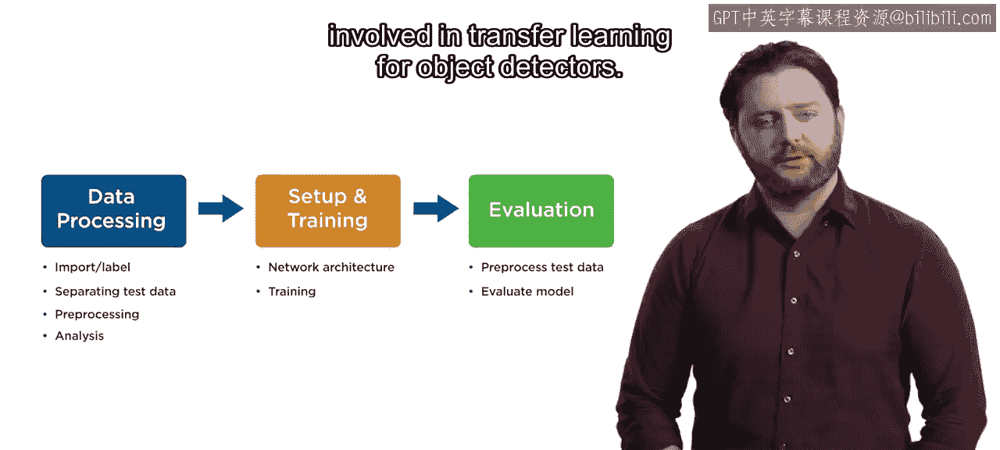
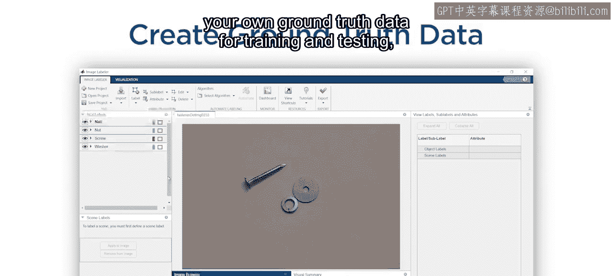
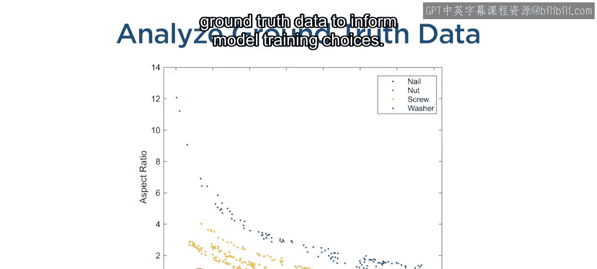
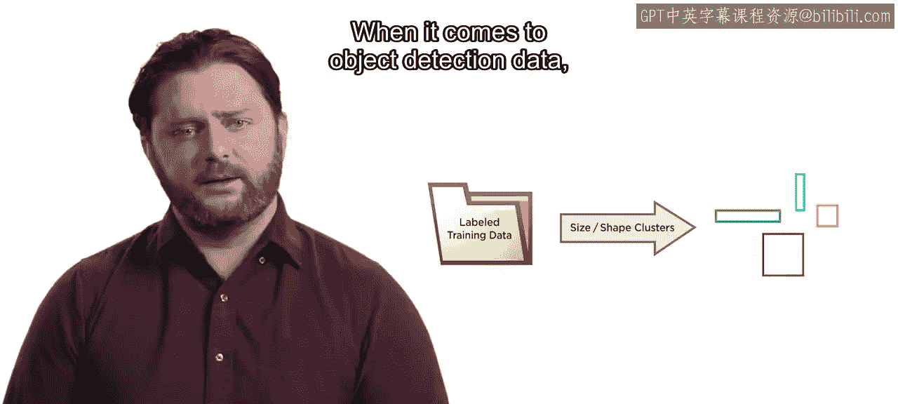
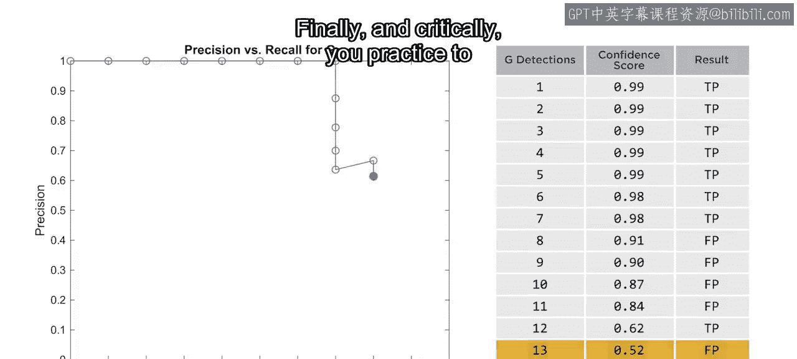
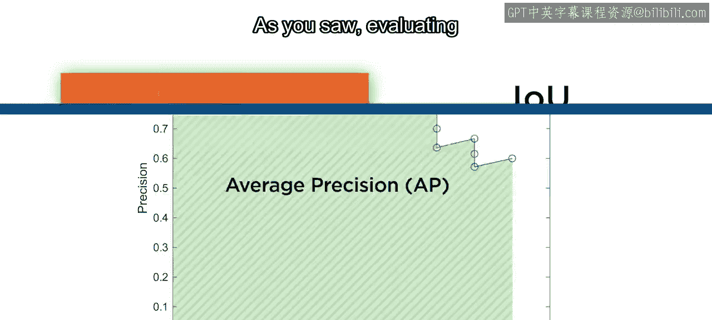
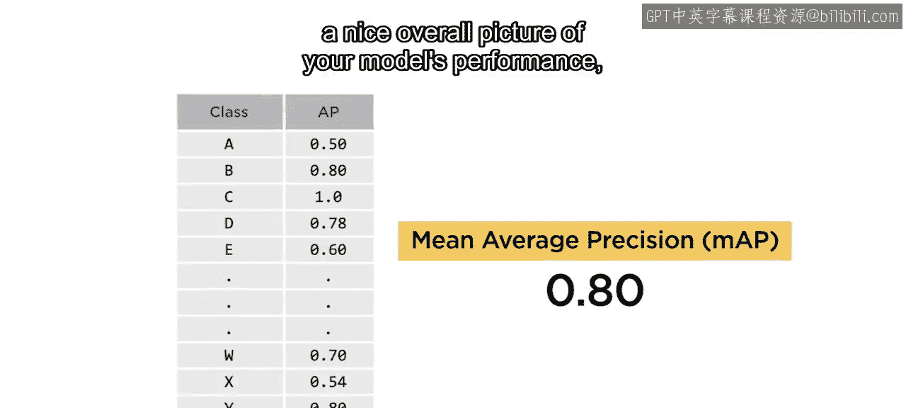
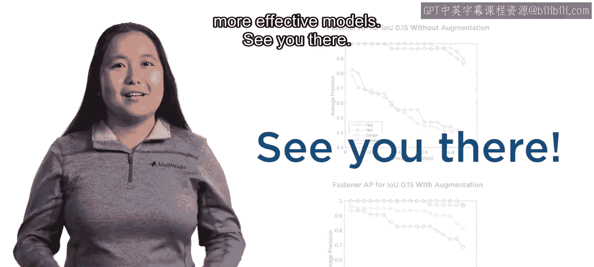

# Mathworks《深度学习在计算机视觉中的应用（简介、目标检测、高级深度学习）｜Deep Learning for Computer Vision》 p25 11_深度学习用于目标检测的总结.zh_en -BV1Rb421v71M_p25-

🎼，Congratulations on completing deep learning for object detectionte。Well。

 object detection is not an easy topic。It is one of the most important and widely applicable techniques in computer vision。

In this course， you've applied powerful object detection models。

 built and pre traineded by experts on extensive data sets。

This enables you to tackle an ever growing range of optic detection scenarios quickly。Of course。

 you often need to do something more customized。So you also practice the entire workflow involved in transfer learning for object detectors。

This included adding labeled bounding boxes to images to create your own ground truth data for training and testing。

As well as analyzing the distributions of classes， areas and aspect ratios in ground truth data to inform model training choices。

When it comes to object detection data。

Performing analysis of these quantities up front can save you a lot of frustration and wasted effort down the road。

Finally， and critically。You practiced evaluating your results to know if they will work for your application。

As you saw， evaluating detectors involves many different metrics。

Remember to consider what specific metrics might be most critical for your needs。Well。

 M P gives you a nice overall picture of your model's performance。

Specific classes may be important to take a deeper look at。Sometimes after all this。

 you may conclude that you simply need a lot more data。

Obtaining ever larger amounts of ground truth data can be difficult。Amanda。

 is there anything we can do to help。 Great question， Matt。In the next course。

 you will use a technique called model Ased or AI assisted labeling to automatically create ground truth data using thousands of images。

And when collecting additional data is costly， you will see how to artificially augment your data。

 which will allow you to train more effective models。See you there。

