# Mathworks《深度学习在计算机视觉中的应用（简介、目标检测、高级深度学习）｜Deep Learning for Computer Vision》 p27 1_计算机视觉中的高级深度学习技术.zh_en -BV1Rb421v71M_p27-

🎼。

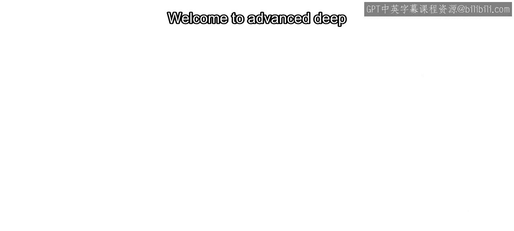

Welcome to Advanced deep learning Techs for Comp Vis。In this course。

 you'll tackle common challenges that go beyond model development for classification and object detection workflows。

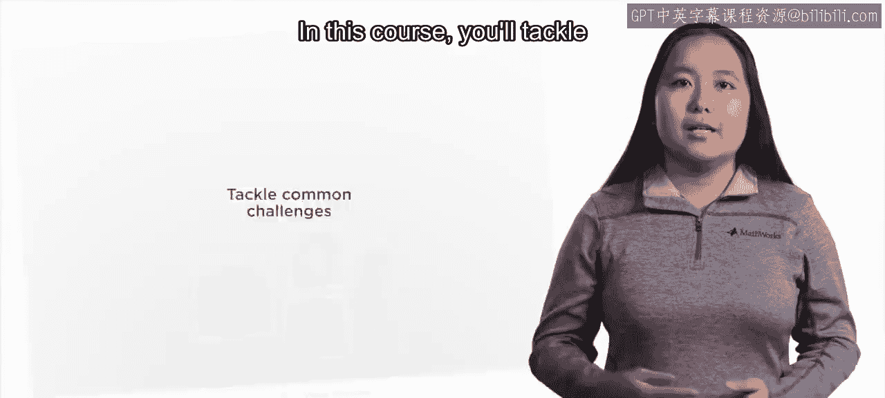

More specifically， you will learn how to build an anomaly detector。

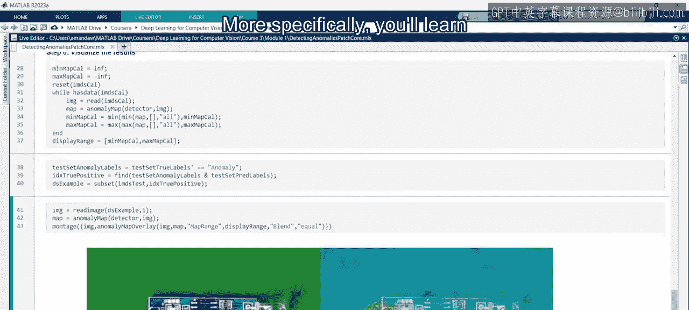

Create synthetic data with data augmentation and use AI to label automatically。

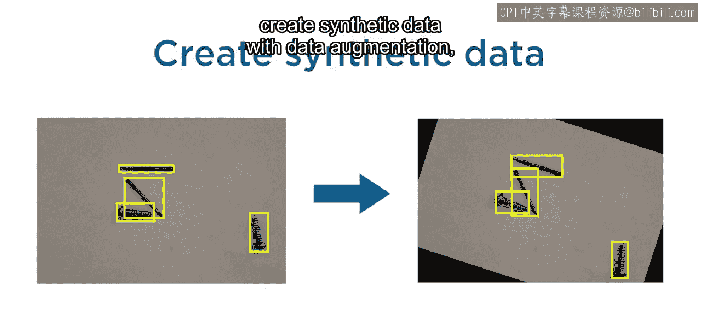

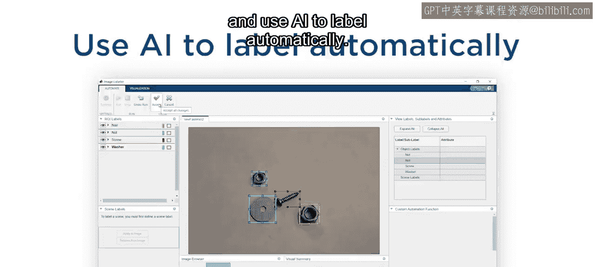

After training and refining your classifiers or object detectors。

 you might conclude that you need additional variation in the data to build a more robust model。

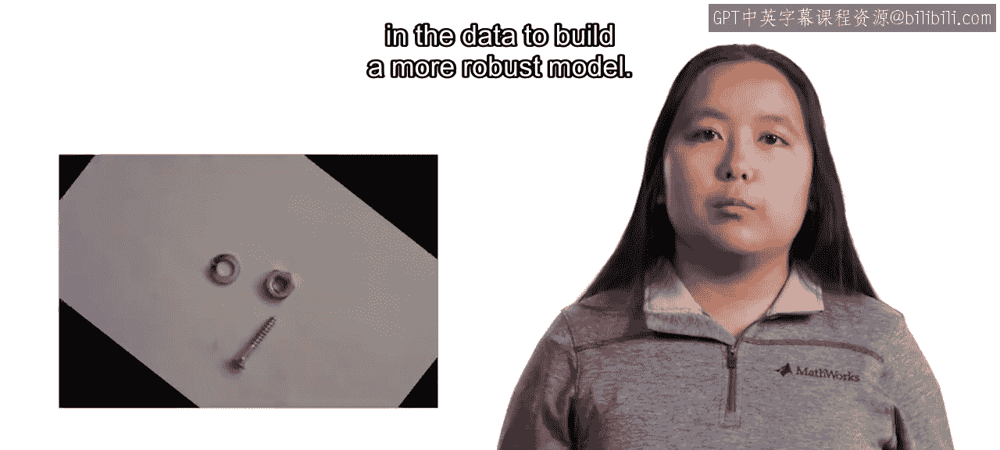

To address this issue， you will use a technique called data augmentation to create synthetic images that supplement the data you already have。

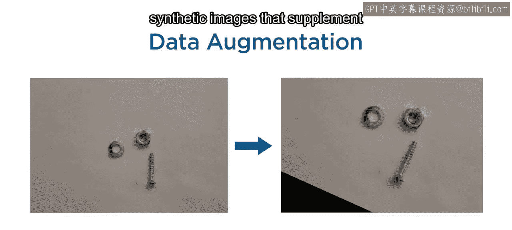

Augmentation generates new images based on the transformations you designate。

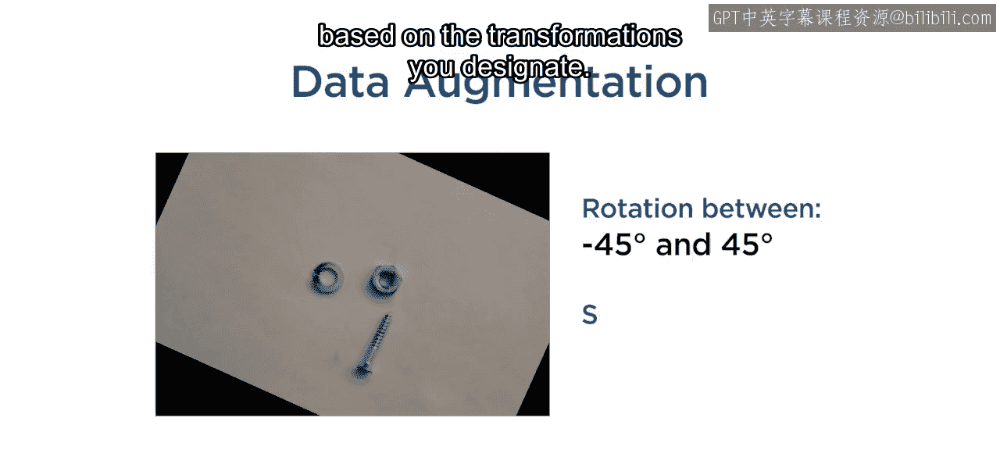

This approach can frequently help add robustness to a model。

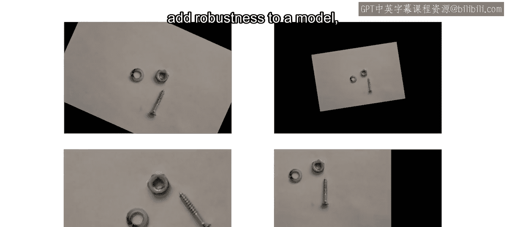

But sometimes you just need to collect more data to improve your results。

If you're building a detector。This means labeling a lot more images， which is often tedious。

Model assisted labeling， also known as AI assisted labeling， can help save a lot of time and effort。

This technique uses an existing detector to automatically label new images and videos you collect。

The labels usually aren't perfect， so you'll need to adjust them。

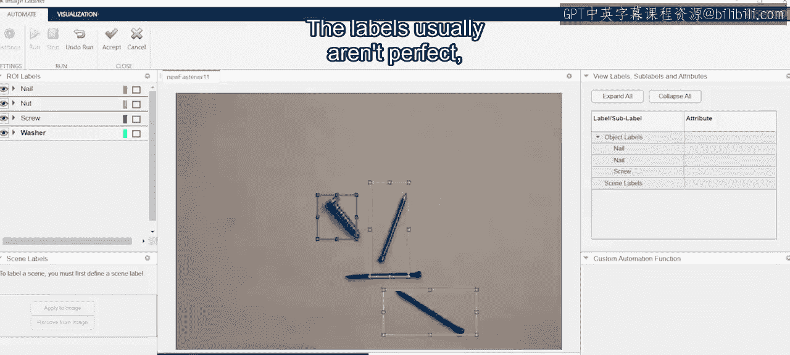

But adjusting labels is much faster than creating them from scratch。Finally。

 what if you have an application where you need to detect abnormalities？

You don't know specifically what you're looking for。

 So this is neither a classification nor an object detection problem。 A new type of model is needed。

You'll learn to build anomaly detection models that identify any defects in these printed circuit boards and any medical abnormalities and endoscopy images。

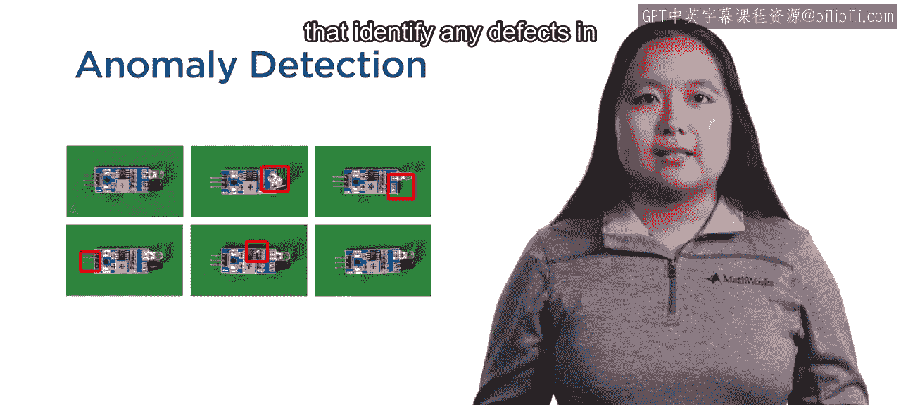

Let's get started。