# Mathworks《深度学习在计算机视觉中的应用（简介、目标检测、高级深度学习）｜Deep Learning for Computer Vision》 p29 3_在MATLAB中检测异常.zh_en -BV1Rb421v71M_p29-

🎼，Anomaly detection is an important task in a wide variety of industries。

 from manufacturing to healthcare。In this video， youll use MATLab to detect anomalies in printed circuit boards。

There are six main steps for developing an anomaly detector in Matlaab。

Choosing a detection algorithm。Importing and splitting the data。Training the algorithm。

Setting the anomaly threshold。Evaluating the model。And visualizing the results。First。

 you need to choose the anomaly detection algorithm。

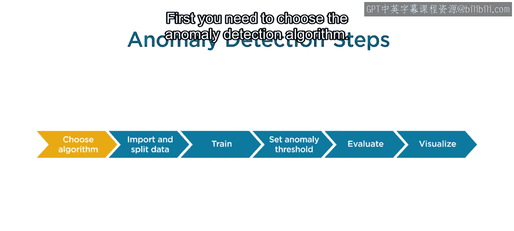

Common algorithms available in Matlab include patchcore， Fast flowlow。

 and fully convolutional data of description， or FDD for short。

Each one has its own benefits and drawbacks。 For example， compared to F DD。

 the fast flow and patch cord detectors produce more powerful and accurate models。

 but they are both more memory intensive to train and use。

We'll use patch Core here because it's one of the most common。

But the MatLb workflow is similar for all three。

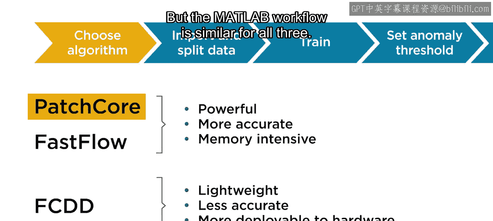

In Maab。Open the script for PCB anomaly detection using patchcorps， located in the course files。

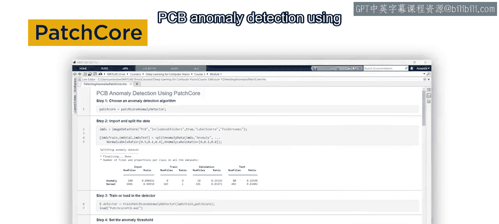

First， initialize the patch cord detector。And import the circuit board image data into an image data store。

The data we use for this example is located in one folder with two subfolders， normal and anomaly。

When importing， include both subfolders。And use the folder names as the image labels。

Then split the data into training， calibration， and test sets。Passing in the data store。

The labels to designate as anomalies。And the proportion of normal and anomaly images to include in each data store。

Now that you have the model and data set， you're ready to train。

Use the training data and untrained detector as inputs。And save the resulting model。

Remember that training often takes a long time。So you typically only perform a step on your own if you have a GPU available。

For example， this model took us 20 minutes to train on a GPU。

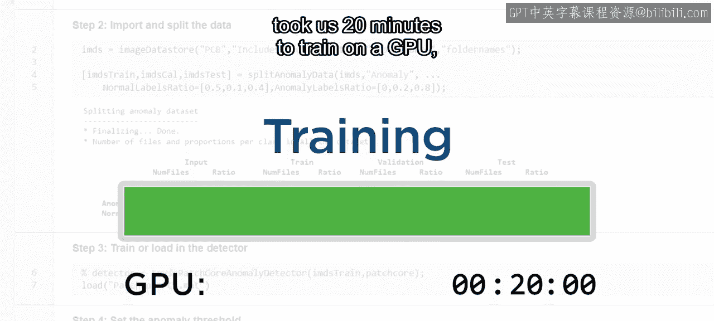

But could take many hours on a CPU。Don't worry if you don't have one， we've provided a trained model。

 so load that instead。The next step is to set the anomaly threshold。

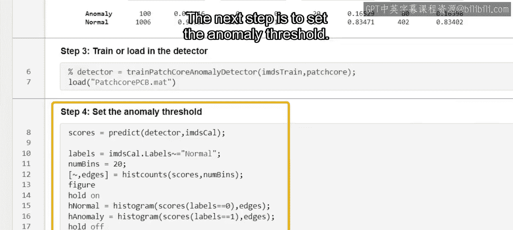

Recall that a train model produces anomaly scores on a pixel level and image level。

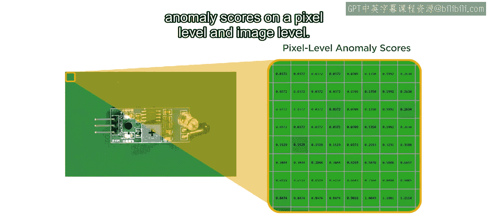

And images with scores above the anomaly threshold are considered anomalies。

Let's predict the image level anomaly scores for the images in the calibration set。

To get a sense for what the anomaly threshold should be。

 visualize the spreads of anomaly scores for normal and anomaly images in a histogram。

It's often not obvious from the figure what the best threshold value is。Fortunately。

 MatLA has a function that uses statistical methods to calculate the threshold。

This function needs a calibration set labels。Predicted image level anomaly scores。

An anomaly labels to produce a threshold value。Set this as a detector's anomaly threshold。

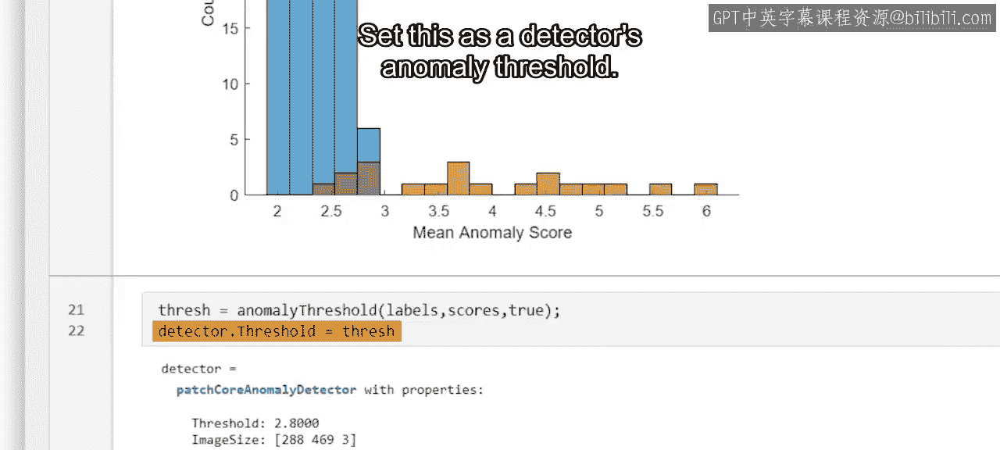

The anomaly detection model is now complete。

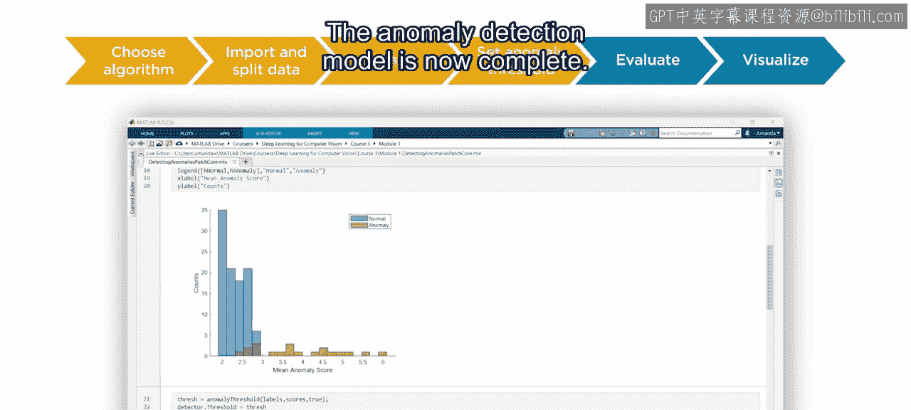

Evaluate the model by classifying each of the images in a test set。

And comparing them to the true labels using a built in evaluation function。

This gives you a few different metrics to use to evaluate your data。

 most notably the overall or global accuracy。You can also analyze the evaluation results in a confusion matrix。

 which shows the prediction acuracies for both classes。

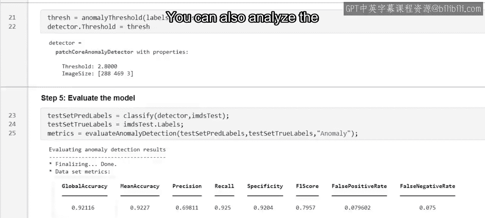

These results seem pretty good。Depending on your application。

 you could change the results by adjusting the threshold value set earlier。

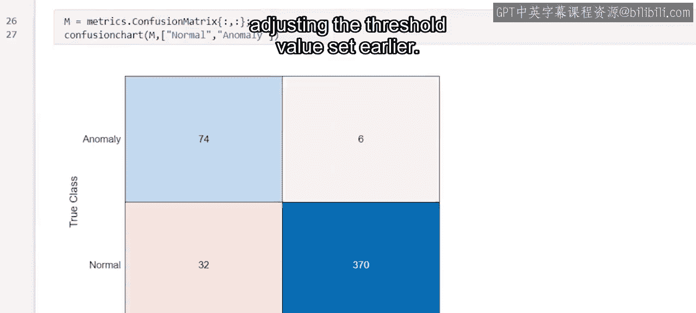

Finally， it's a good idea to visualize the anomaly maps to better understand the model and help you identify any anomaly locations。

 since they might not always be easy to see。To do this。

 you need to determine which scores should be represented by which colors。

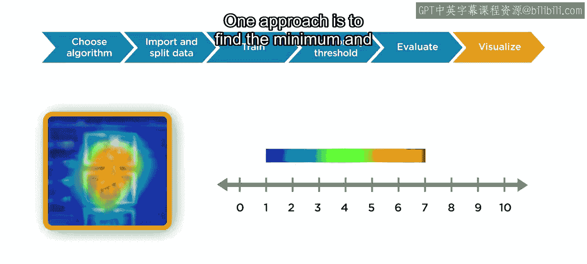

One approach is to find the minimum and maximum anomaly pixel scores in all of the calibration images and set the minimum pixel score to be one end of the color spectrum and the maximum score to be the other end。

Save these values as the display range。Then determine the kinds of images you want to check anomaly maps for。

Let's focus on a test images correctly identified as anomalies to see if the model really identifies the anomalies in expected locations。

Read in the first test image。Get the anomaly scores for every pixel。

And then show the pixel values overlaid on the original image using the display range you saved earlier。

This may seem like a lot of code。But remember that you have it in the course files so you can explore it more closely。

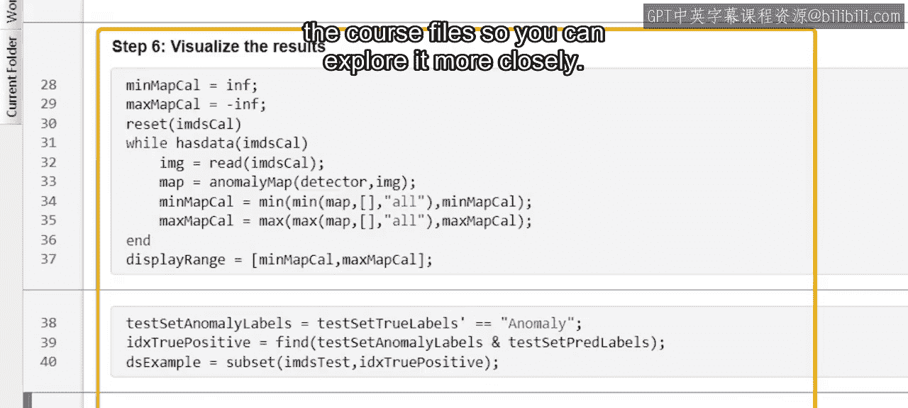

Looks like the model did a great job here。A few of the pieces on the left are bent。

 and a model identified the pixels in that area of the image as having the highest anomaly scores。

Visualize the predictions for more images to see how the model performed。

It's often very difficult to see how various deep learning models make decisions。

So visualization tools like this are a great way to gain a deeper understanding of your model and get a glimpse into its decision making process。

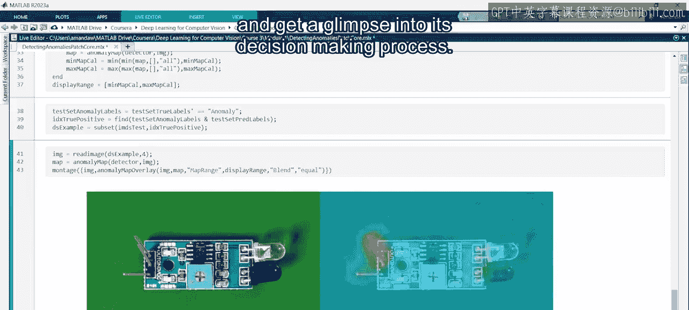

🎼。