# Mathworks《深度学习在计算机视觉中的应用（简介、目标检测、高级深度学习）｜Deep Learning for Computer Vision》 p31 5_目标检测的数据增广.zh_en -BV1Rb421v71M_p31-

🎼。

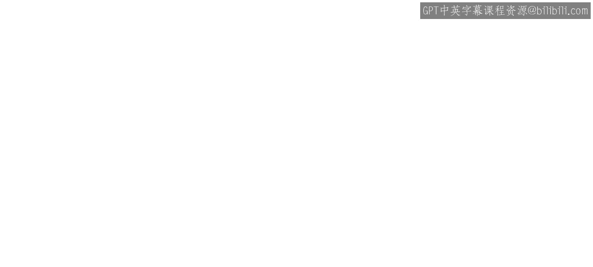

Data augmentation is a powerful technique that adds variety to your training images。However。

 data augmentation for object detection is more complex than it is for classification。

Because you need to apply the augmentation transformation to both the images。

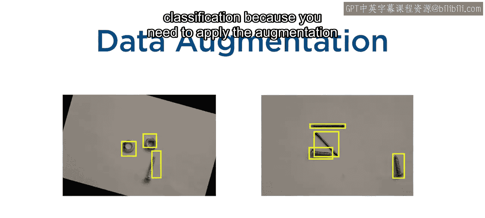

And the bounding boxes。Additionally， augmentation might remove objects partially。Or entirely。

When an object is partially visible， you need to decide whether to keep the bounty box or remove it。

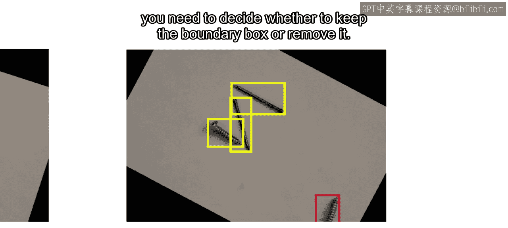

Because of this additional complexity， performing data augmentation for detection requires a custom function。

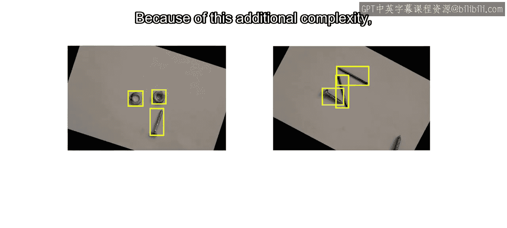

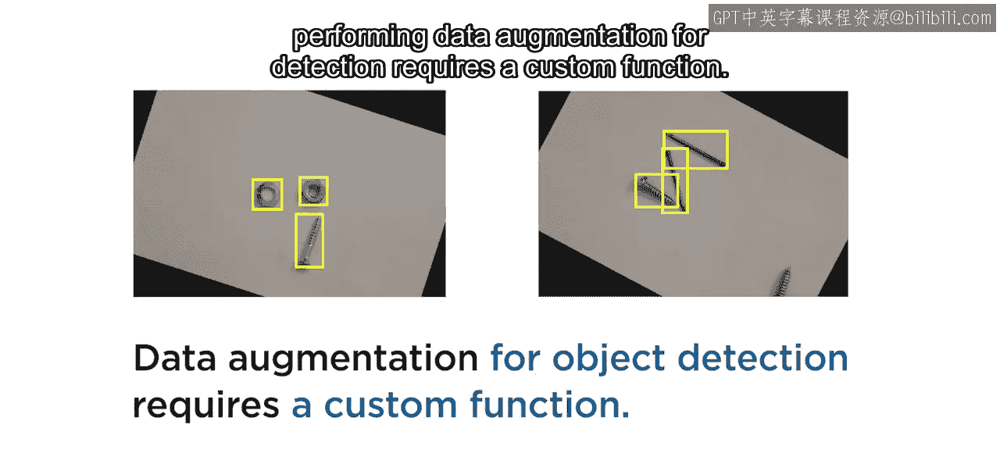

Let's go into MatTLb to see an example of this for the Fastener data set。In this function。

 the input and output are combined data source。Which contain both the image data and the bounding box data。

Once the data is extracted。The random Aine 2D function generates the desired random transformation。

This function can perform several types of augmentation。Such as translation。Rotation。Reflection。

Skill。And shear。In this example， we apply a random rotation transformation between negative 180 and 180 degrees。

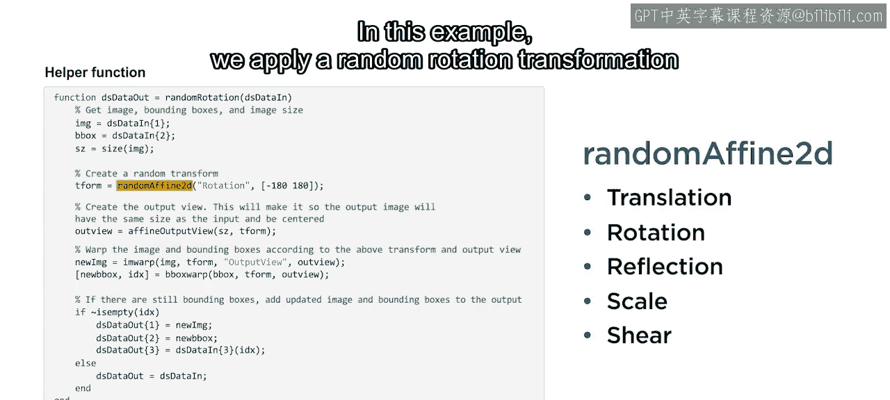

Because fasteners should be detected at any angle。The image and the bounding boxes are warped according to this transformation。

 using the IM Warp and B box warp functions respectively。

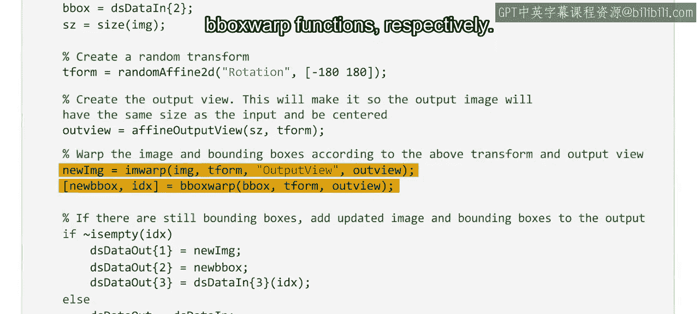

Make sure to use the output View option。To ensure that the resulting image maintains the same size and center position as the original。

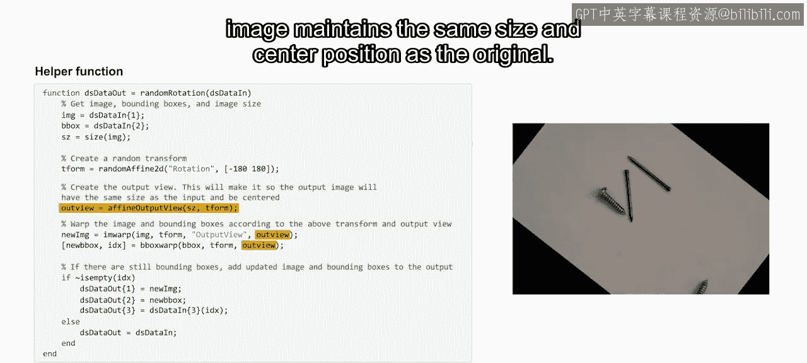

This is also where you decide if you want to keep partially visible objects。By default。

 Bbox Warp only keeps detections that are entirely visible。

But you can use the overlap threshold option to specify how much of an object needs to be visible for it to be detected。

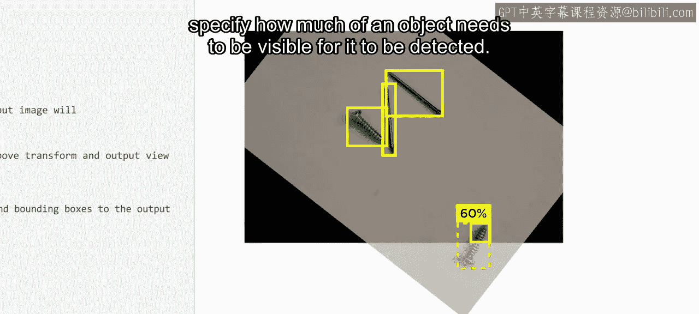

Finally， you need to check if any bounding boxes remain after the transformation。

If there are no bounding boxes left， the function returns the original untransformed image。

 where there was at least one detection。Now that you've seen the code for the augmentation function。

 let's see how it fits into an existing object detection workflow。

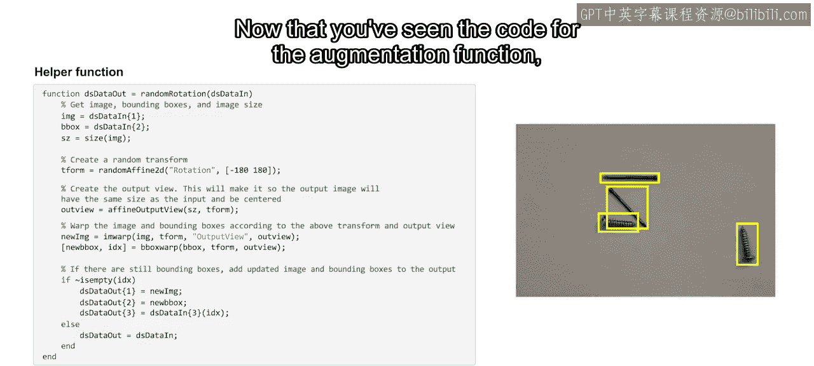

This is code that was used to train an object detection model for the Fastenner dataset set。

To add data augmentation to this workflow。First， insert the data augmenter function from before。

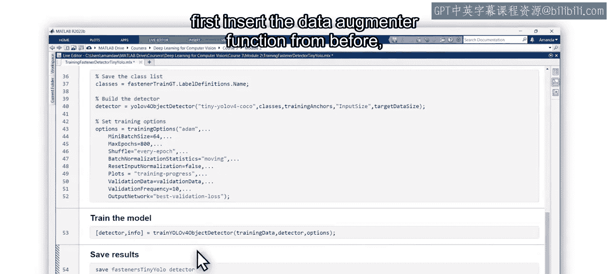

Then apply this function to the training data and save the result。And that's it。

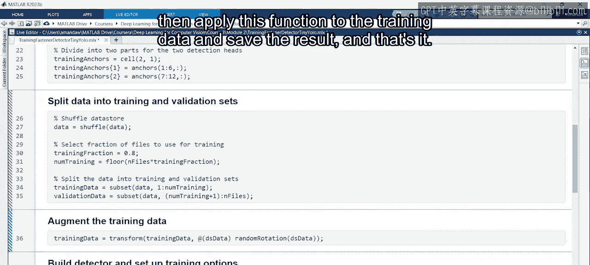

To train a new detection model that incorporates augmentation， we simply rerun the code。

Here are the results in terms of average precision at different detection thresholds。

Notice that the performance for nails and screws improved dramatically。

And the precision for nuts and washers increased as well。

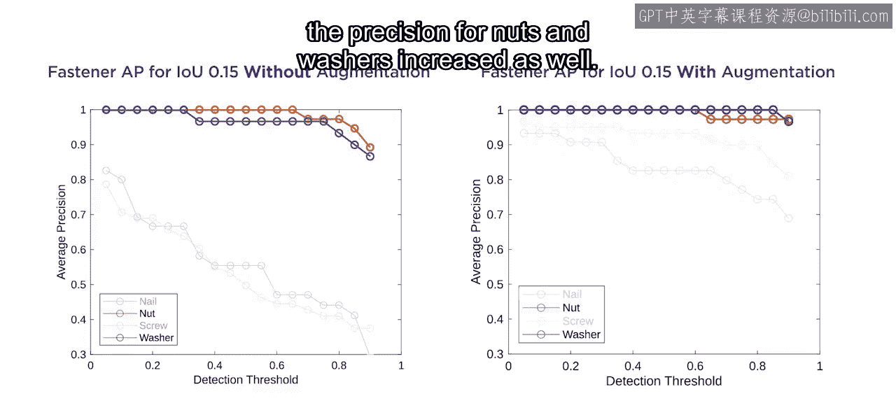

You've now seen an example of incorporating data augmentation into a detection workflowll。

Remember when you work with your own data， that augmentation can be a powerful technique to try。

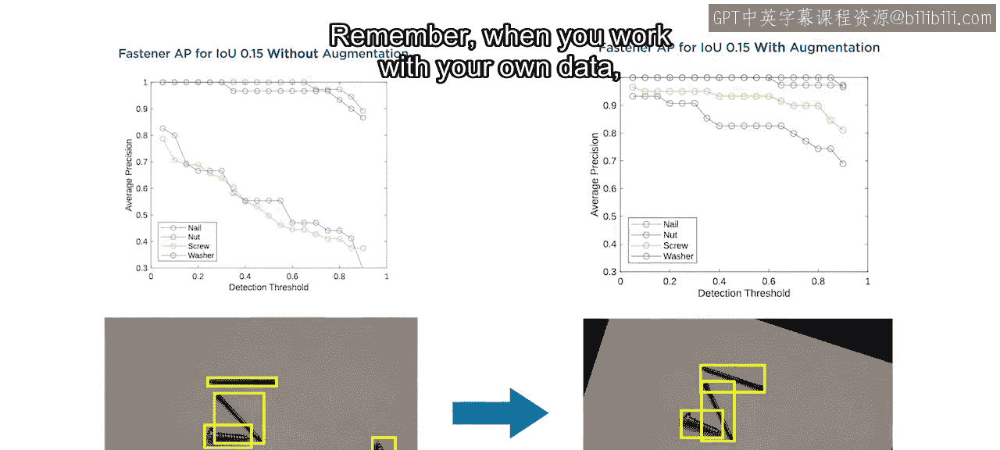

。