# Mathworks《深度学习在计算机视觉中的应用（简介、目标检测、高级深度学习）｜Deep Learning for Computer Vision》 p33 7_开始你自己的深度学习项目.zh_en -BV1Rb421v71M_p33-

🎼。

Throughout this specialization， you've applied deep learning techniques to a variety of data sets。

But it can be a little overwhelming to get started on your own deep learning project。In this video。

 we will go over some key things to keep in mind as you start working with your own image or video data。

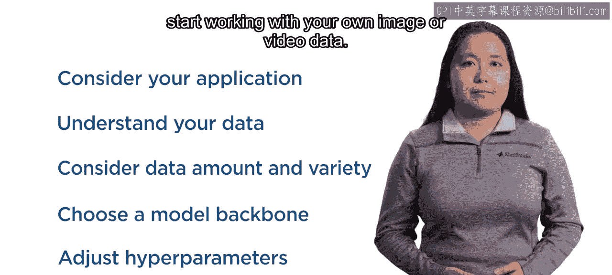

First， consider your application。Would classification。Object detection。

Or anomaly detection be the best approach。

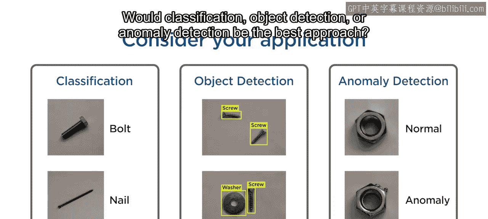

Once you know what approach to take。It is crucial that you understand your data before developing or training any models。

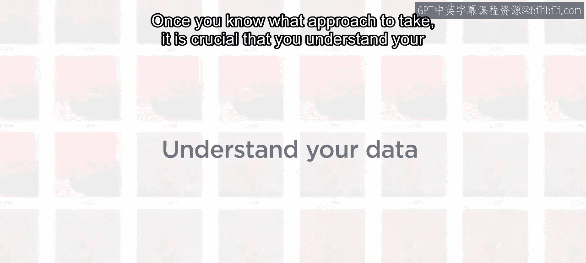

Consider the original source of your data。

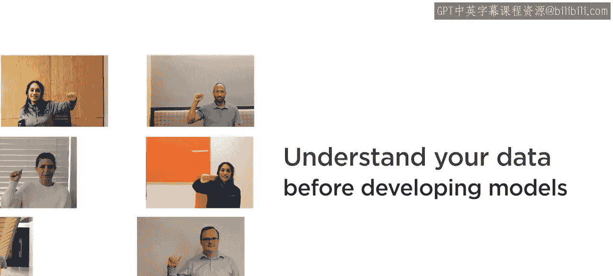

Is it trustworthy？When and where was it gathered。Are there any innate biases， patterns。

 or mistakes in the data set？To answer these questions。

 you'll likely need to do some research and visually inspect the images to ensure that they align with your expectations。

You should also consider the original purpose of the data。

Does it fit what you need for your application？If not。

It might be a good idea to collect your own data and prepare it using the image labeler and video labeler apps。

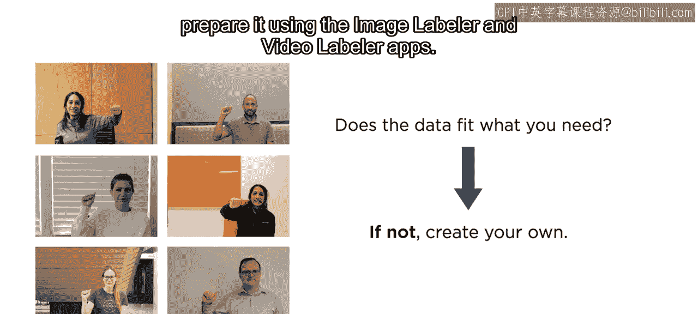

You also need to think about the variety and the amount of data that you have。

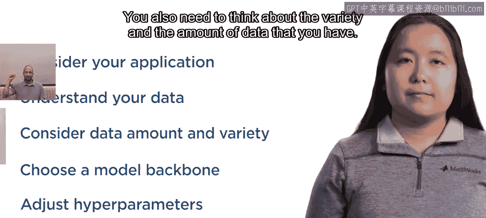

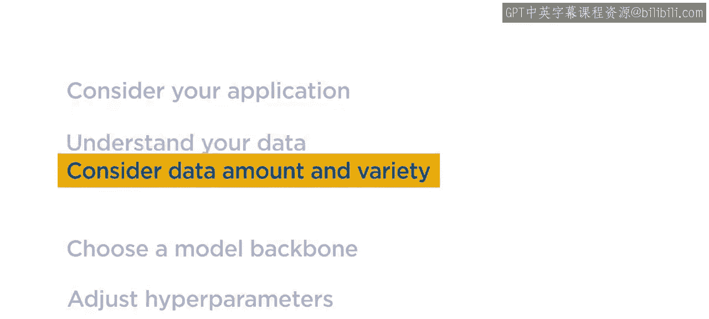

Should you use data augmentation。To create more synthetic images。

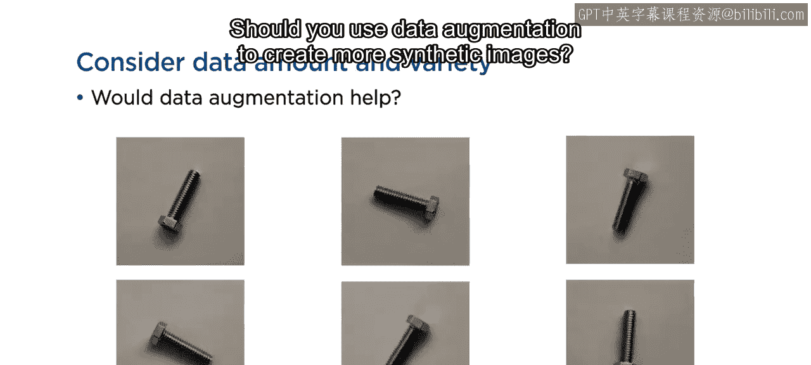

If so， youll need to decide which types of augmentation are appropriate for your application。

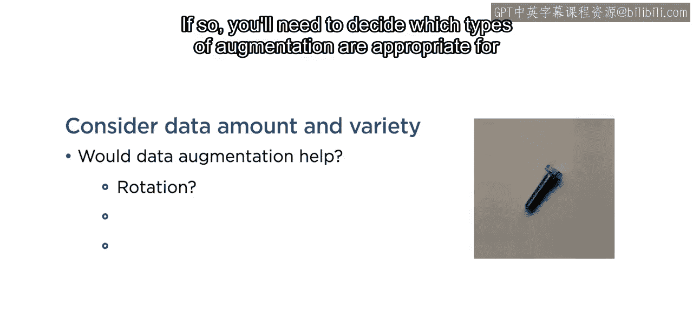

Augmentation is a powerful technique to try when you want additional variation in the datata。

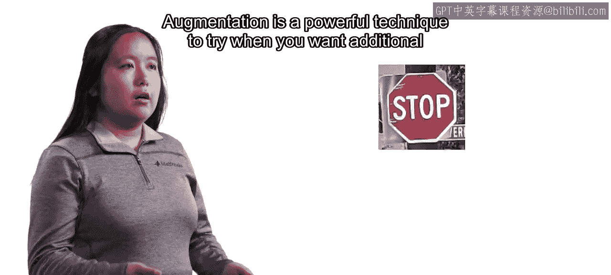

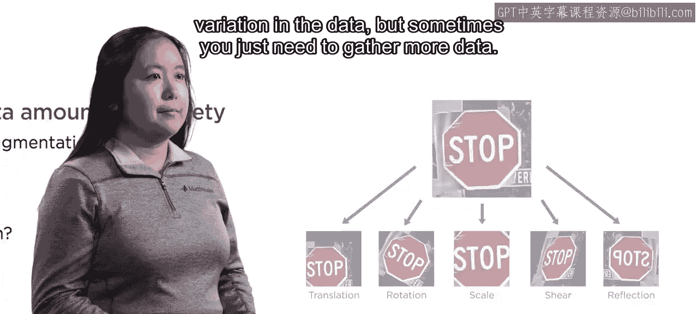

But sometimes you just need to gather more data。If you're building a detector。

 this means labeling more images。Labelling is often very tedious。

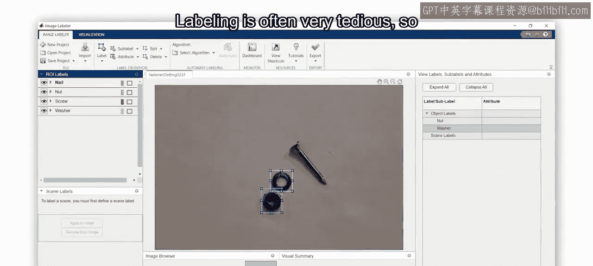

So remember that model assisted labeling can help save a lot of time。

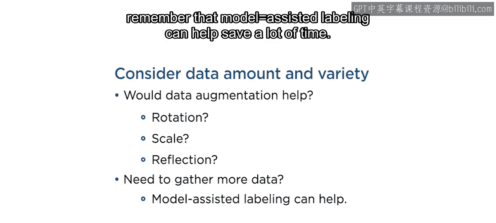

Next， you'll need to choose a model backbone or algorithm if you plan on performing transfer learning。

You should consider the desired accuracy， as well as the computational resources you have available。

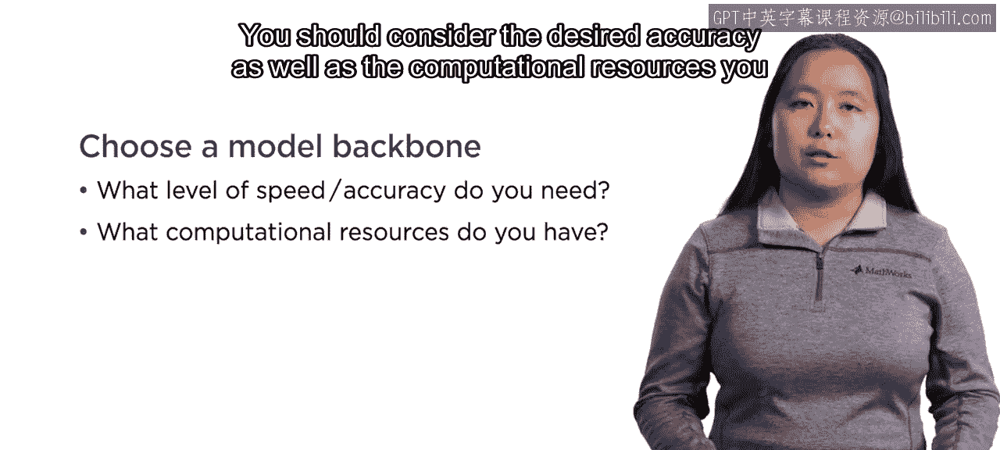

Together， these will affect the model backbones you choose to try。

If you want to develop a lightweight model on a CPU。

You'll likely use a different model backbone than if you need very high accuracy and have a powerful GPU available。

While trying out different models， you'll also benefit from adjusting hyperparameters to achieve the best results。

For call that many common model options are interdependent。

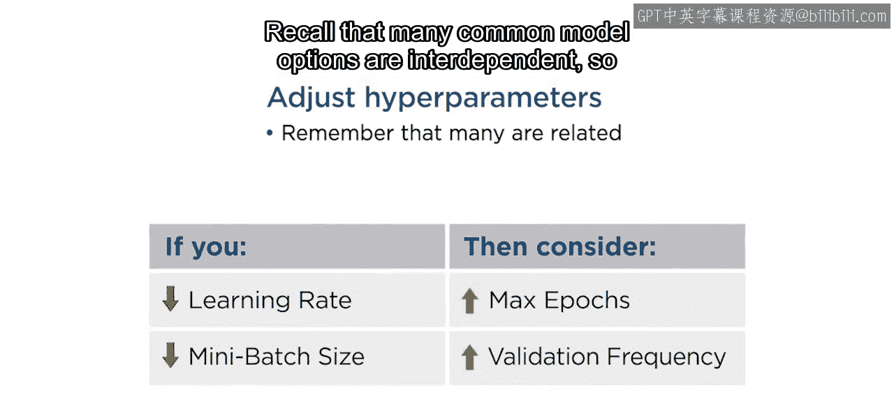

So be mindful of how you change them。

Also， remember that this entire process is iterative。

 so don't be afraid to follow some of these steps out of order。Ultimately。

 there will be some trial and error before you reach the desired result。

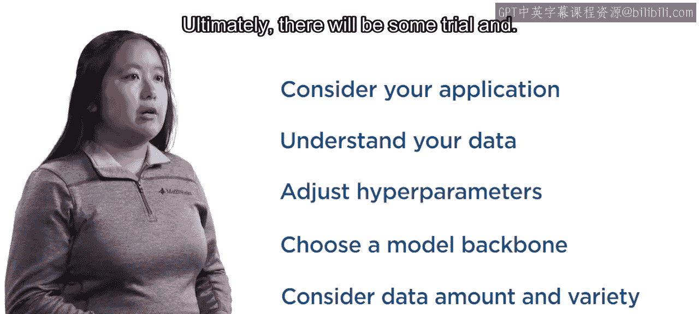

Use the coding examples from this specialization to help you get started。

We've also created a short guide for you to refer to as you embark on your own deep learning journey。

🎼Good luck。

