# Mathworks《深度学习在计算机视觉中的应用（简介、目标检测、高级深度学习）｜Deep Learning for Computer Vision》 p35 9_集成你的代码.zh_en -BV1Rb421v71M_p35-

🎼。

You may be wondering， after you've developed your algorithms， what's next。

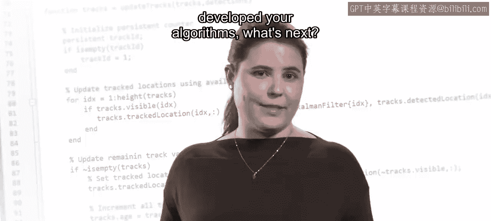

Maybe you want to run your code in the cloud or on specific devices like a smartphone。

The process of putting code into production is called deployment or integration。

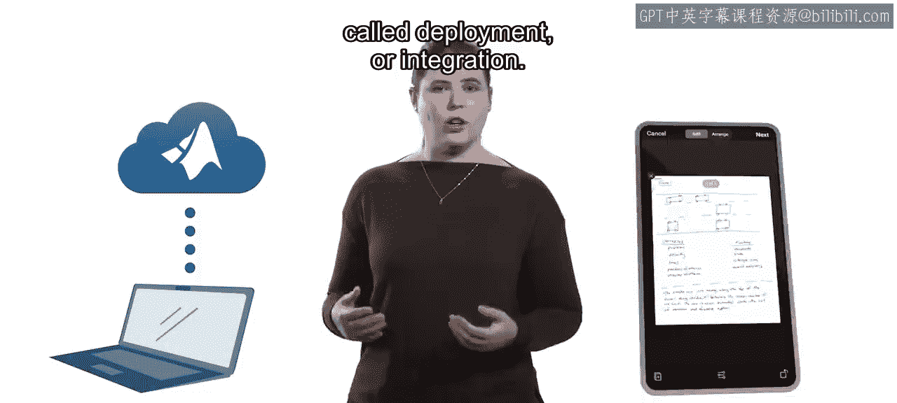

In this video， you'll learn three options for deploying your code。For each workflow。

 you'll see how MatTLb includes tools to help you use your model in the real world。

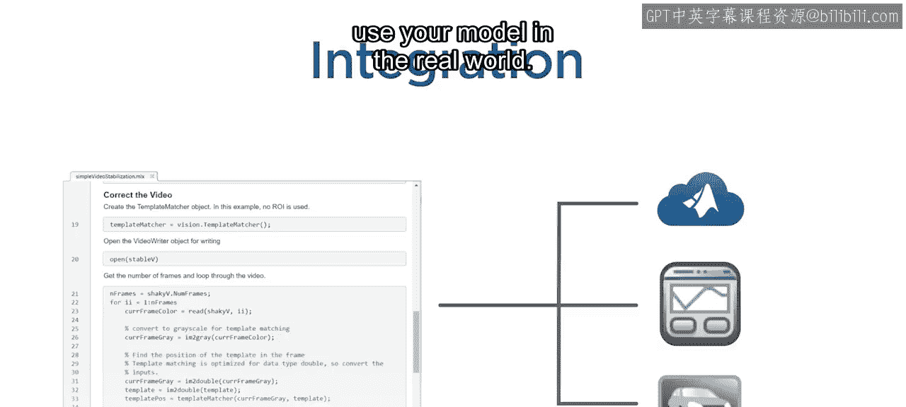

Imagine you're a researcher who wants to share your results and collaborate with colleagues。

A great option for you is simply sharing your Matlab code。

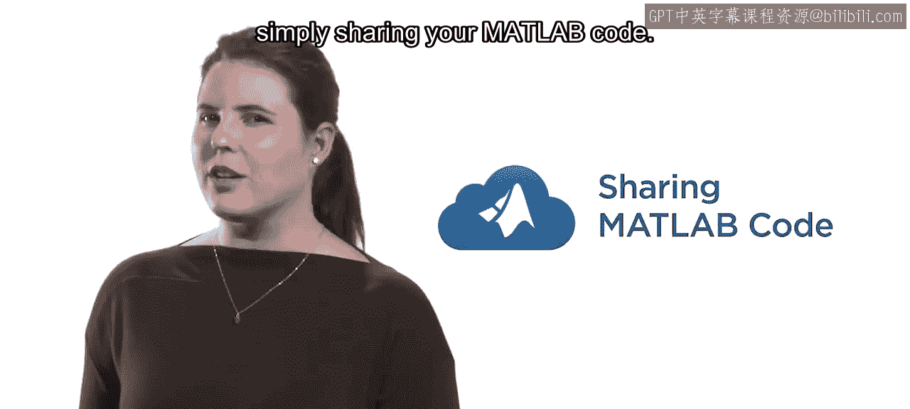

First， you collect your code files together and the Matlaap project。

Then use the source control tools in MatTLb to upload your code to a cloud based repository like Gitthub。

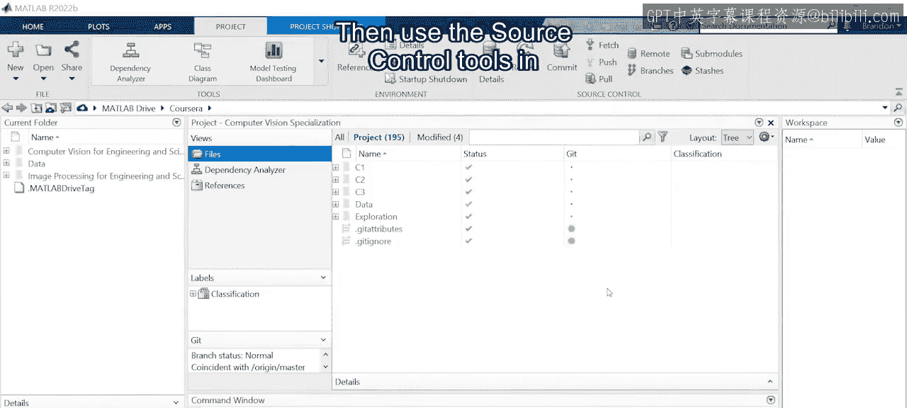

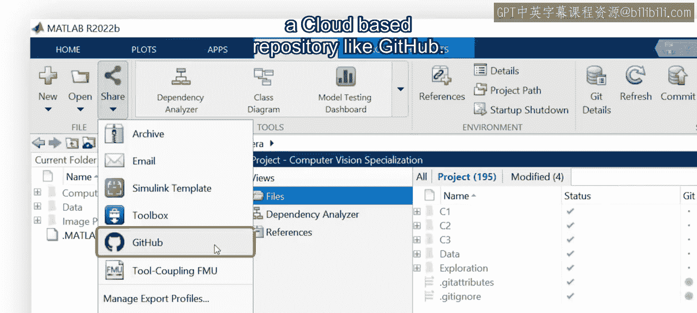

This provides access to others and enables you to track changes when working with collaborators。

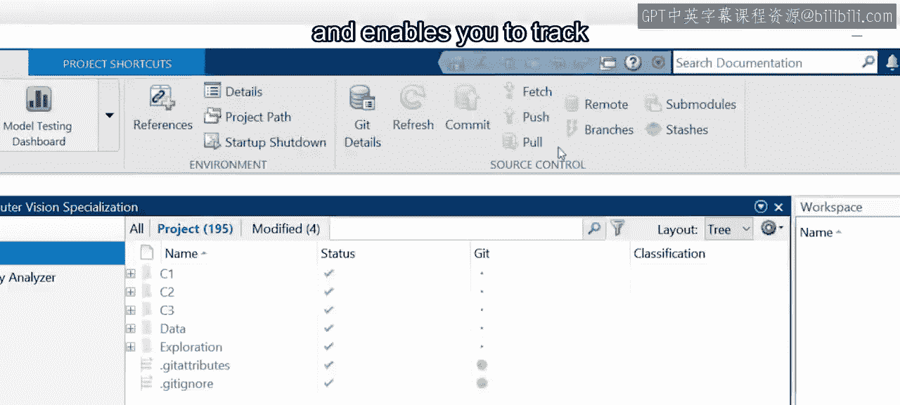

If you're working with people using other coding languages like Python， don't worry。

MatLb provides flexible two way integration with several languages。

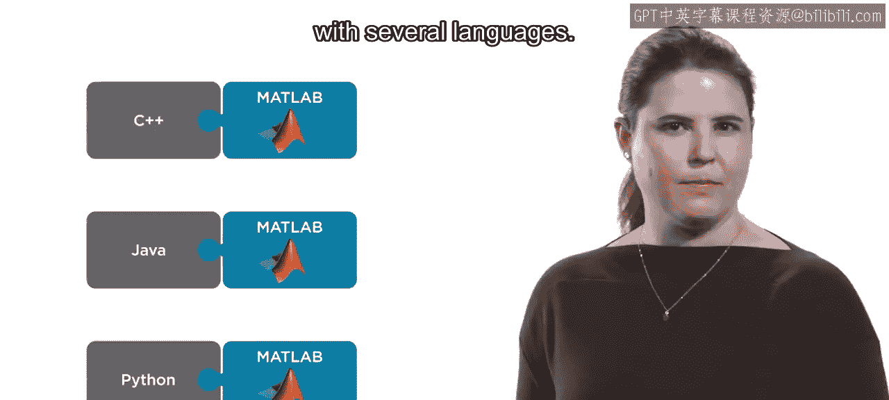

For example， you can call Python code from inside MatTlab。

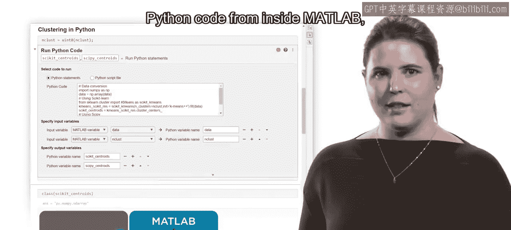

And your colleagues can use MatTLab Engine APIs to use your MATLb code within their environment。

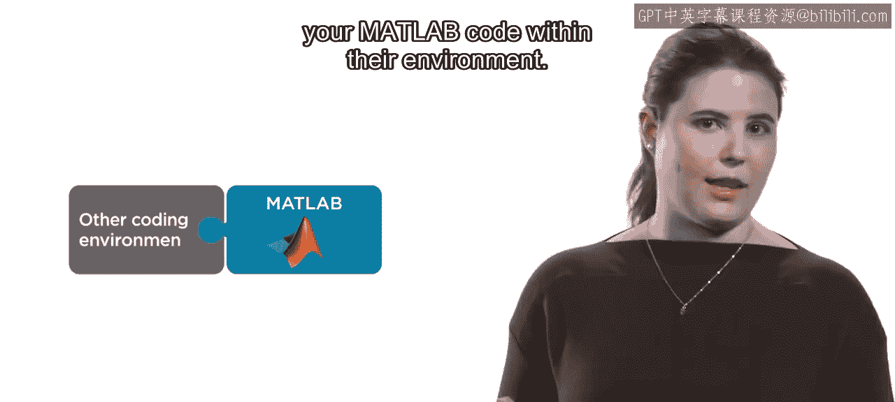

Now， imagine you're an engineer that needs to provide access to others in your organization with an easy to use interface。

A good option is to create a web application。First， you would design and create an app in MATLAb。

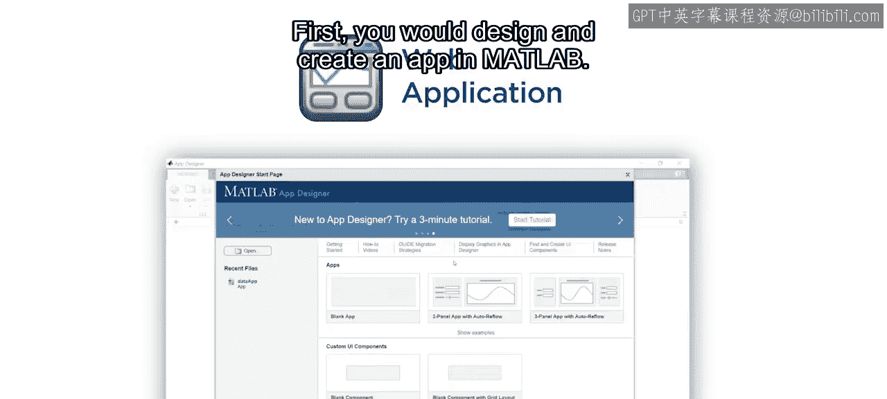

Your app can include interactive components， making it easy for others to adjust parameters while your code runs behind the scenes。

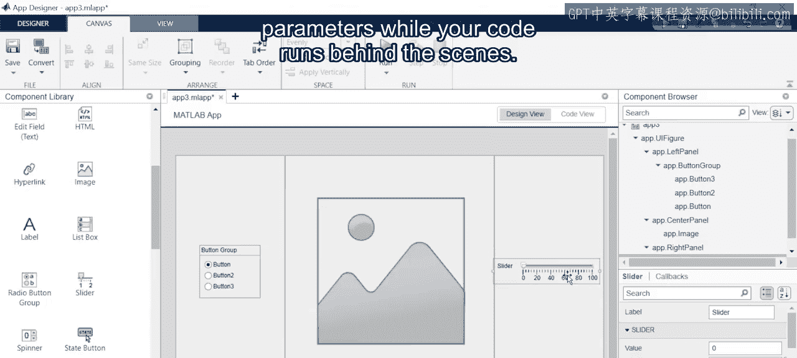

Then you'd host the app on a web server so others can use it from their browsers。

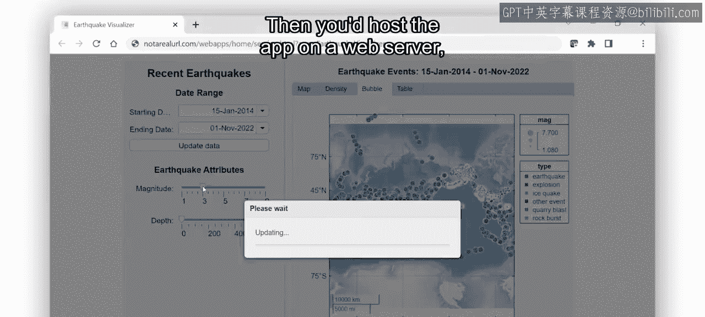

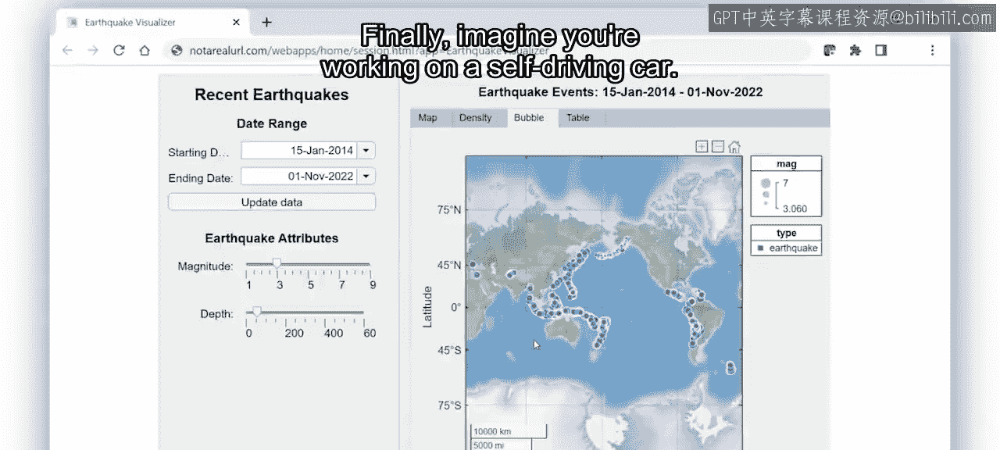

Finally， imagine you're working on a self driving car。

You need to get your MatTlab code onto the hardware devices embedded in the car。

How can you deploy your code to hardware that doesn't run MatTLAb？

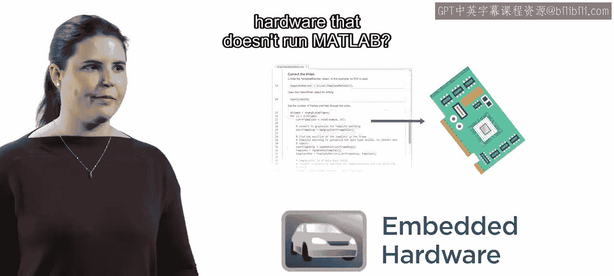

The answer is to convert your code to another language that can run on the device。

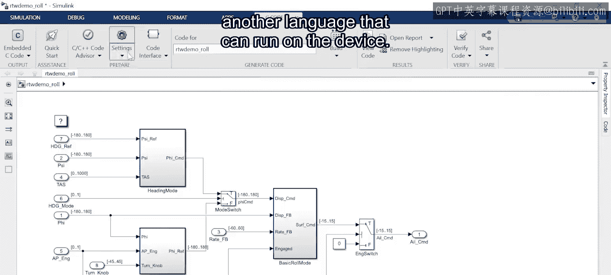

If that sounds intimidating and time consuming， it is。If you do it manually。

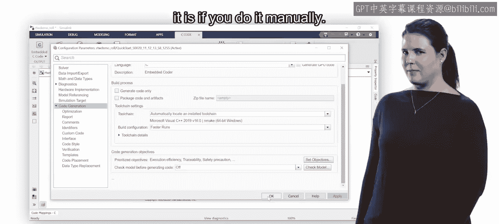

But with MATLAb， the task is much easier。MatLb can automatically generate code like C， C++， HDL。

 and even code to run on GPUs。Cogeneration saves engineers huge amounts of time。

By letting them rapidly prototype and test algorithms on new hardware systems。

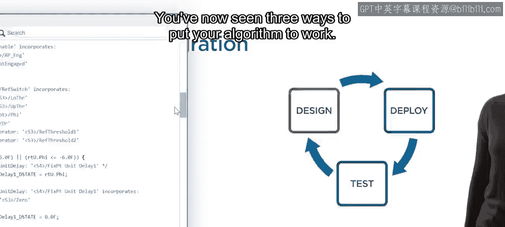

You've now seen three ways to put your algorithm to work。So as you develop your code。

 remember that MATLab includes tools to help you deploy it in a variety of ways。

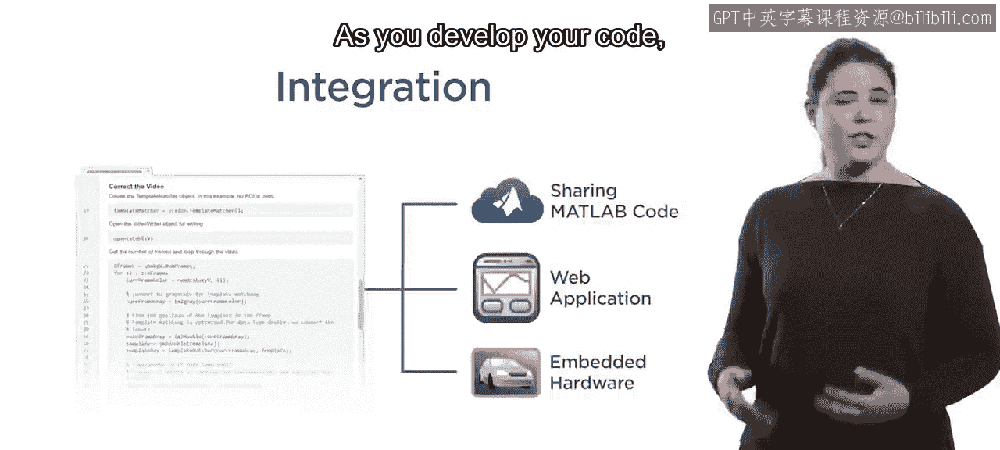

。