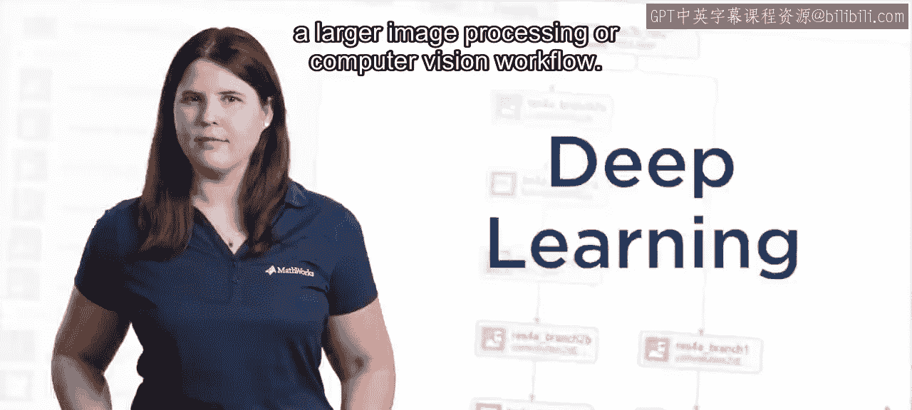
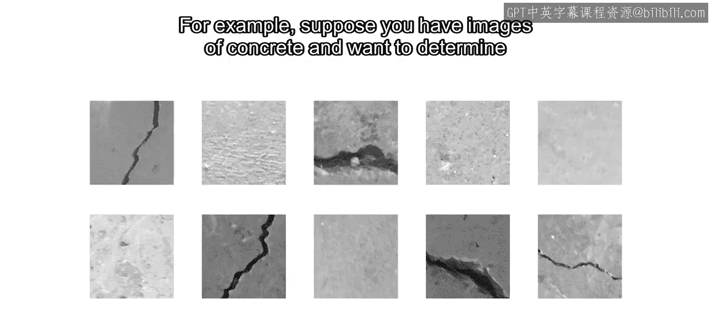
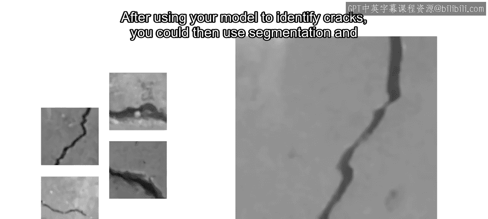
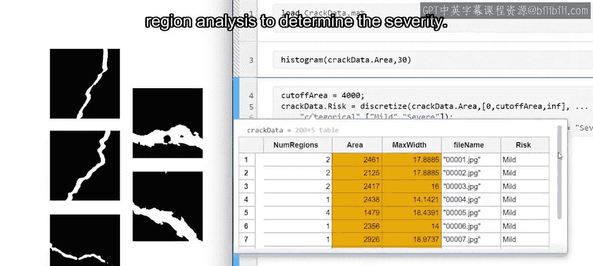
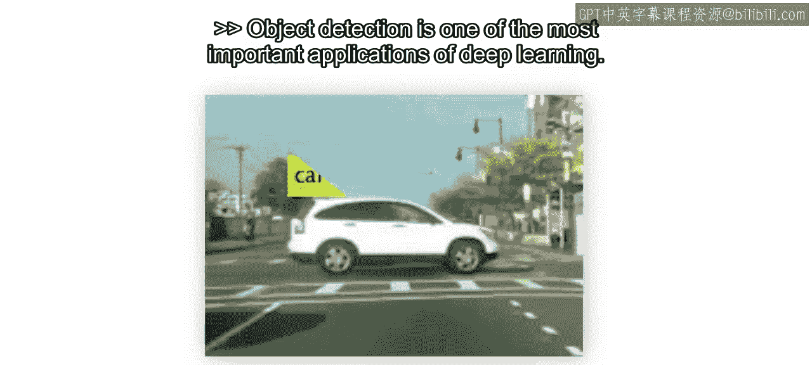
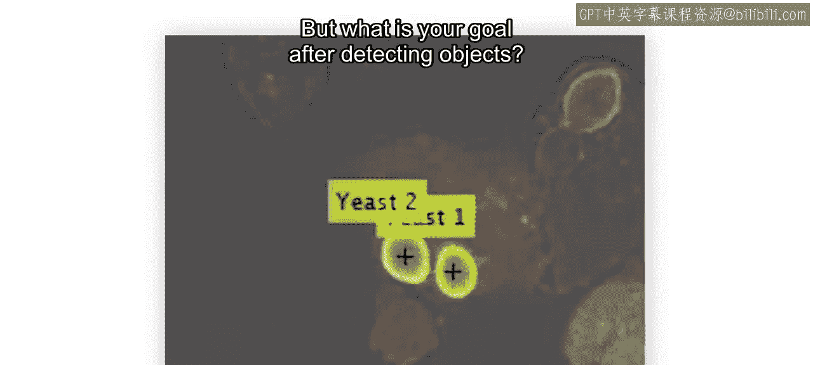
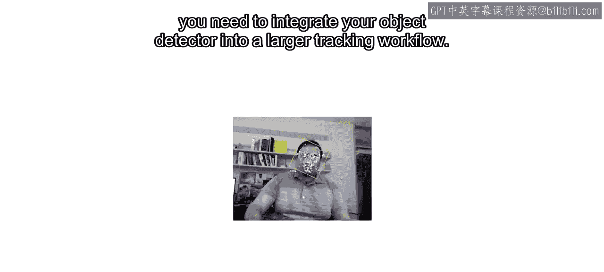
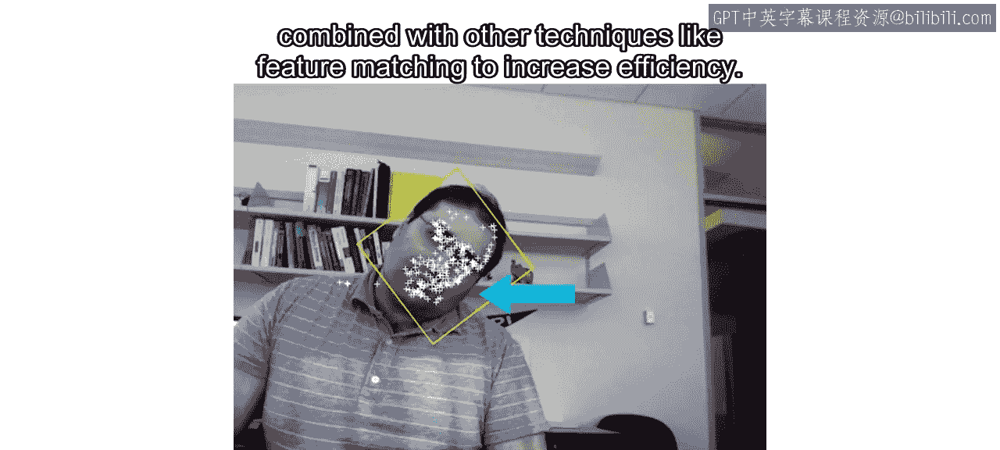

# Mathworks《深度学习在计算机视觉中的应用（简介、目标检测、高级深度学习）｜Deep Learning for Computer Vision》 p36 10_深度学习在计算机视觉中的总结.zh_en -BV1Rb421v71M_p36-

🎼，Great work reaching the end of this specialization。

You can now use deep learning to solve a variety of computer vision problems。Autonomous systems。

Manufacturing。And medical research are just a few examples of industries that perform deep learning with image and video data。

Throughout this specialization， you've gained hands on experience working with the most common types of models used in these industries。

Deep learning gets a lot of attention， but it's usually just one step in a larger image processing or computer vision workflow。

For example， suppose you have images of concrete and want to determine which images have cracks。

And analyze those cracks to determine severity。Prior to training。

 you might remove noise to increase model accuracy。After using your model to identify cracks。

 you could then use segmentation and region analysis to determine the severity。

To gain these skills and more， check out our image processing for engineering and Science specialization。

Object detection is one of the most important applications of deep learning。

But what is your goal after detecting objects？

Often， the goal is to count track。And determine properties like speed and direction。To do this。

You need to integrate your object detector into a larger tracking workflow。

And because object detection is computationally expensive， it's often combined with other techniques。

 like feature matching to increase efficiency。

Learn about these topics by enrolling in our computer vision for engineeringing and science specialization。

Image and video data are becoming increasingly important in a wide variety of fields。

Whether you're looking to diagnose disease or design safety features for cars。

 you are ready to apply deep learning to your work。Good luck。

