# Mathworks《实用数据科学与MATLAB（数据探索、特征工程、机器学习、毕业项目）｜Practical Data Science with MATLAB》 p02 1_使用MATLAB进行探索性数据分析概述.zh_en [BV1Jr421w7wL_p2]

🎼。

Hello and welcome to the course。 I'm Er Byne， and I look forward to getting you started on your data science journey throughout this course。

 my colleagues and I will help you to develop practical skills for exploring data that you can apply to your daily work。

 After completing the next five modules， you'll be equipped with the skills needed to import。

 visualize and perform common statistical analyses on your data。

 These skills are necessary before moving on to more advanced topics。

 such as predictive modeling with machine learning。😊。

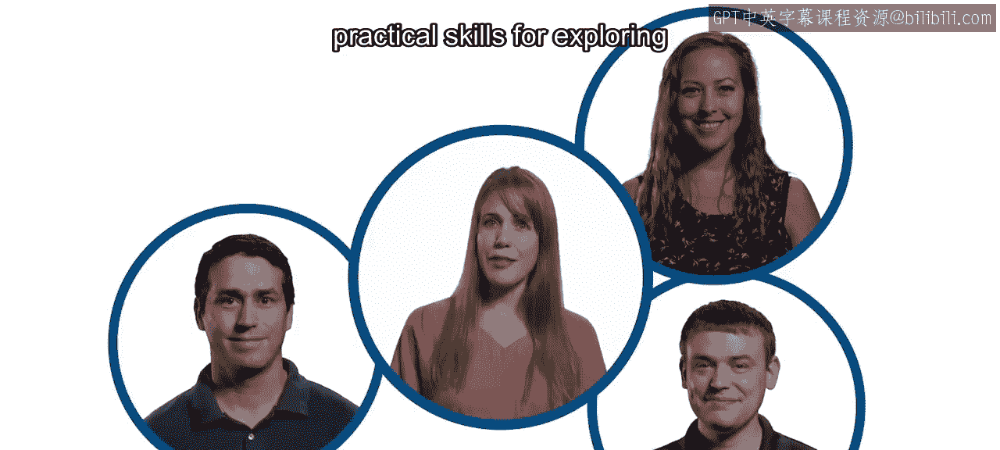

The course begins with an introduction to data science。

 You'll learn how to approach the task of exploring data and how to formulate questions that you can answer through data analysis。

 You'll use interactive documents called live scripts to explore a prepared analysis and to gain insight from a real data set。

 By the end of this course， you'll create your own live scripts to capture your analyses and to share your insight with others。

😊。

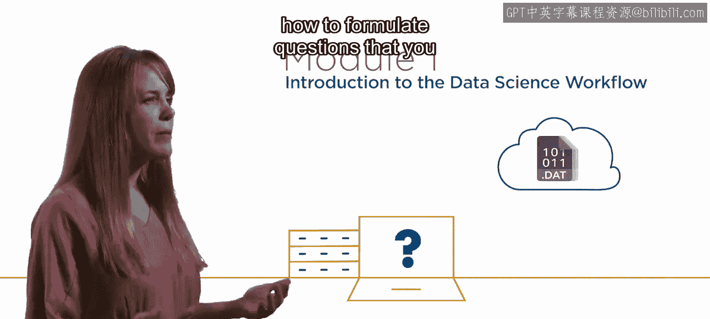

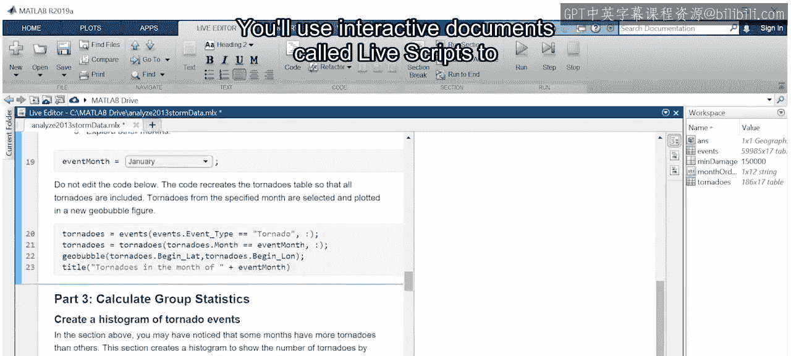

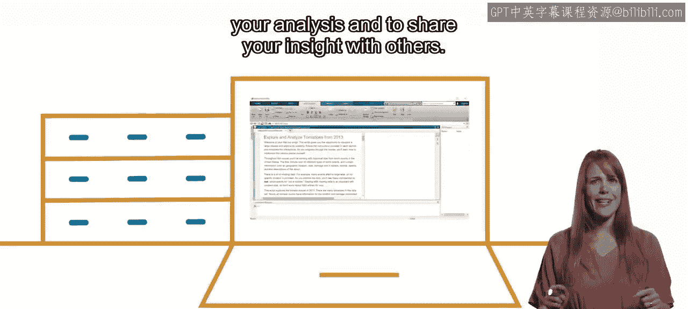

In the second module， you'll learn how data is represented and how to bring it into MATLb。

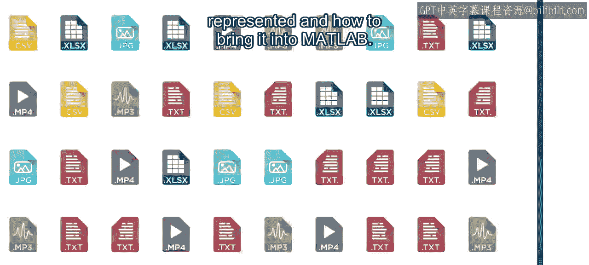

Getting lots of data into a form you can use for analysis is a common challenge in many applications。

 You'll use tools that help you bring your files into Matlab quickly while generating code that you can use to repeat the process in the future。

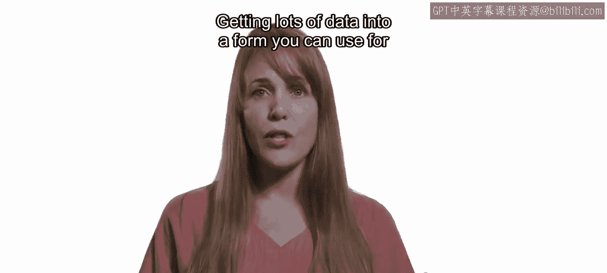

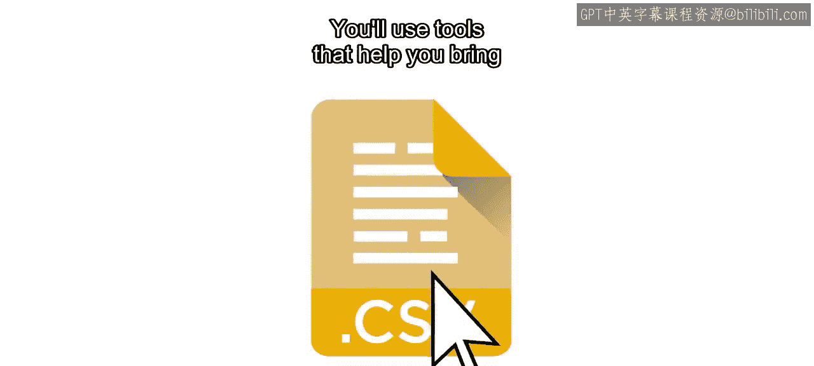

Once you reach the third module， you'll filter your data into a subset you want to analyze。

 You'll then visualize it to understand how you might answer your questions。

 as well as gain new understanding。

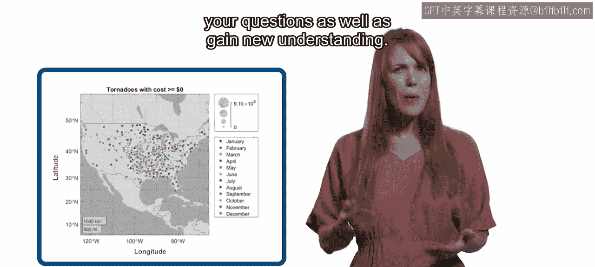

The main data set for this course includes geographic data with latitude and longitude coordinates。

 In addition to plotting standard graphs， you'll also produce maps with the data overlaid on familiar geographic boundaries。

 as well as other visualizations that provide practical insights。

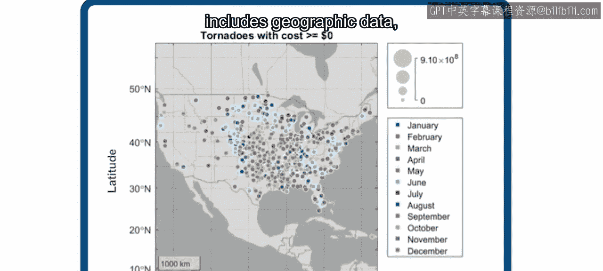

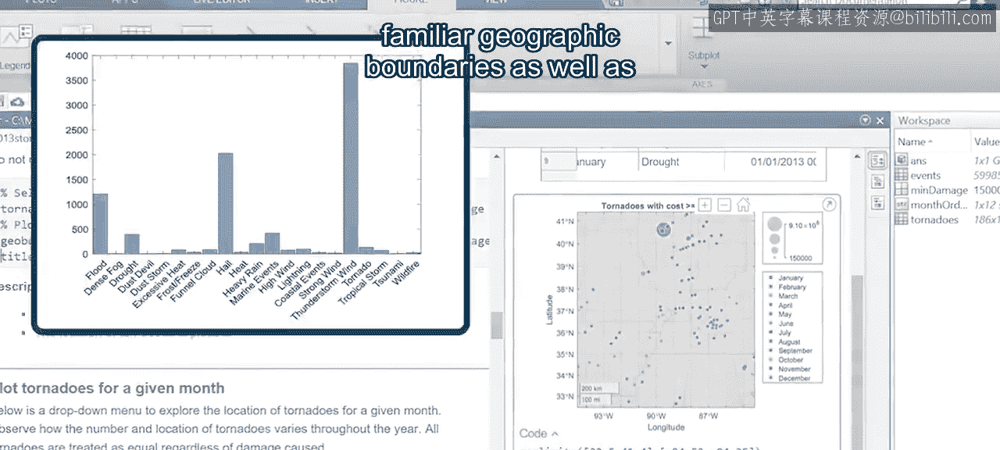

At this point， you filtered and visualize your data。 Now， in the fourth module。

 you're ready to perform statistical analyses。 You'll think beyond the spreadsheet to analyze your data by distinct groups。

 rapidly iterating through operations on different groups of data。

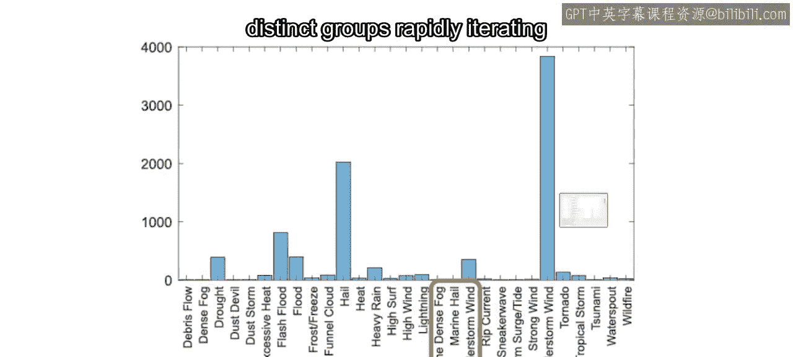

These tasks are the foundation of exploring and experimenting with your data。

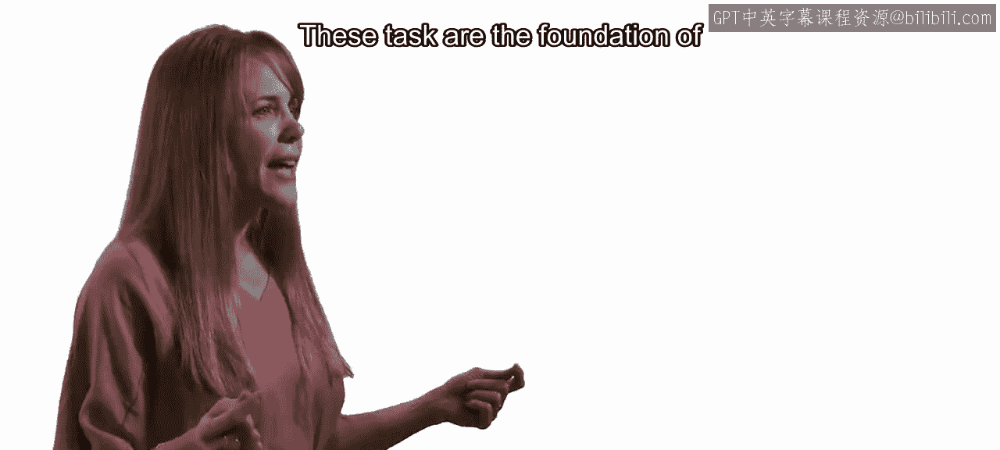

Finally， in the fifth module， you'll bring it all together to tell the story of your data。

 The world of data science today is so much more than code and number crunching。😊。

Live scripts can help you bring your data analysis to life。Throughout this course。

 they'll support your analyses and enable you to apply the same thought process to other similar data sets to further your analysis。

To get the most out of the course， think about how you can apply the concepts you learn to your own data。

 The data set you'll encounter in the course are meant to be representative of what you're likely to see in your own work。

Sound interesting， join the millions of industry professionals who use MATLAb to explore， filter。

 visualize and analyze their data。

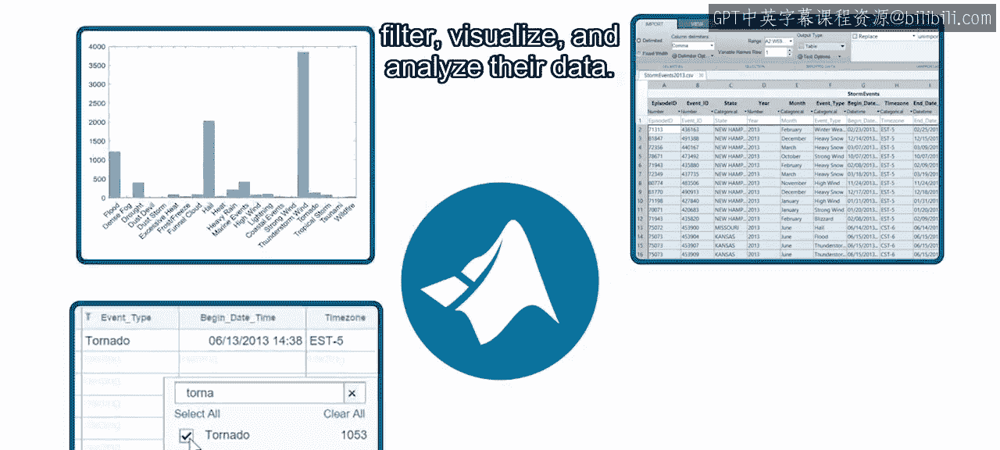

Get started now and use the discussion forums if you have any questions。

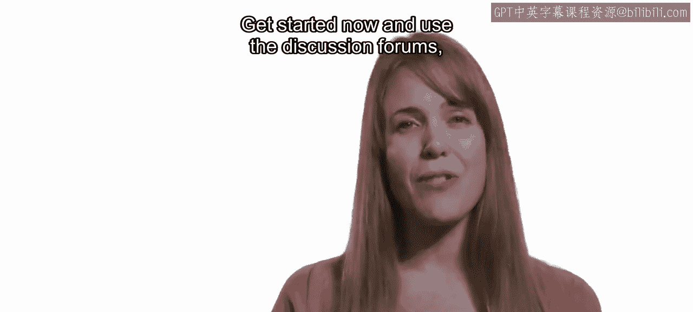