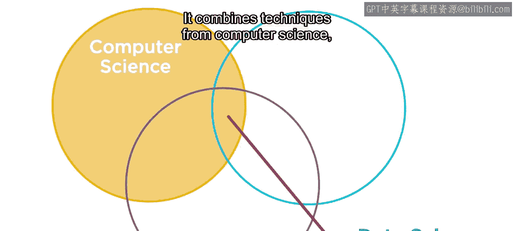
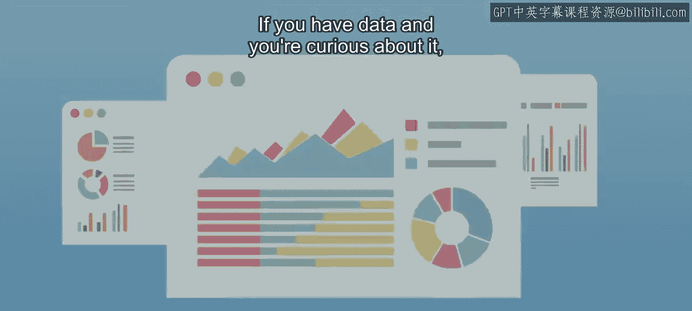
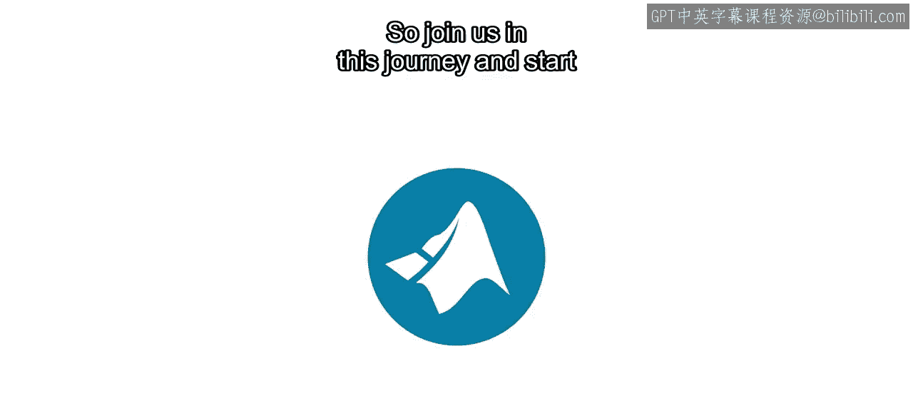

# Mathworks《实用数据科学与MATLAB（数据探索、特征工程、机器学习、毕业项目）｜Practical Data Science with MATLAB》 p04 3_为什么我们需要数据科学.zh_en [BV1Jr421w7wL_p4]

🎼，The world we live in is connected all the time。Interacting in social media。

 requesting a taxi service， making purchases， tracking your daily physical activity。

 everything you do generates data。And once you start aggregating the data from everyone。Well。

 it gets quite difficult to quantify。It's fair to say that we live in a data driven world。

 So what do you do with this immense amount of data。This is where data science comes into action。

Data science is more relevant today than ever before， because we have tons of data available。

But what is data science in the first place？Data science is， as you guessed， the study of data。

It combines techniques from computer science， statistical analysis， and your own domain knowledge。

If you have data and you're curious about it， data science is a path for exploring and analyzing the data。

 getting answers from it， and then communicating your findings。

In other words， data science is about the ability to tell a compelling story from your data。

Nowadays， in data science， the problem is not a lack of available data。

 but rather the opposite data comes in a deluge from a multitude of sources and in a variety of forms。

 text， numbers， images， audio， video， signals。So your first step is understanding what kind of data you're working with。

 You accomplish this by accessing and exploring the data。

Recent techniques focus on making sense of the ever growing amount of data available to us。

 a phenomenon you may have heard of as big data。After exploring your data， modeling it may be next。

To extract the insights it holds， many times you need an accurate， predictive model。In recent years。

 techniques like machine learning and deep learning have made headlines and are now accessible to everyone。

Machine learning， for example， teaches computers to do what comes naturally to humans。

 learn from experience。It's great for complex problems involving a large amount of data with lots of variables。

 but no existing formula or equation that describes the system。

The algorithms adaptively improve their performance as the number of samples available for learning increases。

But do you need to be a software engineer or a seasoned statistician to do any of this？Fortunately。

 not。Many data science techniques are used by scientists and engineers who are experts in their own domains。

 but not necessarily trained as programmers。And this is where MatTLAb can help you。

MatLb is tuned for the workflows of scientific exploration， analysis and visualization。

MatLb contains ready to use analysis and modeling functionality that spans multiple domains。

So you can focus on your work， not on becoming a software engineer or an expert in statistics。

MatLb enables domain experts to do data science。With Matlab， you can show your work step by step。

 along with powerful visualizations that help you communicate a story to others。

By enabling you to obtain valuable insights from your data and make predictions。

 data science makes it possible to solve the toughest problems。

 like engineers who use machine learning and sensor data to detect when a car begins to oversteer。

Or like engineers who created a system to restore arm and hand control to a quadriplegic man by processing signals from an electrode array implanted in its brain。

Data science enables you to solve day to day problems as well。

 Many data science techniques are used every day to make critical decisions in medical diagnoses。

 stock trading， energy load forecasting， speech recognition and more。😊。

Even media sites rely on machine learning to sift through millions of options to give you song or movie recommendations。

Data science is already a big part of your life。So join us in this journey and start on the path of doing data science with MATLb。

