# Mathworks《实用数据科学与MATLAB（数据探索、特征工程、机器学习、毕业项目）｜Practical Data Science with MATLAB》 p05 4_MATLAB作为数据科学工具.zh_en [BV1Jr421w7wL_p5]

🎼，Data science combines techniques from computer science。

 statistical analysis and your own domain knowledge。

 so you might be wondering how can I start doing data science？

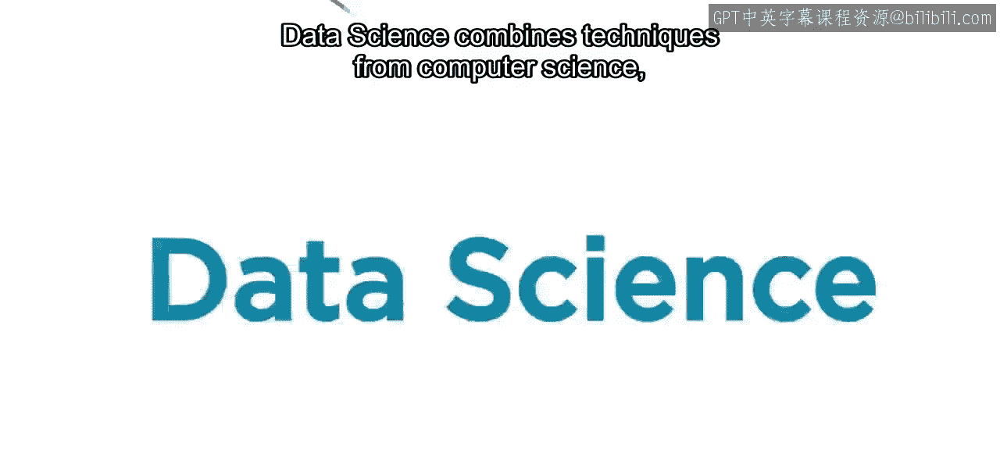

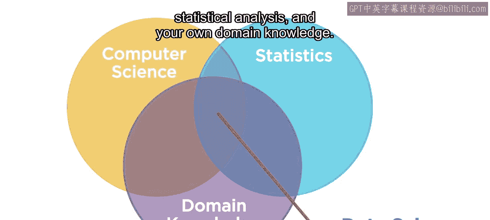

Well， some people new that data science are attracted to the software development or statistical modeling。

Others are less interested in those aspects and have little desire to reinvent the wheel on the math or programming involved。

 They are interested in applying common tools， along with their knowledge of their field。

 to answer questions about their data。In any case， you want to use tools that help make the tasks of data science easier。

 and Matlab was designed precisely to do that With Matlab， you can explore。

 visualize and analyze data， which leads to a better understanding of complex systems。

 So what is Matlab。

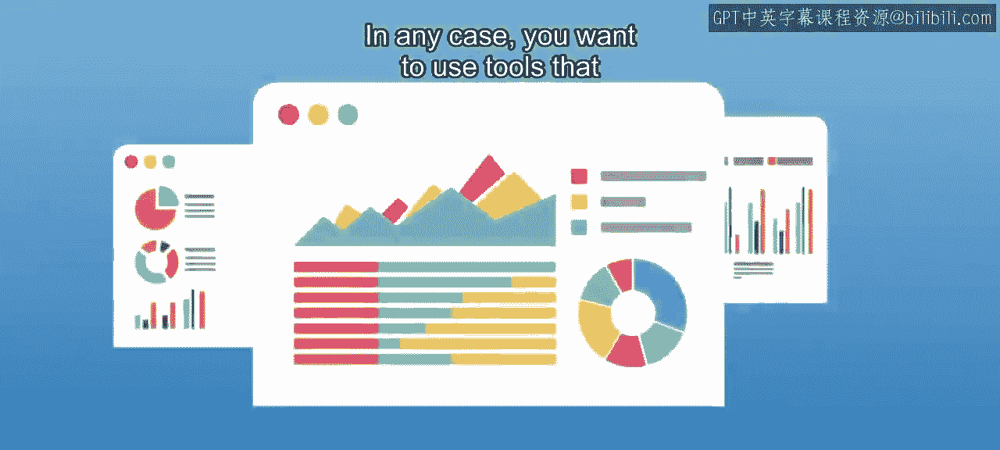

In the 1960s and 70s， solving problems with computers required writing lots of code。

Professor Cve Moer wanted his students to focus on solving math and engineering problems。

 So he created Matlap using syntax that mirrors common science and engineering notation。Today。

 MatTlab is still the same language， but with many new， powerful and easy to use capabilities。

The Matlab environment lets you create live scripts that combine code。

 output and formatted text in an executable document。

You can use interactive tools to explore figures and tables in the output。

But why is MATLAb a great tool for data science？MatLAb includes functions and interactive apps for each of the key steps of data science。

Importing， cleaning and exploring data。Building and evaluating models。And even making predictions。

Let's explore these in more detail。First， to do data science， you need data。

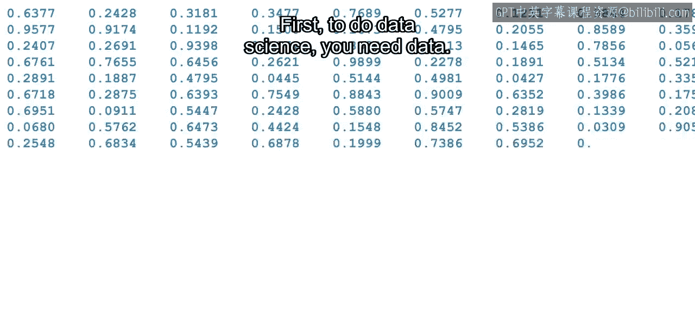

MatLb can read different kinds of data from a variety of sources and help you stitch all of your data together。

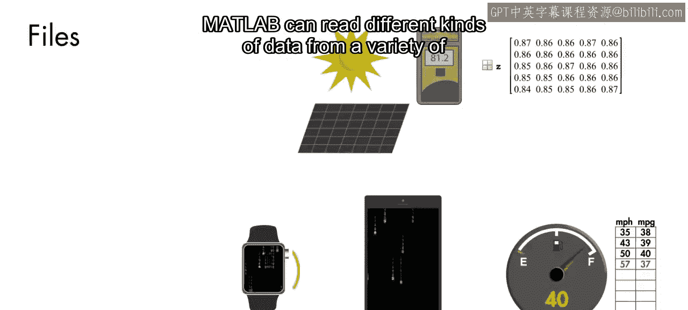

Sometimes you'll have so much data that your computer won't be able to handle it all at once。

Maab can take care of this for you。And you can test out your ideas on a small amount of data before tackling the whole data set。

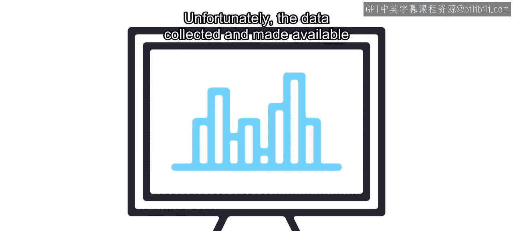

Unfortunately， the data collected and made available to data scientists is usually not perfect。

You might have to deal with noise， missing data and outliers。

Cleaning data is often the most time consuming part of working with it。

 Many features in Matlab enable you to quickly clean up messy data。😊。

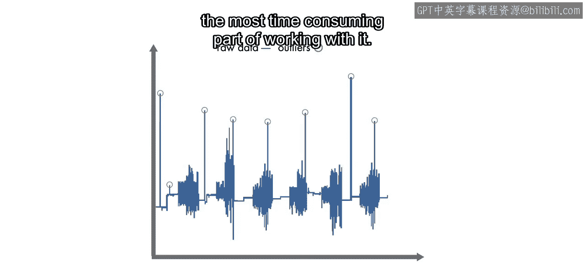

High level functions can make it possible to pre process your data in quick steps。

 rather than writing many lines of code。This helps you get your job done faster。

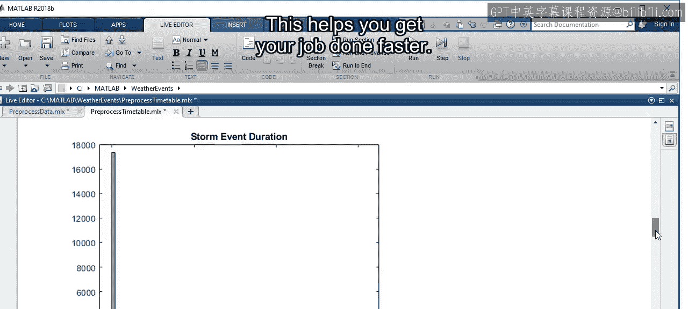

Once you've cleaned your data， the heart and soul of data science is exploring your data and building models to answer interesting questions。

 For example， how much damage will a storm cause。

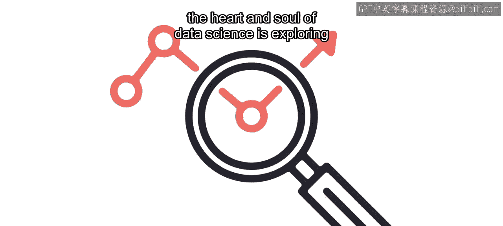

There are many standard modeling techniques you can use to answer this question。

MatL provides simple functions that implement these methods。

 it also provides interactive apps so you can explore different models and options。

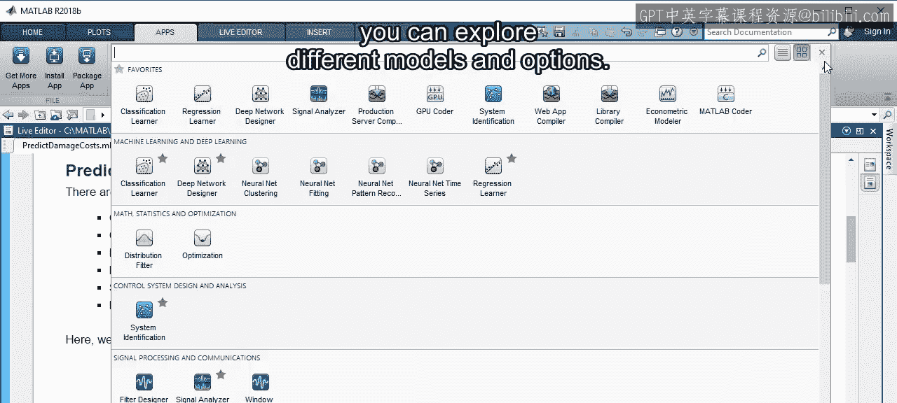

Machine learning techniques， for example， use computational methods to learn directly from the data without relying on a predetermined equation as a model。

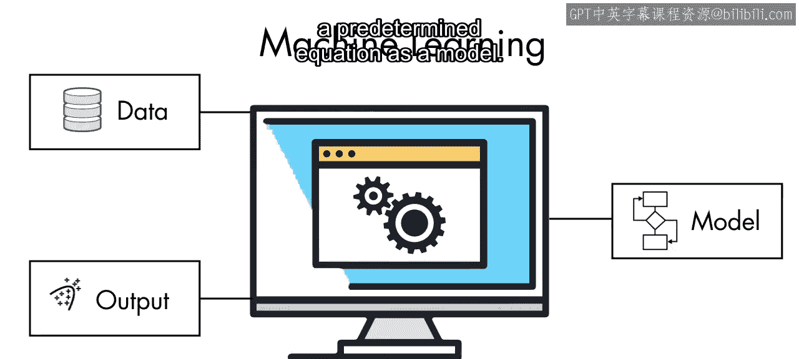

You start with your best guess about what features might influence the outcome you're trying to predict。

MatLab enables you to perform this feature extraction step using multiple techniques。

 Then with the interactive apps in MatTLb， you can quickly identify the model that provides the most accurate estimates。

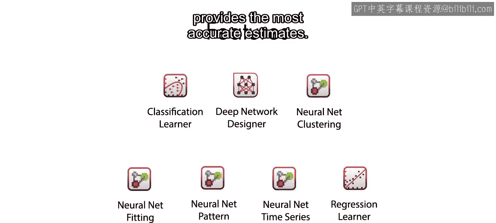

With these apps， you don't have to be an expert in statistics and other techniques to take advantage of powerful machine learning models。

For example， you can use the regression learner app to try several models to predict the cost of storm damage。

The regression learner app lets you interactively explore various regression models。

Once you've identified the model that works best， you can generate the MATLB code so you can automate the process in the future。

These tools guide you through the model exploration phase。

 giving you more confidence in the accuracy and robustness of your model。

Being able to explore interactively and save the steps needed to repeat and automate your work is important because real data science。

 like any science， is messy and experimental。You have to try different things as you answer one question。

 you often come up with other questions to explore。

The goal of data science is to answer questions that have some real impact。

 If you build a model that predicts the damage a storm will cause。

 you want to use it and let others use it as well。Maybe you want to put this model into a web application。

Rather than reccoding everything into a different language with Matlab。

 you can integrate the work you've already done into other systems。

You can either integrate MATLAB code with applications that use other languages or deploy your solution to embedded hardware。

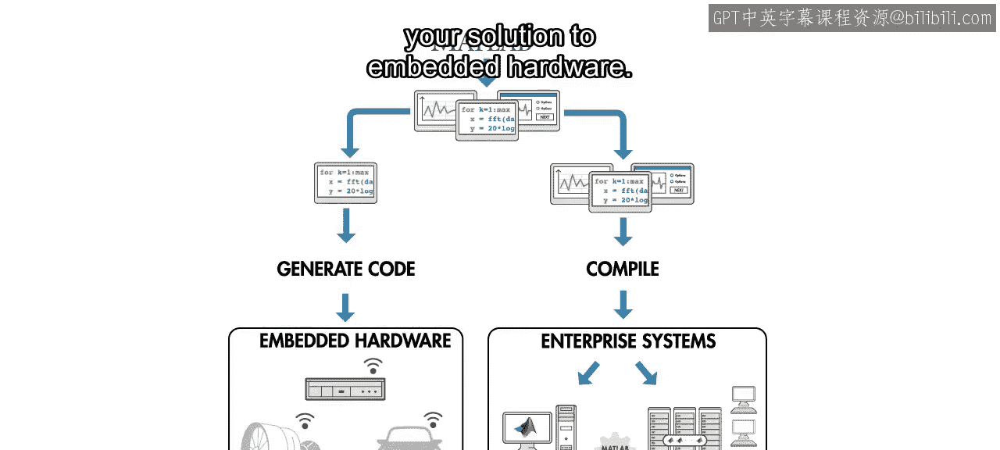

Here you see an example of a MatTLAb web app。 you can deploy this to your organization's MatTLb web app server。

 giving everyone across the organization access to the app and a web browser。

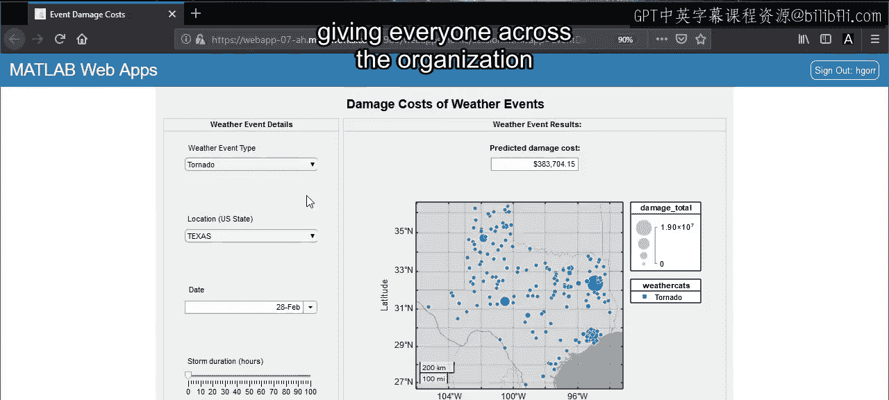

Regardless of how you decide to make your solution available。

 there is only one algorithm to develop and maintain where you run it is up to you。

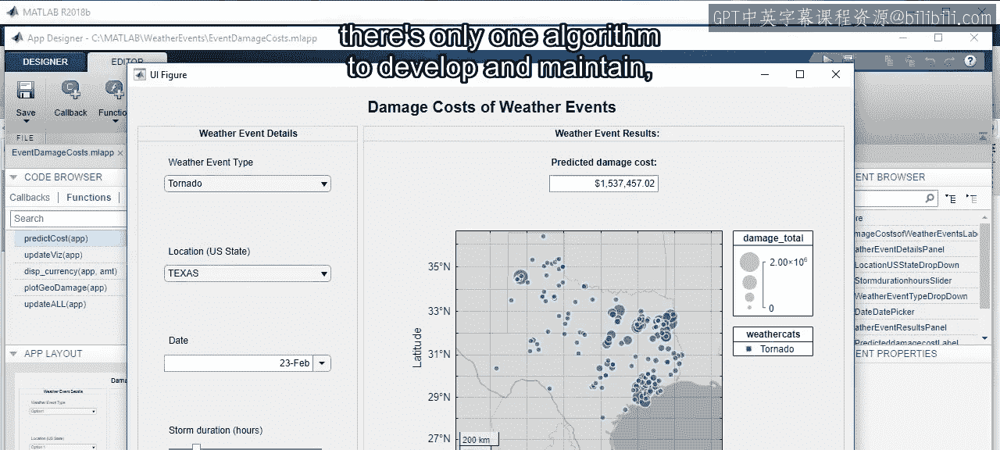

In this specialization， you'll learn the different steps in the data science workflow。

Being successful in data science requires the right tools。

You'll soon develop a proficiency with MATLap， a powerful tool for data scientists solving wide ranging problems across many disciplines。

 so let's dive into it。

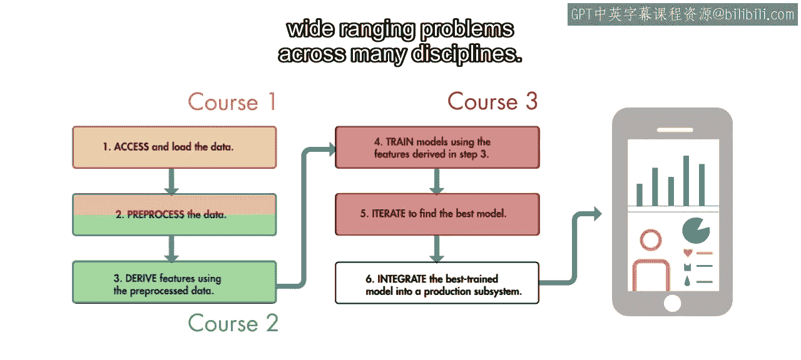

。