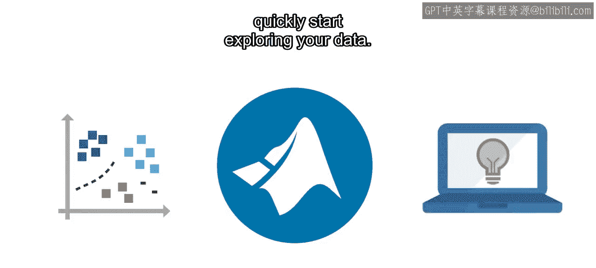
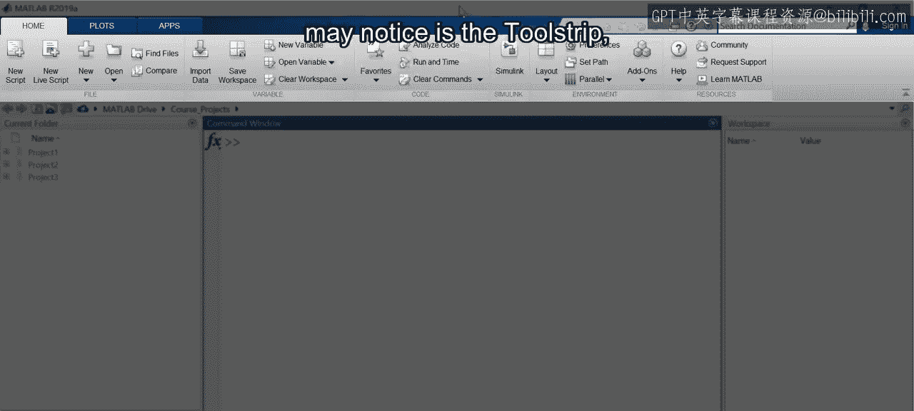
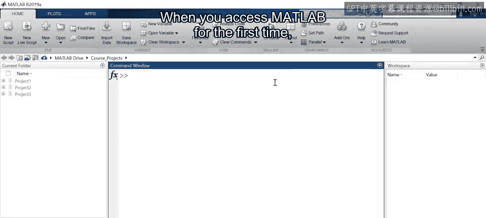
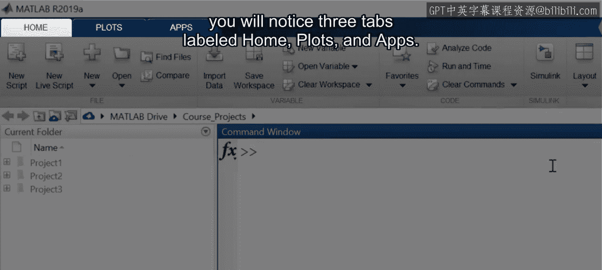
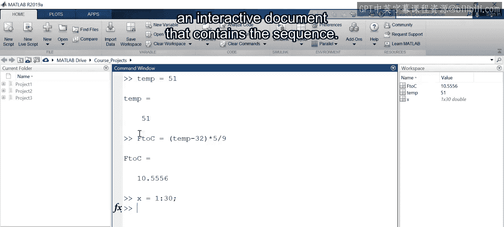
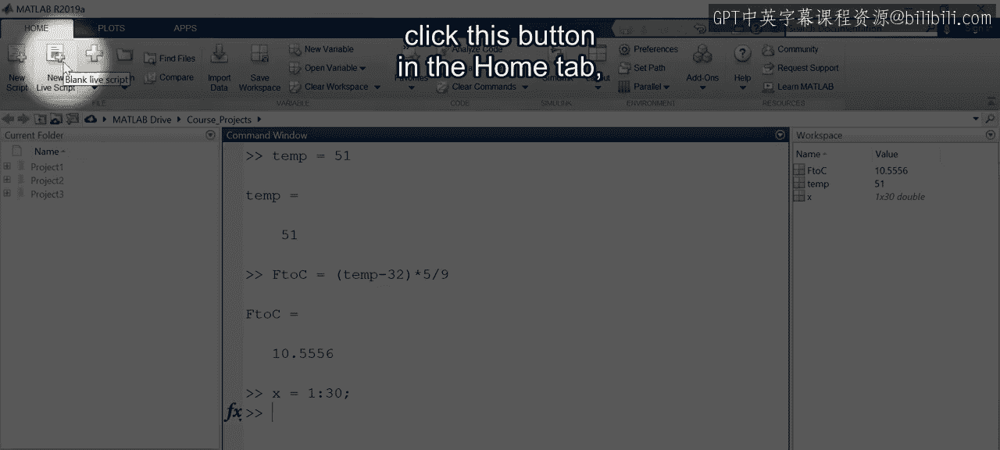

# Mathworks《实用数据科学与MATLAB（数据探索、特征工程、机器学习、毕业项目）｜Practical Data Science with MATLAB》 p06 5_开始使用MATLAB.zh_en [BV1Jr421w7wL_p6]

🎼。Now that you've seen how MatTLB is used for data science。

 it's time to get familiar with the MATLAb environment so you can quickly start exploring your data。

In MatTLabb， the first thing you may notice is the tool strip。

 which organizes MatLb functionality in a set of tabs。

Tabs are divided into sections that contain related controls， including buttons。

 drop down menus and other elements。The tool strip provides easy access to MATLB capabilities that you use frequently and can help you learn about functionality that may be new to you。

When you access MALB for the first time， you will notice three tabs labeled home。

Plos and apps。These global tabs are always present， no matter what you are doing in MATLB。

In addition to global tabs， the tool strip also has contextual tabs。

Which only appear when you're performing certain tasks in MALB。

The Home tab is for general purpose operations such as creating new files and importing data。

The plotts tab includes a gallery of plots available for displaying selected variables。

 and the apps tab provides access to interactive applications included with MatTlab。

 You will use apps later in this specialization to test different machine learning models。

Below the tool strip， the default layout has three main panels。The current folder browser。

 the command window， and the workspace。The command window is where you perform computations by typing commands at the prompt。

Some commands create new variables that hold the results of computations。

 You'll see these variables appear in the workspace window。

Notice that when you add a semico into the end of the line， the result isn't displayed。

If you need to view the contents of a variable， you can double click the variable in the workspace to open the variable editor。

From the command line， you can recall or rerun a command you executed previously by pressing the up arrow key to view the command history。

You can then select a command to edit or run again。

But very soon you'll want to reuse a series of commands or save your work for later。

 you do this using scripts。A script is a sequence of commands that are executed in order to achieve a result。

In particular， a live script is an interactive document that contains the sequence。

To create a new live script， click this button in the home tab。

 which opens the Matlab Live editor window。

Copy the commands from the command history and use the editor to make changes。

Notice the new contextual tabs in the tool stripip。Once you start working with a live script。

 you can organize your analysis by splitting groups of commands into sections and adding text。

 comments， headers， images， equations， and more。You'll learn more about live scripts throughout this course。

You can also start with a live script that someone has shared with you。In that case。

 you open the file by first navigating to it in the current folder browser。

Navigate to the location of your file and open it by double clicking。

Live scripts are files with the extension， M， L X。Take a closer look at the current folder toolbar。

It shows the current folder path and it's a reference location that MATLB uses to find files when you run the script。

Make sure you change your current folder to the project directory where the live script is stored。

To run the live script， simply click the Run button。If your code is divided into sections。

 you can also run a script section by section and examine the results as you work。

You can toggle how the output is displayed on the right or in line。

If you want to change the layout and get more space to display your live script and its output。

 you can minimize the panels that are shown by default。

And you can quickly restore the default layout using the layout menu in the home tab。

If you have questions about a specific function in your live script。

 you can find more information by right clicking it and selecting Help on。

All MatTLb functions have a documentation page that includes calling syntax， a description。

 and examples。In addition to the documentation， you can use the auto complete functionality to view the correct syntax or choose the variable you want to use。

 This can help you avoid typos and other errors。This is a great start Now that you've learned the basics of the Matlab environment。

 it's time to start exploring some actual data。

。