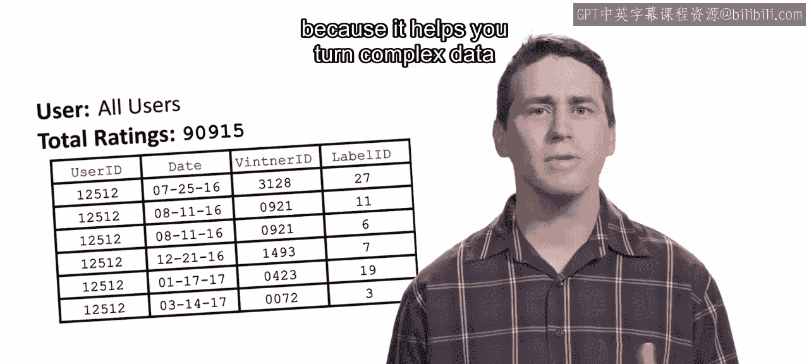
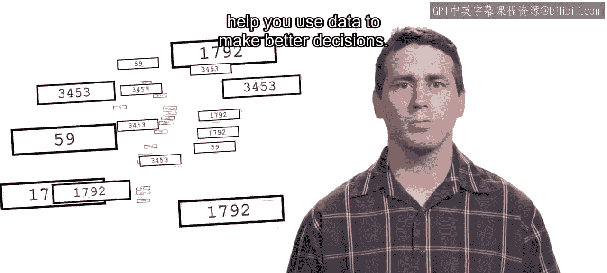

# Mathworks《实用数据科学与MATLAB（数据探索、特征工程、机器学习、毕业项目）｜Practical Data Science with MATLAB》 p07 6_如何提出好的数据问题.zh_en [BV1Jr421w7wL_p7]

🎼。

Now that you have a better understanding of why you need data science， this is a good time to think。

 what will you do with your data？The best way to get started is learning how to ask good questions about the data。

This is an important first step in data science because it helps you turn complex data into actionable information。

In other words， asking the right questions will help you use data to make better decisions。

There are many different ways you can do that。

The simplest and most straightforward is asking what happened in all its forms？

What exact information is available？Let's see this in the context of a more specific example。

 exploring data from a machine that requires maintenance。At this point。

 your question could be what component broke？

These descriptive questions focus on analyzing data for the purpose of identifying patterns， trends。

 or tendencies， often with exploratory data analysis。

You can take it one step further and then ask， why did this happen？

In the machine example， you might ask， why did the component break？

Asking diagnostic questions helps you identify areas that require further study because such questions cannot typically be answered simply by looking at the data。

At this point， you can go even further and ask what will happen next？

This is an opportunity to start predicting what is likely to happen in the future。

Here， machine learning techniques can help you build predictive models that forecast an invent or outcome。

For the broken machine， you could also ask what similar components are likely to break。And finally。

 you may ask， what should be done about it？

Now you're not just predicting what will happen in the future。

 but also automating the process of determining the best actions to take。

So in the machine， if you knew a component was likely to fail。

 could you optimize your operations to make sure maintenance is performed at exactly the right time。

Organizations are looking to data scientists to help inform their decisions。

 asking the right questions of the data available will help you define the scope of your data analysis。

So let's now start the journey of interactive data exploration。

