# Mathworks《实用数据科学与MATLAB（数据探索、特征工程、机器学习、毕业项目）｜Practical Data Science with MATLAB》 p08 7_交互式数据探索.zh_en [BV1Jr421w7wL_p8]

🎼，You have data， lots of it， and you have questions you want to answer using that data What tools should you use for exploration and analysis？

Spreadsheets enable users to create plots and calculate basic statistics without writing code。

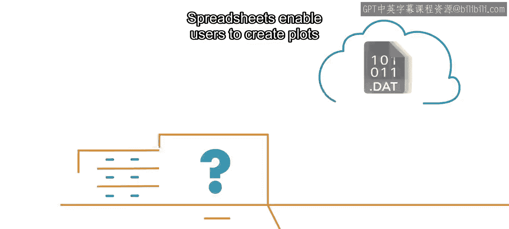

This is great if you have only a few files and your questions don't require complex calculations。

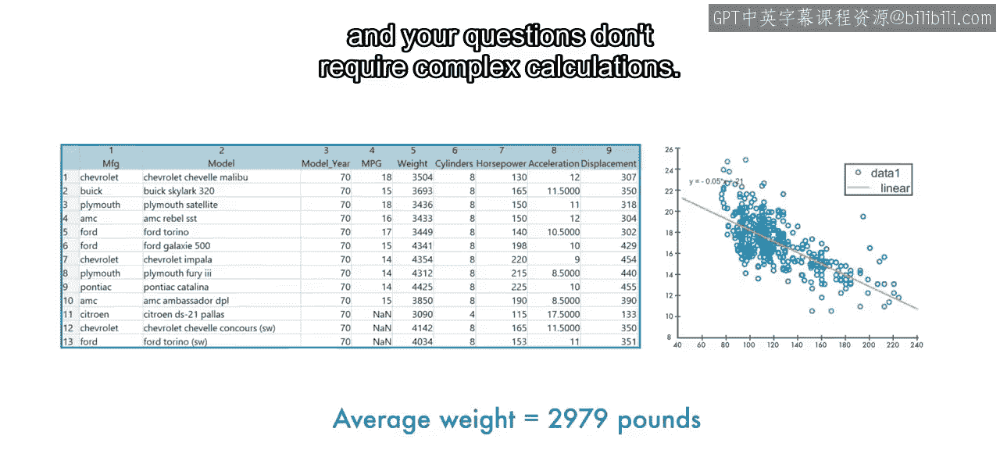

But what if you have lots of files， maybe your files have very different formats。

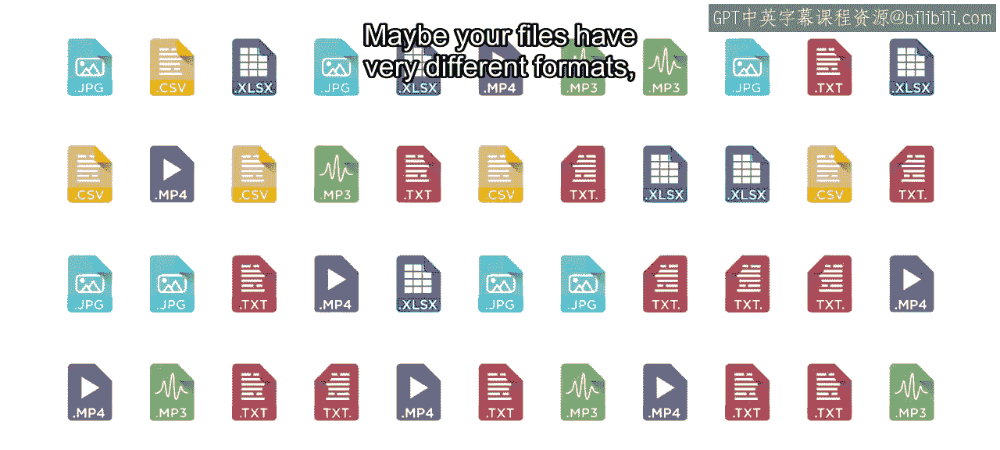

Or maybe there are many possible predictors in the data。

 and you need to determine which ones are most important。

Analyzing data with spreadsheets does not scale well。

Learning a programming language provides the flexibility to analyze lots of data with complex models。

So do you need to be a seasoned programmer before you can get started with data science？

That's where MatTLb comes in MatTLb is both an environment for interacting with data and a powerful programming language。

However， unlike other languages， MATLAb enables you to explore your data and build models while automatically generating code。

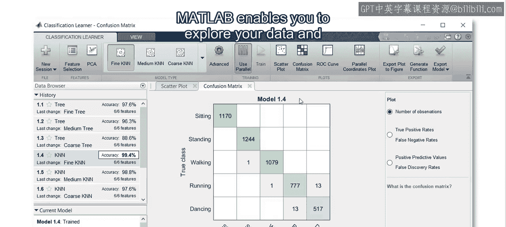

Let's look at an example。In this video， you'll learn to interact with the live script to explore data。

You'll also use interactive controls to modify visualizations and calculate statistics。

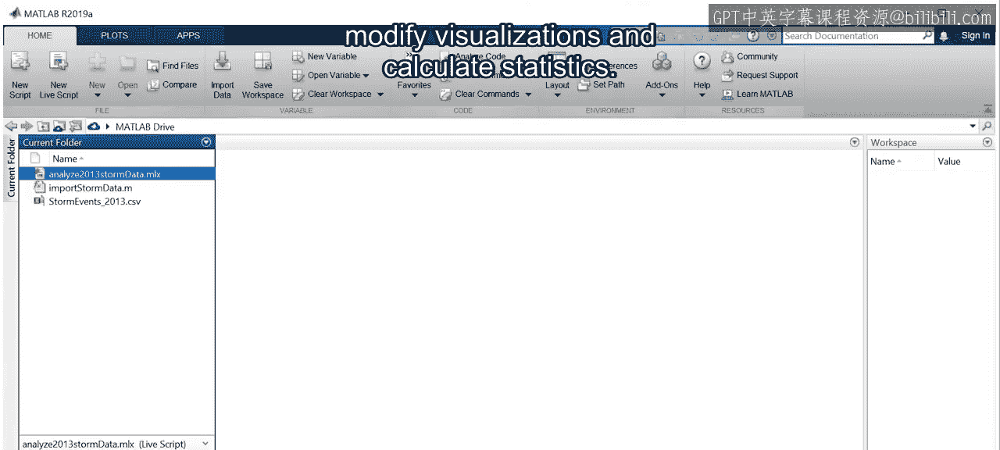

Throughout this course， you'll use live scripts to analyze data。 By the end。

 you'll be creating them yourself。A live script is more than just code。

 it contains rich text and graphics to help document and communicate your results。

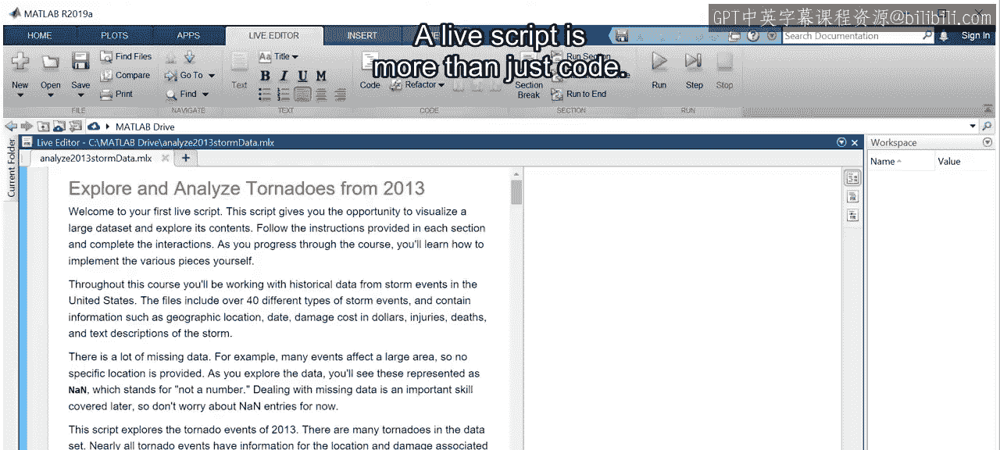

This script uses weather event data described earlier to look at the location and damage cost of tornadoes。

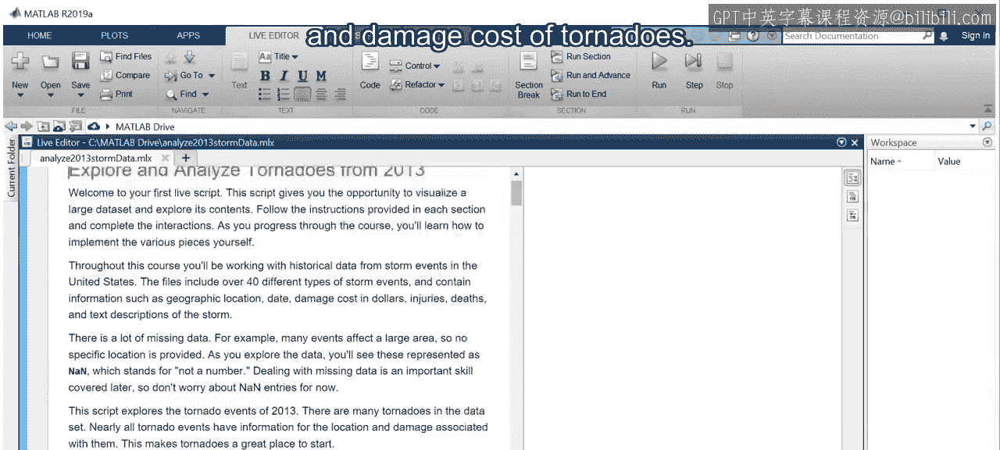

Clicking an item in the table of contents takes you to that section。

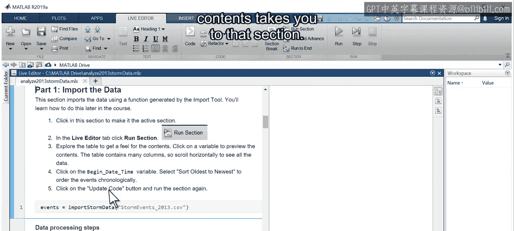

The active section is identified by blue lines enclosing it。

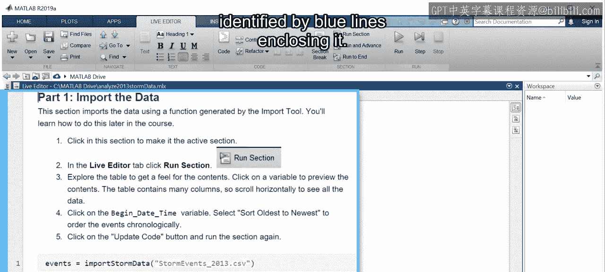

Separating code into sections is helpful because you can interact with the results from one section before moving on。

You run a section by clicking the Run section button found here in the live editor tab。

This section imports the data。A preview of the data is displayed next to the section with scroll bars so that we can view large tables。

This is not a static preview， however， click on a variable to preview the contents， filter the data。

 sort the table and more。The code to perform the changes is captured and displayed to you。

This lets you document your changes as well as learn the language as you experiment。

To continue with the exploration， click into the next section and run it。Now look at this。

 the script created a map of all tornado locations。

 already you start getting a feel for the regions most affected by tornadoes。

Notice this slider sliders enable you to quickly change a parameter when exploring your data。

This slider sets a minimum threshold for the damage caused by a tornado to be included in the figure。

Figures are interactive， as well。Click on a figure to bring up the data exploration buttons。

You can zoom in。And drag the map to explore different regions in more detail。

Changes are captured in the code displayed so you can automate the process in the future。

Continuing through the script， you'll find more controls to visualize tornadoes by month。

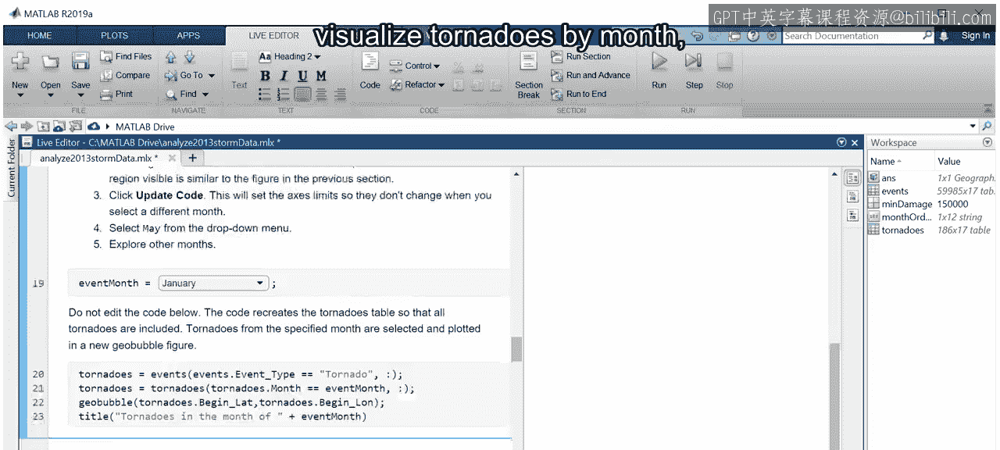

And to calculate statistics on the data。Now that you know how to navigate and use a live script。

 it's time to try it out yourself。The live script shown here is provided for you。

 follow the instructions to practice exploring and visualizing data。

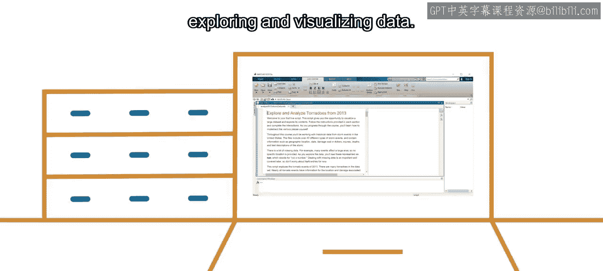