# Mathworks《实用数据科学与MATLAB（数据探索、特征工程、机器学习、毕业项目）｜Practical Data Science with MATLAB》 p09 8_数据科学工作流程概述.zh_en [BV1Jr421w7wL_p9]

🎼，A typical data science project comprises three stages， data analysis， machine learning。

 and working with the results。 This video provides an overview of each stage。

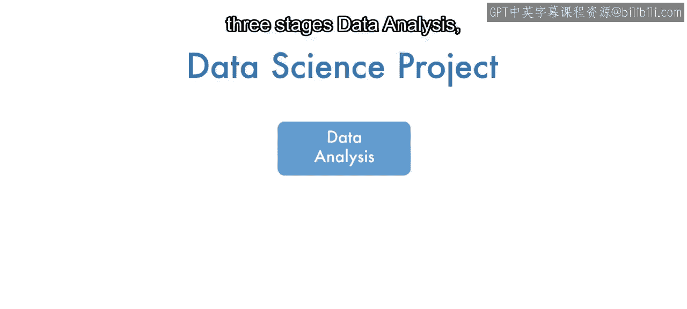

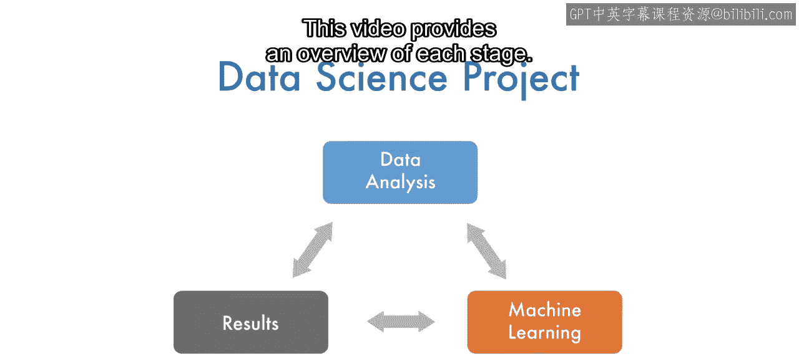

Let's start by taking a closer look at data analysis。

The goal in this stage is to learn more about your data before trying to learn from it。

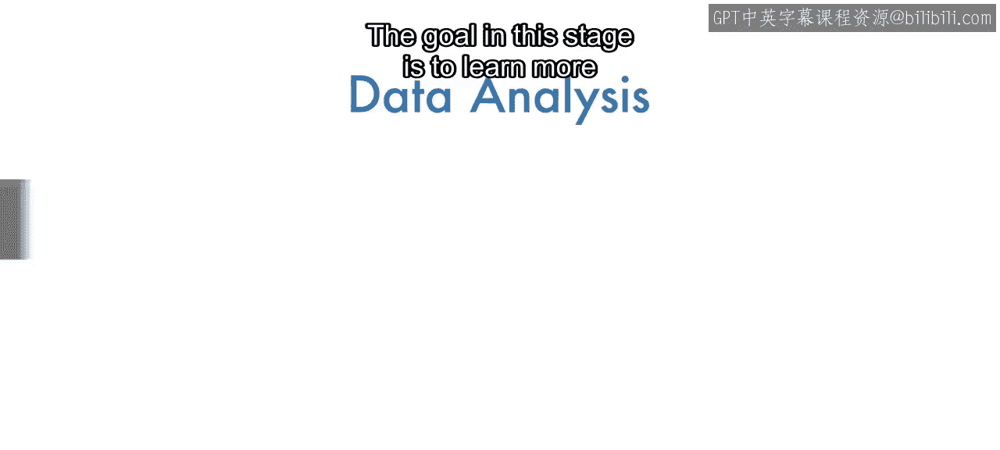

It's helpful to begin with an idea of what you want to learn from your data and what you want to do with that knowledge。

 your project may also have more specific deliverables。

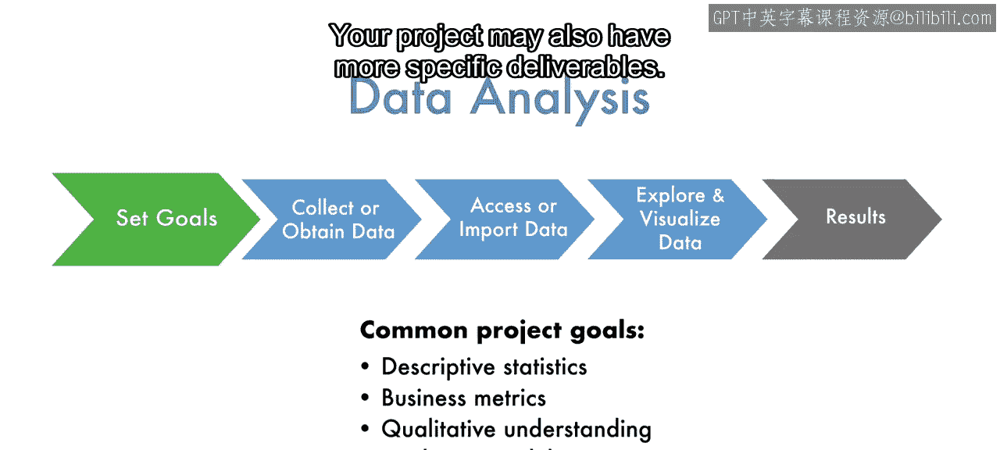

The next step is to identify the types， amounts， and sources of data needed for your project。

Your data may already exist， or you might be generating new data from experiments。

 surveys or simulations Once your data is available。

 you can access it using MATLb the method you use for each source depends on the data location。

 type and size。

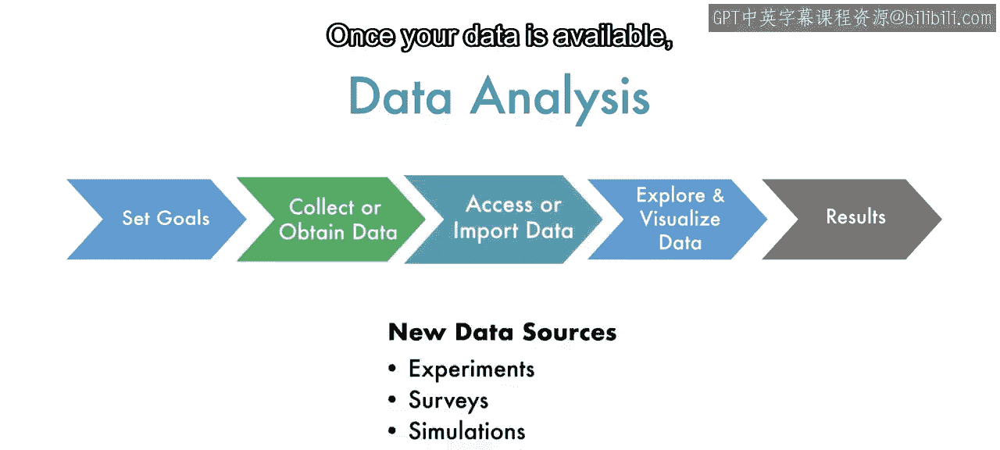

MatTLb can load smaller files directly， and it can also pull remote data from databases and streaming sources。

Larger data sets can be sampled or loaded and analyzed in smaller chunks。

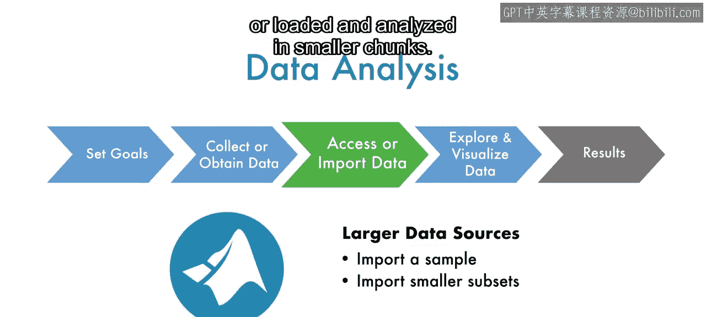

Next it's time to learn about your data through exploration and visualization。First。

 check for missing， incomplete or duplicated data that will complicate your analysis and produce misleading results。

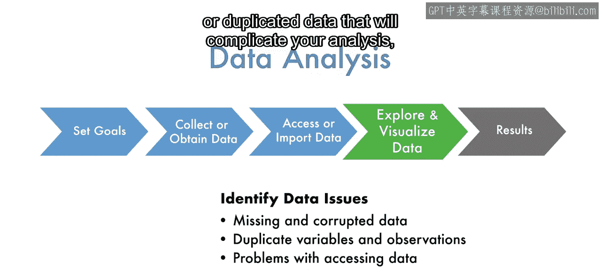

Next， get a sense of how your data is organized and what type of information each variable contains。

Information about variables including their values， range， distribution。

 and outliers can be obtained using MATLB statistical and summary functions。

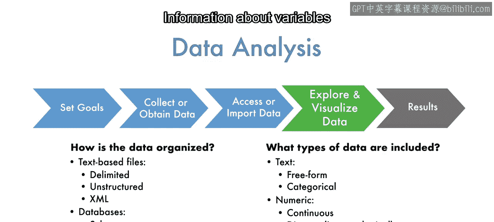

Use grouping functions in MatTLab to study these properties in finer detail Viizations like histograms and scatter plots offer another quick and effective way to learn how variable values are distributed and help you identify potential relationships。

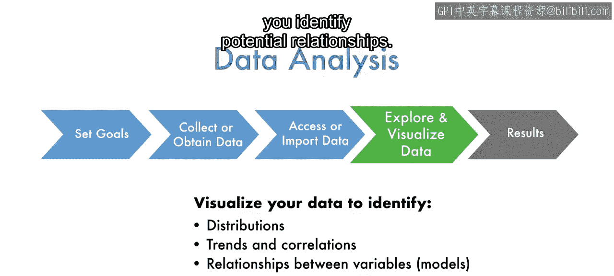

Lastly， it's time to accomplish your specific data analysis goals by computing the statistics。

 investigating the trends or correlations， or creating the visualizations you set out to obtain。

What you learned about your data while exploring and visualizing should provide context and give you confidence in your results。

Before discussing what to do with your results， let's look at an additional component of many data science projects that often follows data analysis。

 using your data to model relationships between variables or observations。

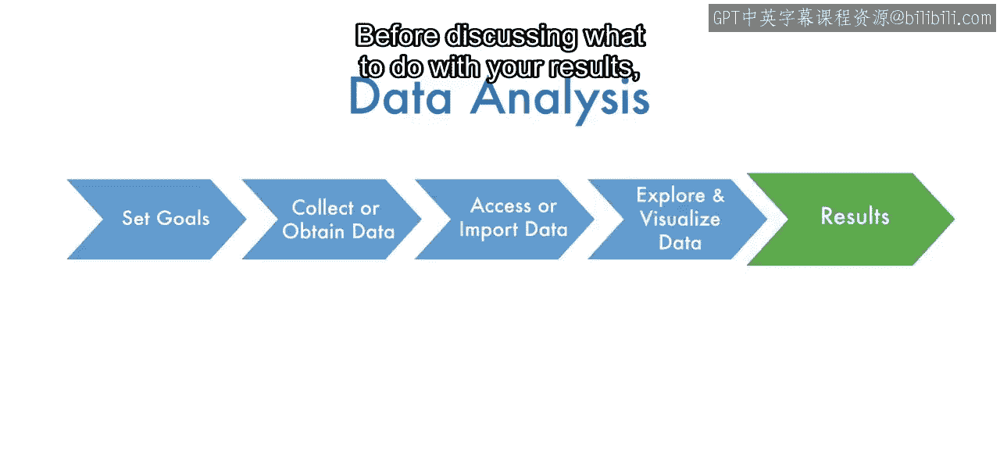

Machine learning is the process of using algorithms to obtain a model of these relationships。

In particular， machine learning algorithms take a general model and adapt it to describe a specific relationship using data to solve for one or more model parameters。

You'll learn more about machine learning in a future course。

 but for now the process can be summarized in the following steps， model and variable selection。

 data preprocessing， model training， and model validation。

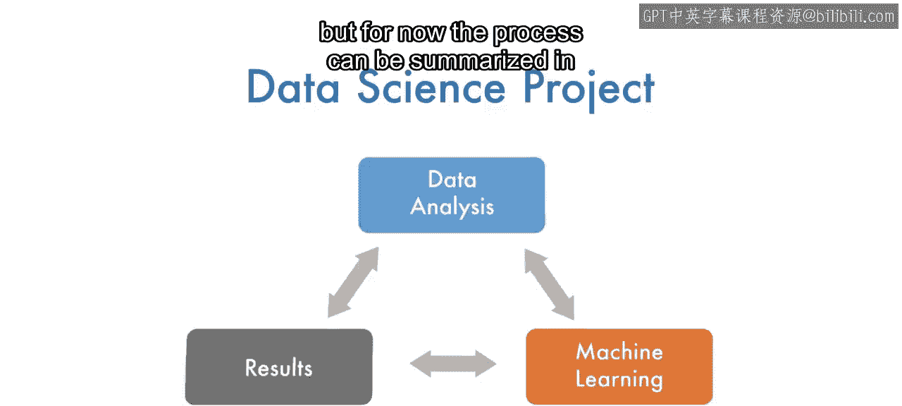

The result is a trained， validated model you can then use for prediction and further analysis。

After completing the data analysis or machine learning stage of your project。

 you can start working with your results First， check your work for mistakes and make sure your results are reproducible。

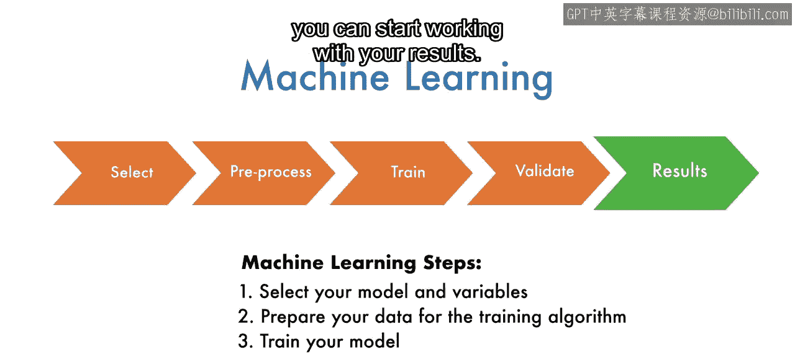

That is， they don't rely on unreasonable assumptions or suffer from bias。

Once you are satisfied with your methods and confident in your quantitative results。

 you can use them to draw conclusions and generate the qualitative understanding you were looking for。

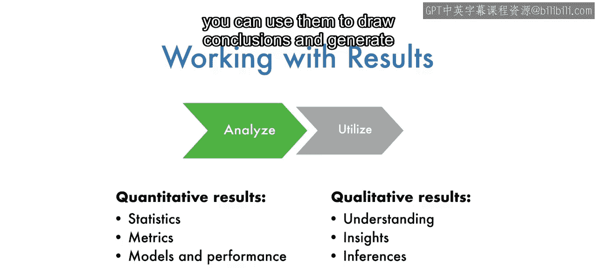

Finally， share your results through visualizations， presentations and reports。

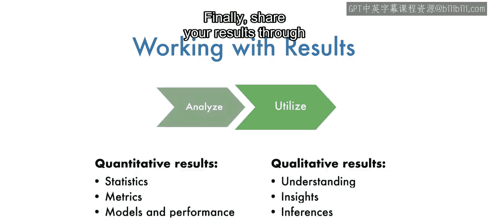

You might also make your data and code available so that your work can be used and extended by others。

More recently， publishing custom reports and metrics using automated dashboards and deploying predictive models to automated systems have become popular uses for sharing data science results。

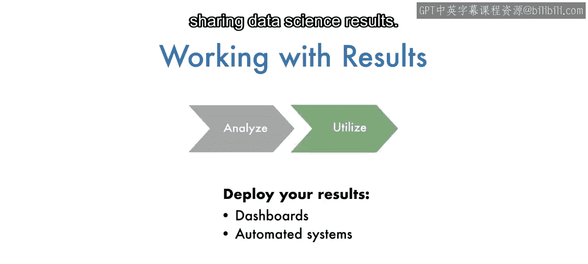

In the next video， you'll see an example of the data analysis workflow and practice。

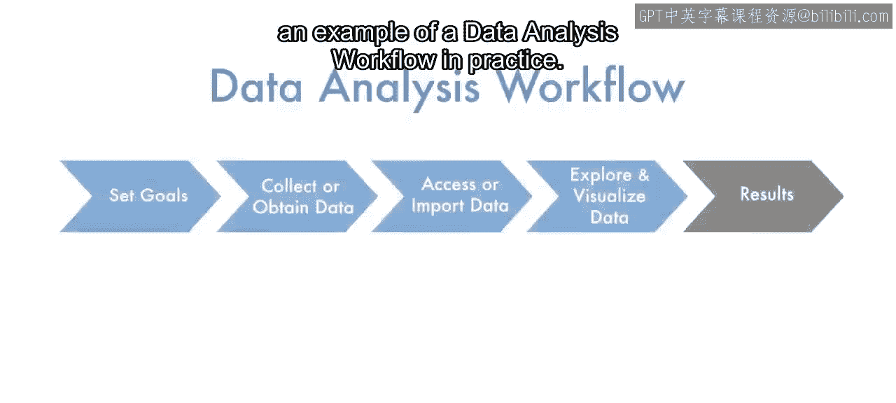