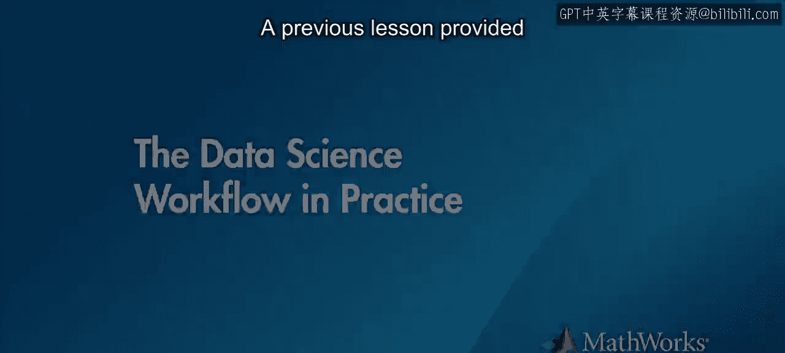
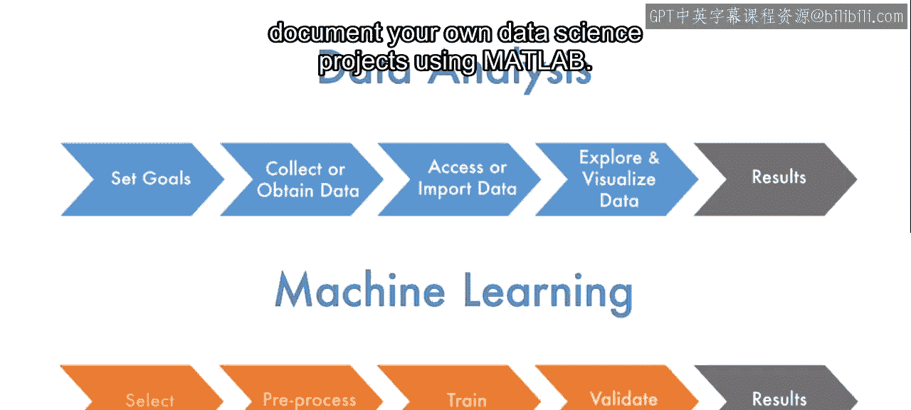

# Mathworks《实用数据科学与MATLAB（数据探索、特征工程、机器学习、毕业项目）｜Practical Data Science with MATLAB》 p10 9_实践中的工作流程.zh_en [BV1Jr421w7wL_p10]

🎼。

A previous lesson provided an overview of the data science workflow。In this lesson。

 you'll see the workflow in action while walking through an existing analysis of taxi trip data。

You will also preview some of the tools available in MATLAB for data analysis and machine learning and see how a data scientist used a live script to document their entire workflow from goals to results。

The first goal in this project was to better understand the trip log data， in particular。

 the relationship between the total charge and the distance and time of each trip。

The second goal was to create a simpler alternative to the current fee schedule。

 using only trip distance and time to compute fares。

The pricing model also needed to satisfy two practical constraints。

 generate roughly the same total revenue， and minimize fare changes。

The data scientist also provided a summary of the data， including the source， file type。

 and a description of variables recorded in each log entry。

The import tool was used to preview the file contents。Select the variables of interest。

And import the data into a MATLb table。The corresponding code was then generated and added to the live script to import the data automatically for future use。

The data scientists next use interactive tools and visualizations to inspect the table variables and apply filters to remove missing data and outliers that might skew the analysis。

The filtering code was added to the live script to focus the analysis on common distance and fair amounts。

While the trip distance was included in the original data。

 the total charge and trip time needed to be generated from the other variables。

Additional field terrain code was added to remove any outliers from these new variables after inspection。

Next， the dataset set was explored using descriptive statistics and histograms。

 which provided information on the range and distribution of variable values。Lastly。

 the data scientists investigated relationships between charge， distance。

 and time by calculating the correlation coefficient and generating a scatter plot for each pair。

The results indicated that a strong linear relationship exists between these variables。

With the first goal achieved， the next step was to capture this relationship using machine learning。

As noted in the script， the data scientists use the regression learner app to create the model。

 Let's open the app to see how that was done。The first step was to select the model variables。

Since the data was already cleaned， no additional pre processing was necessary。

 and the app provides validation by default。 The next step was to select the model type。

Followed by trading and validation。After training， the app provides performance measures and visualizations for model evaluation。

The model can then be exported as a MALb variable。Or code could be generated and added to the script to recreate the model automatically。

With the machine learning complete， the last step in the analysis was to see if the resulting model satisfied the second project goal。

First， the total charges from the current fairR model were compared to those generated by the new model to make sure the model was behaving as intended。

Since there was a large amount of data， the data scientist also used a scatter plot to confirm that the simplified model captured the behavior of the current system。

Lastly， it was shown that the model satisfied the given constraints。Total revenue remain the same。

 and most fares change by less than 50 cents or 5%。With both goals satisfied。

 the data scientists concluded their analysis by noting that more could be done to verify and refine the results。

 and now that you've seen an example of the data science workflow in action。

 hopefully you're excited to learn how to carry out and document your own data science projects using MatLb。

。

