# Mathworks《实用数据科学与MATLAB（数据探索、特征工程、机器学习、毕业项目）｜Practical Data Science with MATLAB》 p100 15_训练多类模型.zh_en [BV1Jr421w7wL_p100]

🎼，So far， you have used binary classification to predict if a taxi trip will have a toll。

What if you wanted to know where a toll came from instead？

Binary classification will no longer work because there are more than two possible outcomes。

In this video， you'll see how to train a multiclass model that can predict an outcome from more than two classes。

You'll also compare the performance of two different multiclass models with confusion matrices。

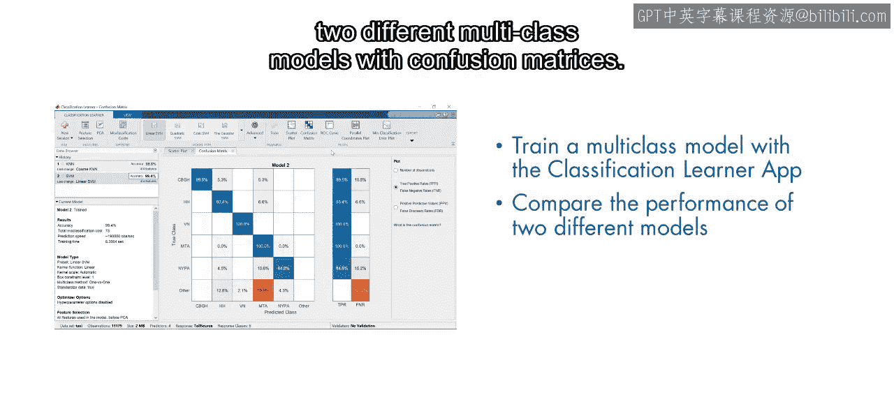

Let's look at a map of New York City with the different sources of tolls highlighted。

The various bridges and tunnels can be grouped into five classes based on the toll amount。

 For example， the purple crossings labeled MT TA all charged $5。54 in 2015。

The abbreviations here refer to either the name of the bridge。

 such as H H for the Henry Hudson Bridge or to the Transportation Authority that collects the tols。

 such as MTA for Metropolitan Transit Authority。Some of the other tolls in the data set did not match any of the prices reported by the authorities。

 These tolls have been grouped into a sixth class， named other。To get started。

 open a new live script and load a month of taxi data。Use the provided function。

 add Toll source to add a new categorical variable containing the six toll sources。Next。

 remove the trips that did not charge a toll with another custom function。

 since these data points are no longer needed。

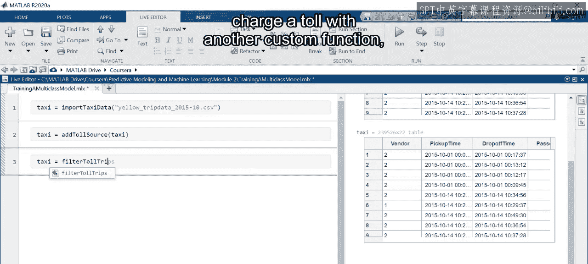

Open the Class learner app from the To strip and start a new session。

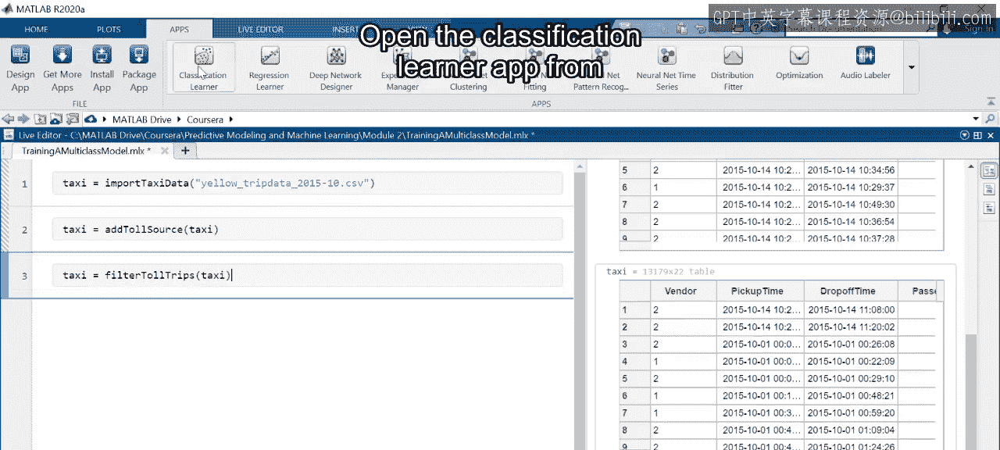

Make sure the taxi data is selected in the drop down list and choose the variable Toll source as the response variable。

Select the pickup and drop off coordinate variables as predictors。

 as you did previously with binary classification。And choose no validation before starting the session。

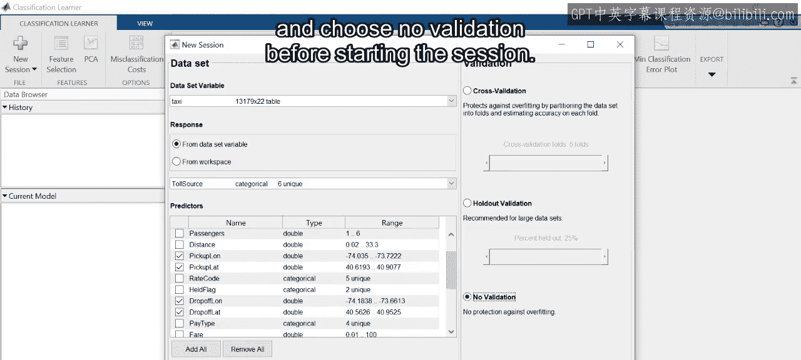

Notice the rough shape of Manhattan Island on the scatter plot， showing the pickup locations。

Most trips with tolls start in Manhattan or at one of the nearby airports。However。

 it's hard to make out the different toll sources from the pickup locations。

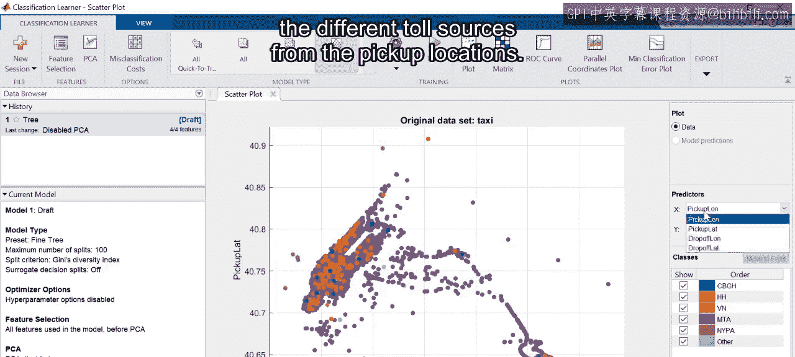

Try selecting the drop off locations instead。Now， there are different clusters of points with the same color。

 Most of the points are purple， so they belong to the MTA class。

You can also see smaller groups of points with different colors such as the VN or HH class。

 The clear visual separation of these classes suggests that the drop off locations will be helpful in predicting the toll source。

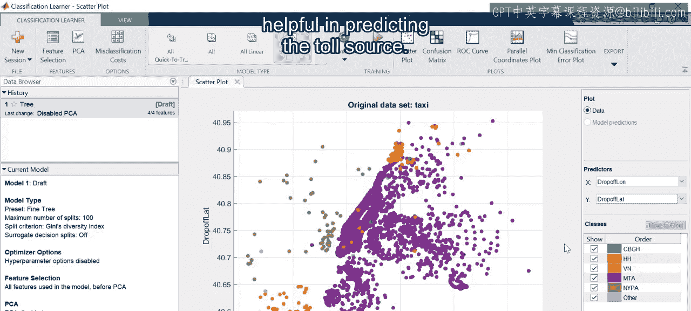

So how do you train a model to predict multiple classes？

Some algorithms are easily extended from binary to multiclass models， such as K nearest neighbors。

A K&N classifier works by identifying the nearest neighbors for each data point and then assigning it to whichever class is the most common。

It doesn't matter how many classes are represented in the set of neighbors。

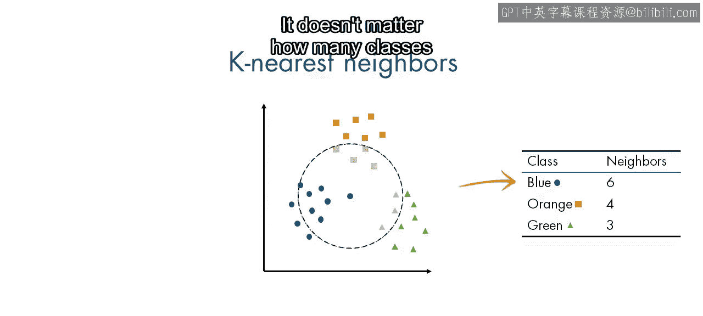

To try this out yourself， select a Cose KNN model and click Train。How did the K And N model do， Well。

 the reported accuracy is over 98% cent。Does that mean the model performs well？

Take a look at the scatter plot。 Many trips were incorrectly labeled， as the MTA class。In fact。

 it looks like some of the classes don't appear at all。

You can see this more clearly in the confusion matrix。

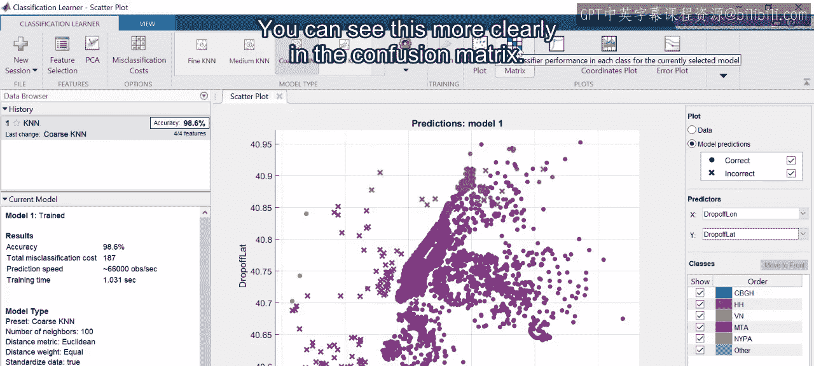

The confusion matrix from multi class models is similar to the binary case。

 with the predicted class on the X axis and the true class on the y axis。 However。

 now there is a row in column for each class。 So the size of this matrix is 6 by 6。

Notice that almost all the data points were predicted as the MTA class。

 but because this class is the most common， the overall accuracy is high。

Three of the columns are empty， meaning those classes had zero predicted points。

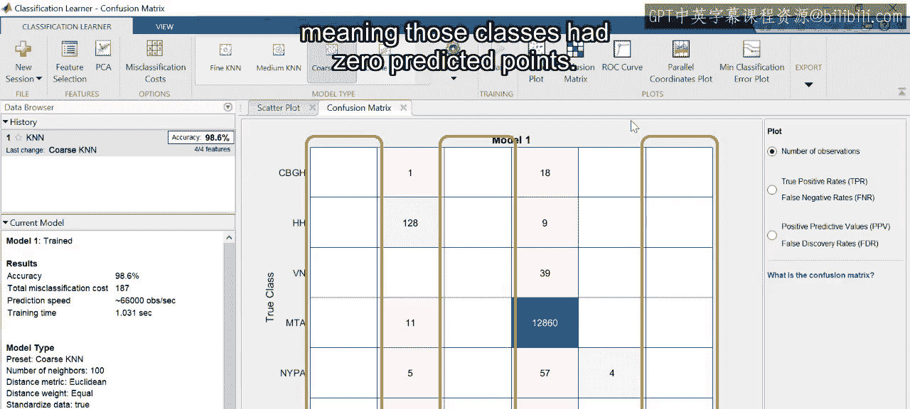

This poor performance is reflected in the recall or true positive rate for each class。

The recall for the HH and MTA classes are above 90%。

 but it's less than 10% or even undefined for the other classes。

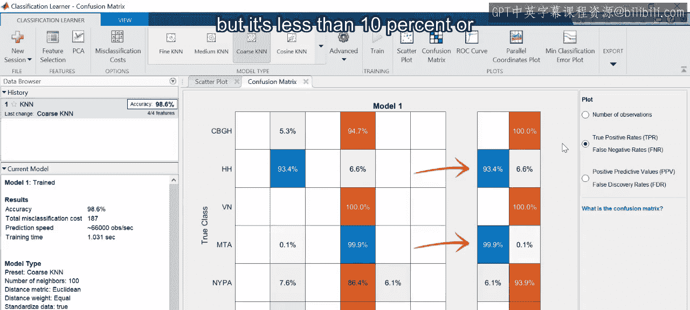

Why did this happen？A co K and N model uses a value of 100 for k。

 meaning that each data point is assigned to the most common class among its 100 nearest neighbors。

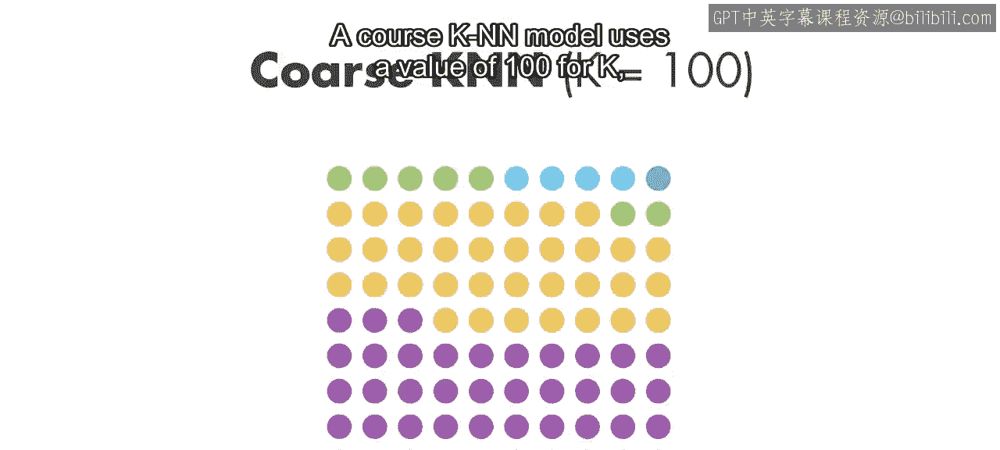

However， several of the classes don't even have 50 data points in them。

 which means they will always be assigned to the much more common MTA class。

Try customizing this model on your own。 What value of K will improve the recall for these classes。

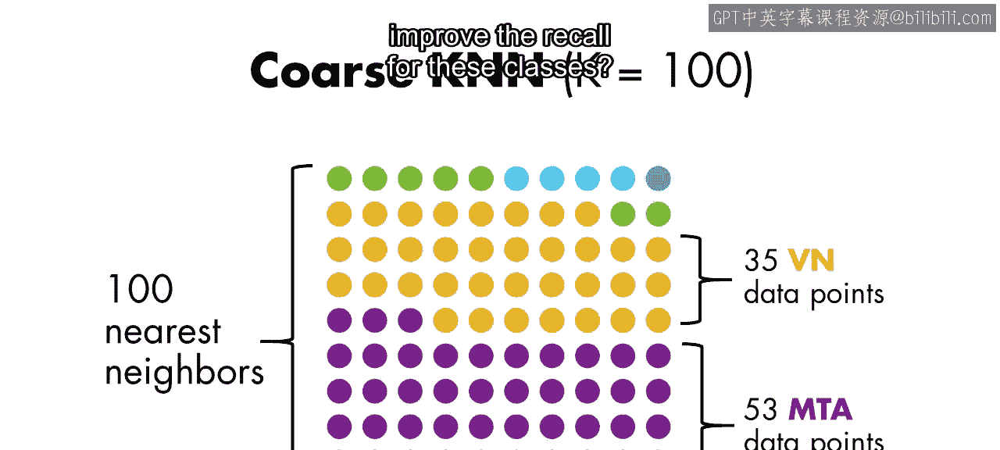

Let's move on to a different type of model。 support vector machines。

Recall that a single SVN model will find a decision boundary between two classes。

 so it can't be easily extended to multiple classes。Instead。

 multiple binary classifiers can be employed to achieve the same goal。

 The strategy called one versus all classification uses a separate model for each class。

Before training， the data points in each model are labeled as either belonging or not belonging to a particular class。

The models are then trained with a binary classification technique such as SVM or logistic regression。

When it comes to predicting the class for a new data point， a score is calculated for each model。

The score represents how well the new data point fits in with the isolated class。

 The data point is assigned to the class whose model has the best score。

All of this is handled automatically for you in MATLAb。

 so the process for training in SVM is the same for binary or multiclass models。

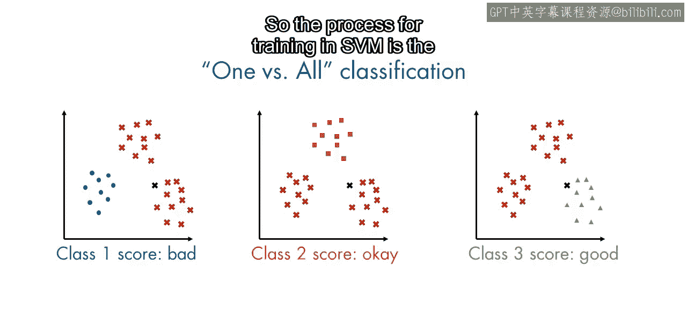

Let's train a multiclass SVM in the app。First select a linear SVM model from the dropdown list。

In the advanced options， the default multiclass method is1 versus1。

This is a slightly more advanced version of the one versus all strategy。

 but it uses the same approach of training multiple models。

Keep this option selected and train the model。The overall accuracy for the S VM model is higher than the K and N model。

 but is it better at predicting the smaller classes。

 It looks like this is true from the scatter plot， since more classes are visible。In other words。

 the SVM model did not assign all the points from the smaller classes to the MTA class。

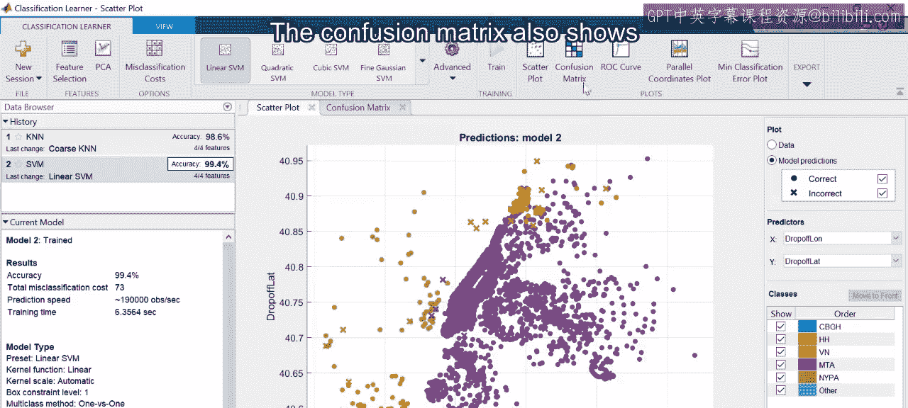

The confusion matrix also shows better recall rates， except for the other class。 Nevertheless。

 these results indicate that the linear SBM model does a better job at predicting the known toll sources than the course K and N model。

So why is the performance poor for the other class。

 Go back to the scatter plot and deselect all the classes， except other。

 The drop off locations are fairly spread out， meaning this class overlaps significantly with the other classes。

😊。

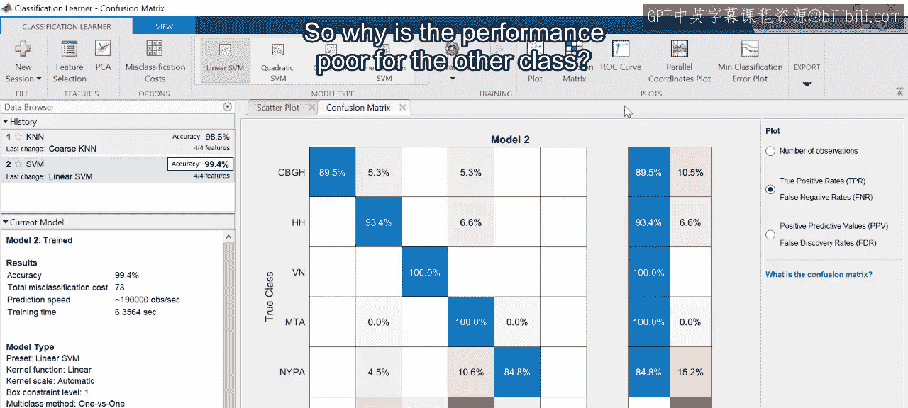

You would therefore need additional features besides the pickup and drop off locations to accurately predict this class。

On the other hand， it's possible that these tolls should belong to one of the known sources。

 but their amounts were recorded incorrectly。 It's worth investigating further to see if these data points should be treated as missing。

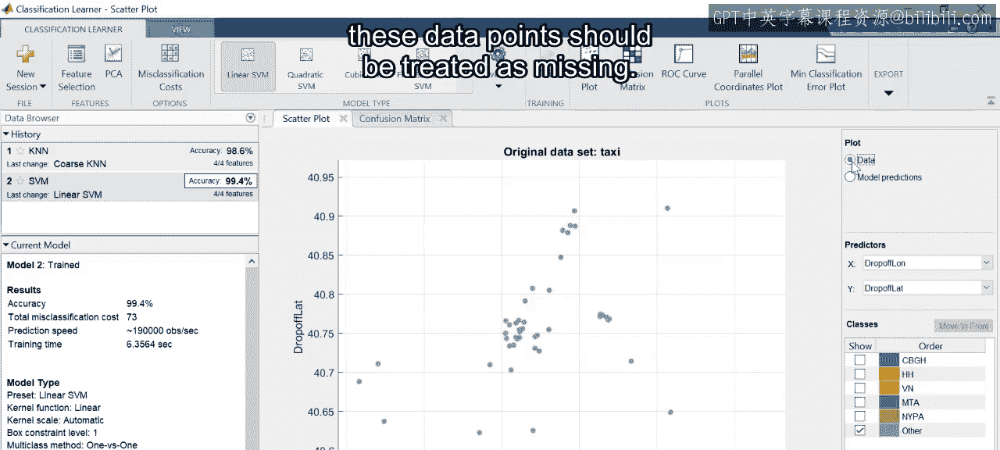

You've now trained and evaluated multiclass classification models in MATLb to summarize the main points。

Multiclass models can be trained by extending binary models to more classes。

 or by combining multiple binary models together。The Class learner app can perform both these tasks。

 so the workflow is generally the same for multiclass and binary models。Finally。

 the overall accuracy metric rarely tells the whole story。

 Make sure to review the performance metrics for each class when evaluating your model。

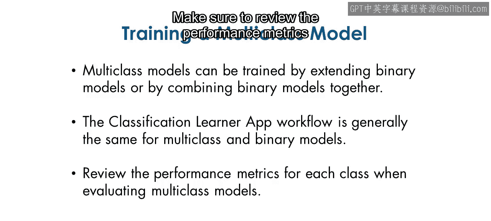

。