# Mathworks《实用数据科学与MATLAB（数据探索、特征工程、机器学习、毕业项目）｜Practical Data Science with MATLAB》 p101 16_分类总结.zh_en [BV1Jr421w7wL_p101]

🎼，Good work， Reach the end of this module。 Classification bottle are used when your response has a discrete set of possible outcomes。

 For example， patients who are at risk for disease and those who are not。😊。

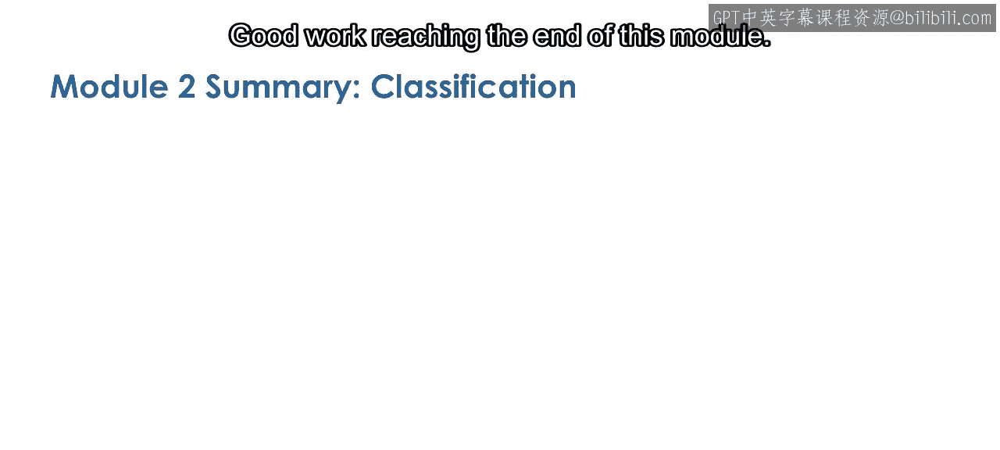

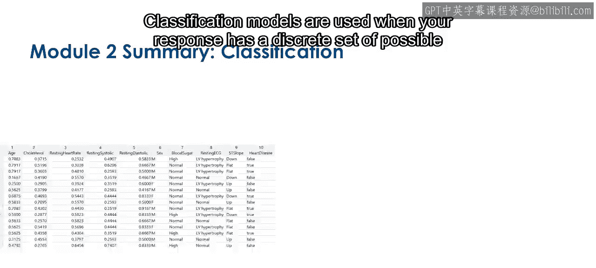

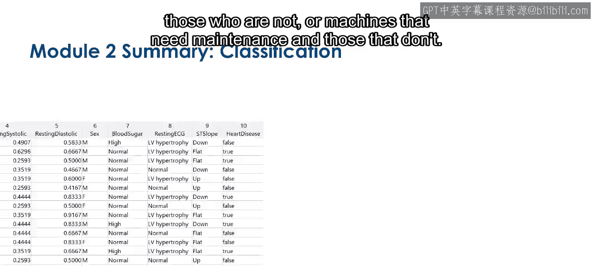

Or machines that need maintenance and those that don't。

Here you use the taxi data to predict if a trip would include a toll。

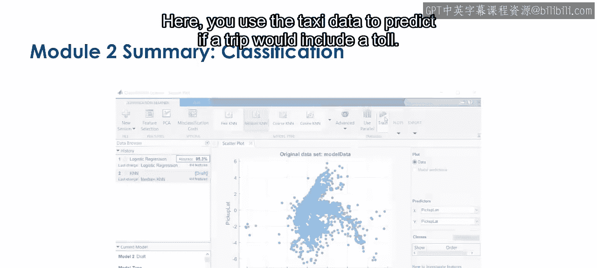

Using the classification learner app， you trained different types of models。

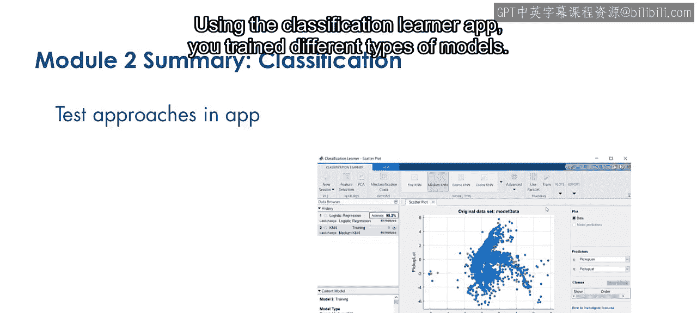

The confusion matrix and ROC curve help you evaluate models so you can quickly iterate and find the best approach for your application。

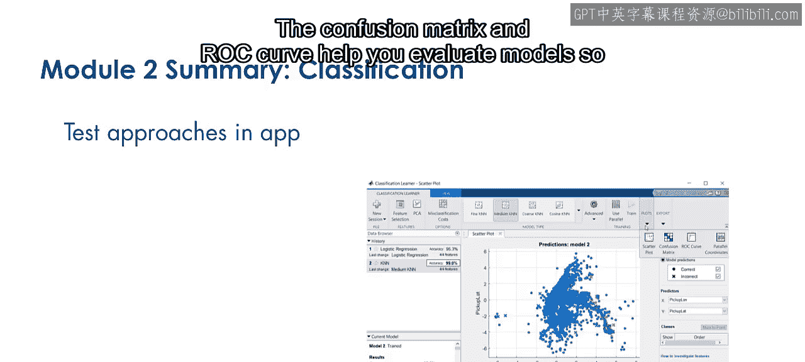

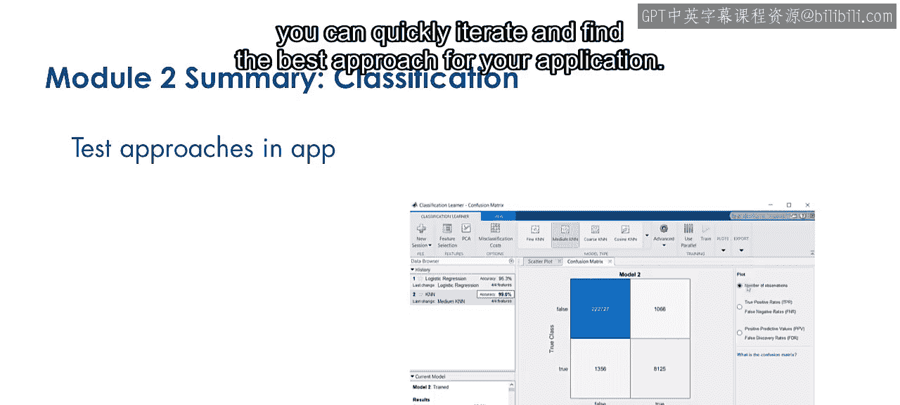

The performance of a classification model involves more than just prediction accuracy。 Often。

 getting one class correct is more important than getting the others correct。

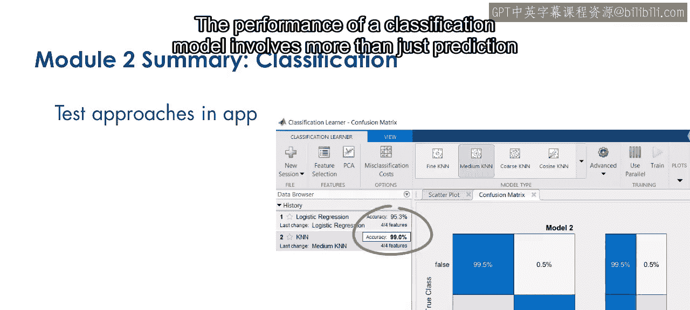

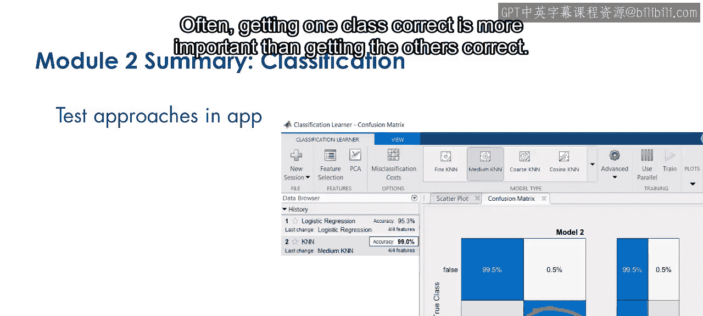

You learned several classification metrics to help you evaluate your models。

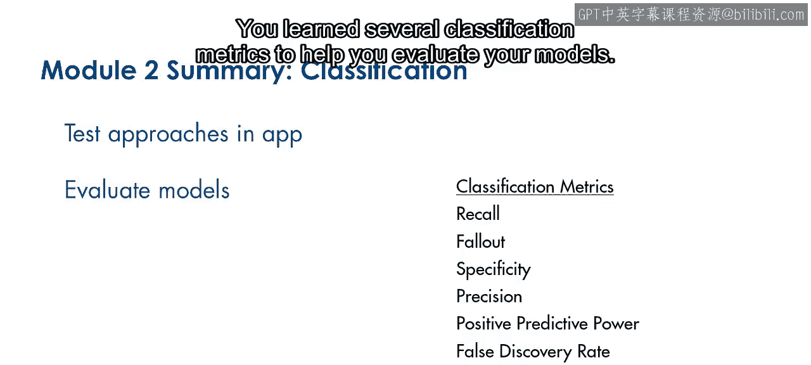

For example， visualizing recall and fallout with an ROC curve helps you identify the trade offs between these two metrics。

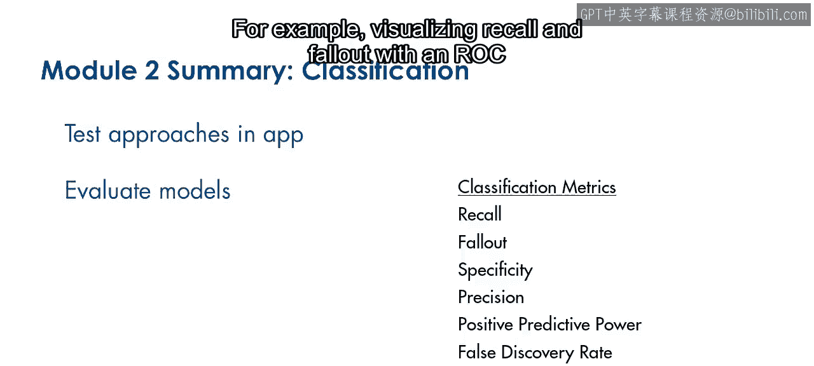

You can adjust the model or try a new approach based on your requirements。

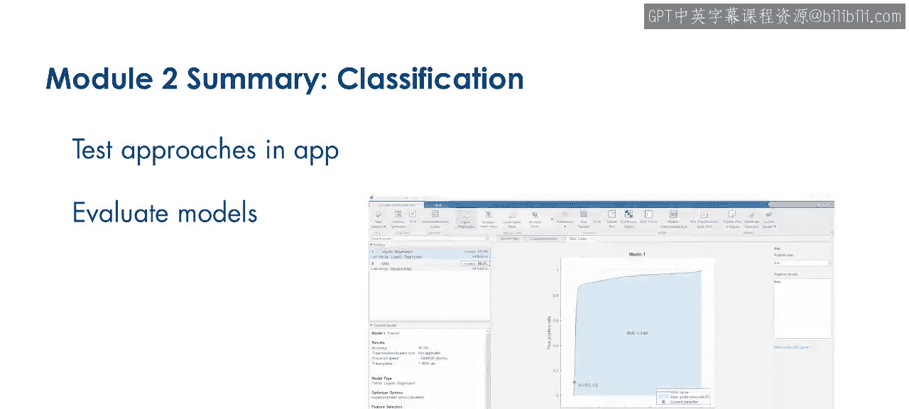

You ended the module by training and evaluating multi class models。

 You learned how one versus  one and one versus all methods are used to extend binary classifiers to multi class problems。

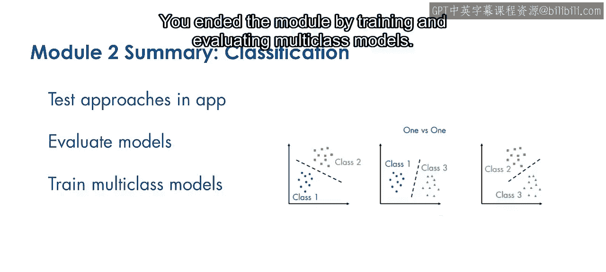

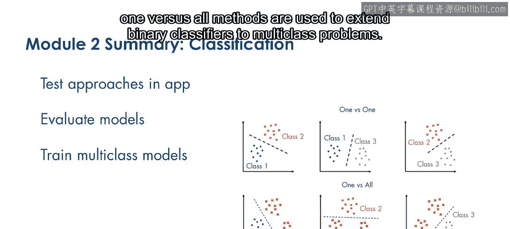

You also learn to interpret a multi class confusion matrix to evaluate the results。

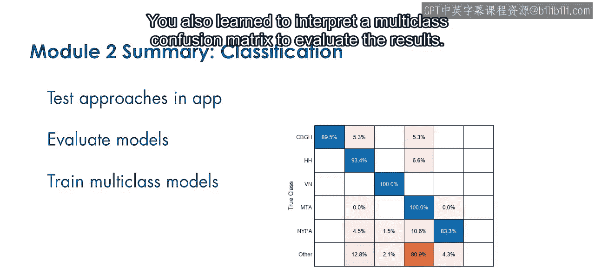

Take some time to practice what you've learned。If your own data has a discrete response variable。

 try training a few classification models。

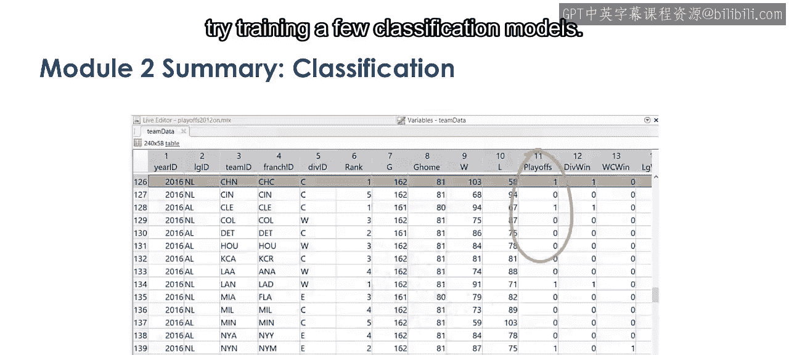

Using a data set that has meaning to you is a great way to practice。

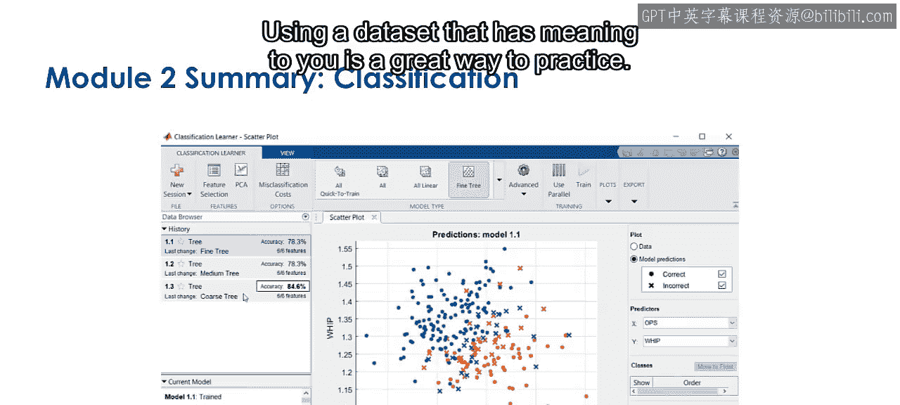

You can also continue practicing on the taxi data。 Try a summer month to see if the results differ。

 And when you're ready， take this module's quiz。😊。

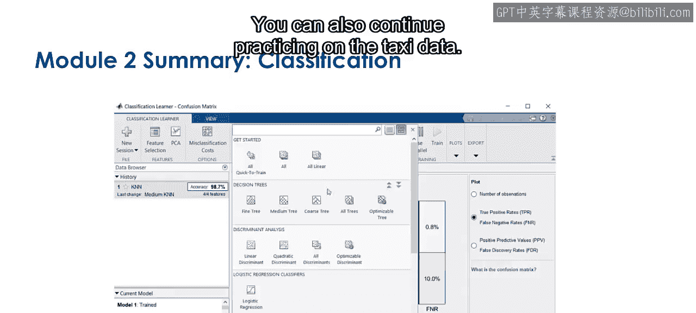

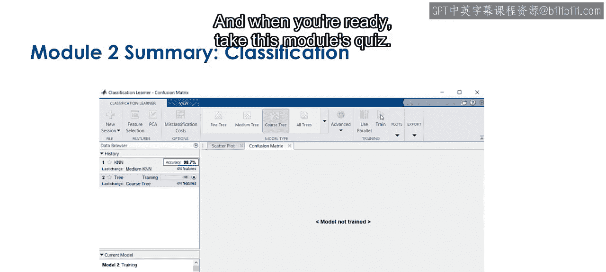

Good luck。