# Mathworks《实用数据科学与MATLAB（数据探索、特征工程、机器学习、毕业项目）｜Practical Data Science with MATLAB》 p102 17_解决欠拟合和过拟合.zh_en [BV1Jr421w7wL_p102]

🎼，Recalled that previously， when training models in an app， you selected the no validation option。

The app warns that this option does not protect against overfitting。

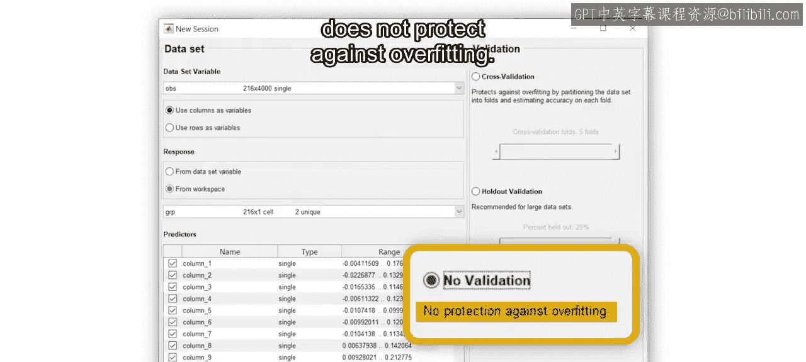

What is overfitting？And why is validation data important to help avoid it？

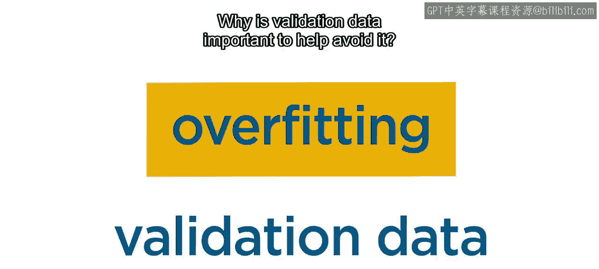

In this video， you will identify overfitting as well as underfitting and learn how to apply training。

 validation and test data。Consider the following data and this simple linear model fit to it。

You know that simple linear models are easy to interpret， fast to train and fast to make predictions。

However， they have a downside。Linear models do not capture complex patterns and trends。

This can result in large errors。That effect is called underfitting。

 and the model is said to have a high bias。How do you avoid underfitting？

If the model is too simple for the data， you could use a more complex model。

Or engineer new features with more predictive power。For example。

 if a first order linear model is too simple for this data set。

 you could choose a higher order polynomial like this。At this point。

 you already know that more complex models can be more difficult to interpret and take more time to train and make predictions。

But they can have another issue as well。When you look at the result。

 you can tell that the model fits the training data very well， but it might fit too well。

 which means that it captures the noise in the data。

 That is it captures patterns that are not real and will not reappear the same way in the future。

Once you apply this model to new data， this can lead to larger errors。

This effect is called overfitting， and the model is said to have high variance。

Before covering how to avoid overfitting。Let's look at the relationship between model error and model complexity。

Let's choose a simple model。And start increasing the model's complexity to avoid underfitting and to get a smaller error。

You could do that until the error is really small for your training data。Now。

 when you look at additional data， the model error will almost always be a bit higher compared to the training data。

But notice as the complexity increases， there is a point where the error begins to increase。

Selecting a model with the lowest error on the training data will result in a relatively high error with additional data。

So this model might not be the best choice。Notice that there is an optimal point for model complexity。

 where the model captures trends in the training data well。

 but is also flexible enough to predict well on data beyond the training set。

This model will show a larger error in predicting the training data。

But it is more likely to generalize well。Models to the right of this optimal line overfit the data。

 whereas models on the left underfi。

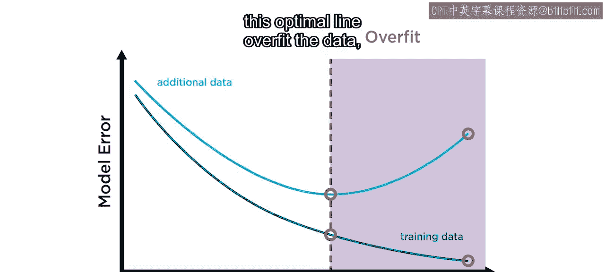

So how do you find the best configuration for your model and avoid overfitting？

You've just learned that you could consider decreasing model complexity。

You've also seen that to make the best decision for model complexity。

You need more than a single data set to validate your model。

You could also try reducing the number of features or regularizing the model。

These two approaches will be covered in an upcoming lesson。

This video covers the approach of using additional data。The additional data。

 which will be used in the training process， is known as validation data。

You've already seen this hinted at in the app。As well as in the supervised learning workflow。

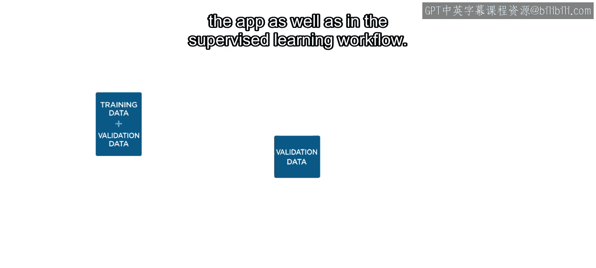

When you look closely at the workflow， you'll notice another data set called test data。

This is additional data you'll use to evaluate the final results after training and validating the final model。

So overall， you'll need three different sets of data， the training data set。

 which is usually the biggest data set， the validation data， and the test data。

 which are often much smaller sets。You'll use the training data to build your model。

The validation data will help guide your model selection， parameter optimization。

 and any iterative preprocessing steps taken。Because validation data is used as part of this process。

 it cannot represent unseen future data。You need test data to finally evaluate how your model will perform with data is never seen。

After applying the same preprocessing steps to the test data。

You will see how well the model predicts new data。

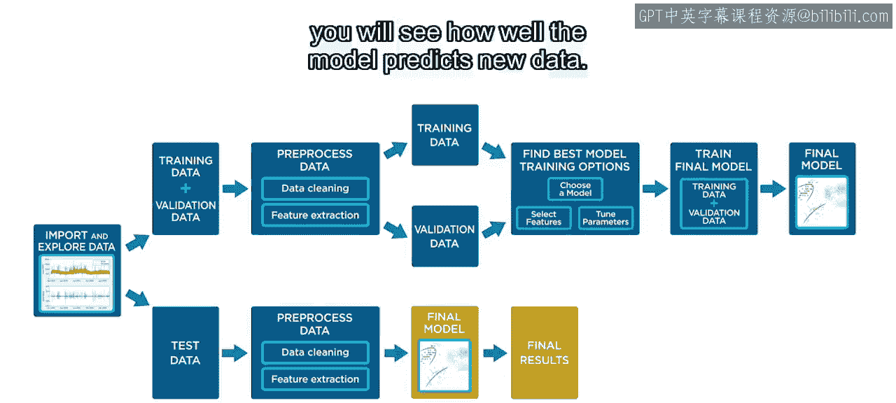

Let's start with a first split where you divide the initial data set into training and validation data and test data。

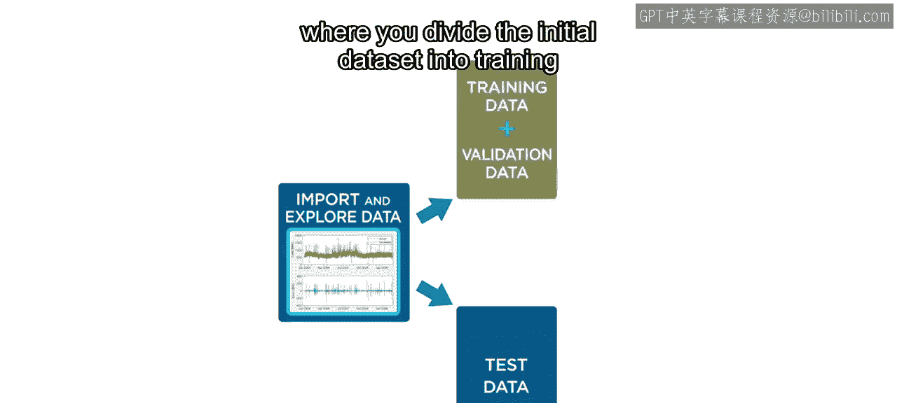

Say these dots represent your data。

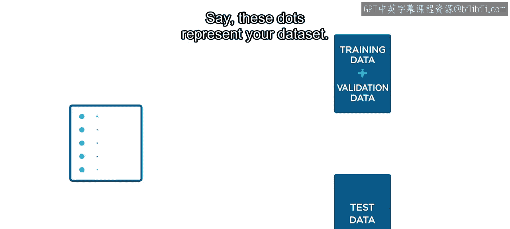

A typical split could look like this。Where you keep 80% of the data for training and validation。

But hold out 20% as your test data。This method is called Hol Out。

You might also hear the termH Out test set for your test data。You don't have to choose an 8020 split。

 other percentages may work as well， depending on the size of your data。Set the test set aside。

This will only be used to evaluate your final model。Now。

 take the remaining data in the combined training and validation set。

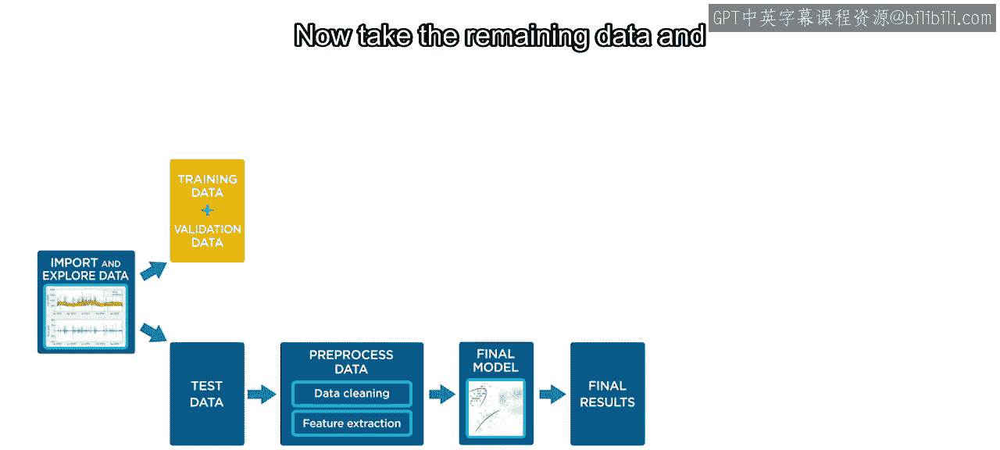

And preprocess that data。Then split it into training data and validation data。

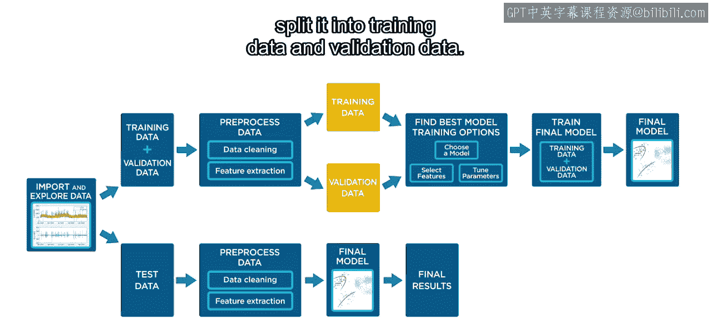

There are different ways of doing this。The most common methods for splitting。

 which you also saw in the app are Holout and Kfold cross validation。Let's look at holdout first。

You already know this method from the test data split， it works in the same way as before。You keep。

 for example， 80% as training data to build your model。

And 20% of the data goes into the validation data set。

You then train a model on the training set and assess its performance with the validation set。

For Kfold cross validation， you divide the data equally among several subsets， the so called folds。

Let's use three folds as an example。For the first fold。One subset is chosen for validation。

 while the other two are used for training。

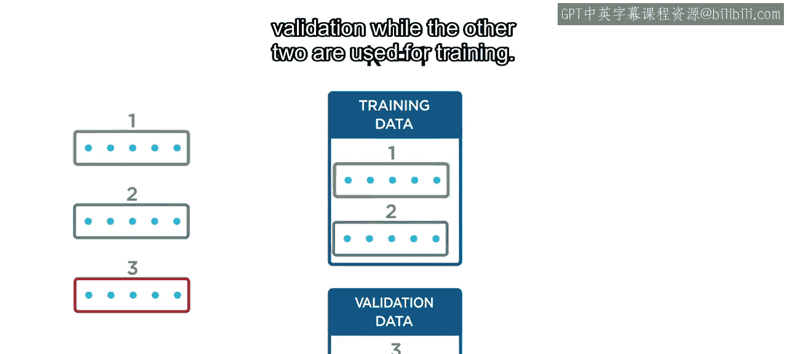

After calculating the performance， a different subset is used as validation data for the next fold。

The training set also changes accordingly。

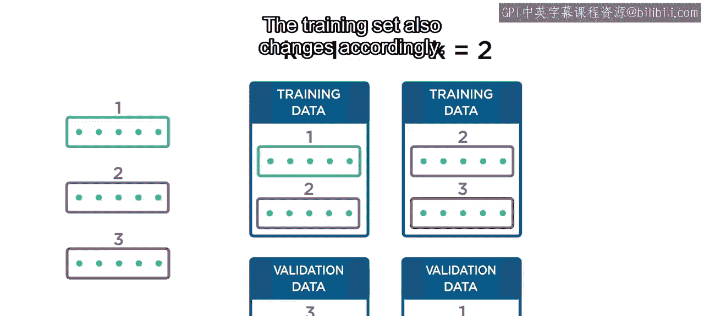

This process is repeated until all subsets have been used as validation data once。

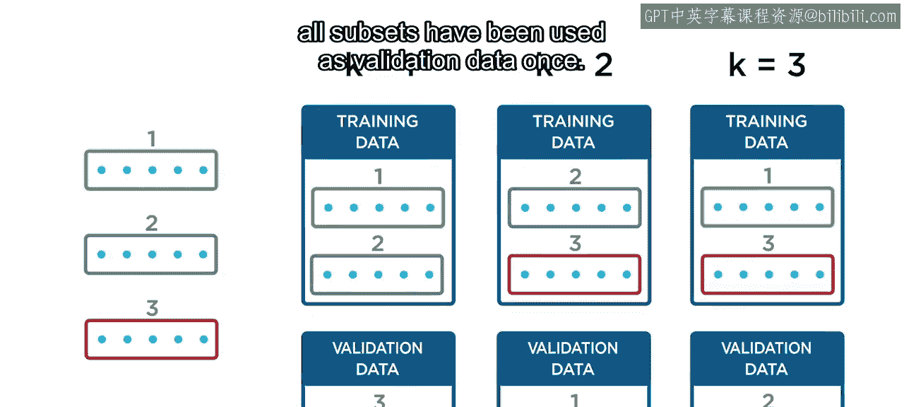

Finally， the mean performance across all folds is calculated。

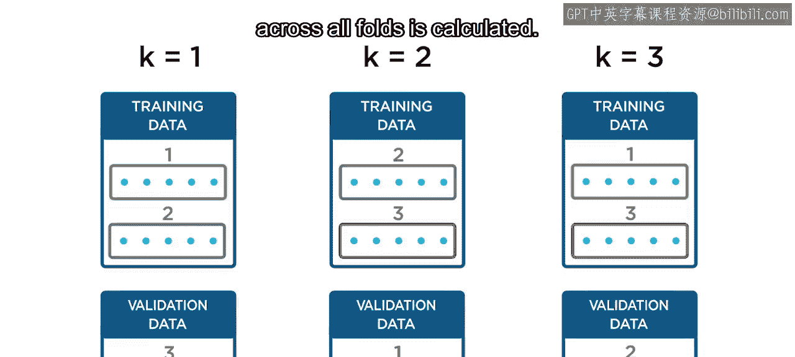

So which validation method should you use？Let's compare both。

Holdout validation involves testing your models on a single validation set。

 whereas Kfold repeats that validation process k times and averages the performance。

This results in longer training times， but can give more accurate results。

 especially for smaller data sets。If you have a lot of observations。

 then holdout accurately captures all the trends in the data and will be much faster too。

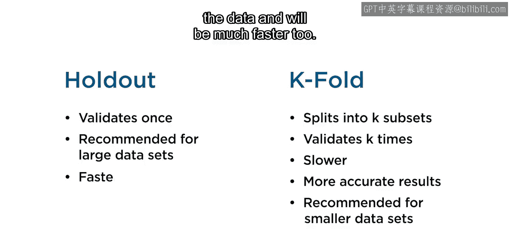

Once you've decided on the validation method。You use the validation data。

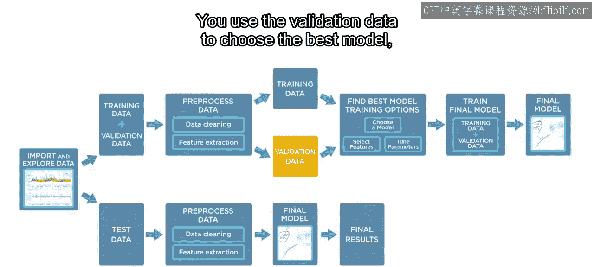

To choose the best model， select features and tune parameters。

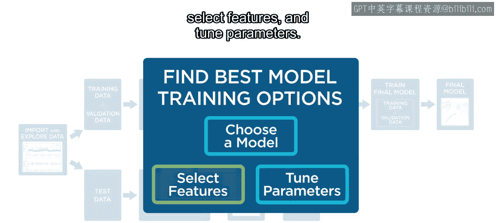

When you are satisfied with the model， you then train the final model using both the training data and validation data。

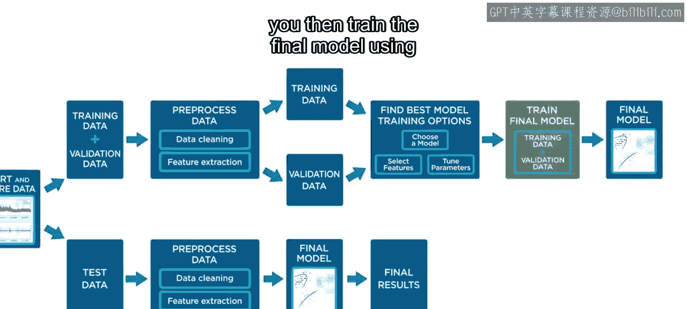

The app automatically does the step for you。

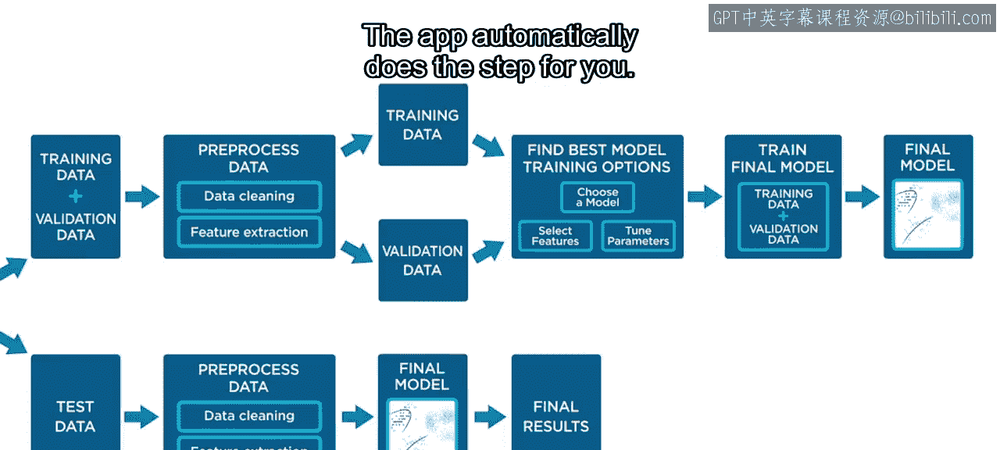

Finally， use the test data that you set aside at the beginning to assess the generalization error of the final model。

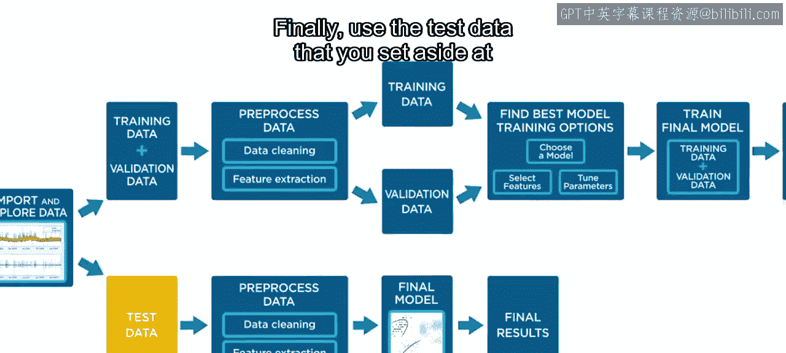

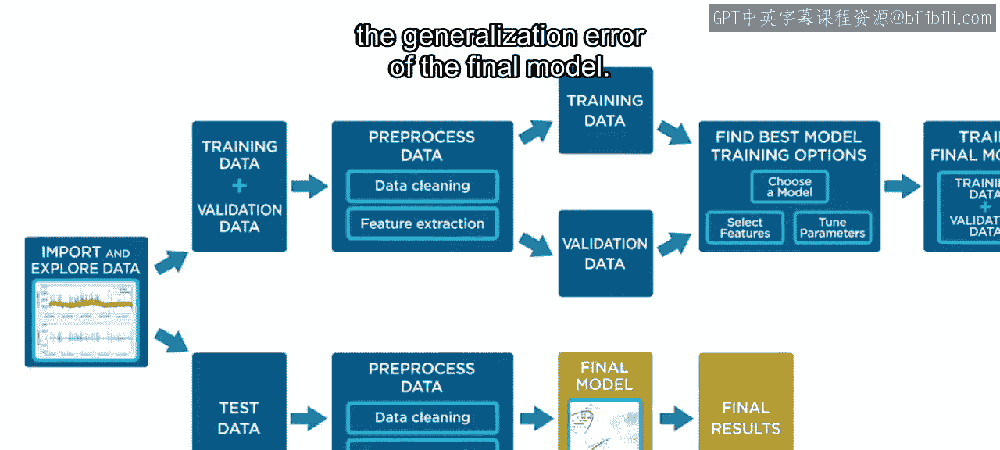

Let's summarize what you've learned。Simple models are usually easier to interpret and faster to train。

Typically， they also make predictions faster and require fewer computational resources。

But simple models may fail to capture more complex patterns and trends in the data。

This type of failure is known as underfitting。More complex models such as higher order polynomials。

 trees， or SVM models with nonlinear kernels can capture these trends。

But could potentially fail to generalize well to new data。

This type of failure is known as overfitting。By using validation data to guide your modeling process。

 you can find the right level of model complexity to predict new data as well as possible。

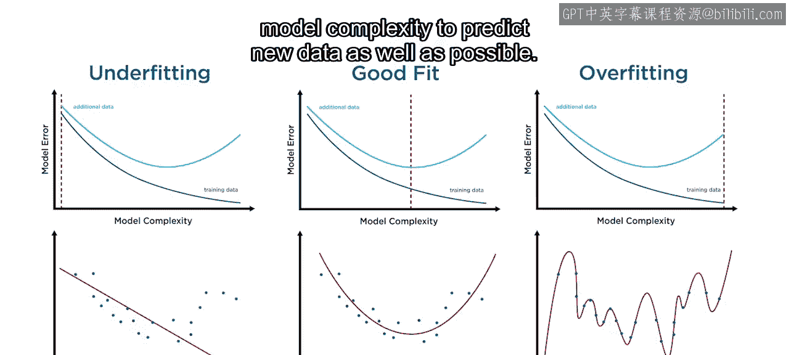

🎼。