# Mathworks《实用数据科学与MATLAB（数据探索、特征工程、机器学习、毕业项目）｜Practical Data Science with MATLAB》 p103 18_训练时使用验证数据.zh_en [BV1Jr421w7wL_p103]

🎼，You've just learned that while more complex models can capture patterns and trends in the data with less error。

 they can potentially overfit the training set， leading to even more error when generalizing to new data。

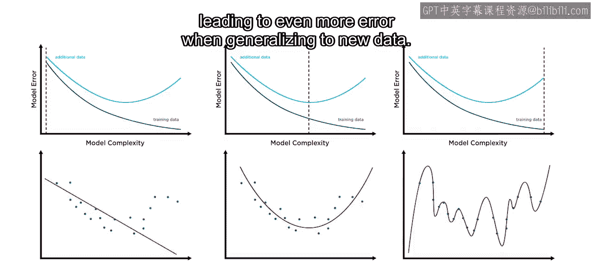

You learn the importance of splitting off a subset of your data for final testing。

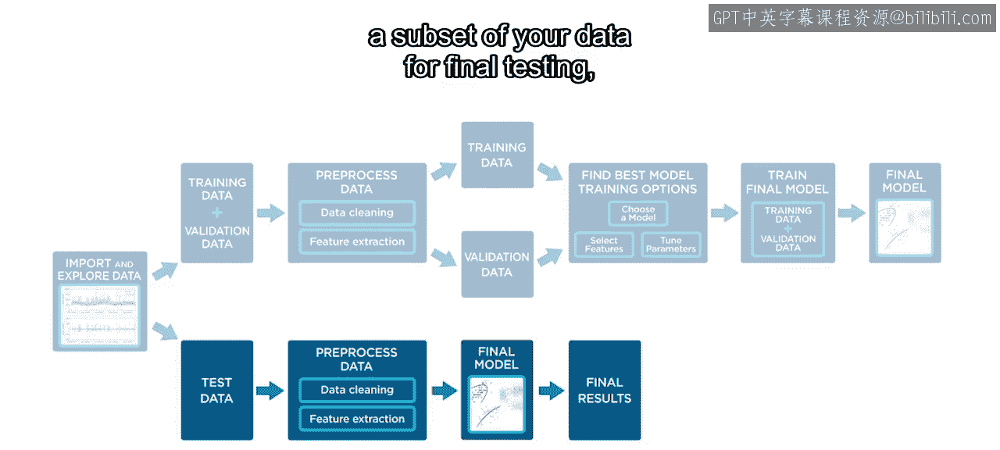

As well as using validation data to prevent choosing a model that overfits。

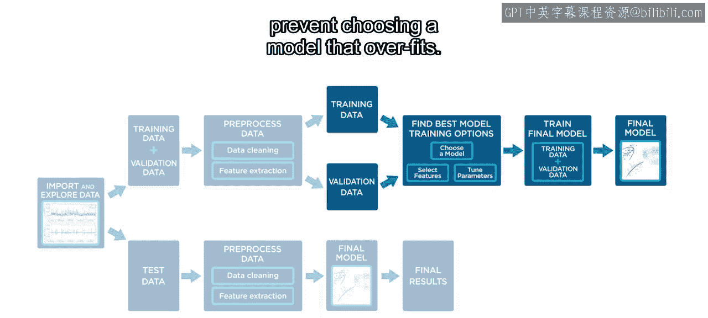

Now let's see how to do this in MATLb using trip duration prediction as an example。To get started。

 import the taxi data for the month of May。 you'll want to do so without any pre processing。

 since you still need to split off the test set。

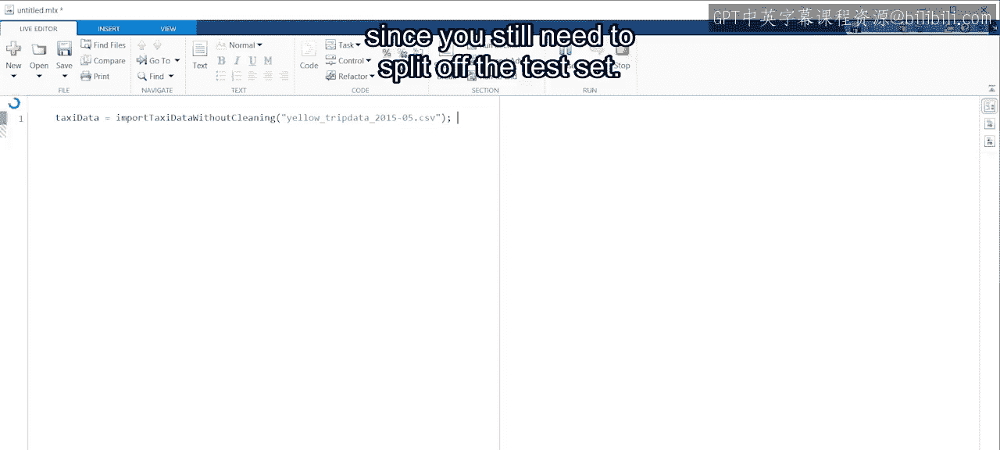

For reproducibility， let's set the random number generator seed。This way。

 if you rerun the script in the future， you won't get a different test and training split。

To create the partitions， use the function CV Partition。

The arguments should be the height of the data。The holdout method。

And the fraction of the data to use is a test， let's say 20%。

This will give you a CV partition object that can be used to get indices for test and training data。

Extract the test indices from this object， using the function test。Next。

 use the result to extract the test data by indexing into the original table。Remember。

 you'll set this data aside for the time being。Similarly。

 get the training indices using the training function on this object。

And extract the training data by indexing into the original table。

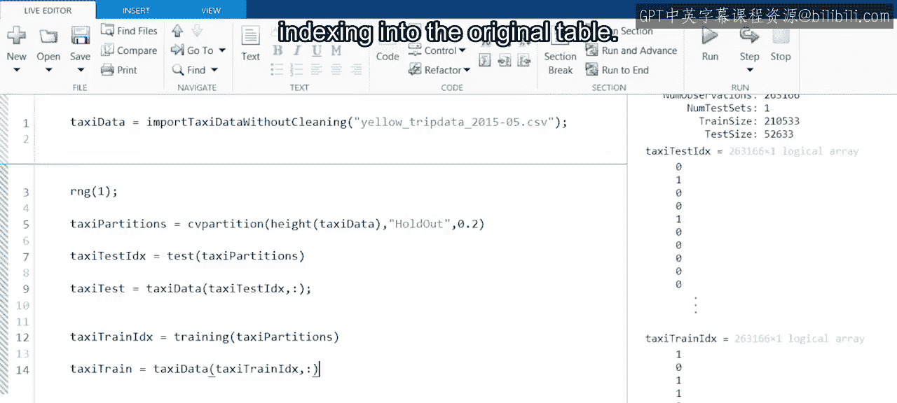

Finally， before you train any models， let's apply the basic preprocessing function to the training data。

Add the time of day feature。And the day of week feature。

Now let's open the regression Learner app and start a new session。

Select the training data as the dataset variable。And duration as the response variable。Next。

Select Dis。Pick up longitude， pick up latitude， drop off longitude， drop off latitude。

 time of day and day of week as predictors。Finally， for later comparison。

 when you use validation data， let's start with no validation selected。

 as you've been doing up until now。

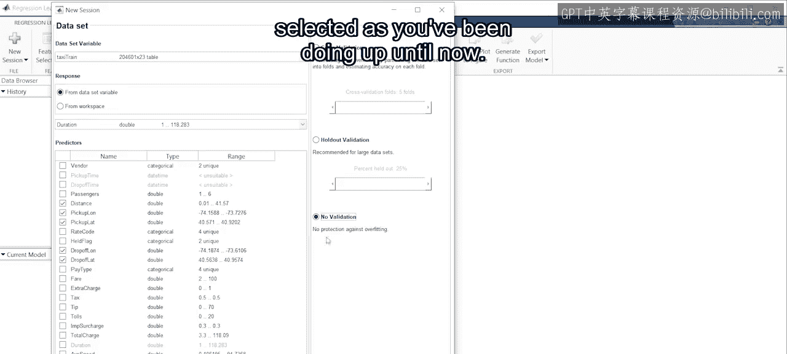

Training using the all trees option。

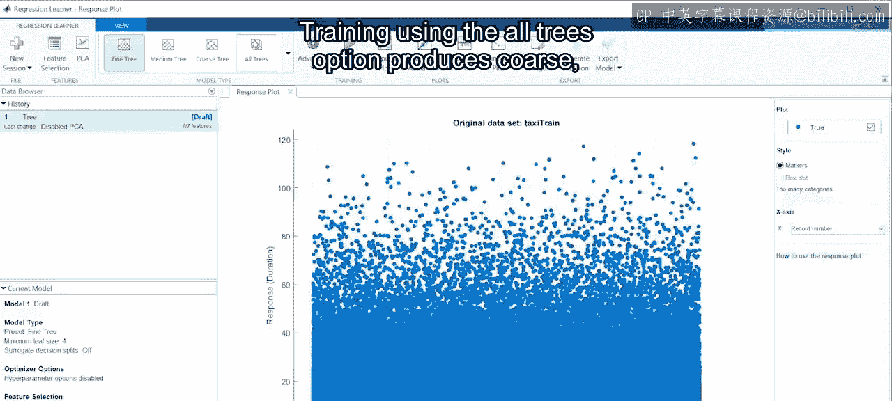

Produces coarse， medium， and fine trees。

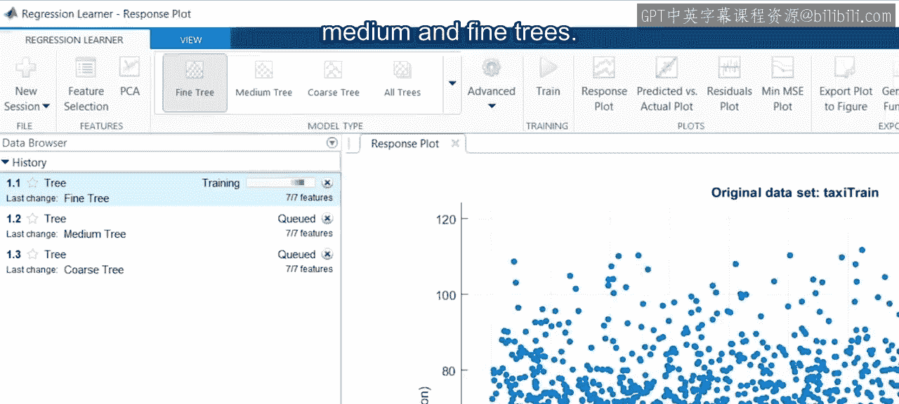

Examining the results， the fine tree has the best RMSE。However。

 these metrics were calculated using the same data that was used for training the models。

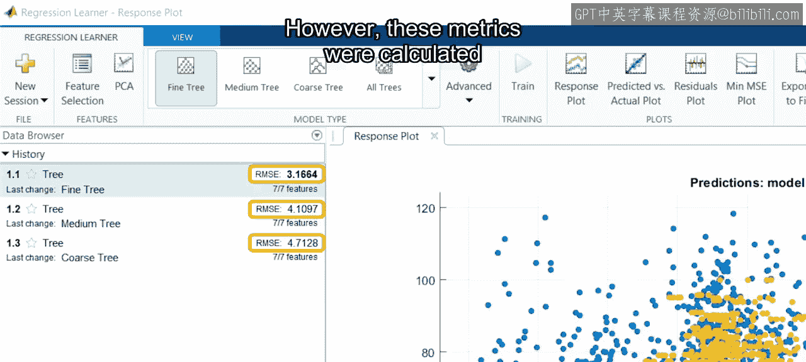

This means we may be overfitting。

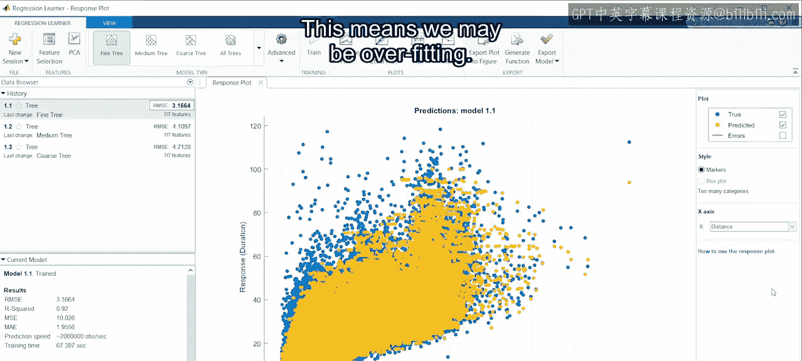

Let's see how this compares to the results when using validation data。

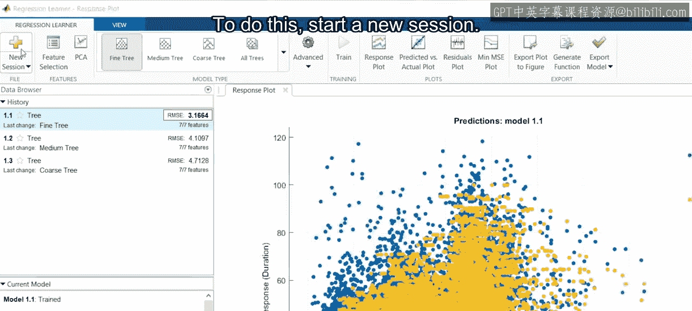

To do this， start a new session。The data set， respond and predictors will all be the same。

 but this time you'll use validation。Although you could use cross validation。

 since the data has over 200，000 rows， holdout validation should be sufficient and faster。

So let's try this with say 20% of the data。

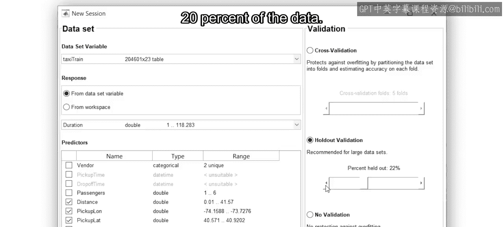

Train the same tree models as before。

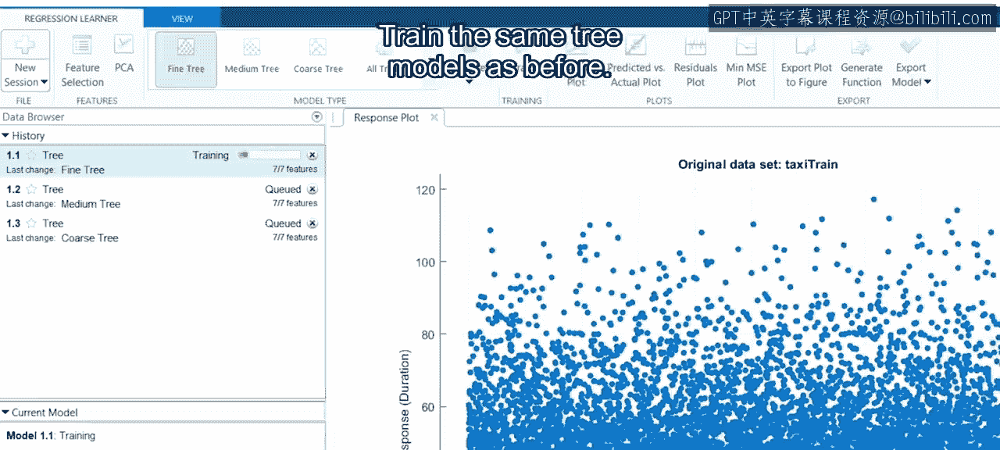

This time， however， the metrics will be calculated using the 20% holdout validation data。

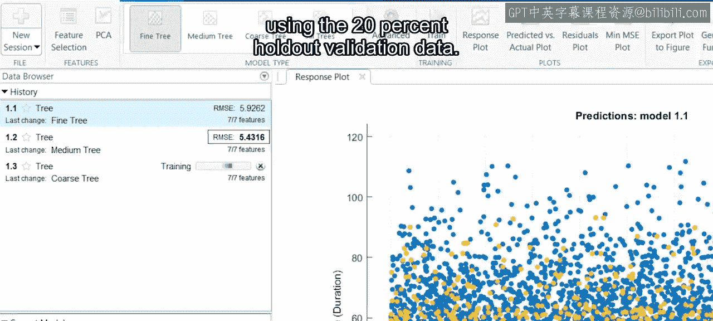

Now， the coursese tree has the best RMSE。

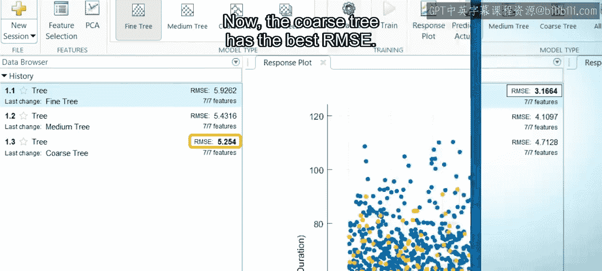

As suspected， the fine tree was overfitting the training data。

And the coursearse tree generalizes better。

In this video， you saw how to use validation data in the regression learner app to better evaluate model performance and prevent choosing an overfitting model。

Next， you'll learn additional methods and training options to create models with even better performance。

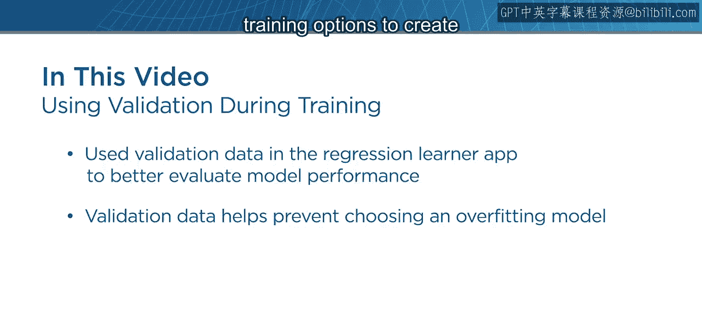