# Mathworks《实用数据科学与MATLAB（数据探索、特征工程、机器学习、毕业项目）｜Practical Data Science with MATLAB》 p105 20_使用正则化防止过拟合.zh_en [BV1Jr421w7wL_p105]

🎼。

When you train a model with a large number of features， it's easy to overfit the data。

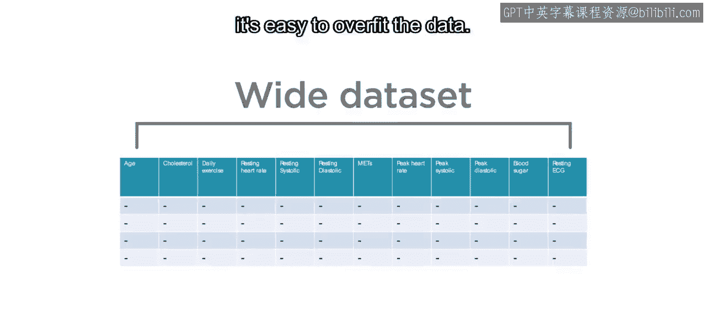

One technique to help you prevent overfitting is regularization。In this video。

 you will see how regularization works， and then you'll train a regularized model in Matlab。

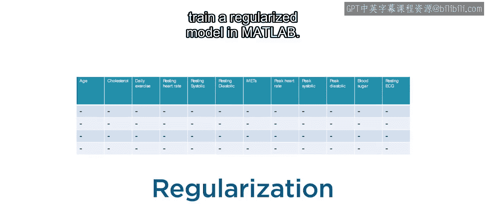

Let's start by considering a simple data set with a polynomial model。

This model starts with a single feature X。You can think of adding polynomial terms as analogous to adding additional features to the model。

When a high order polynomials fit to the data， the coefficients of the fit denoted here by beta are very large。

The large values are necessary to capture the noisy fluctuations in the data。

One way to prevent overfitting is to reduce the order of the polynomial。

This will be like using feature selection methods on a high dimensional data set。

With fewer coefficients， the model no longer overfis。The beta values are smaller as well。

 since the polynomial is not being stretched to fit every fluctuation in the data。

But what if you want to keep all the polynomial terms？To prevent overfitting。

 you could restrict the coefficients from getting too large。That way。

 the order of the polynomial is still high， but the result looks like a lower order polynomial because none of the terms are dominating the fit。

This idea of constraining the model parameters to prevent overfitting， is called regularization。

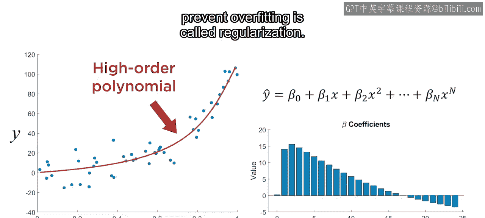

There are different types of regularization for different types of models。

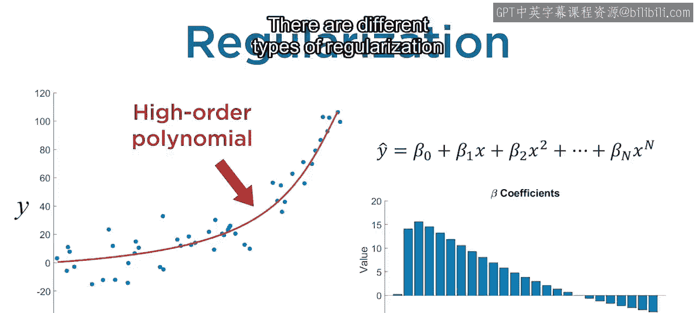

For example， you can regularize a decision tree by pruning branches and reducing the tree depth。

You've already done this when changing a fine tree to a coursese tree。

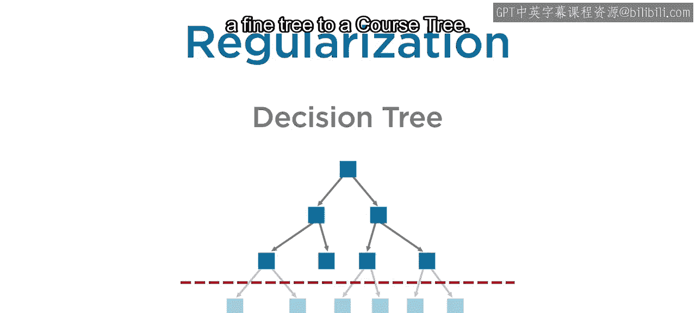

In this video， you'll see a type of regularization for linear and logistic regression。

 You'll use it to improve a logistic regression model for the ovarian cancer dataset set。

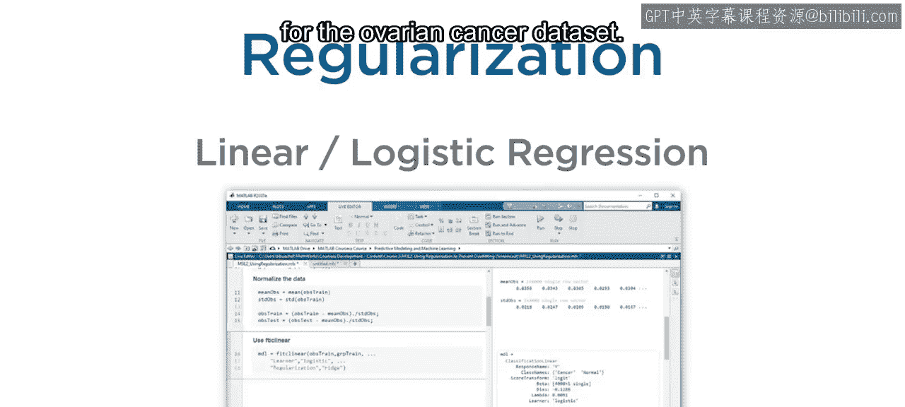

To explain this type of regularization， remember that most regression models are trained by minimizing the mean squared error or MSE。

Regularized models are trained by minimizing the MSE term plus an additional penalty term calculated from the model parameters。

The penalty term prevents the beta values from getting too large。

The MSE term and the penalty term work to counteract each other during training。

If the model is overfitting， the MSC will be small， but the penalty will be large。

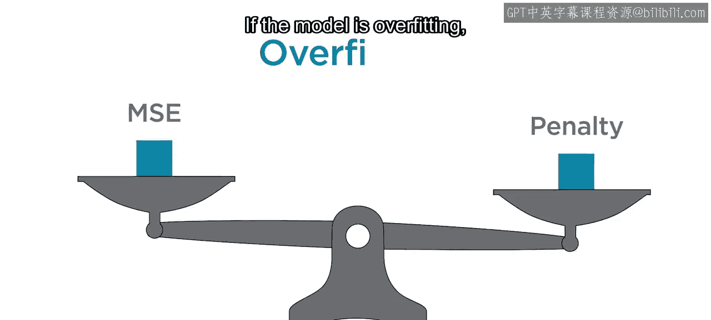

And if the model is under fittingtting， the ME will be large， but the penalty term will be small。

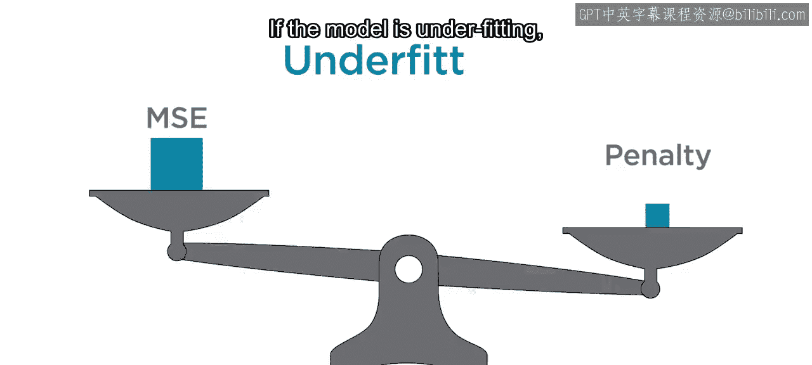

The final result is a fit that balances both。

So how are penalty terms calculated。

There are two common ways。Ridge regression uses the square of the beta coefficients。

 While Lasso regression uses the absolute value。This may seem like a minor difference。

 but it can have a significant effect on the trained model。

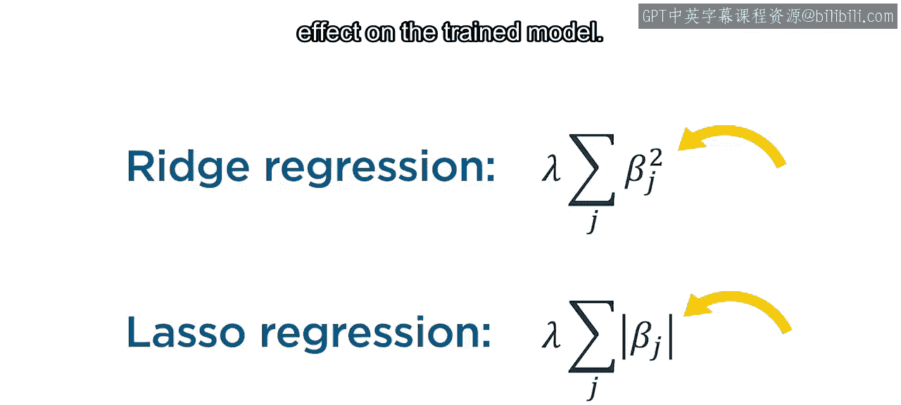

For example， here are the beta values from the regularized polynomial model shown earlier。

 These coefficients were fit using ridge regression。

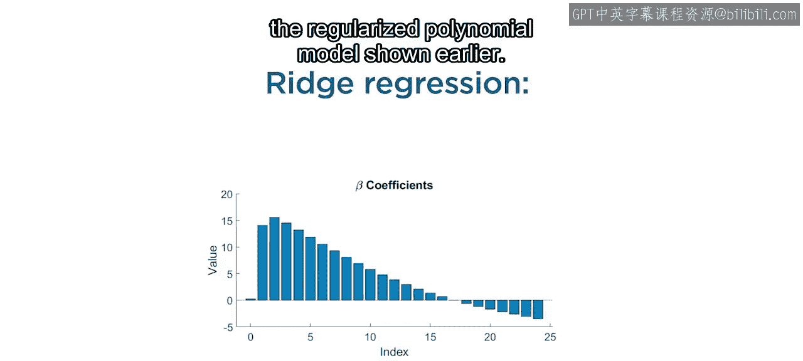

Now， compare with the beta values fit with Lassso regression。 The scale of the beta is similar。

 but many of the values are 0。

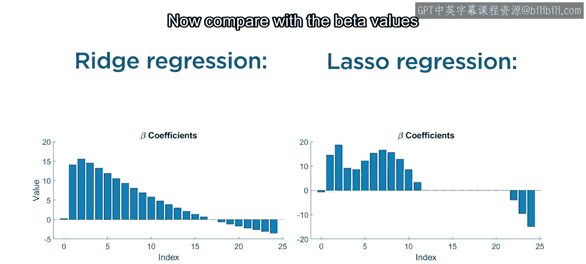

This is because Lassso regression tends to drive small beta values to zero during training。

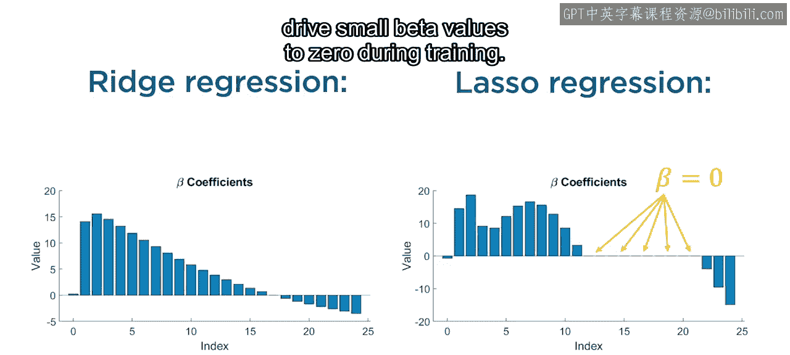

Therefore， Lassso regression is also a type of embedded feature selection。

 since setting a beta value to 0 essentially removes that feature from the model。

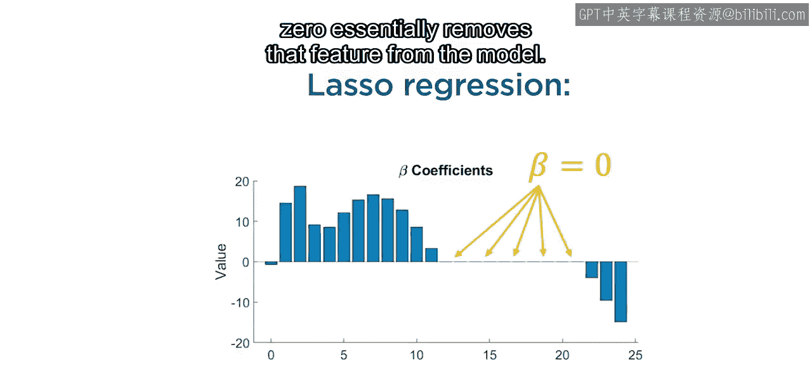

Now let's train a regularized model in MatTLap。

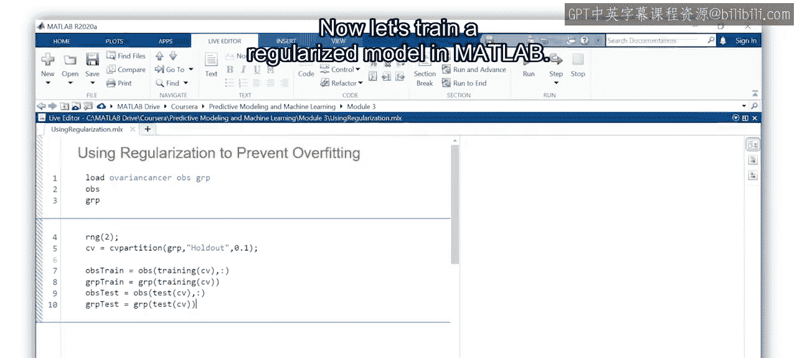

First， load the ovarian cancer data set。 Remember that this data is high dimensional。

 It has 4000 features。

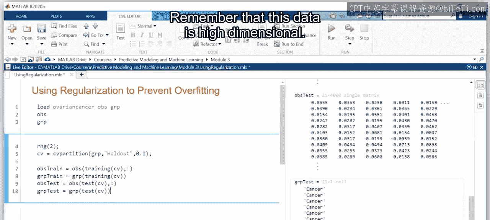

Split the data into a training and test set so you can later evaluate your final model。Next。

 normalize the data so all the features have a similar scale。

 This is critical for the penalty term to work properly in Ri and lasso regression。

Save the numbers used to normalize the training data so you can apply the same normalization to the test data。

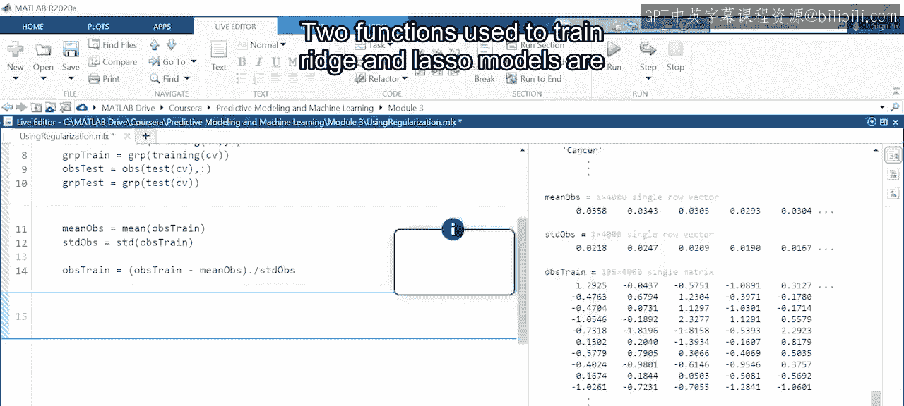

Two functions used to train Rige and lasso models are fit R linear for regression and fit scene linear for classification。

Since this is a classification problem， let's use fitt C linear。

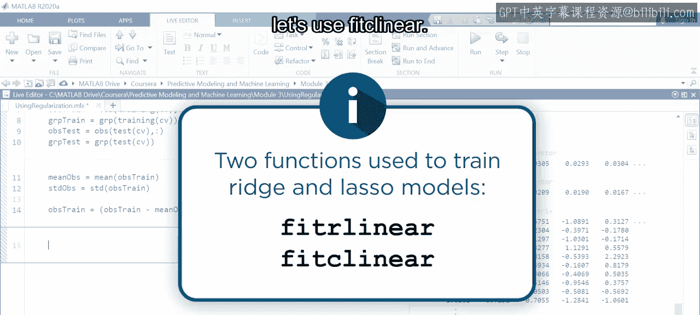

Add the first two inputs to the function with the predictor matrix in response vector。

Then set the learner option to Lo to specify logistic regression。

Since ridge regularization will keep all the features， let's use it as a starting point。

Set the regularization option to ridge。But feel free to try out Lasso later so you can compare the results。

Lastly， set the Kfold option to 20 to use 20fold cross validation。Let's see how the model performed。

 Since this model has Kfold validation， use the function Kfold predict to get the predicted classes。

The only argument you need is the trained model。Then use the C metrics function to obtain the performance metrics。

The accuracy is very good， Almost 95%。 And since this model used validation data。

 you can be reasonably confident that it would perform well on new data。

 even though it's using all 4000 features。

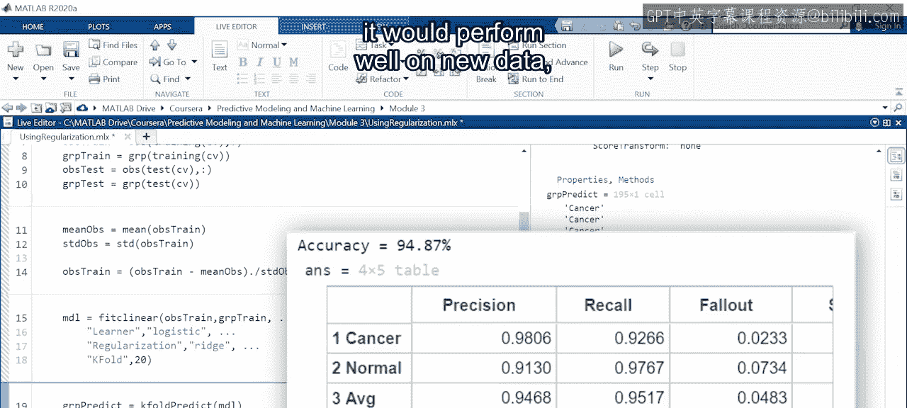

You've now successfully trained a model with regularization。

 but there's one final thing to consider before you do the evaluation with the test data。

If you look again at the penalty terms， notice that they both have a variable lambda。

This is a hyperparameter that controls the strength of regularization。

A higher land of value means a stronger penalty term。

Matlab uses a default value of1 over n for lambmbda， where n is the number of observations。

The default value performed well with the ovarian cancer data， but that may not always be the case。

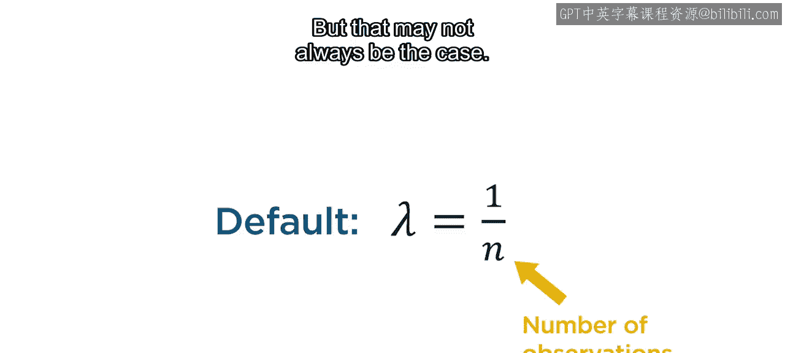

You can tune the value of Lambda with hyperparameter optimization， which you'll learn about later。

To summarize， regularization helps to prevent overfitting by restricting the model parameters。

Two common types of regularization are ridge and lassso regression。

Use Lassso regression when you want to reduce the number of features。 otherwise。

 use Rige regression when you want all the features to contribute。

The functions fit C linear and fit R linear have regularization options for classification and regression respectively。

Finally， don't forget to tune the hyperparameter lambmbda to adjust the regularization strength。

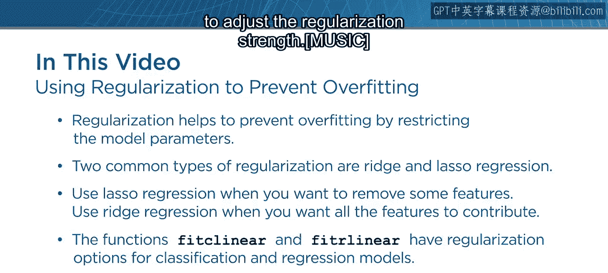

🎼。