# Mathworks《实用数据科学与MATLAB（数据探索、特征工程、机器学习、毕业项目）｜Practical Data Science with MATLAB》 p106 21_集成模型介绍.zh_en [BV1Jr421w7wL_p106]

🎼。

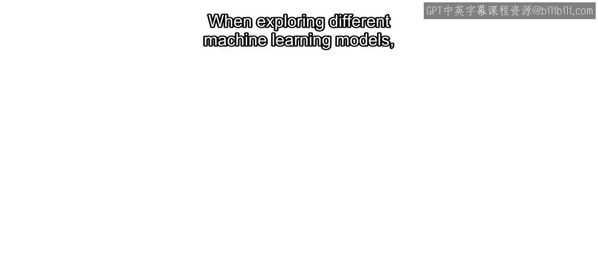

When exploring different machine learning models， you'll likely notice that several of them yield roughly the same classification accuracy。

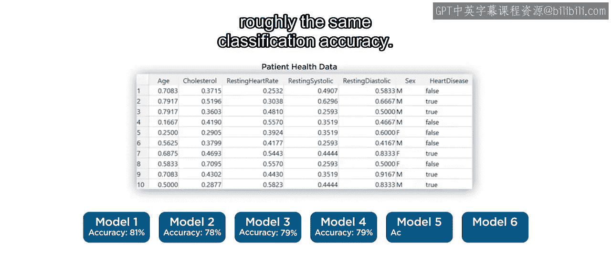

However， individual predictions from these models may still be different。

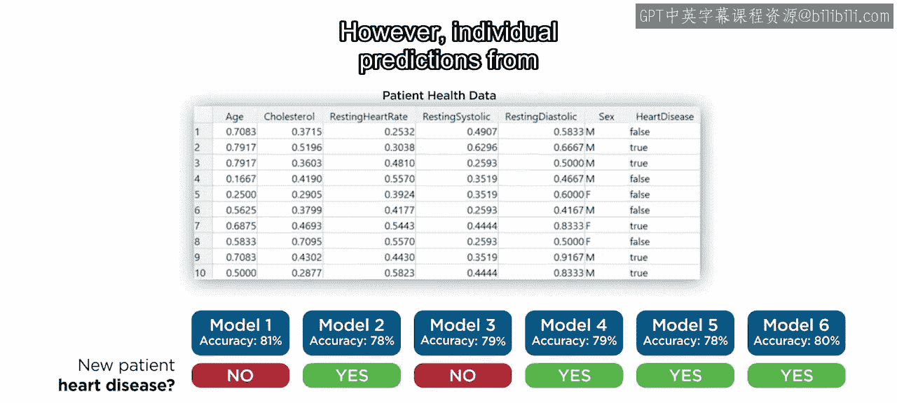

In this situation， you may want to take the results from multiple models into account。

 rather than drawing conclusions from just one of them， even if it is the most accurate。

Taking the most common or average prediction from multiple models is usually more reliable than a single prediction from one model。

This is the principle behind ensemble models for machine learning。

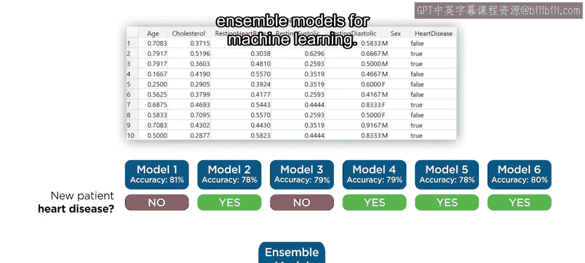

There are several classes of ensemble models。 This video will focus on two of the most common methods。

 boosted and bagged trees， both of which are extensions of decision trees。

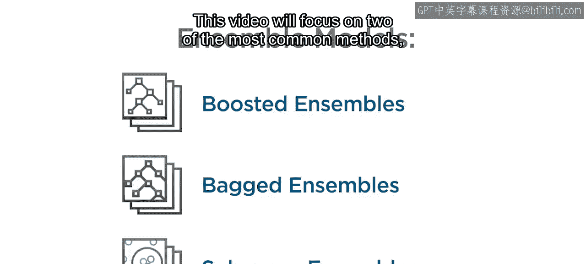

Boosted tree ensembles use specific algorithms for regression and classification problems。

 but to illustrate the concept， let's focus just on regression。For this example。

 the goal is to predict the duration of a taxi trip。After training a regular decision tree。

 each observed duration will have a corresponding predicted value and residual from the model。

The boosted tree ensemble approach is to use the residuals as response variables to train an additional regression tree。

This yields a new set of predictions， and also new residuals。

This process can then be repeated multiple times with additional trees being trained on the new residuals。

The end result of a trained boosted tree ensemble is a series of decision trees。

The first tree makes an initial prediction。Which is then refined by each successive tree。

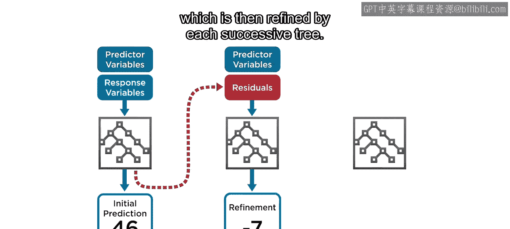

Summing the results yields a final prediction that's more accurate than the initial one。

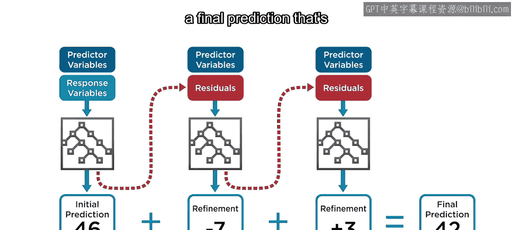

Bag decision trees are another type of ensemble algorithm。For this model。

 a collection of decision trees is trained simultaneously on the same data。

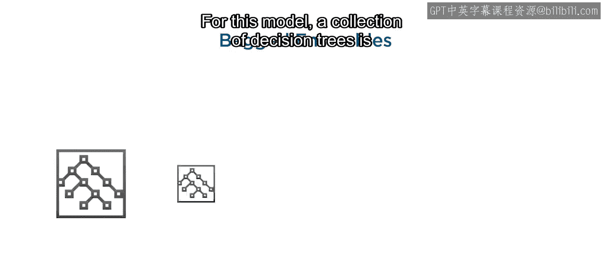

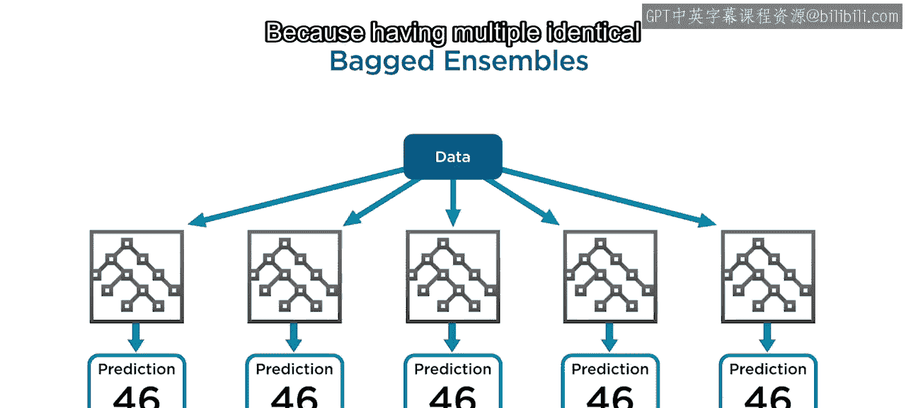

Because having multiple identical models would be redundant。

 Each one is given a random subset of the available data， which ensures they're all unique。

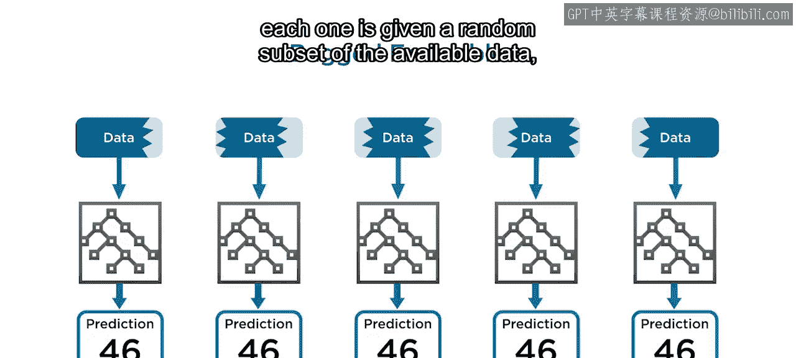

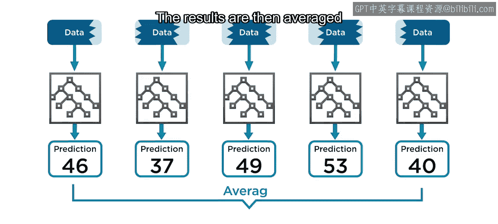

The results are then averaged together into a final prediction。

An extension of bag trees is the random forest algorithm。

Remember that a decision tree splits the training data using a series of questions about the predictor variables。

All trees in a bagged ensemble follow this pattern。However。

 because each individual tree is modeling similar subsets of the data。

 they will likely have highly correlated structures。

A random forest ensemble avoids this problem by using a random subset of the available features at each split。

Ensuring that each individual tree is unique。

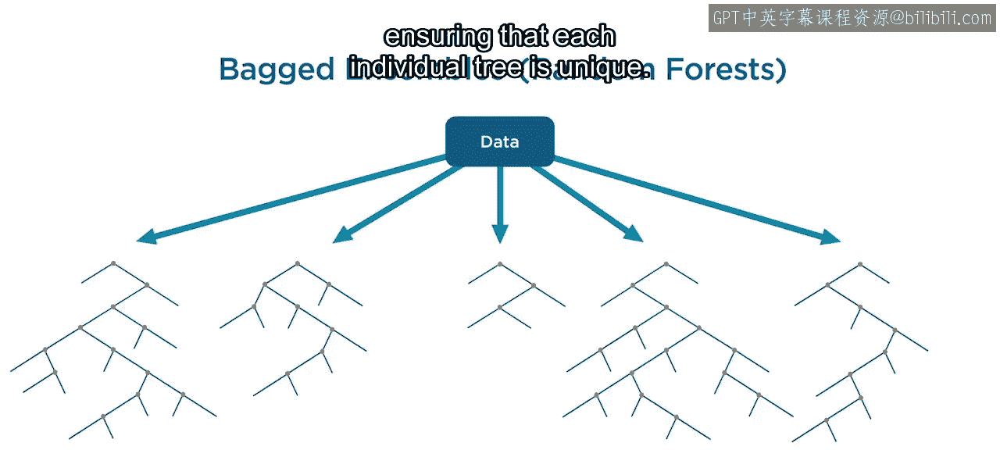

The accuracy that may be lost in the individual trees can be recovered when averaging them altogether。

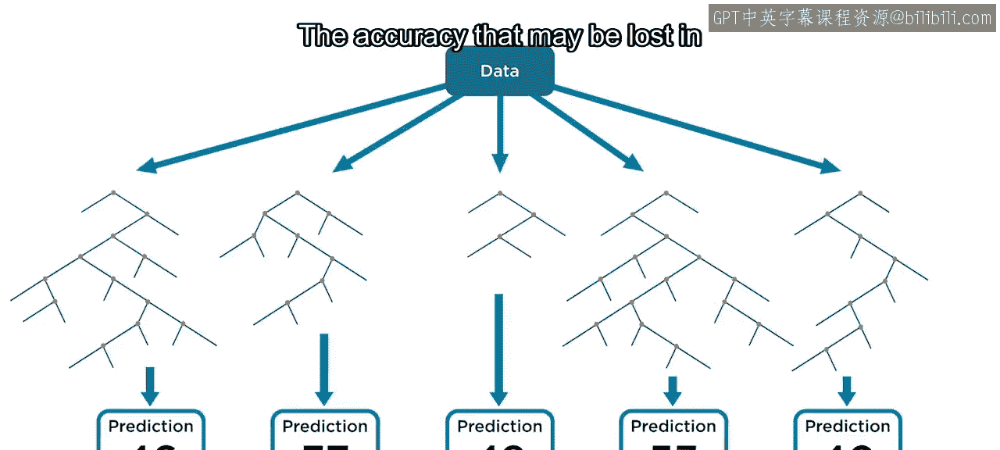

The result is an ensemble model that is potentially more robust to overfitting than a simple bagged tree。

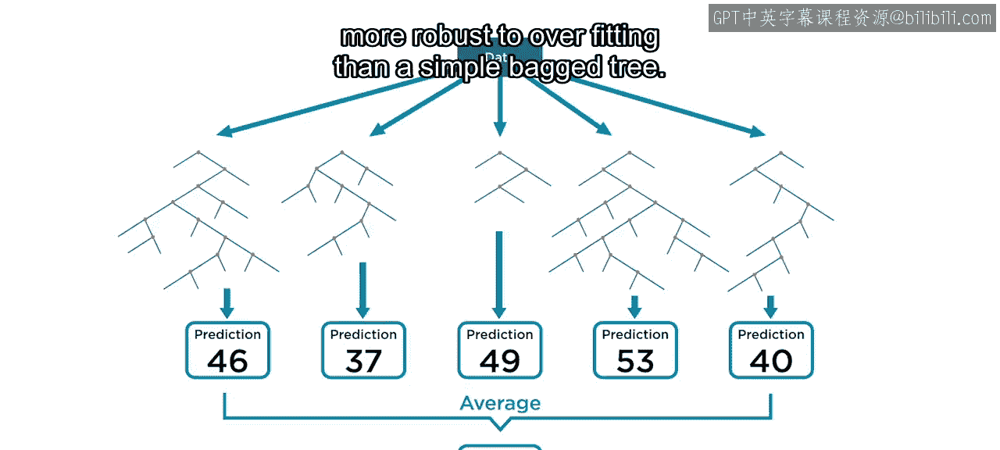

In summary， various ensemble methods are available for both regression and classification problems。

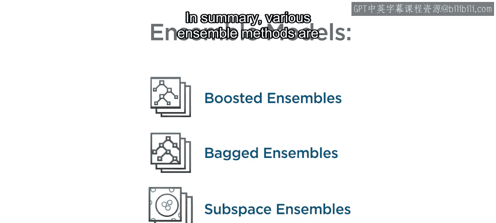

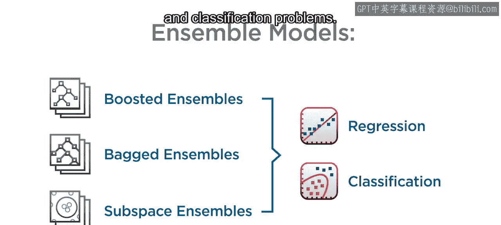

In addition to the ensemble methods provided in Matlab。

 you can create your own custom ensembles by averaging several models together。

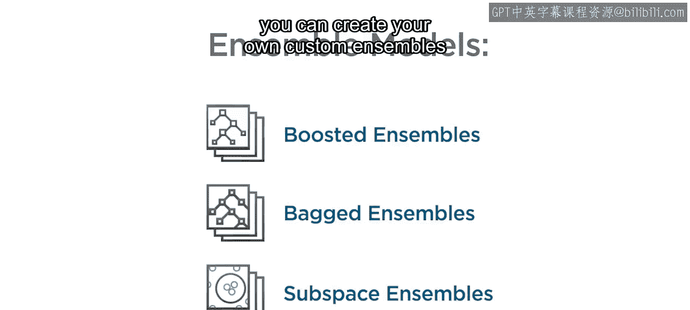

Ensembles can offer more accuracy than their single model versions。

 but note that this improvement usually comes at a cost。

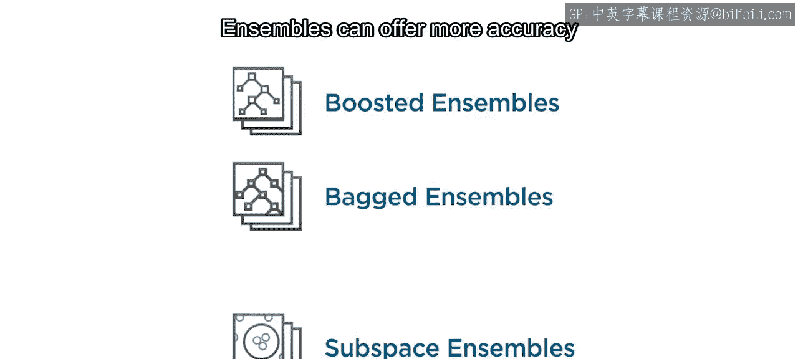

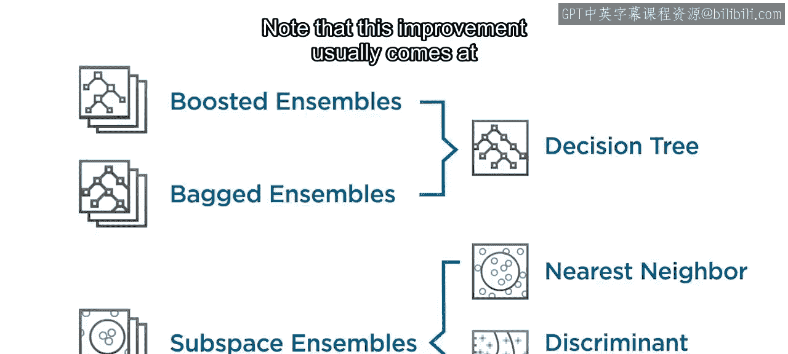

Of training time， memory utilization and prediction speed。

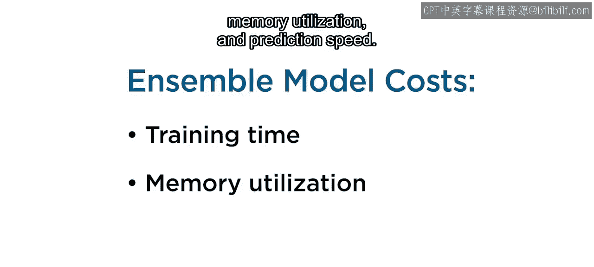

。