# Mathworks《实用数据科学与MATLAB（数据探索、特征工程、机器学习、毕业项目）｜Practical Data Science with MATLAB》 p108 23_超参数介绍.zh_en [BV1Jr421w7wL_p108]

🎼，You have seen terms like parameters and hyperparameters used to describe characteristics of your machine learning models。

But what is the difference between these two terms？In this video。

 you will learn what hyperparameters are， why they are important， and how to optimize them。

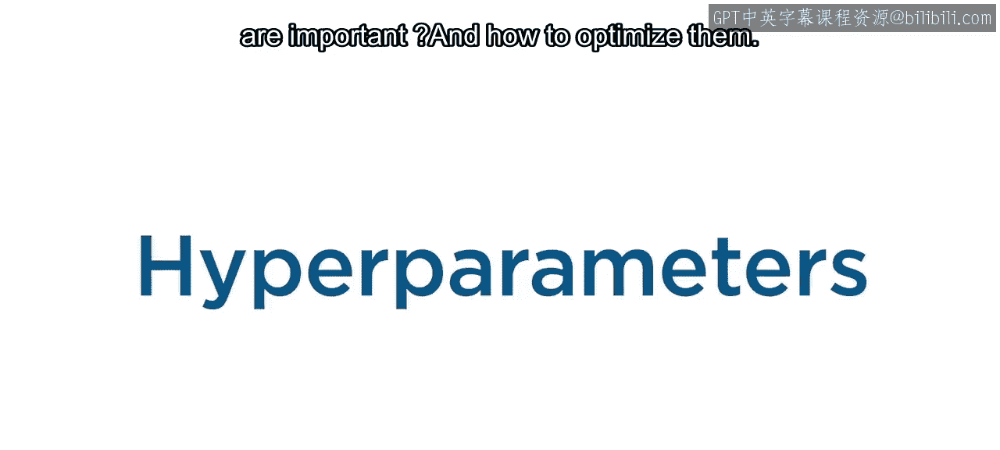

A model parameter is a configuration variable that is internal to the model and whose value is estimated from the data。

Model parameters are learned from the training data。

 and their values are optimized by the machine learning algorithm itself。Therefore。

 they are not set manually by the data scientist。

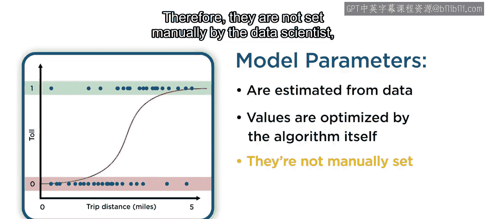

For example， in logistic regression， the coefficients for the sigmoid equation are calculated based on the data。

But there are also parameters that cannot be learned from training a single model。

 These are called hyperparameters。Model hyperparameters influence the way a learning algorithm works。

 but are not optimized by the training algorithm itself using the data。

Hyperparmeters have to be set before running the algorithm。Hence。

 finding appropriate values for hyperparameters is necessary to estimate model parameters。

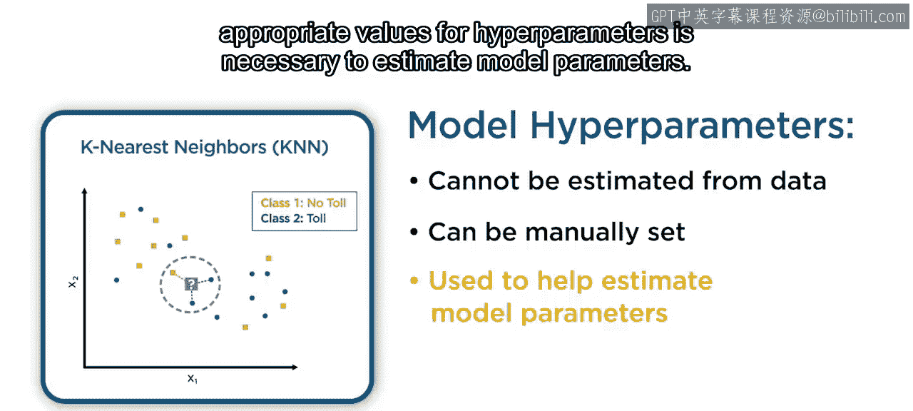

A good example is K in the K and N model。Recall the value for K is not set by the data as it is not generated by the classification model automatically。

For this reason， K is a hyperparameter for the K and N model。

And that's not the only hyperparameter in this case。

 you can also change the distance metric used to determine which points are considered near。

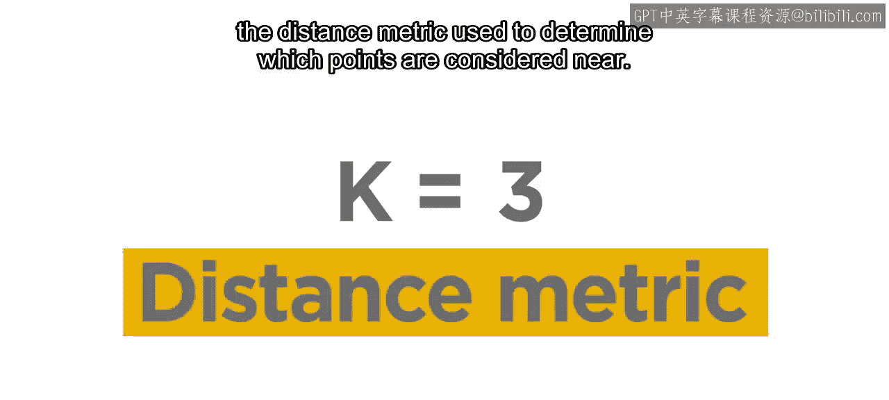

Both of these values can affect the accuracy of your KN N classifier。

You tried already finding a good value for the hyperparameter K using the taxi data。

For both binary and multiclass classification models。

 you experimented by changing K values and evaluating the performance。

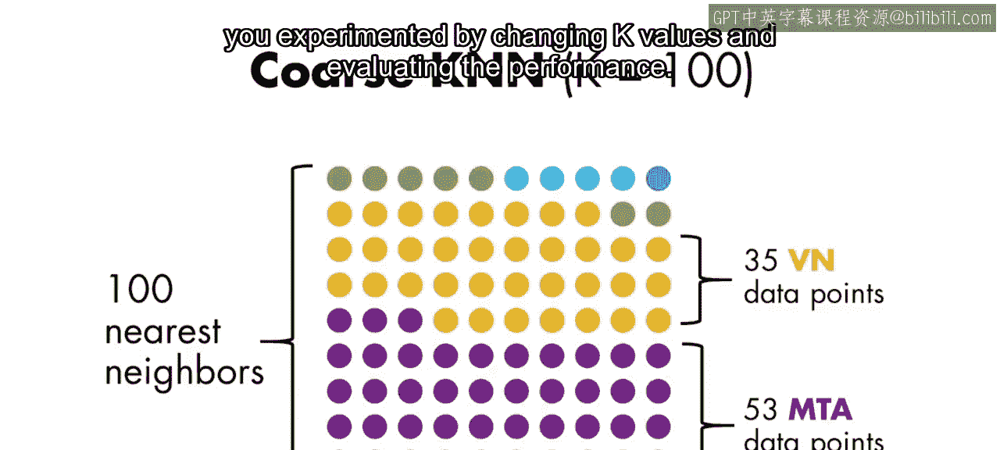

Now you have two hyperparameter， K and distance metric。

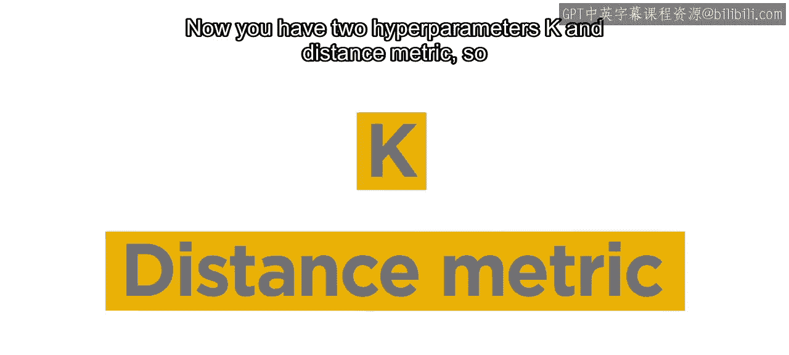

So is there a better way for finding the optimal hyperparameter values？

While parameters are optimized by training the model using the training data。

 hyperparameters are determined outside the training process。

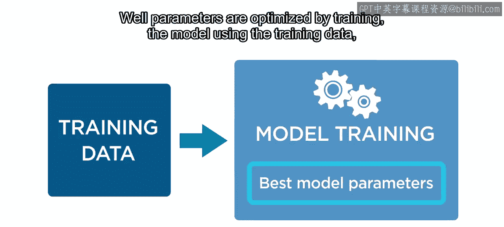

So， in order to estimate the optimal values for hyperparameters。

 you rely on a process known as hyperparameter optimization or tuning。

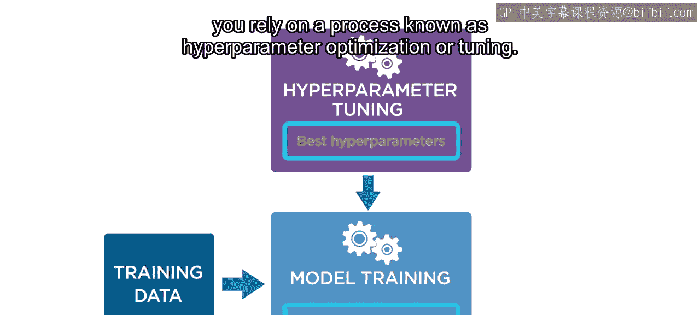

Conceptually， hyperparameter tuning is just an optimization loop on top of the model training to search for the set of hyperparameters leading to the lowest error。

Note that you must use the validation data for this process。

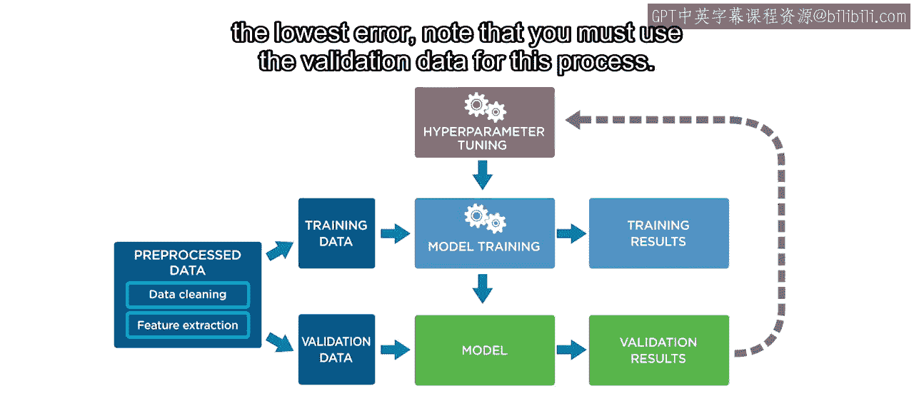

Although this optimization could be done with a manual search。

 it soon becomes a task of trial and error。

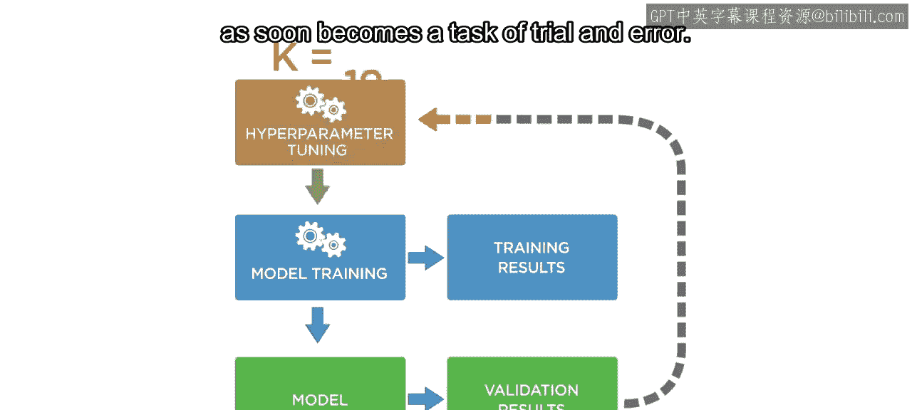

There are ways to automate it。One approach is grid search。

 which looks through each combination of hyperparameter。

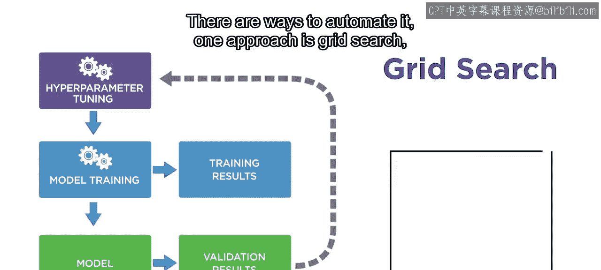

In the case of the K and N example， every combination of values for K and distance metrics would be tried to determine the optimal set of values。

However， this approach can be very time consuming， and it scales poorly as you increase the number of values。

You could also use an approach called randomom search。As the name suggests。

 combinations of hyperparameter values are sampled randomly。As a result。

 not all of the hyperparameter values are tried。This helps because it can be difficult to determine in advance which hyperparameter values the model is sensitive to。

However， random search can still miss the global optimum。

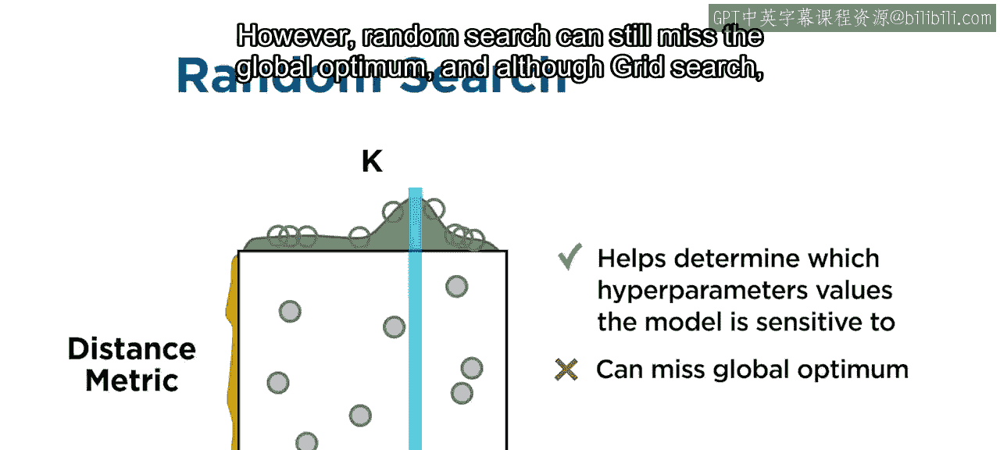

And although grid search and random search are easy to understand， they are inefficient。

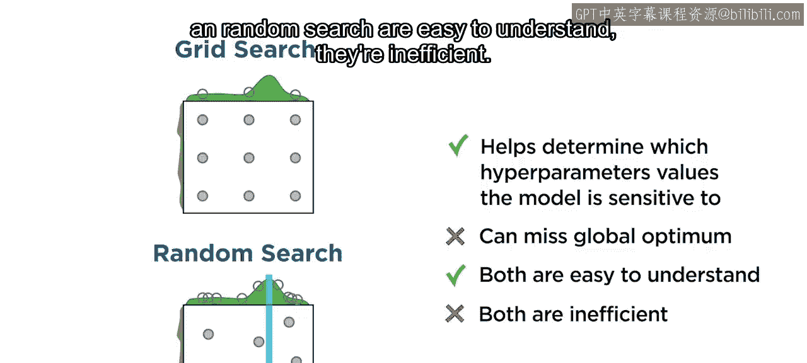

Intuitively， it would be more efficient to choose the next hyperparameter combination according to the performance of past combinations。

This is exactly the aim of Bayesian optimization。With this approach。

 the algorithm keeps track of past evaluation results。

 which it uses to form a probabilistic representation of the model's performance。

This is done using an objective function as the main evaluator of hyperparameter combinations and an approximation of this objective function called the surrogate。

Baesian optimization methods are efficient because they choose the next hyperparameter values in an informed manner and make fewer function evaluations。

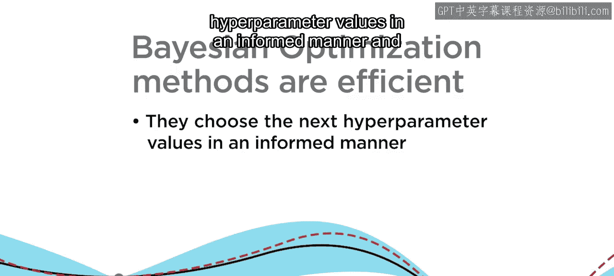

In summary， one way to improve your model is to intelligently pick your hyperparameters。

Finding the best combination of hyperparameters can be tricky。

 but there are methods you can use to automate the optimization process。

An automated hyperparameter tuning process requires less effort in choosing the values。

 but requires more computational time。

Since most models have several hyperparameters， you usually need to select the subset of hyperparameters that will have the most effect on the model's results。

 rather than attempting to tune them all。

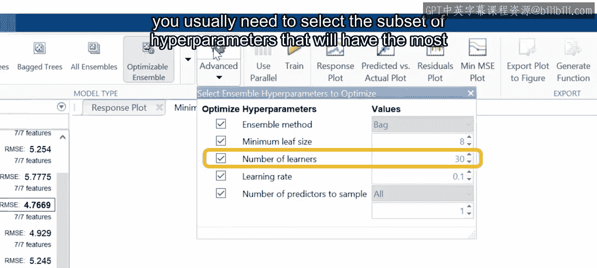

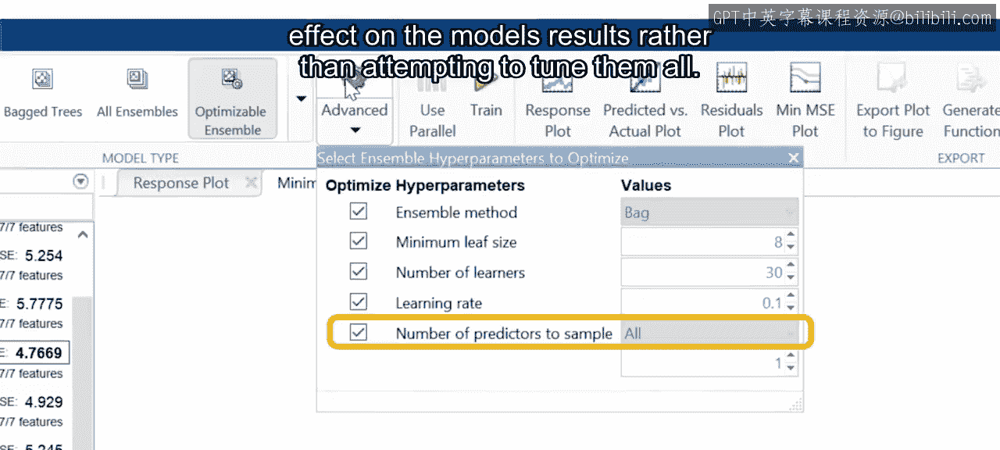

In the next video， you will have the opportunity to see how to tune hyperparameters using MATLB。

