# Mathworks《实用数据科学与MATLAB（数据探索、特征工程、机器学习、毕业项目）｜Practical Data Science with MATLAB》 p11 10_模块1数据科学工作流程总结.zh_en [BV1Jr421w7wL_p11]

🎼，Congratulations， you've reached the end of module1。 before continuing to the quiz。

 let's take a minute to recap what you've learned so far。😊。

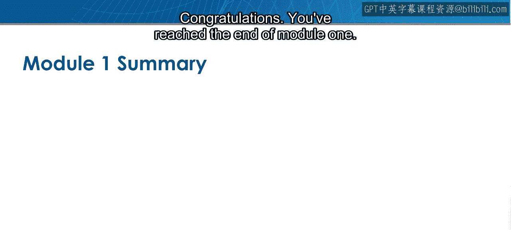

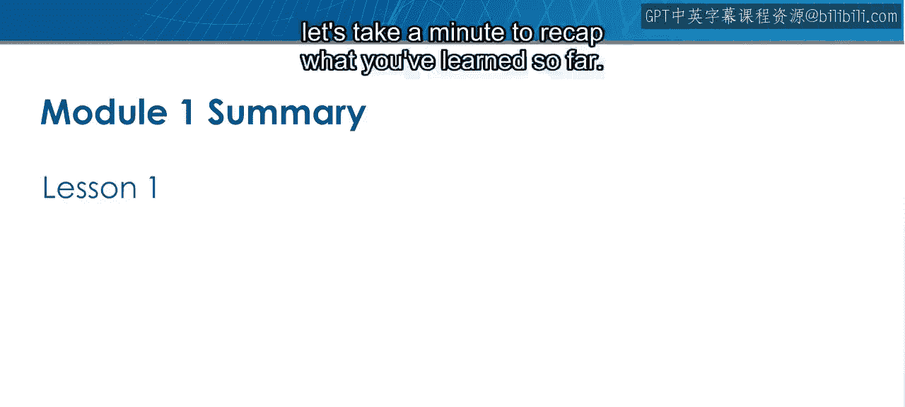

You begin this module by learning about what data science is and why it's become increasingly important in industry and research。

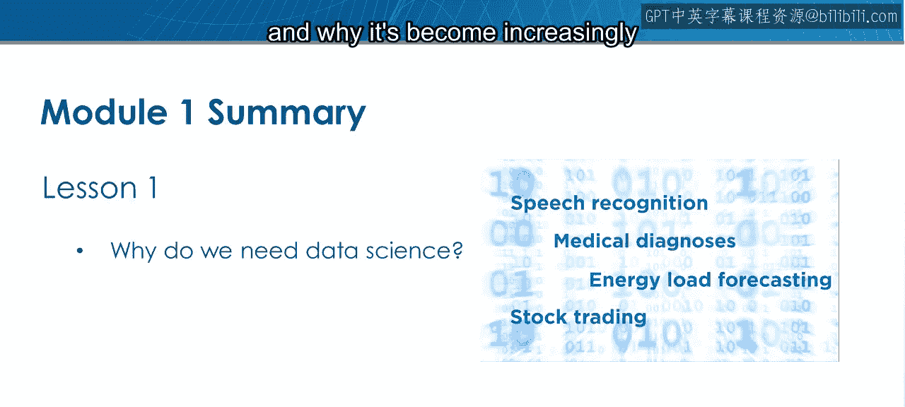

Next， you learned what makes MATLAb a powerful tool for data science and how it's currently being used by analysts。

 engineers， and scientists for a wide variety of applications。

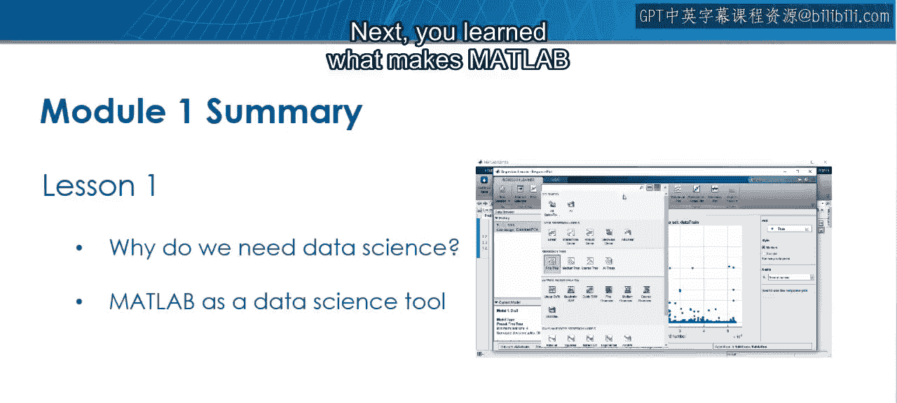

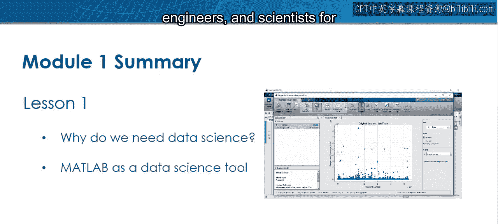

In lesson2， you use the available tools in MatTLb to explore data interactively。

 you also took a deeper look into the types of questions your data can help answer。

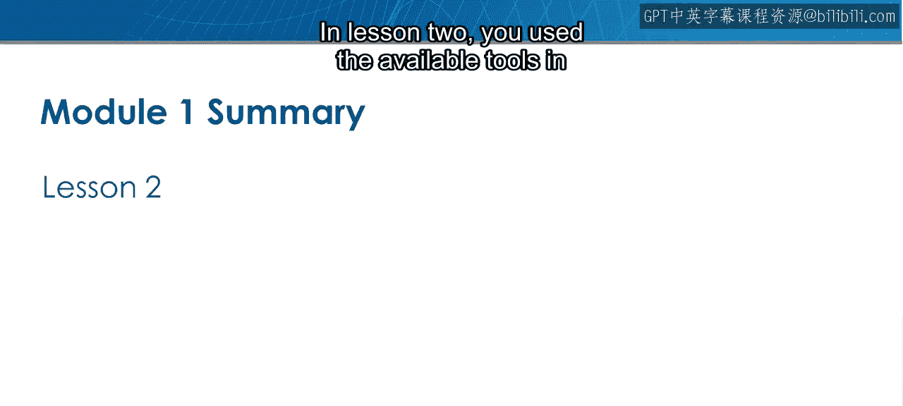

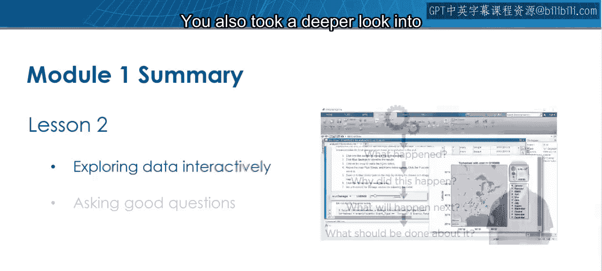

In lesson three， you were presented with a conceptual overview of the data science workflow。

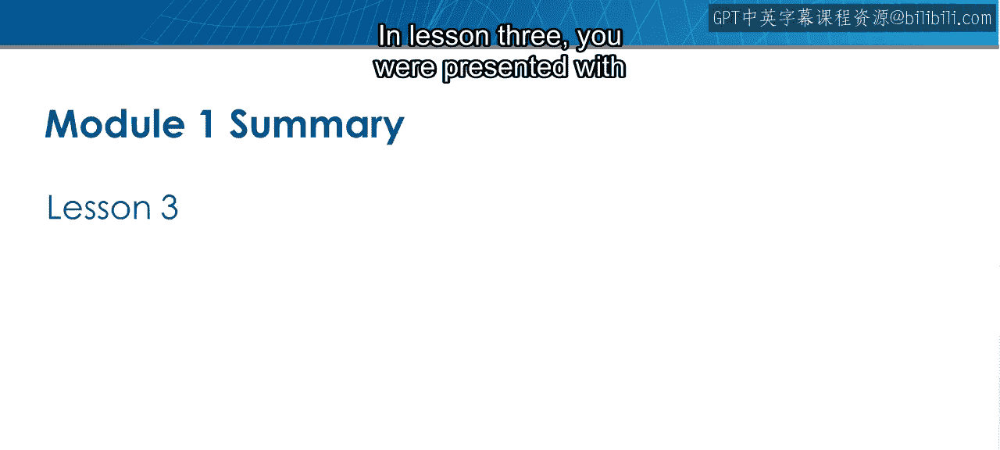

Then you saw an example of how exploratory data analysis is performed in MATLAB。

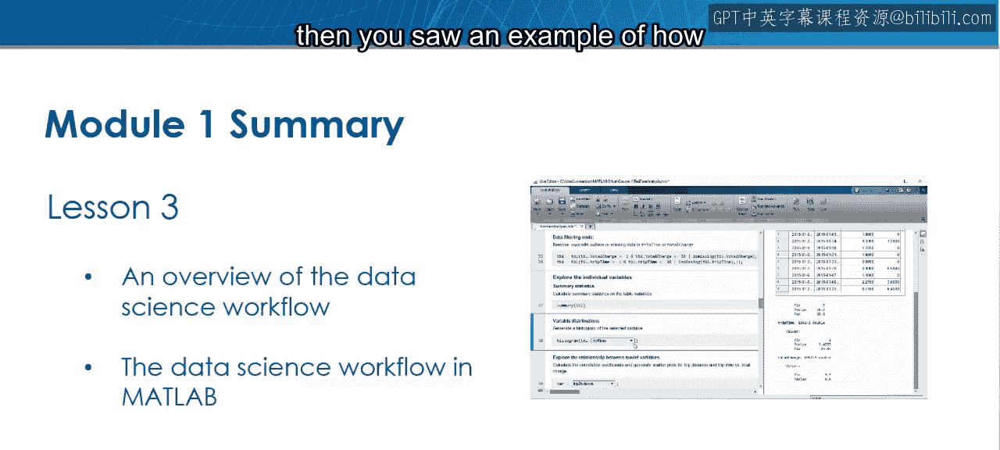

In the coming modules， you'll learn more about working with data and how to conduct your own exploratory data analyses in Matlab。

 But now it's time to test your knowledge with the module 1 quiz。

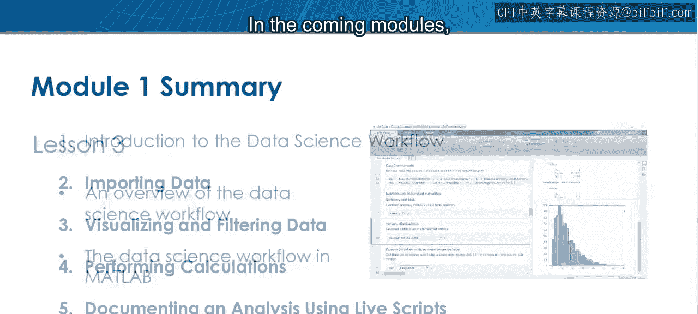

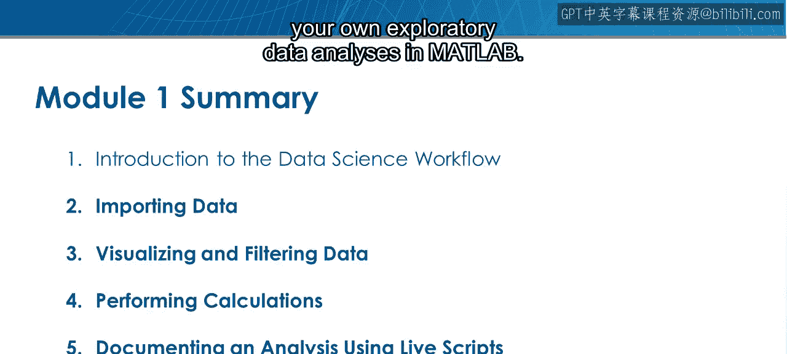

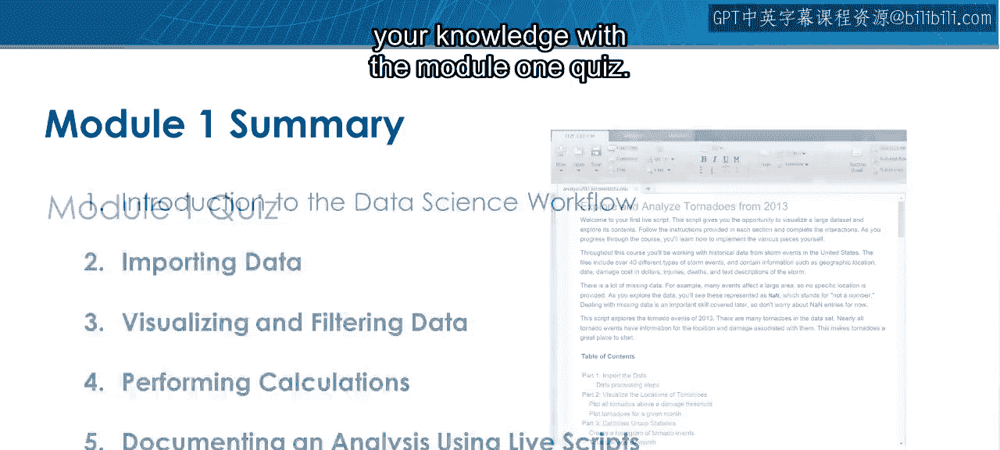

You'll use an existing live script to answer questions about the weather events data。

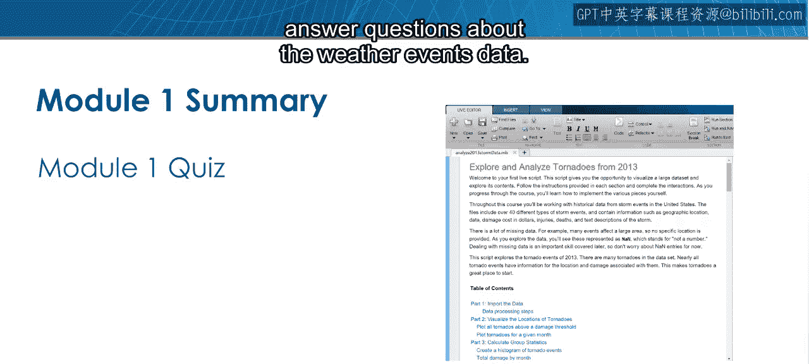

Follow the setup instructions carefully so that you can open and run the live script in MATLap。

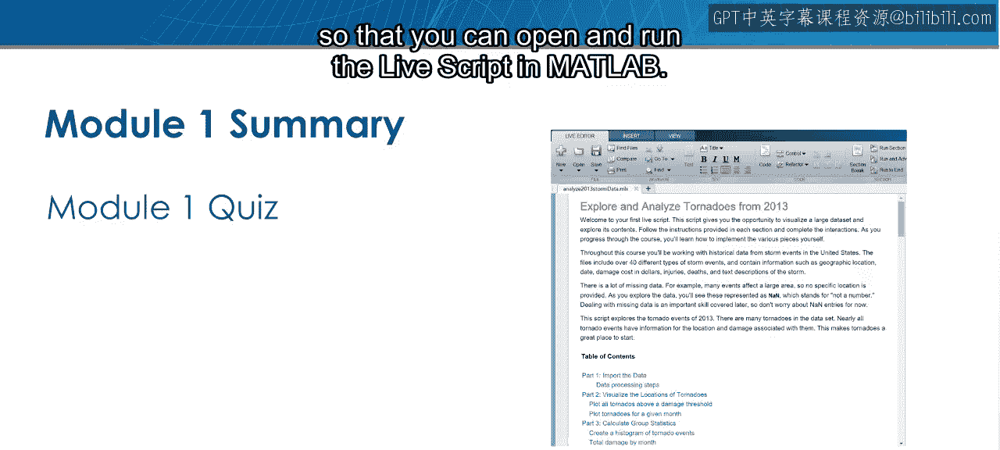

The instructions in the live script will then guide you through the analysis and help you to answer the questions on the quiz page。

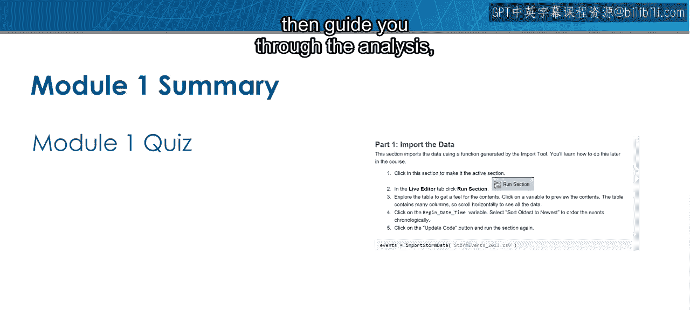

。

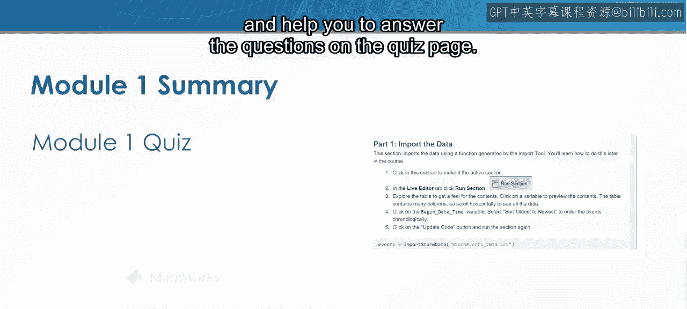