# Mathworks《实用数据科学与MATLAB（数据探索、特征工程、机器学习、毕业项目）｜Practical Data Science with MATLAB》 p110 25_评估和使用模型.zh_en [BV1Jr421w7wL_p110]

🎼。

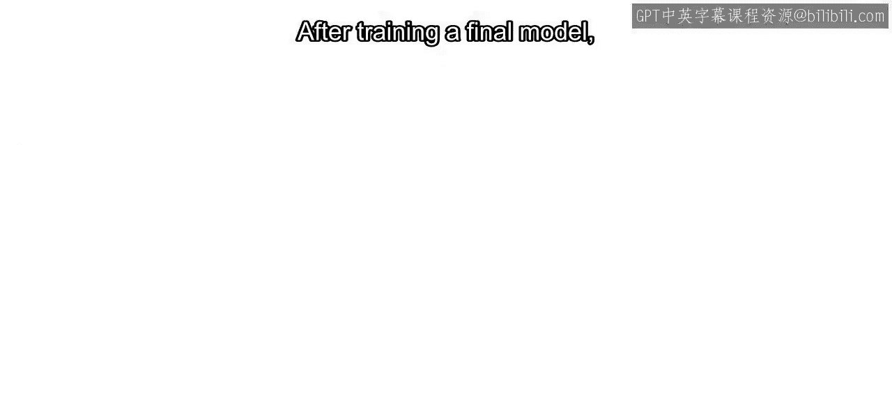

After training a final model， you've completed the most difficult part of the machine learning workflow。

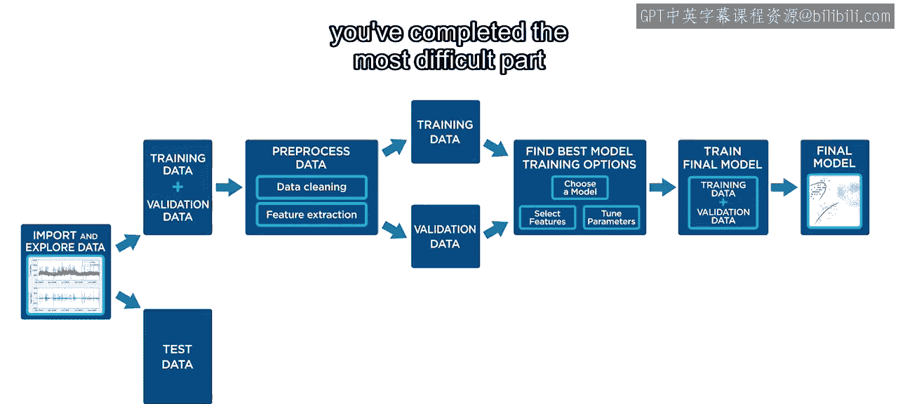

But an important question still remains。

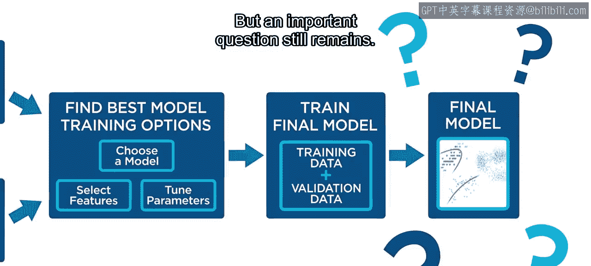

Will your model generalize to data that it has never seen。

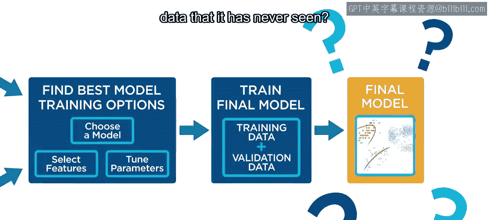

To answer this question， you must apply your final model to the test data to evaluate performance。

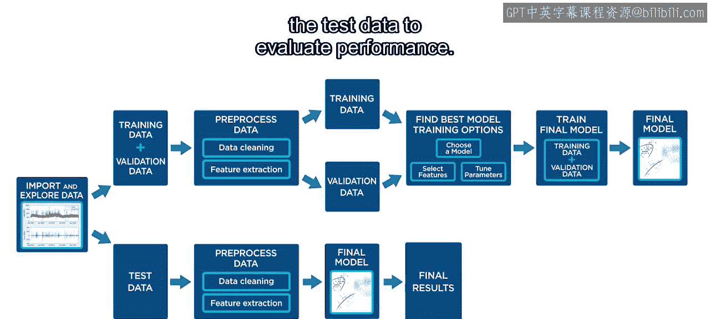

Remember that overfitting is when your model becomes too familiar with the training data and is bad at making predictions outside of it。

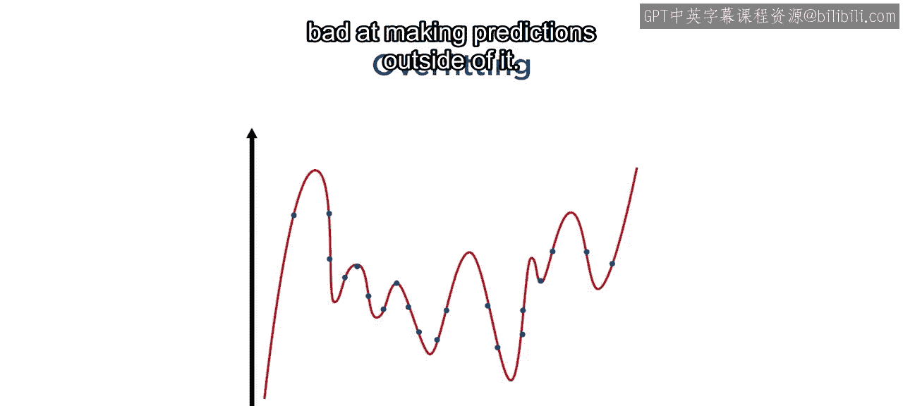

This is why setting aside test data before you begin training a model is important。

Because the test data is not used for training， it simulates how well your model will perform on unseen data。

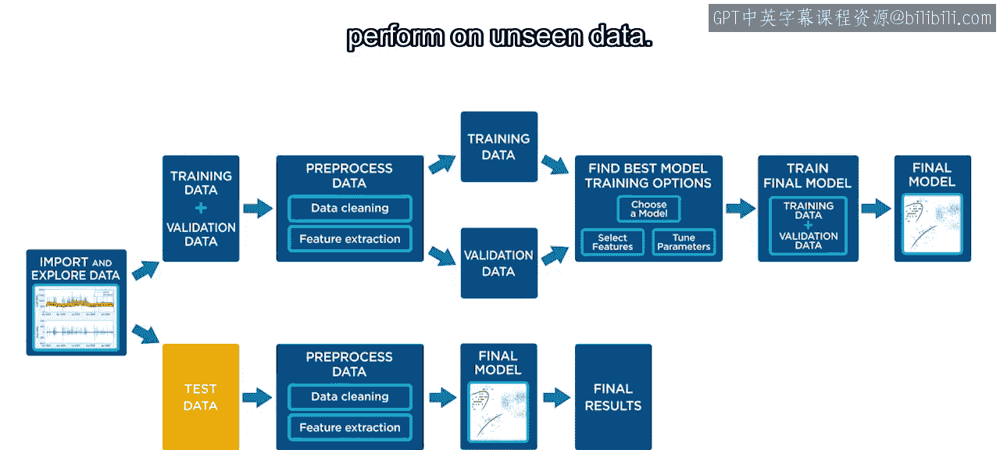

In this video， you will complete the machine learning workflow by applying an optimized model to test data。

Evaluate the performance of the optimized model。And use the model outside of the app to make predictions。

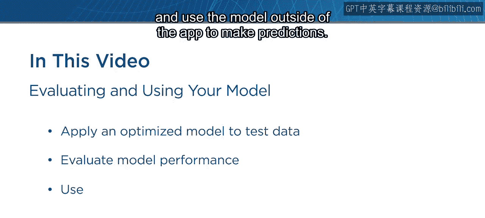

Start by applying the same pre processingces steps to the test data as you did to the combined training and validation data。

You must also add the features your model requires to predict the duration of taxi trips。

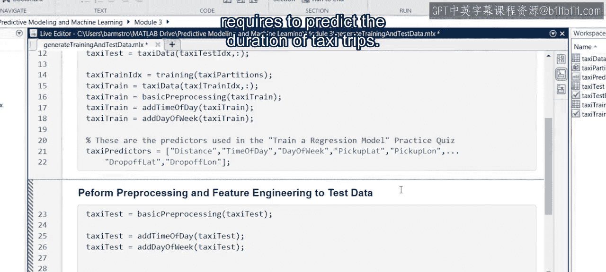

Now that the test data is ready， the next step is to import it into the regression learner app。

Select the test data from the workspace。The response and predictor variables are automatically selected based on the train model。

Then import the data。

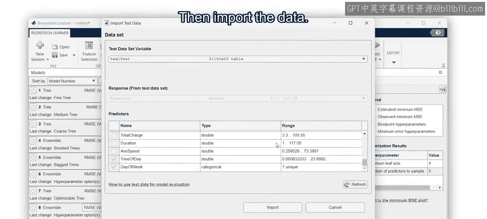

In the model history， select your final model。Here we'll use our optimized Ensemble model with fewer learners。

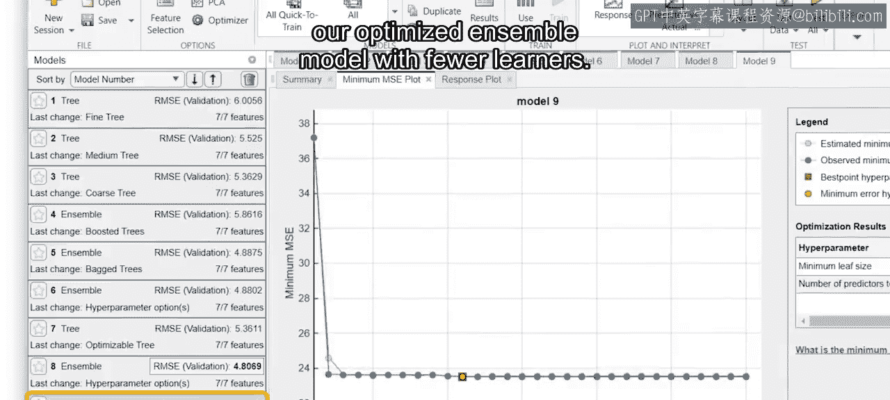

Next， apply the selected model to the test data。

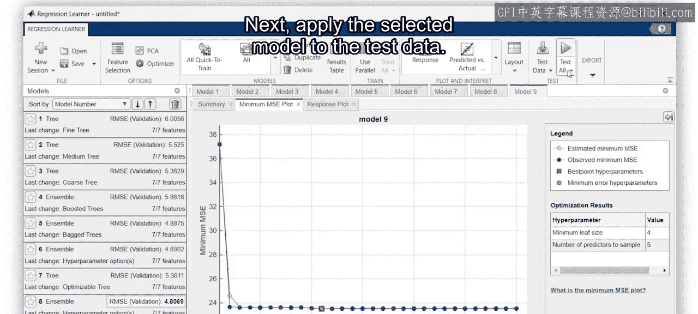

So how did it do？Let's look at the test results located in the summary tab。

The root mean square error tells us that the model predicts the trip durations with an error of around 5 minutes。

The test and training metrics are very similar。 This is a good indication that the model is not overfit to the training data。

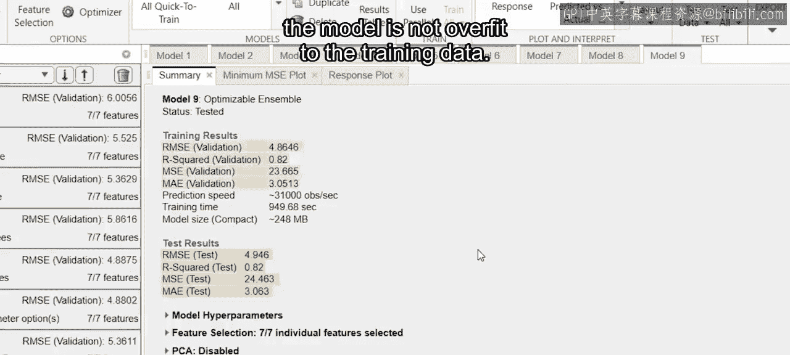

You can see how the air vary with trip duration by taking a look at the residuals plot。

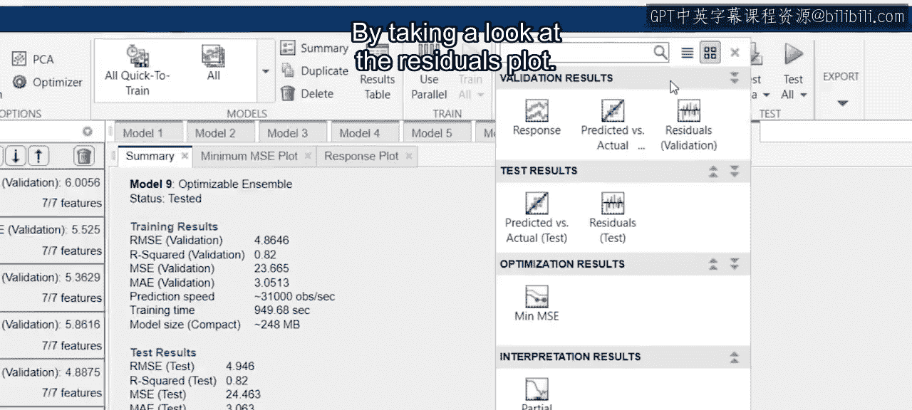

Create a residuals plot of trip duration from the test data to see how the errors look for short and long trips。

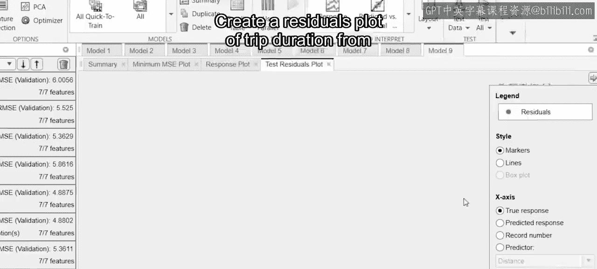

Notice that for short trips， which are the most common， the model performs well。

 and the residuals are near zero。For the less common very long trips。

 the model struggles and underestimates the trip duration。

This could be due to unforeseen circumstances like accidents or road construction。

Additional features for these events might help improve the model。

Once you're done evaluating your final model， you're ready to use it on new observations。

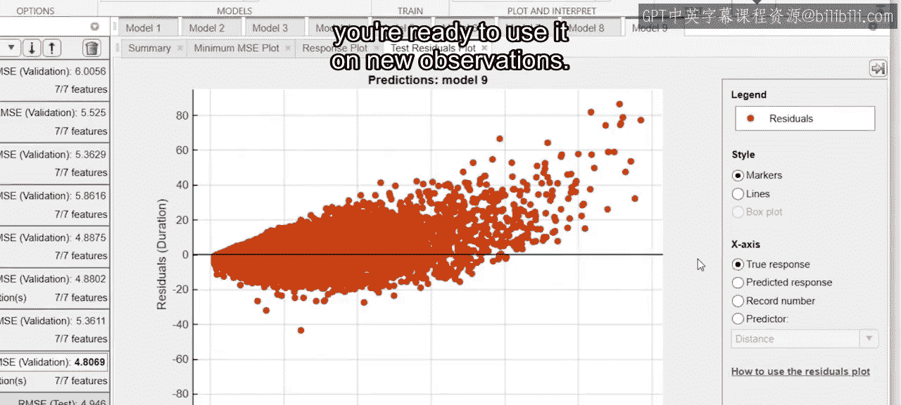

This is done by exporting the model to the workspace。And giving it a name。

The exported model is a structure variable。Structures contain related。

 but different types of data together in a single variable。

Your train model includes information on the required predictor features and type of model。

 but most importantly， a prediction function to use on new observations。For example。

 let's say you need to predict the duration of a trip from lower Manhattan to Times Square at 6 PM on a Tuesday。

The new observation should be stored in a table that includes the same predictor features used during model training。

Then you use the predict function of your exported model to estimate the trip duration。

Looks like this trip would take around 30 minutes。

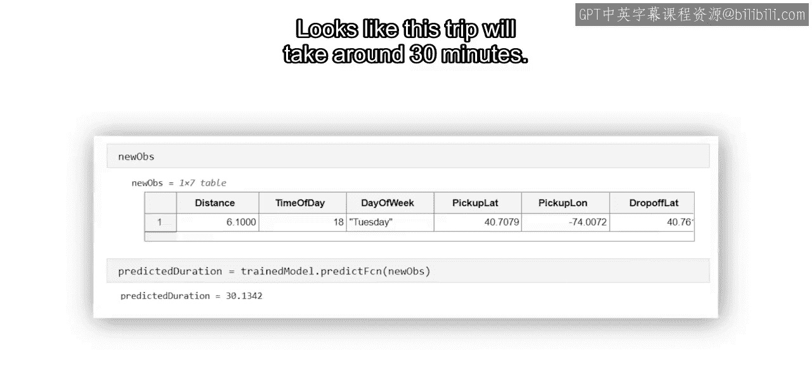

Congratulations， this completes the machine learning workflow。

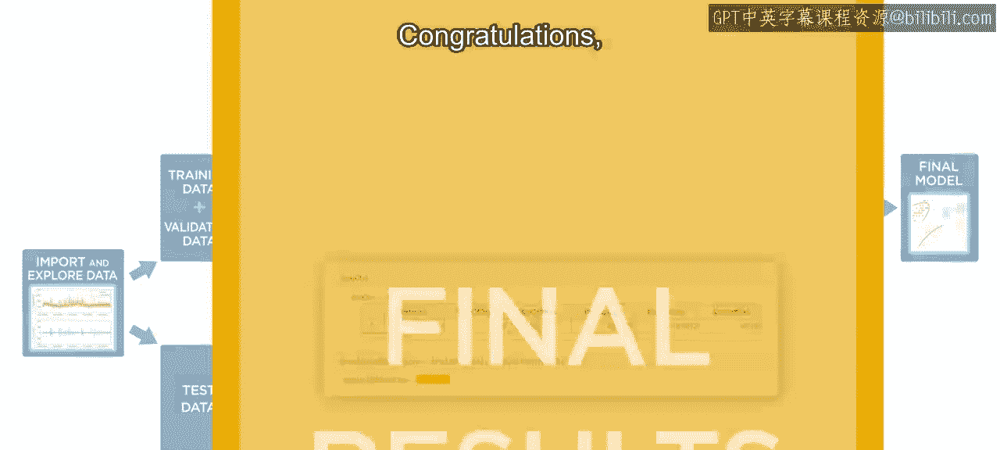

To recap。You started with a spreadsheet containing historical taxi trip data。

 You explored and cleaned the data。Generate new features， then successfully trained。

 validated and tested a predictive model。

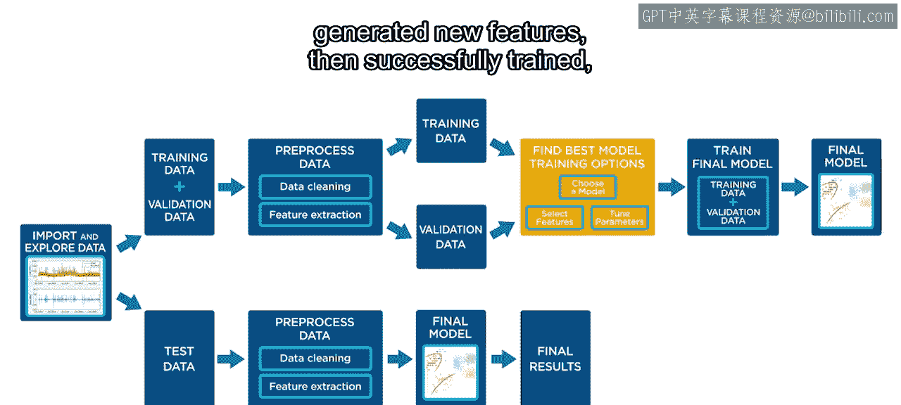

You're now ready to apply this workflow to your own projects。

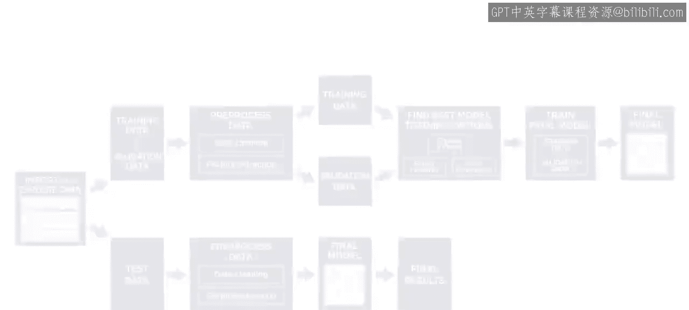