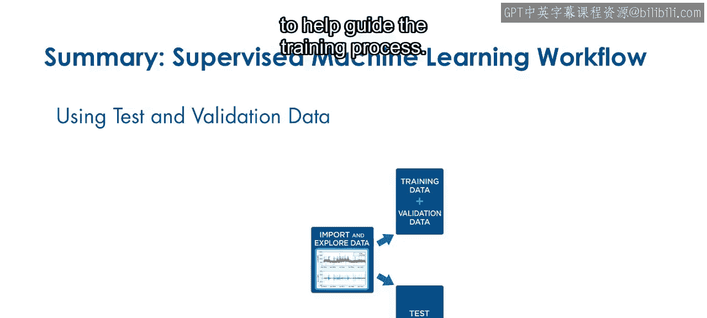
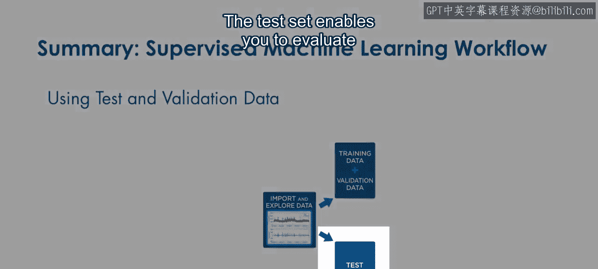
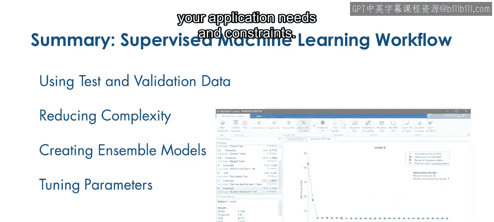
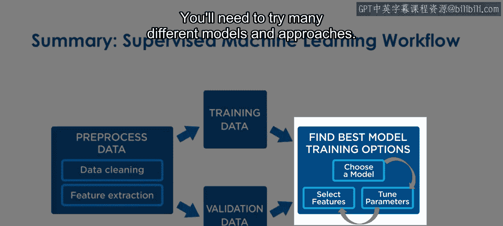
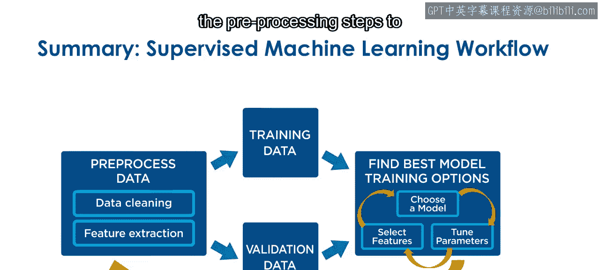
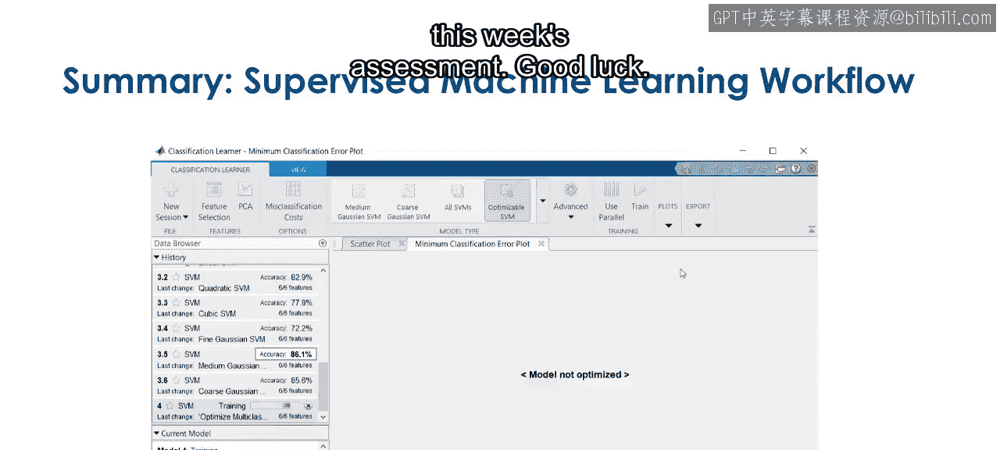

# Mathworks《实用数据科学与MATLAB（数据探索、特征工程、机器学习、毕业项目）｜Practical Data Science with MATLAB》 p111 26_模块3总结.zh_en [BV1Jr421w7wL_p111]

🎼，🎼Great job reaching the end of this module。 combininging the skills you just gained with those from course 1 and course 2。

 you can now apply the complete supervised machine learning workflow。😊。

Let's summarize what you learned。You started by using validation data to evaluate and compare models。

Validation data helps protect against overfitting so that your model generalizes well to new data。

It also provides an estimate of model performance so that you can compare different approaches。

Because you use validation data to help guide the training process。

 it is important to set aside a test data set early in the workflow。

The test set enables you to evaluate your final model using observations the model has never seen。

Next， you use feature selection and regularization to reduce model complexity。

These techniques help you identify the most useful predictors and prevent overfitting。

They are particularly important with wide data sets。

Sometimes a single model is insufficient to capture complex trends。

Combining the predictions from multiple models into an ensemble can improve accuracy。

Common types of ensembles include boosted and bagged decision trees。As you test different models。

 you'll typically have one or more hyperparameters to tune。

You can now create optimized models by tuning selected hyperparameters based on your application needs and constraints。

Keep in mind that machine learning is an iterative process。

 you'll need to try many different models and approaches。

You may also need to return to the preprocessing steps to engineer and clean new features。

Take some time to review and practice the concepts in this module。 When you're ready。

 continue to this week's assessment。 Good luck。

。