# Mathworks《实用数据科学与MATLAB（数据探索、特征工程、机器学习、毕业项目）｜Practical Data Science with MATLAB》 p114 29_集成模型.zh_en [BV1Jr421w7wL_p114]

🎼。

After you've trained and tested a final model。What's the next step。

It's great to show that your model makes accurate predictions。

 but how can you use your model in a practical application？

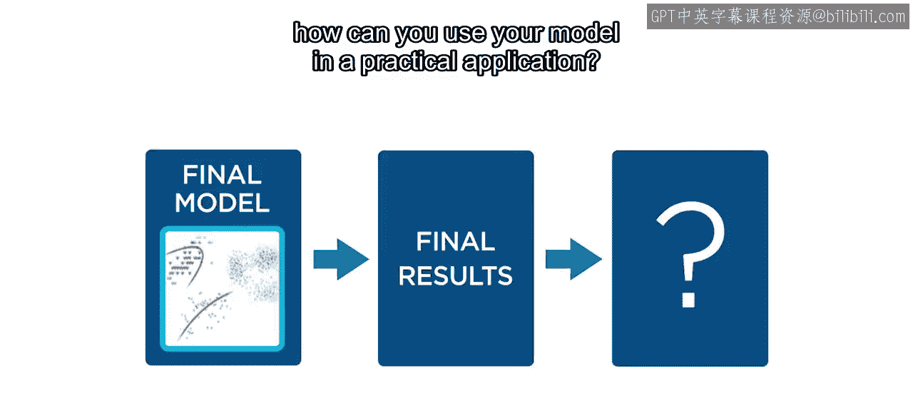

Maybe you're a data scientist who wants to help a retail company make better product suggestions to customers。

Or an engineer using machine learning to improve the performance of a self driving car。

The process of putting a model into production is called deployment or integration。

There are many ways to deploy models for different use cases， each with different workflows。

In this video， you'll see three ways of putting your models into production。

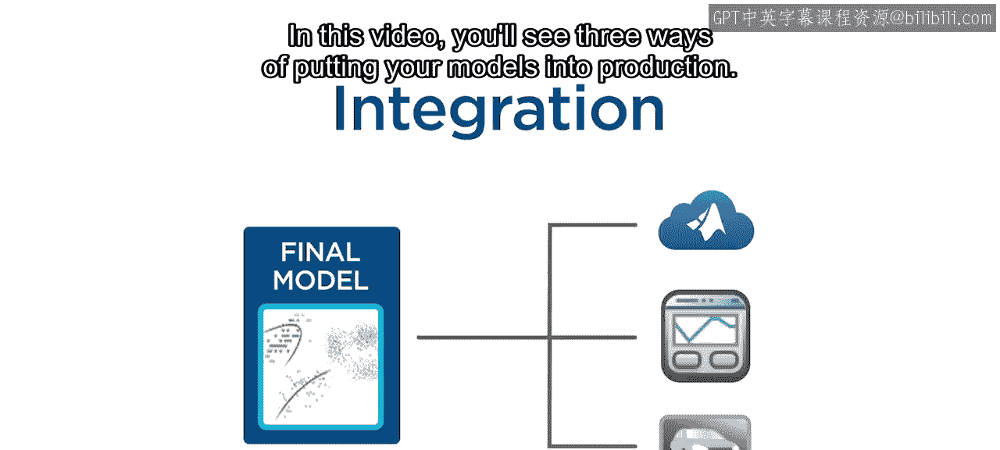

For each workflow， you'll see how MatTLAb can help you deploy your trained model and use it in the real world。

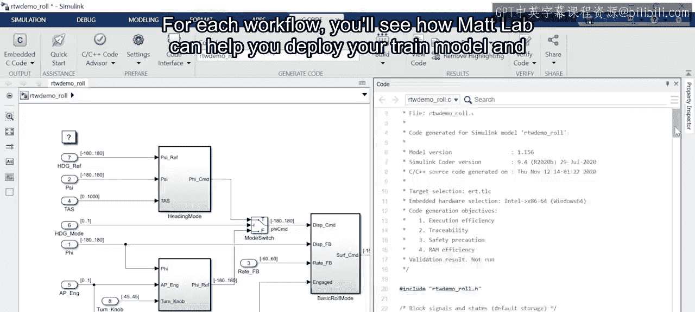

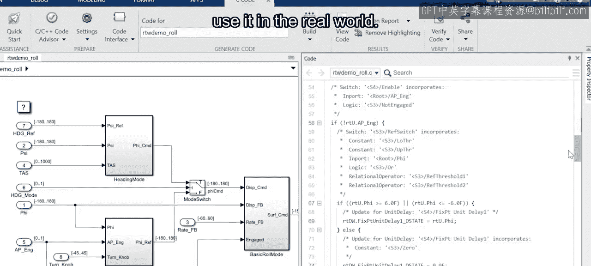

Let's get started。Imagine you're a researcher。The wants to communicate your results with colleagues at other locations。

A great option for you is simply sharing your MATLb code。

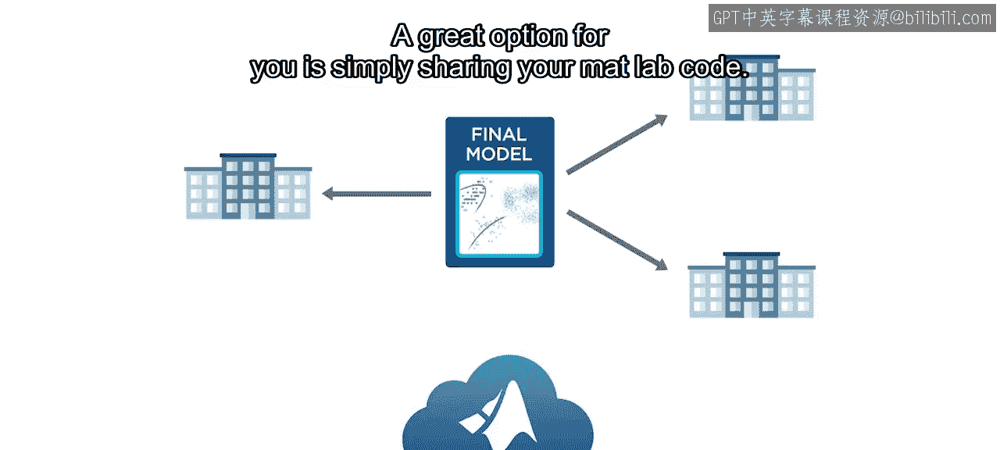

First， you would create a live script or function that makes predictions with your trained model。

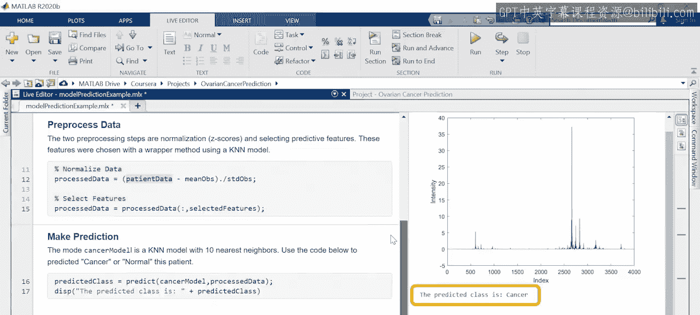

Then use the source control tools in MatTLb to keep track of changes and upload your code to a cloud based repository。

 such as GitHub。

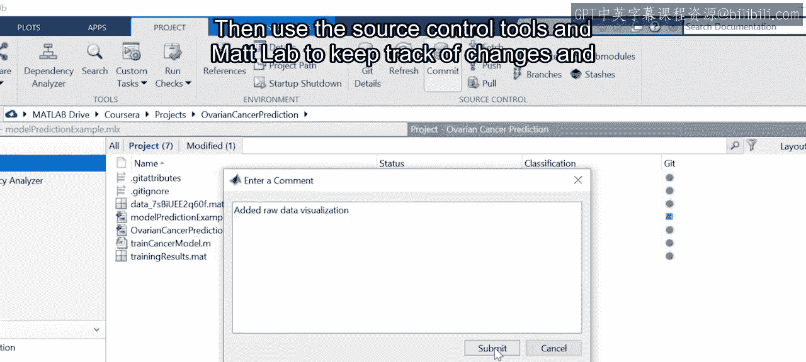

This lets anyone download your MALB code and use it locally on their machine。

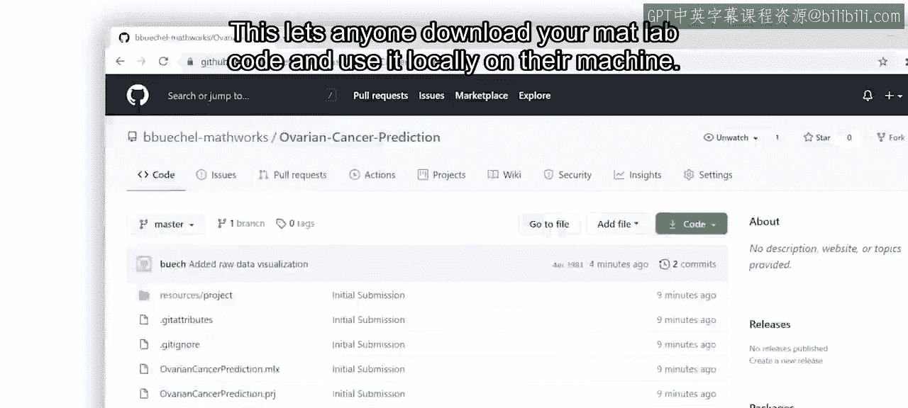

Your MATLb code can even be called in other coding environments。

If the person you're sharing with uses another language like C++， Java or Python。

 they can use MATLAb Engine APIs to call your MATLb code from within their environment。

Now imagine you're the data scientist at a retail company。

You want to wait for anyone in your organization to use your model。

 including people without programming experience。

A good option for this use case is to create a web application with an easy to use interface。

First， you would design and create an interactive app in MATLb that makes predictions with your trained model。

Then you'd host the app on a web server。So any colleague with an internet connection can use the app from their browser。

Finally， imagine you're an engineer working on a self driving car。

Many of the hardware devices embedded in the car could benefit from machine learning models。

How can you deploy your model to a hardware device that doesn't run MATLb？

The answer is to convert your code to another language that can run on the device。

This is a very time consuming process when done manually。

But MAabb can automatically generate C and C++ code。That is easily deployed onto hardware devices。

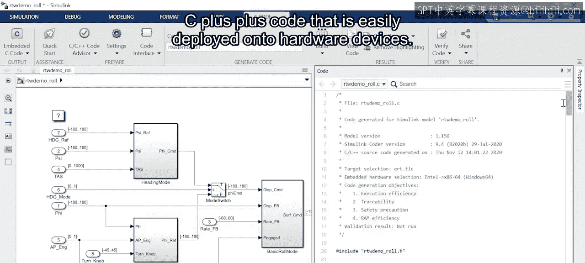

Coodegen can save engineers huge amounts of time by letting them rapidly prototype and test new hardware systems。

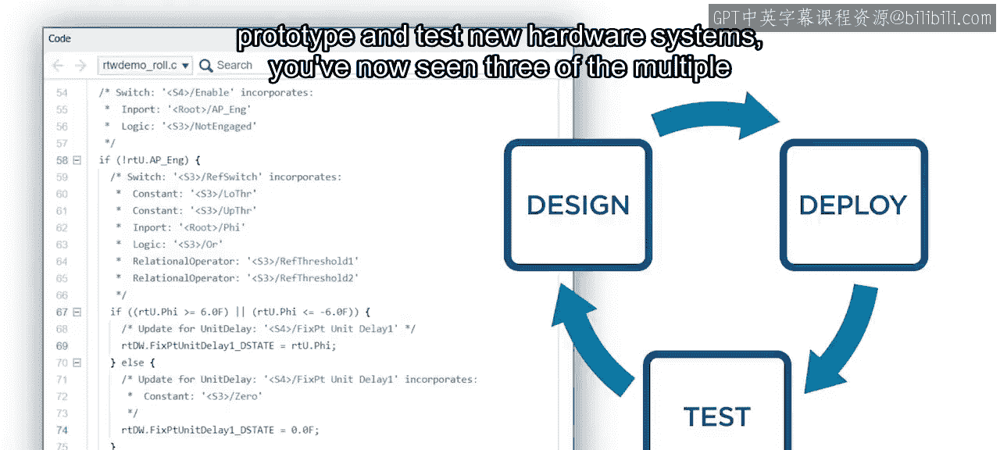

You've now seen three of the multiple methods available for putting machine learning models into production。

Each method represents a way to use your models in a real world scenario To learn more。

 check out the reading following this video for other examples of integrating models with MatTLb。

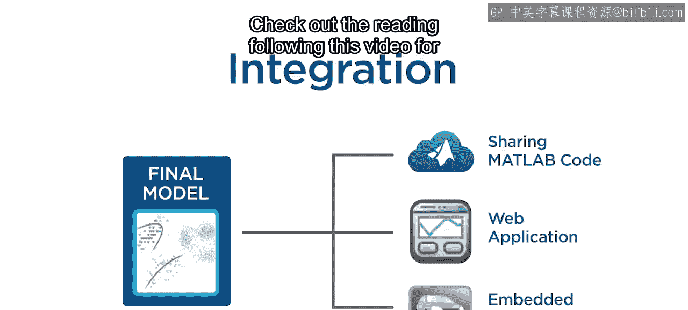