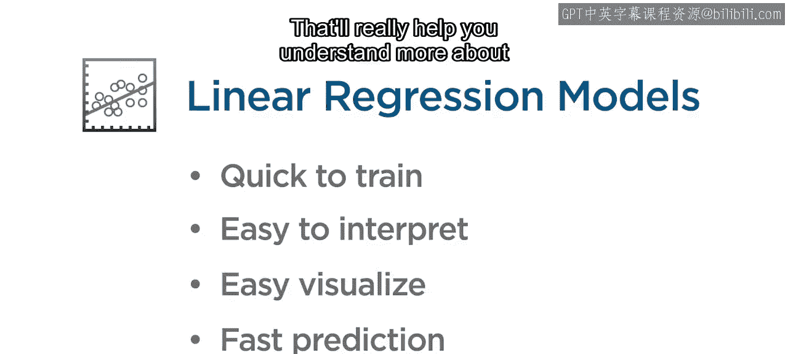
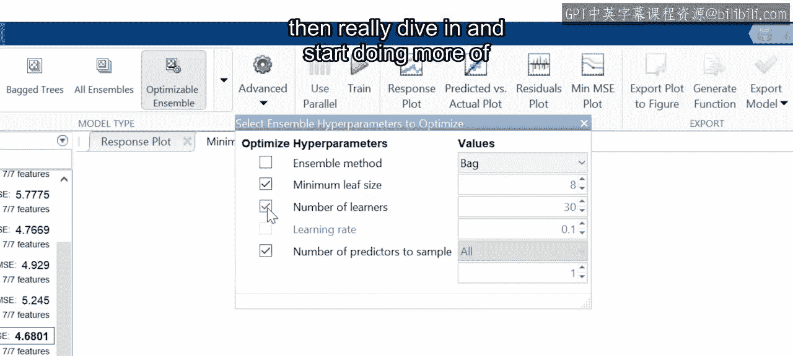
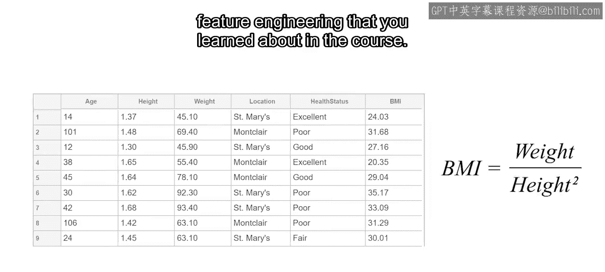
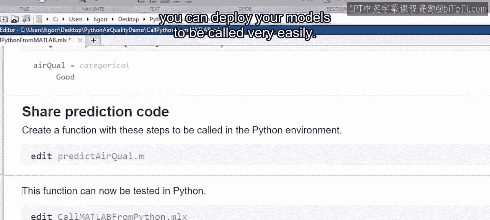
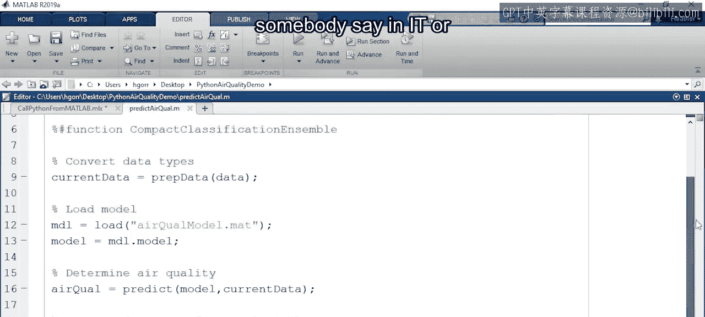
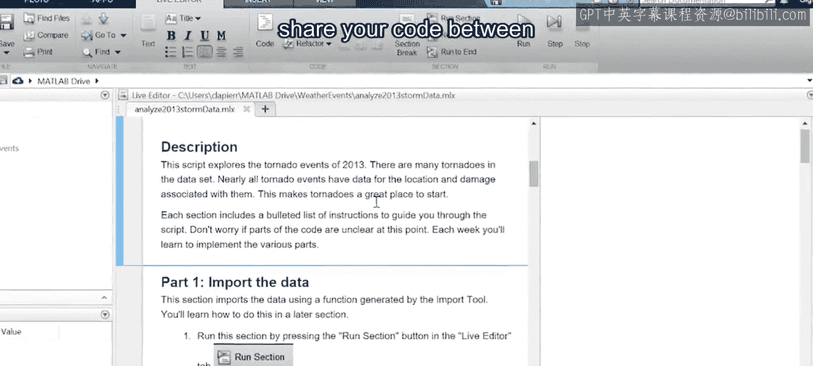
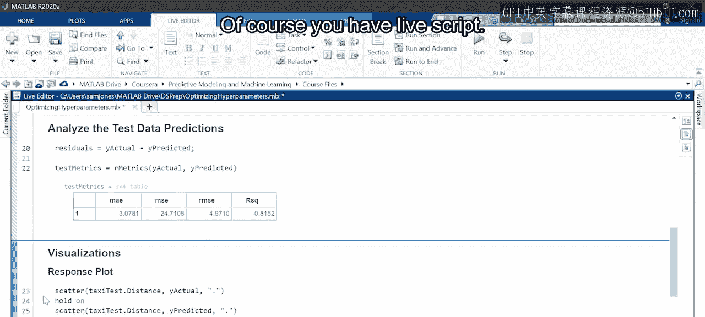
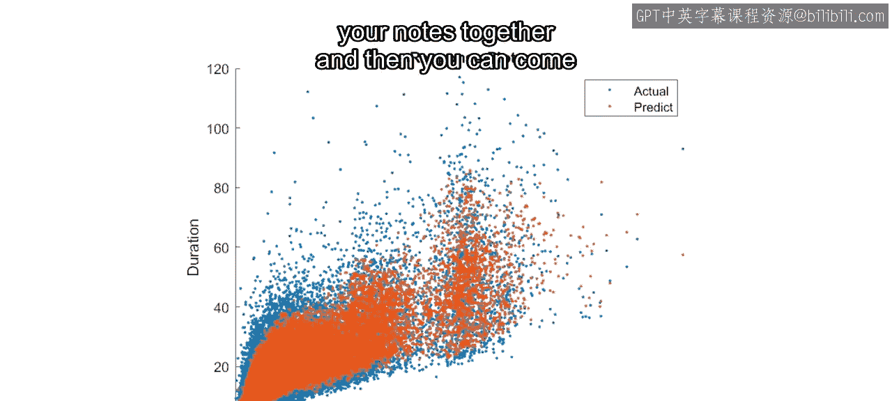
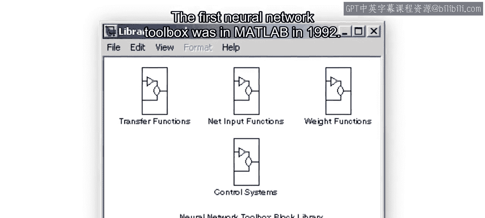
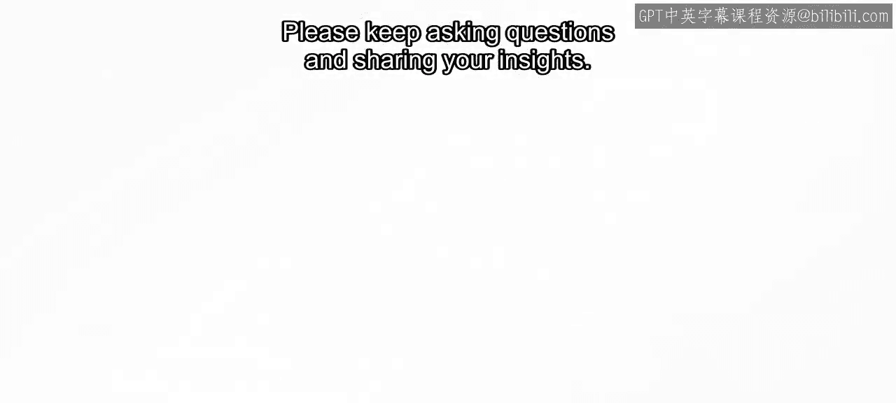

# Mathworks《实用数据科学与MATLAB（数据探索、特征工程、机器学习、毕业项目）｜Practical Data Science with MATLAB》 p115 30_与Heather的讨论.zh_en [BV1Jr421w7wL_p115]

🎼，Welcome， throughout this specialization， we've seen a lot of great engagement on the discussion forums to help you get started applying data science to your own projects。

 Heather's here to answer a few questions we've gathered based on the forum discussions。Thanks。

 Heather， can you start by telling us a little bit more about your role in product marketing and how you interact with data scientists Sure thanks Brandon。

 I help a lot with videos and examples and blog posts。

 things like that of course the course to help provide some practical kinds of explanations for data science topics and then I also bring a lot of feedback back to the dev teams anything that users and folks like yoursels have mentioned for improvements I help them prioritize that and lately I've been helping teams of data scientists。

 engineers larger kinds of teams really integrate their machine learning deep learning applications So in the course we talk a lot about training different types of models and that you're gonna to have to iterate back to previous steps how do you personally work when you're getting started often I think it's really useful obviously with the apps to try a bunch of different models oftentimes you know a little bit about your data so you can exclude some or maybe prioritize some that would work well and I also tend to。

Start with something that's very simple like a linear model even though I know the you know relationships might not be linear you know that actually helps you back out and be able to understand why some of the predictions are being made in the way they are and you also get a lot of nice features you get visualizations and things like a N Nova and that'll really help you understand more about your data and the features and what steps you might want to take next you know so you can get that initial sense of what models might work and then really dive in and start doing more of the you know model tuning and feature engineering that you learned about in the course I'm glad you mentioned feature engineering right there at the end because a common question we've seen is students asking do I need to do feature engineering or should we just apply deep learning techniques So what are a few reasons for doing feature engineering I think as always it depends on your data and the application and in this case how much data you have too So one of the draws I think of deep learning is that you oftentimes don't need to do as much feature engineering or feature selection。

But you do tend to need a lot of data and even in a lot of cases that we see。

 you do tend to do some feature selection or engineering whenever you're working with deep learning models anyway。

 so think about a car for example and collecting all of the sensor data while you're driving that will be a big data problem within a second of capturing that data so you're trying to apply a machine learning model or deep learning model in real time that would be quite challenging to do that every nanosecond or something like that so oftentimes they'll represent maybe that one second of data as this set of features and again I think it really depends on looking forward and seeing how it's going to be used in the end and whether you will need to do feature selection or not that can also help thinking through the pipeline you mentioned self-driving cars there and so you're leading me right along to my next question of how machine learnings being applied in many different industries so what are a few of your favorite machine learning applications that you've seen。

Scientists or engineers working on I tend to like the ones that are helping humanity or the environment in some way Also anything with whether climate change。

 ecological kinds of things are really awesome in my mind and they're also really interesting because you have so much data and they change very frequently and it's very challenging to predict and model so there's a lot of really interesting things going on in the field there I always wanted to be a meteorologist and also for me I love anything that involves music or anything creative know so some of the style transfer artists kinds of applications and some of my favorites are about music'm musician the guitar over there and there's some really inspiring stories about the drummer know we hopefully can share these in the resources and even some we did with children to predict the type of instrument and see if you can beat the computer and help them learn about how to use machine learning so I love any of those kinds of things that will help inspire。

You mentioned some interesting applications and as machine learning becomes more prevalent across different domains。

 many companies are adopting these techniques for the first time what are some challenges you're seeing companies have when starting a data science project and how can these challenges be overcome a lot of times you know there are many。

 many people working on these projects and so the biggest challenges I think or whenever you're trying to deploy or take your models to the next level Some things that you can do to help with this especially since wellve even using that lab throughout the course。

 you can actually call many different languages from that lab。

 you can deploy your models to be called very easily so that helps a lot whenever you're trying to work with somebody say in IT or somebody that is in device engineering you can just deploy your model to Python C Java and then they can go about doing the integration so that's something that's really important and then of course documenting things and being able to share your code between the teams is really。

 really important。

So using things like you saw in the course， like using the live scripts to put all of your results and things that's very。

 very helpful whenever you're trying to communicate with other people on the team。

 whenever you're working on these big projects moving from the company now to our individuals as the learners are finishing this course and starting to apply machine learning to their own projects what is one thing they should remember to do when getting started It's so tempting to dive in and just open up the app and start trying models and doing visualizations but one thing that is really helpful is if you plan ahead if you think through the application upfront what are the goals what are the expectations that'll really help you not to get lost in all the exciting models and all the fun stuff and try to keep remembering what the goal of the project is and documentation along the way is really helpful even for yourself I can't tell you how many times I've repeated the same steps because I forgot to save it or I forgot to make a note of which model I was training at the time or which results went。

Whi algorithm of course you have live scripts so it's really nice because you can keep the visualizations and you all of your notes together and then you can come back to that and even having your goals and sometimes I just put a bulleted list of some of the ideas and just kind having all that in one piece is really helpful I think that's really great advice as a closing do you have any fun fact or quote that we want to share with the learners Sure yeah I wanted to point out that this stuff isn't necessarily new the first neural network to a box in Matlab in 1992 and regression polyfi andval and things like that or way before that I think that's a fun fact it's likeow deep learning and machine learning this is a new but this is something that it's been around for a while we're just taking really good advantage of it now thanksather I think these insights are really gonna help our students Thank you so much are great questions I really appreciate the opportunity and to our learners thank you for your engagement in the course and on the forum please keep asking questions。

🎼And sharing your insights。

