# Mathworks《实用数据科学与MATLAB（数据探索、特征工程、机器学习、毕业项目）｜Practical Data Science with MATLAB》 p116 31_预测建模和机器学习总结.zh_en [BV1Jr421w7wL_p116]

🎼。

Congratulations on reaching the end of predictive modeling and machine learning。

You're now able to create a variety of machine learning models and evaluate their performance。

 Let's summarize what you learned in this course。😊。

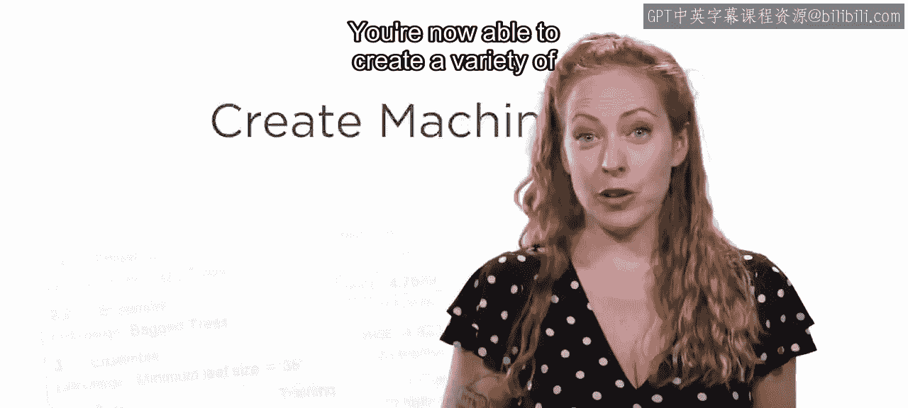

In modules 1 and 2， you learn the basics of common regression and classification algorithms。

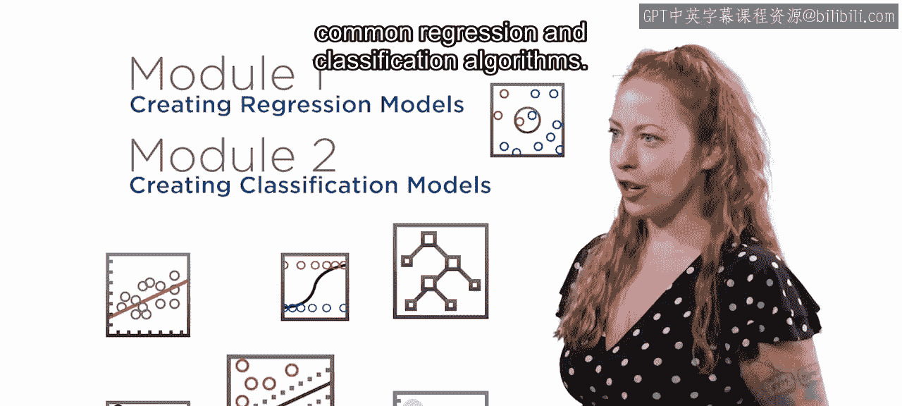

It's important to have an understanding of different models so that you can make informed choices when choosing and tuning a model。

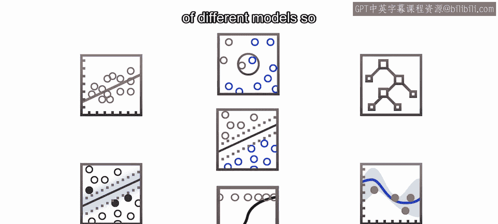

For example， linear models are fast to train and easy to interpret。

 but may not capture complex trends。

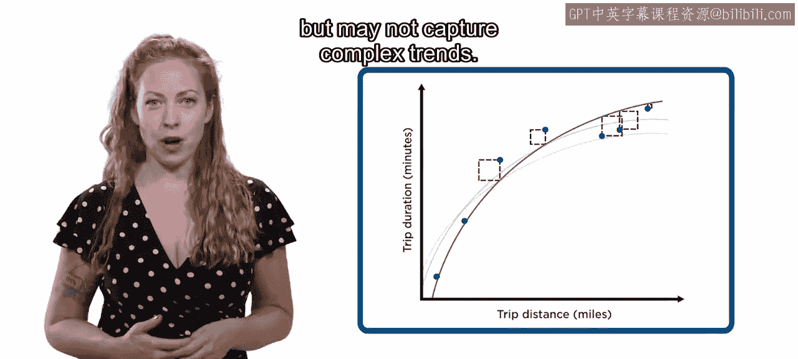

Decision trees you a good job at capturing nonlinear trends。

 but introduce hyperparameters that you need to set manually or via an optimization process。

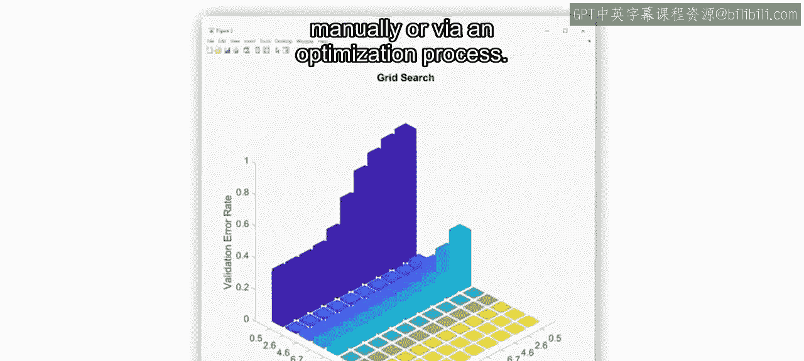

You use the regression and classification learner apps to train different models。

Using an app based workflow enables you to quickly select features and tune hyperparameters。

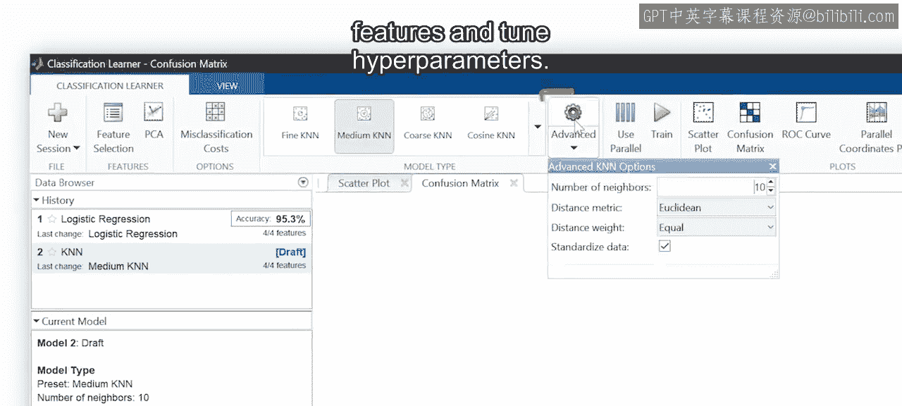

Your training history is maintained， so you can compare your latest approach against an earlier model。

Key metrics and visualizations are also readily available in the apps。

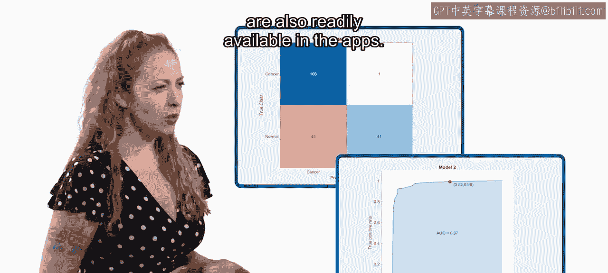

For example， the confusion matrix and ROC curves help you identify where a classification model is making mistakes。

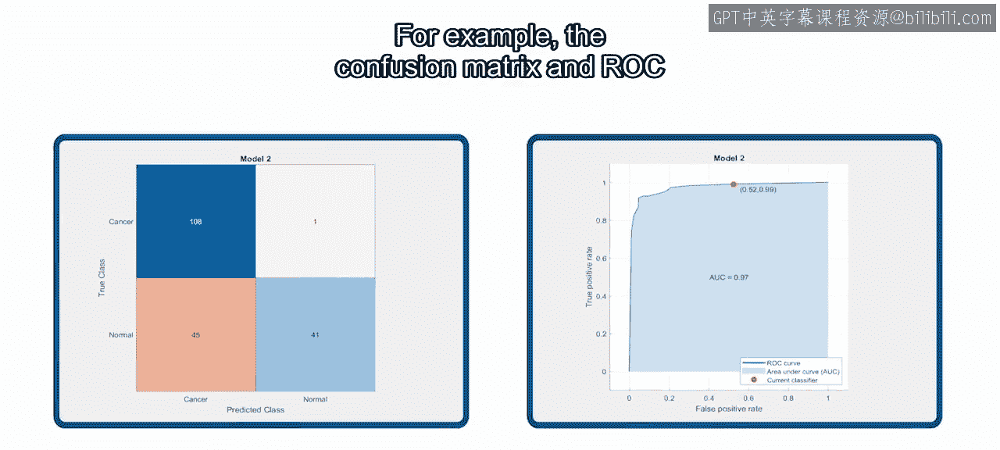

You can examine the residuals of a regression model to find where a model performs well and where it needs improvement。

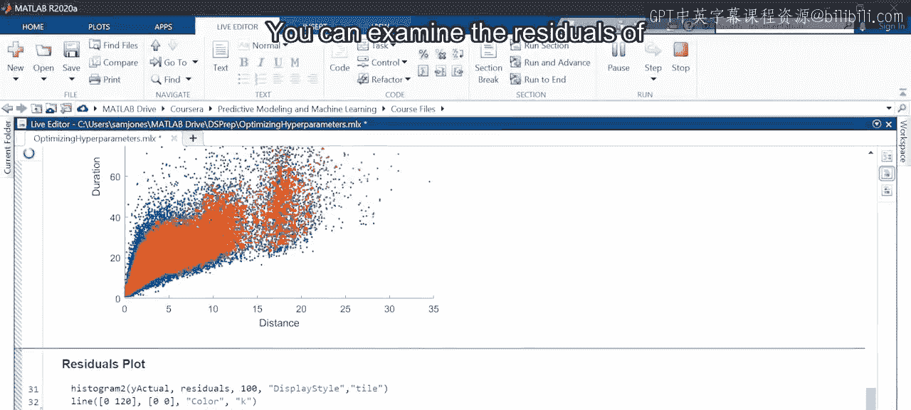

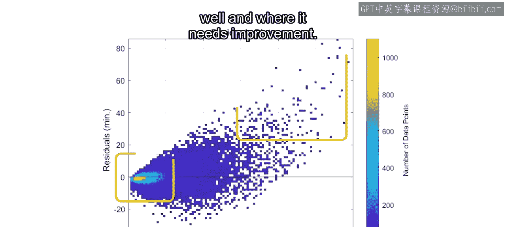

The same workflow applies to both regression and classification problems。

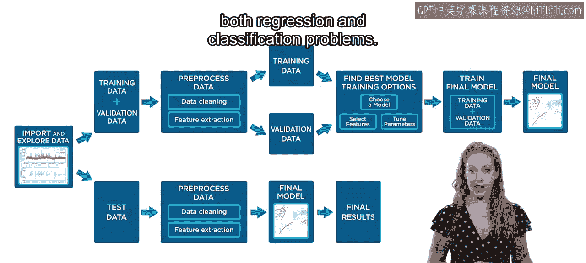

In module 3， you applied the supervised machine learning workflow by creating a test data set for evaluating your final model。

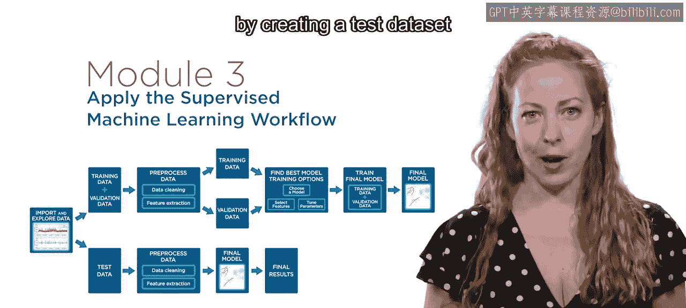

Using validation data to compare different models and prevent overfitting and trying a variety of approaches。

This included using different algorithms， performing feature selection and optimizing hyper parametersa。

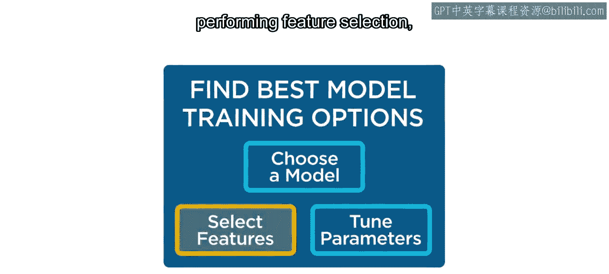

You apply these new skills in a project to predict the demand for taxis at various locations and times of day。

In Moule 4， you learn some advanced techniques， as well as options for deploying your models。

It's common for classification problems to have a class imbalance。

 It's also common for some types of mistakes to be more costly than others。

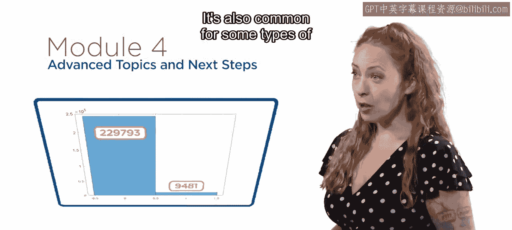

You can now address both issues through sampling and custom cost matrices。Often。

 you'll want to use your modelt outside of Matlab， perhaps as a web app or an app running on a device。

 You now have resources to help get you started deploying your model。

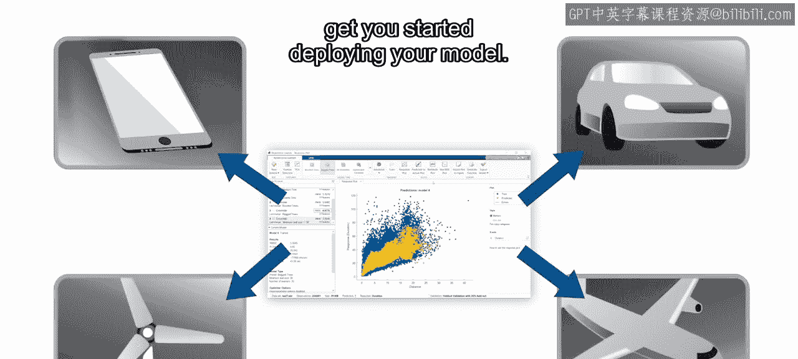

So now that you can build predictive models， what's next？Let's ask Brandon。

 who will lead you through the capstone project。Brandon， what's coming up in Co4？

Thanks Heather， you've now completed the entire supervised machine learning workflow。

 only you've done each step with a different data set。In the capstone， you're now the data scientist。

 you'll make decisions on what statistics are important to capture。

 how to pre processcess the data and what machine learning models to use。

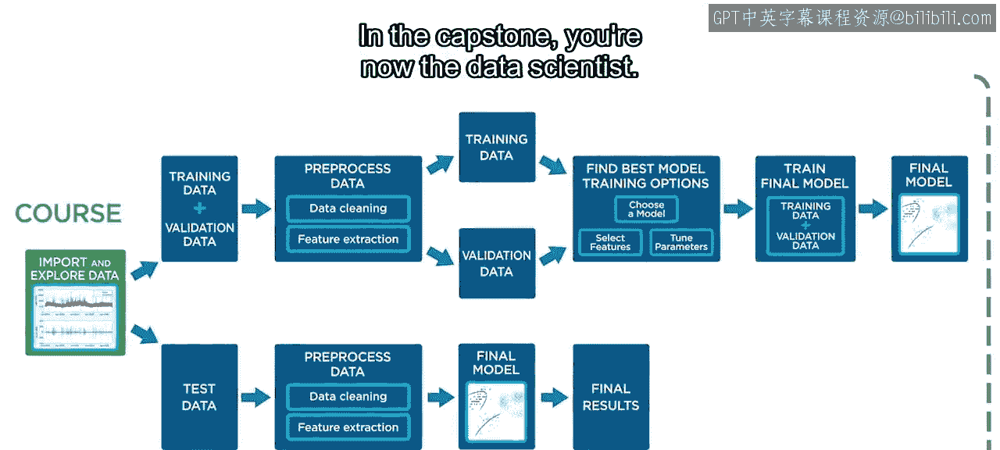

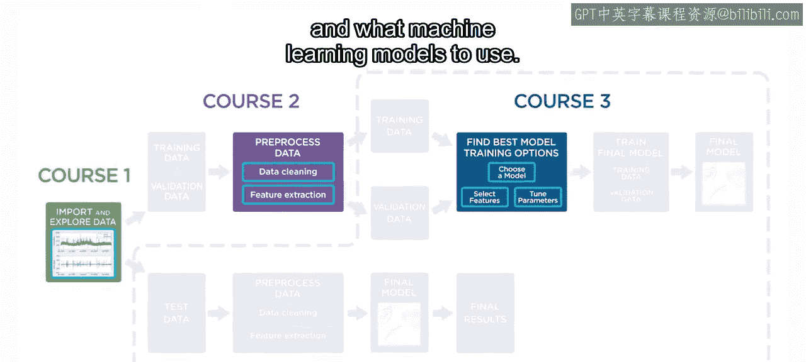

After completing the capstone， you'll be ready to tackle your own data science projects。

 I look forward to seeing you there。😊。