# Mathworks《实用数据科学与MATLAB（数据探索、特征工程、机器学习、毕业项目）｜Practical Data Science with MATLAB》 p118 1_教师介绍.zh_en [BV1Jr421w7wL_p118]

🎼。

Hello， everyone。 My name is Adam Philllian。 I'm Heather Gore。 I'm Brendan Armstrong。 I'm Er Burnne。

 and I'm an online course developer at Mathworks。 I'm a product manager at maththworks。

 I'm a technical product marketing manager for Matlab and data science。

 I an online content developer at Mathworks。 I was definitely a science nerd from a very young age。

 I wanted to be a Disney Imagineer more than anything when I was in fourth grade。

 I started using Matlab back in 2004。 When I started my bachelor's degree in aerospace engineering at Virginia Tech。

 I've been using Matlab for over 10 years in research and teaching。

 My first exposure to Matla was purchasing the student version while working on my PhD in physics。

 I used Matlab primarily to visualize my data and fitted to simple models。

 I first used it while an engineering student at Harvey Mud College。

 My main project from my PhD was on machine learning for pattern recognition in biofluids。

 That was really fun。 My graduate research focused on something called halo orbits。

 My research in this area involved finding optimal transfer trajectories from lowear orbit to these halo orbits。

 Which naturally， I code it up。😊。

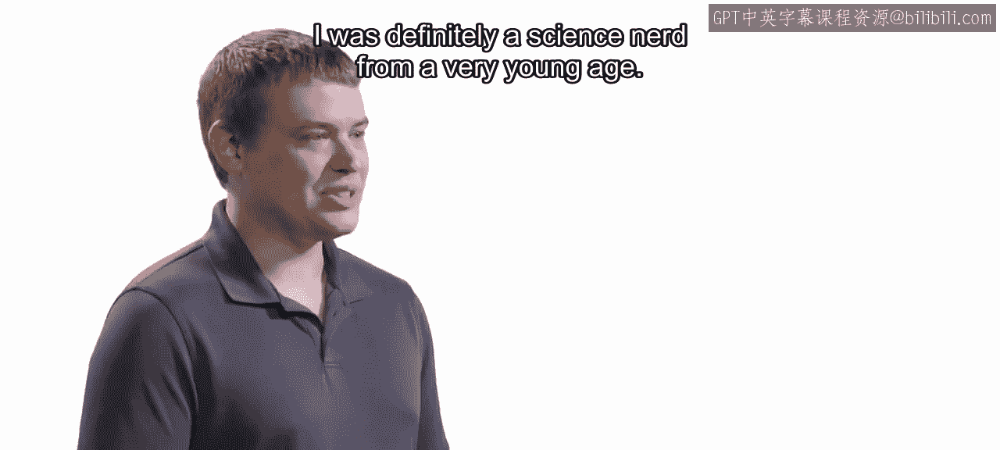

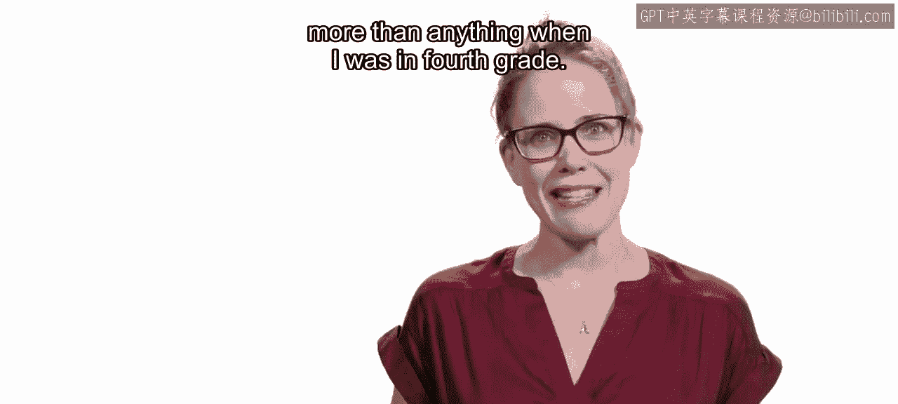

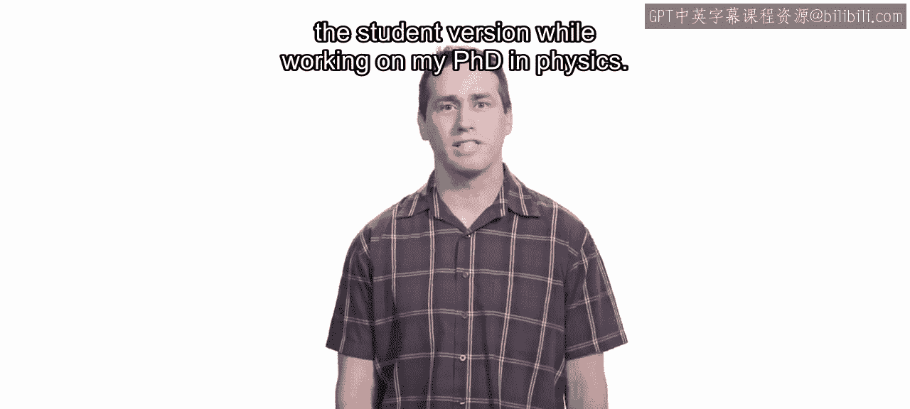

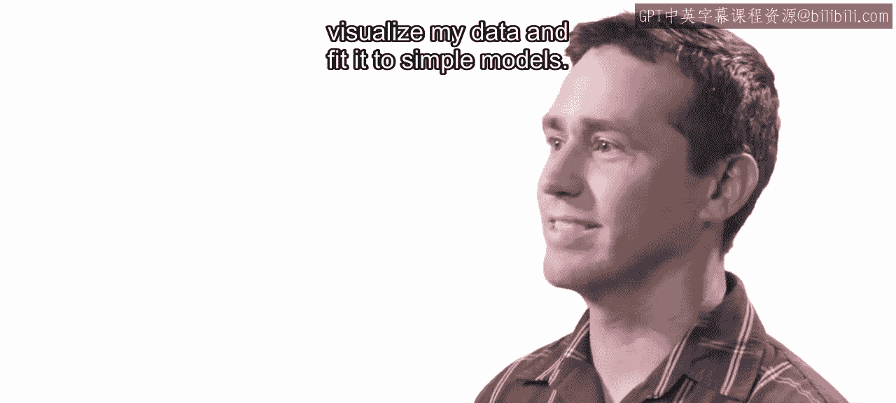

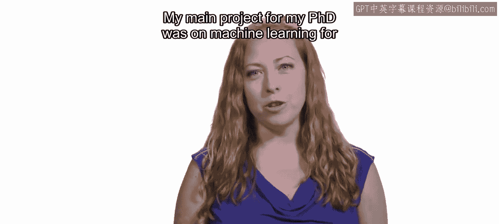

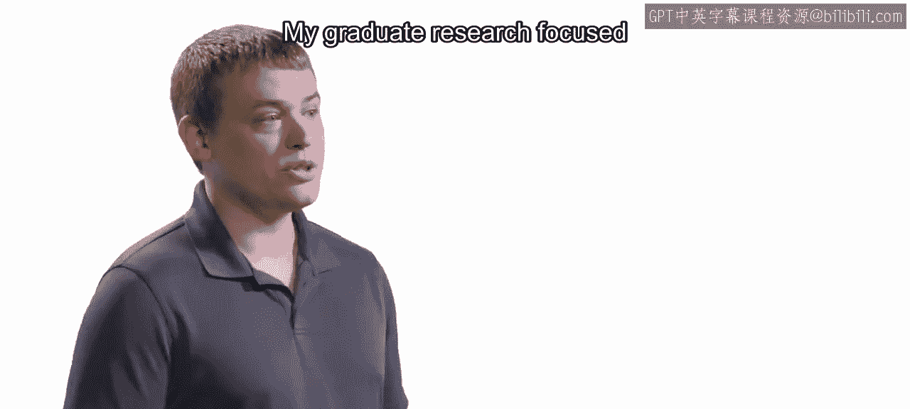

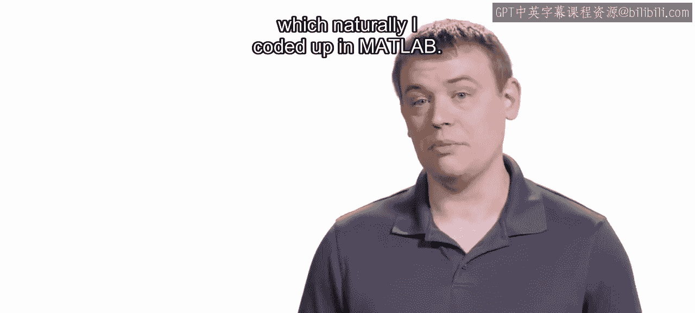

In MatTlab one cool recent project was in deploying machine learning models for realtime predictions。

 I created the signal processing and machine learning algorithms in Matlab。

 Then I used the predictions in a streaming architecture on the cloud。

 I started my career as an aerospace engineer。 I did systems level design and analysis for satellites and interplanetary missions。

 including the Mars exploration rover。 a maththworks。

 My role is to help other people learn how to adopt machine learning。

 deep learning and data science into their work。 I work with our development organization to prioritize what new data science tools we're building next。

 Basically， my whole job is to help people like you get started and get comfortable with using Matlab for your applications I used to be a professional swing dancer。

 I'm a musician。😊。

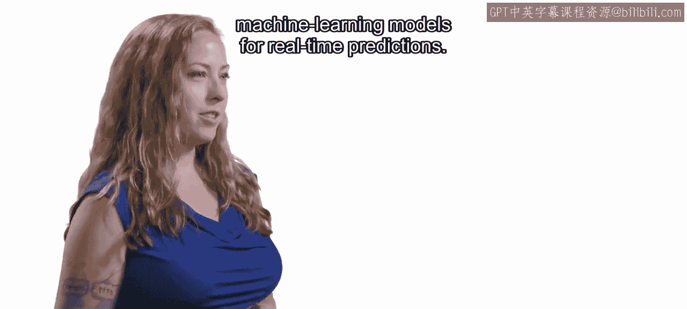

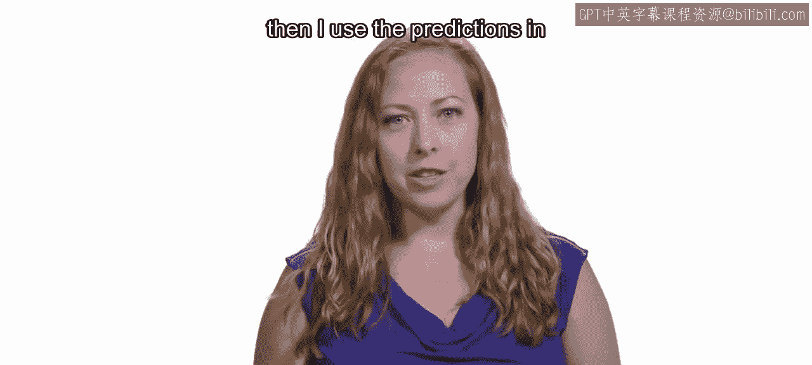

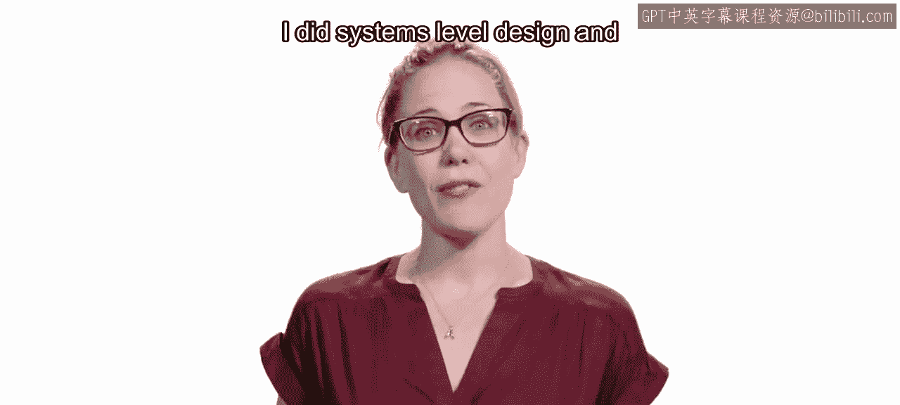

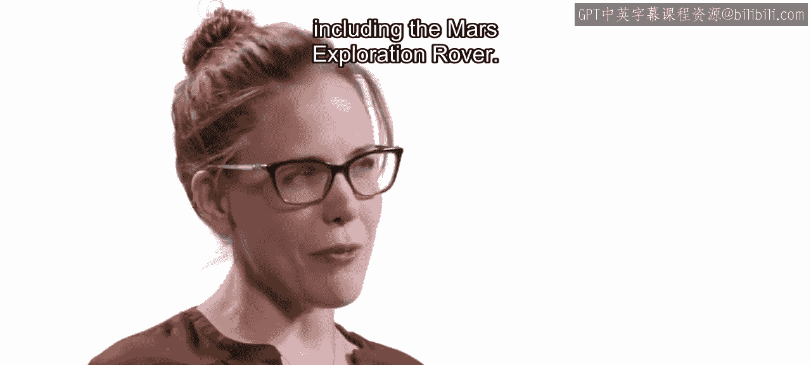

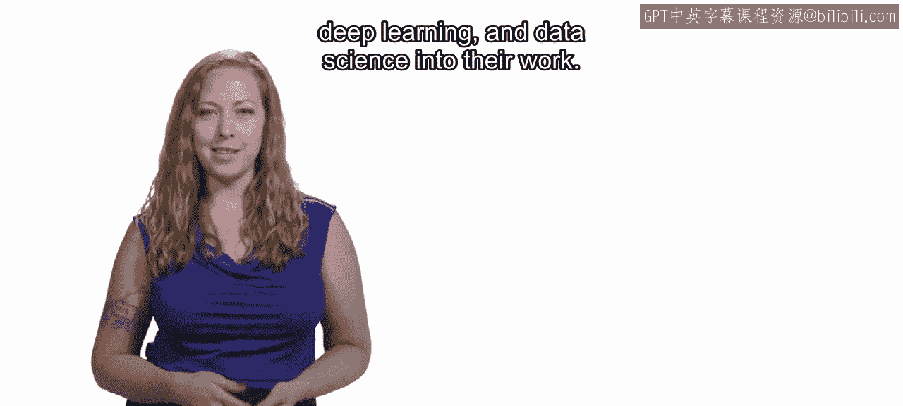

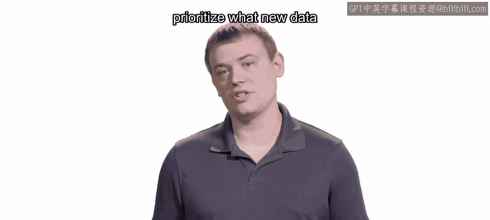

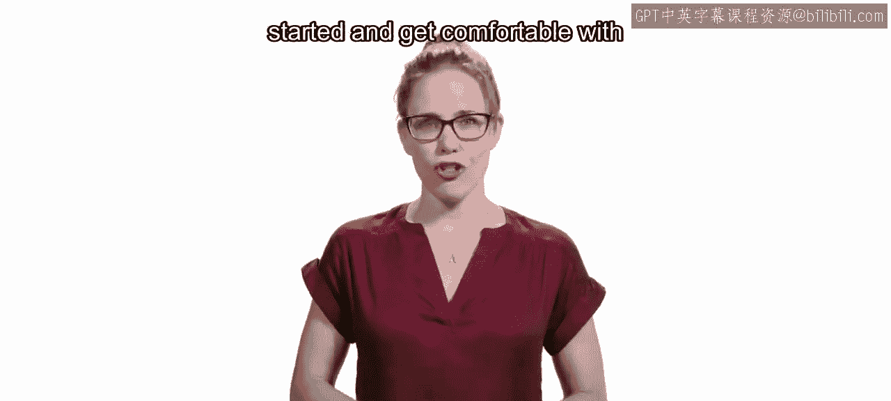

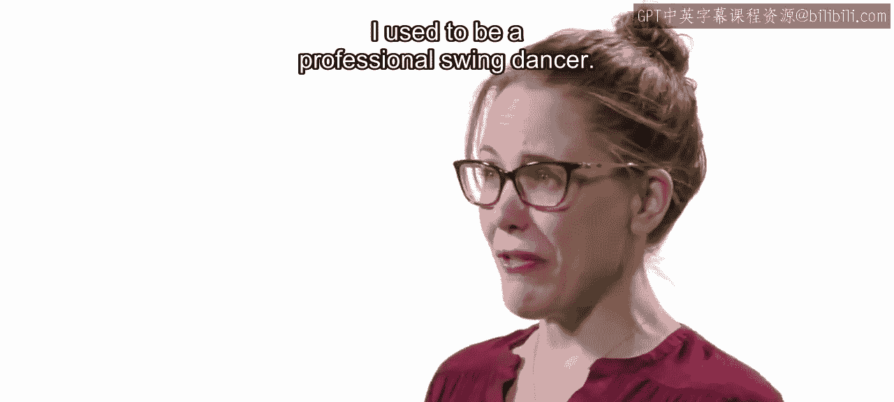

🎼I play guitar and drums， and I love to sing and write music。

 I think my passion for music really helps in my career since I'm really creative。

 and I can think of things from a different angle， which is important in data science。

 I've started dabbing in some astrophoography。 My favorite is of the Orion Nebula taken from my neighbor's driveway because my yard headed a treat。

 I do Matlab in my time off actually， I do just kind of enjoy playing around with data。

 I open Matlab every morning before anything else before emails before anything。

 and I have a little Matlab time before just when I'm starting my day。

 I'm very excited to share with you some of my experiences and hard learnedar lessons throughout this series of courses。

 And I hope you'll see how Matlab can help domain experts like yourselves。 Excelel in data science。😊。

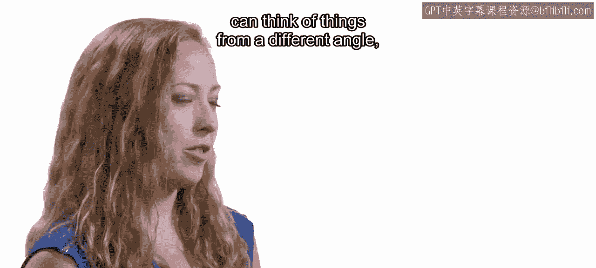

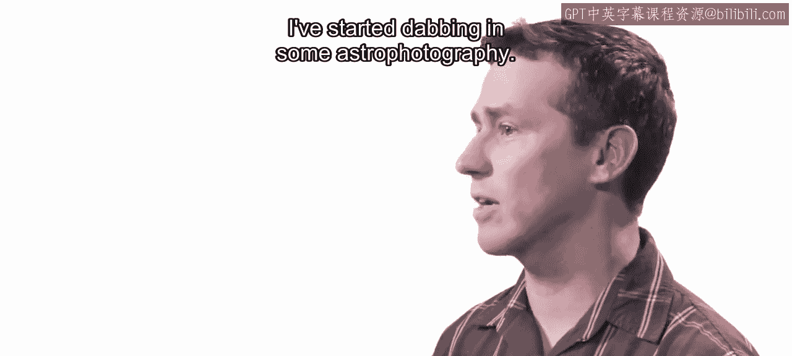

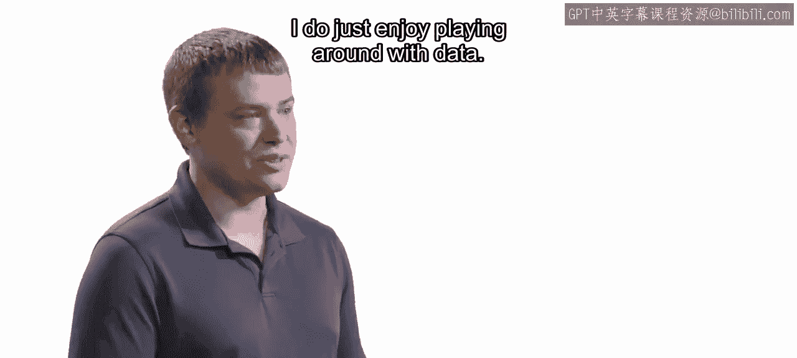

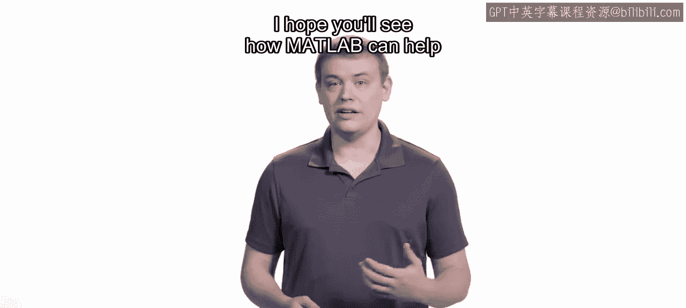