# Mathworks《实用数据科学与MATLAB（数据探索、特征工程、机器学习、毕业项目）｜Practical Data Science with MATLAB》 p119 2_毕业项目简介.zh_en [BV1Jr421w7wL_p119]

🎼。

Welcome to the Data Science Project， MATLAb for the Real World。

You've learned many new skills in this specialization。

Completing this capstone project is an opportunity to both practice and showcase what you've learned。

Like real world projects， the capstone Project has clear goals。

 but no single correct answer or approach。It's your job as the data scientist to apply the machine learning workflow。

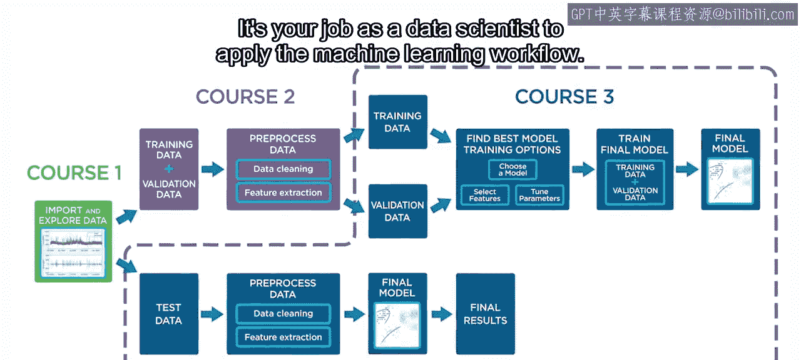

You will explore the data， make choices on how to pre processces the data。

 and train a final machine learning model。

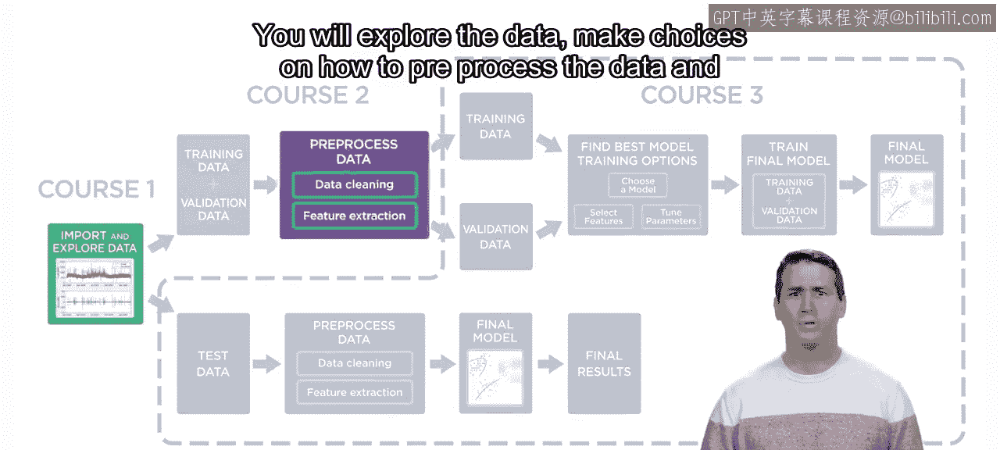

You'll once again be working with the taxi data that you used in Cose3。This time。

 your goal is to predict demand for taxis as a classification problem in six custom regions that you have to create。

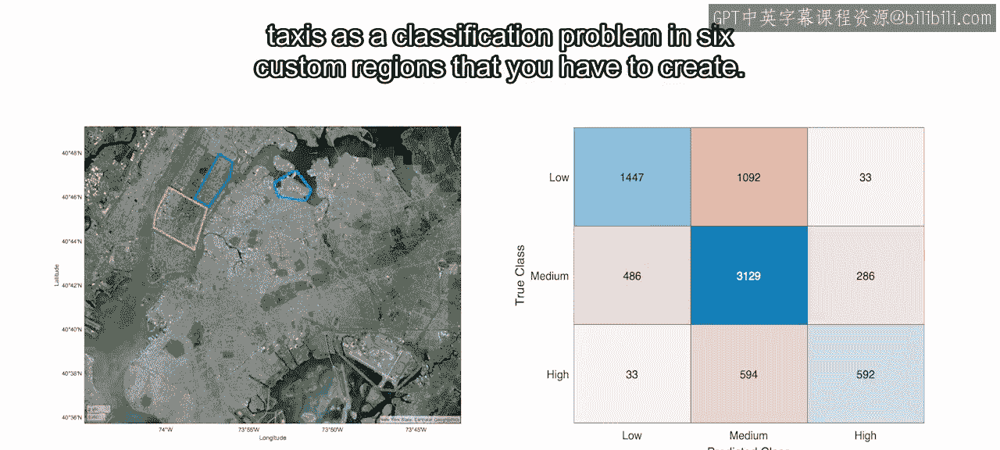

You'll start with the original data containing information about individual taxi trips。Next。

 you'll convert it into a table summarizing the number of trips for each region and hour。

You'll then need to engineer a response variable for demand and features for predicting the response。

After you've prepared the data and evaluated your features。

 you can start trying different machine learning models to predict taxi demand。

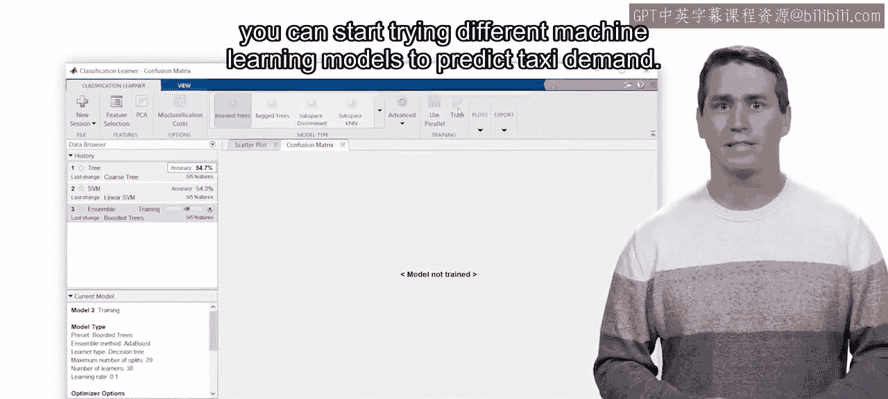

Depending on your results。You might need to iterate back to previous steps。

This is an expected part of the data science workflow。

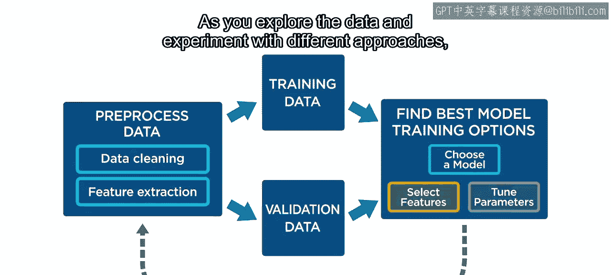

As you explore the data and experiment with different approaches。

 you'll gain new insights that will improve your results。

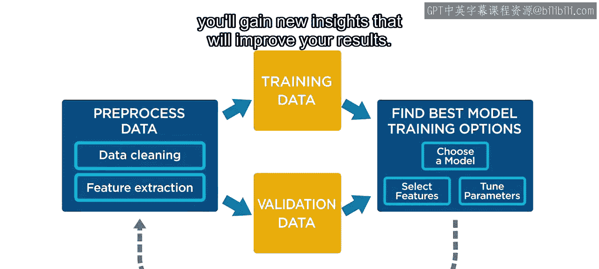

Once you've created and evaluated your final model。

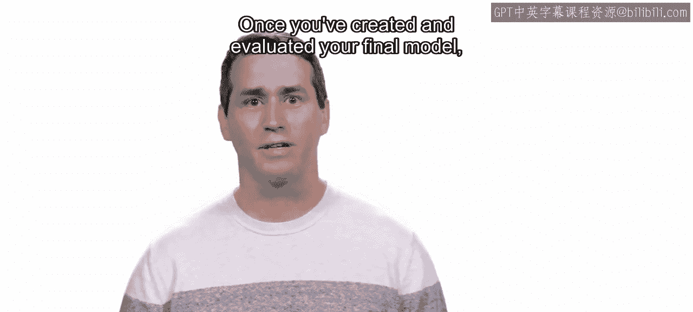

You'll create a data science report to share with your peers。

This is a chance to practice putting together a report for a technical audience。

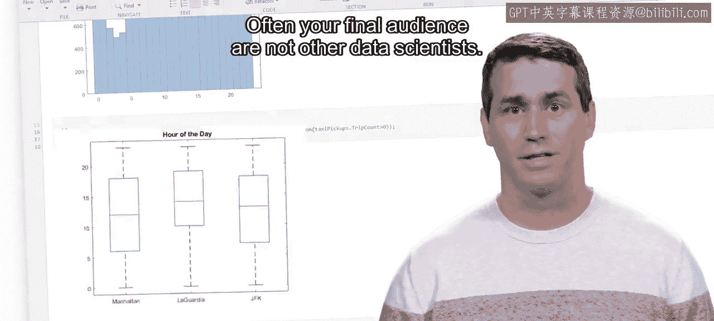

Often， your final audience are not other data scientists。For example。

 you may need to convince a business team to try a new approach based on your results。

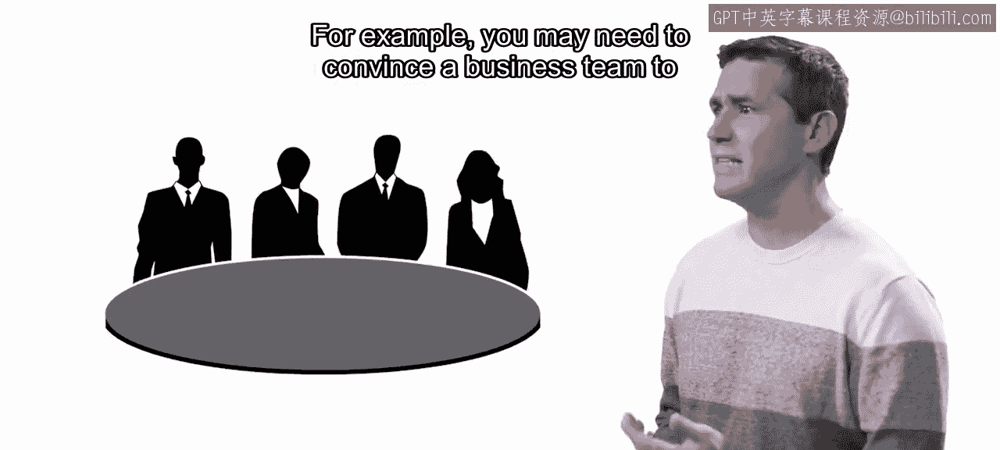

Effective communication makes it more likely that your data science work will have a meaningful effect。

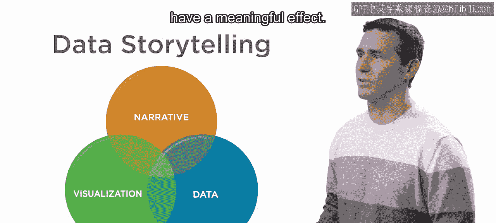

You have all the skills necessary to complete the project。To help guide you。

 the main task have been split into four modules。Each module contains readings that list the task you need to complete。

You'll also find hints and links to key concepts in previous courses in case you need to refresh your knowledge。

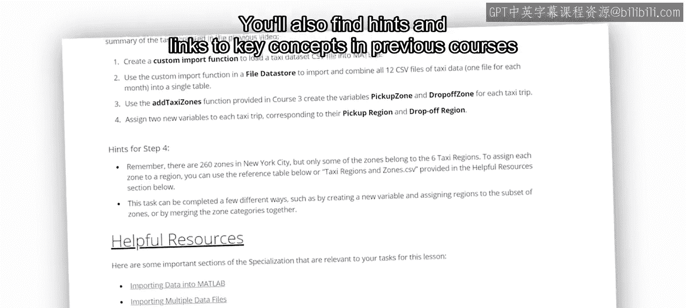

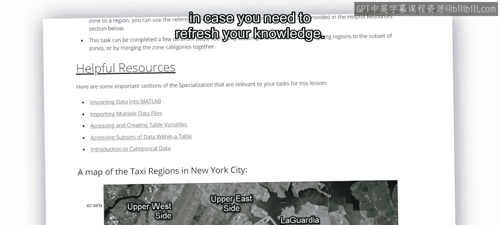

As you work through the project， use the discussion forum to ask questions and share ideas。

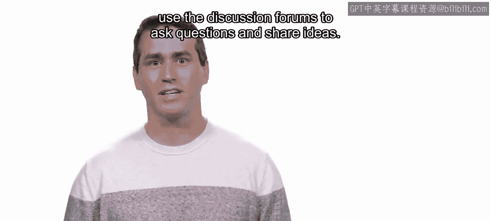

By the end of the course， you'll have your own unique solution and analysis to share with others。

 so let's get started。