# Mathworks《实用数据科学与MATLAB（数据探索、特征工程、机器学习、毕业项目）｜Practical Data Science with MATLAB》 p120 3_创建出租车区域.zh_en [BV1Jr421w7wL_p120]

🎼，Your main goal in the capstone project is to predict when certain regions of New York City are in high demand or low demand for taxis。

But recall what the Tax data set is just a list of individual trips。To determine a region's demand。

 you'll need a new table that summarizes the number of pickups and drop offs every hour。

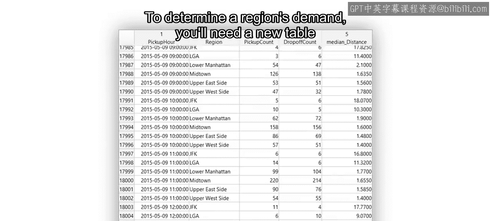

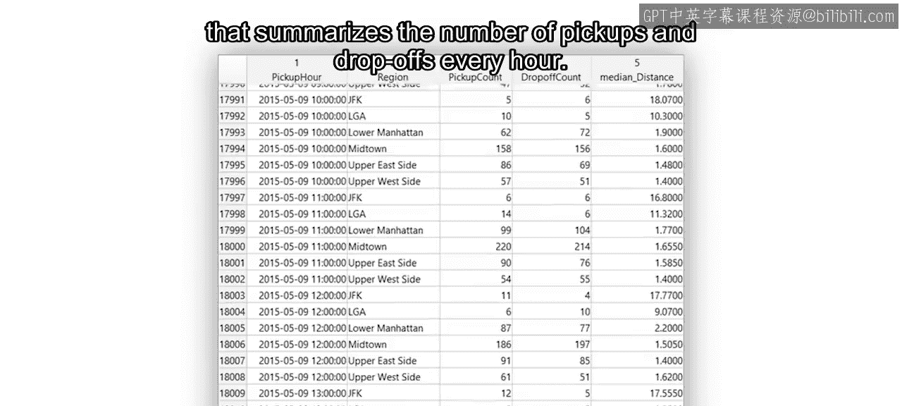

With this table， you'll be able to ask， for instance。

 how many pickups occurred on May 9th between 10 and 11 o'clock in the region of Lower Manhattan。

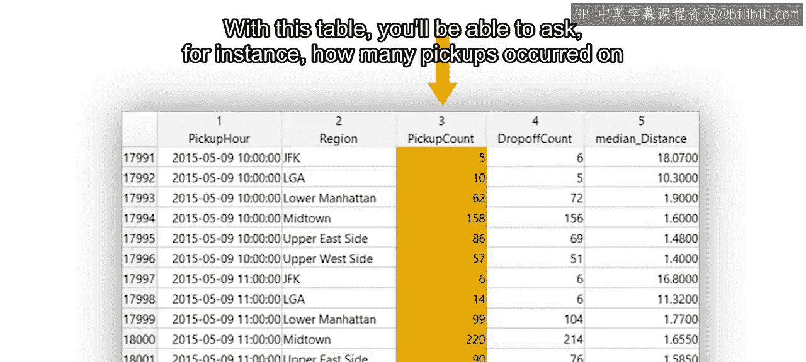

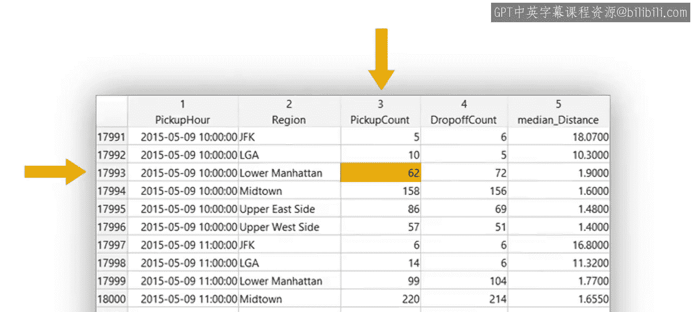

Creating this table is your task for module1， and it's divided into two lessons。

In this first lesson， you'll import the raw Tax data set and assign two new variables to each trip。

 corresponding to their pickup and drop off regions。To begin。

 you'll need to access the data stored in the CSV files。

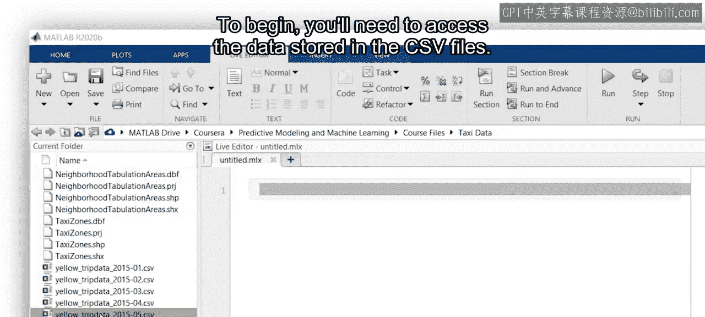

Automating this process by creating an import function will make your work more efficient and reproducible。

Next， because the data is divided by month into 12 files。

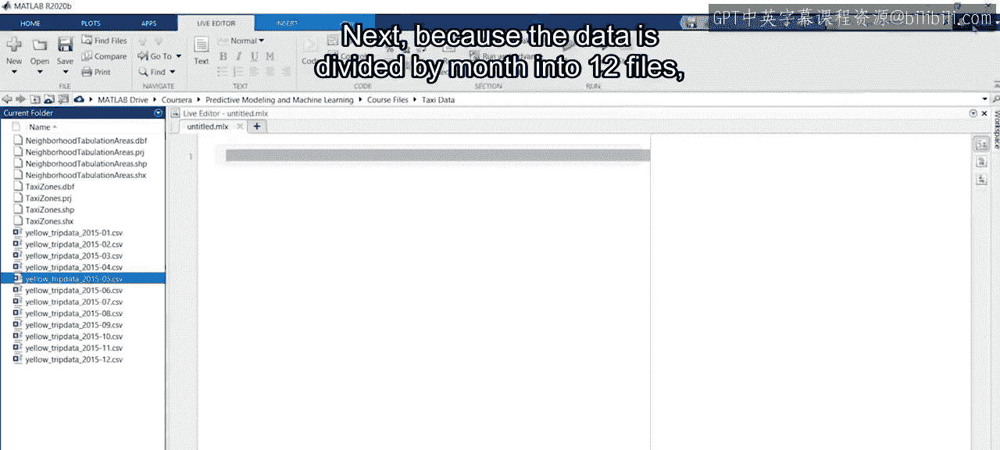

You'll want to use a file data store to import all the files you need without having to load each one separately。

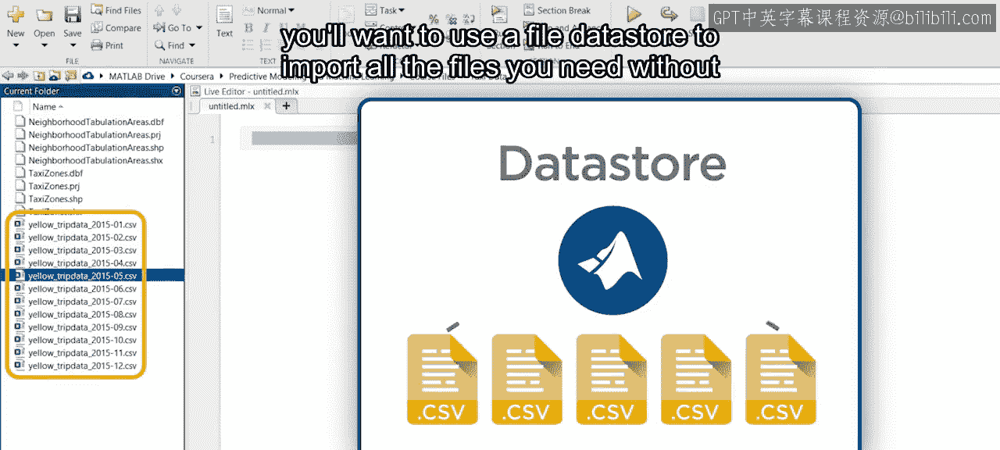

Once the taxi data is loaded into your MATLB workspace。

 you'll need to assign the pickup and drop off regions for every trip。

The files provided with Cose 3 include the Add Tax Zones function， which will help with this task。

New York City is divided into 260 taxi zones， and the six regions you need to create are made up of these zones。

For instance， the region of Manhattan's upperpper west S is composed of these six zones。

While the JFK Airport region contains just the JFK airport zone。

Once you've added the pick and drop off zones to the table。

You'll need to determine which zones belong to which regions。

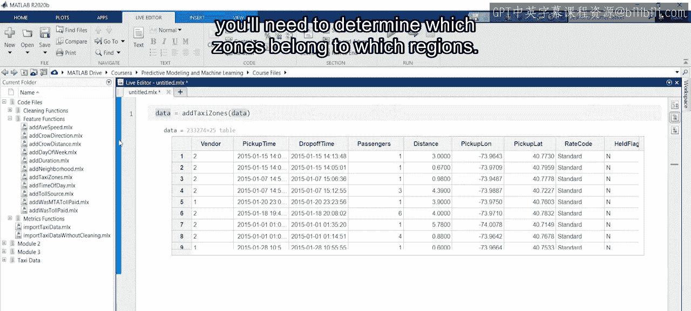

A CSB file available in the following reading provides this information。

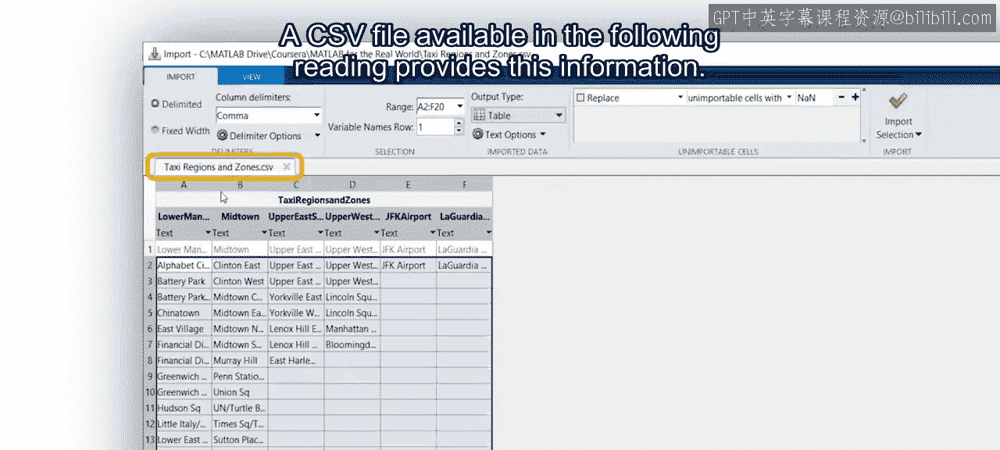

Once this task is completed， you'll have a table of the entire taxi data set。

 but now with two new variables representing each trip's pick up and drop off regions。

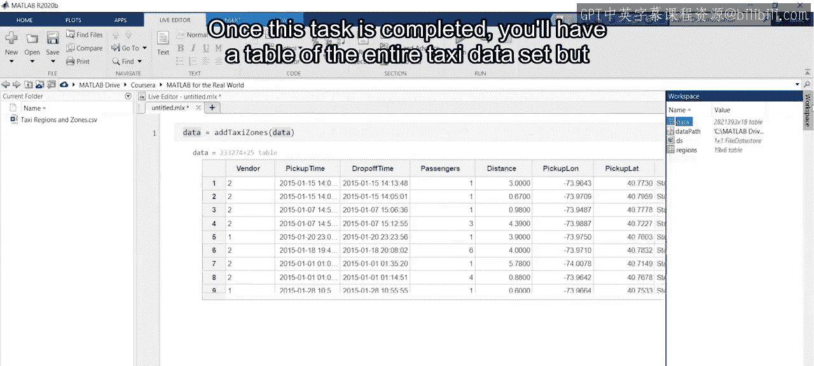

Your next task will be to explore the data using these new region variables。

To accomplish these tasks， you'll be applying many of the techniques you've learned throughout this specialization。

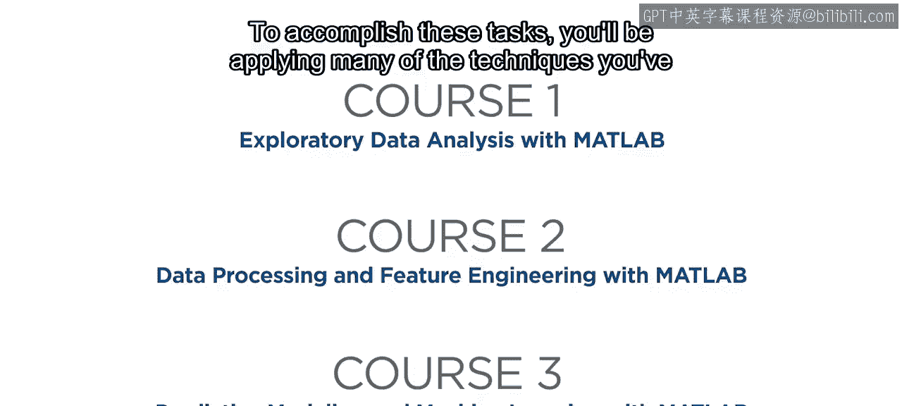

For your own reference， the following reading summarizes this video and provides links to helpful lessons from previous courses。

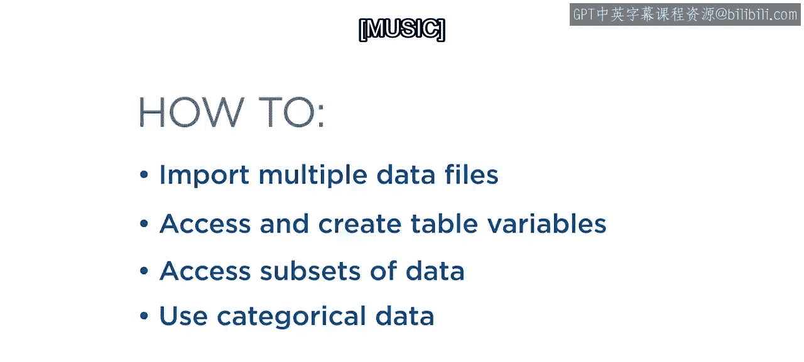