# Mathworks《实用数据科学与MATLAB（数据探索、特征工程、机器学习、毕业项目）｜Practical Data Science with MATLAB》 p122 5_模块2介绍.zh_en [BV1Jr421w7wL_p122]

🎼，Welcome to Moule 2 of the practical Data Science with MatTLb Capstone。

In Module1， you are introduced to the Tax Demand Modeling Project。

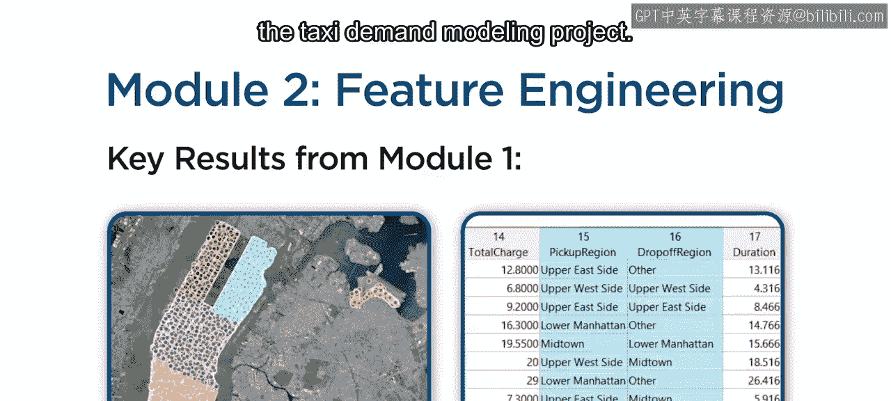

You also completed several key tasks， including importing， cleaning and exploring the 2015 data。

Grouping the pickup and drop off locations into the six given regions。

Suming pickups and drop offs by region and hour。And exploring taxi demand using the difference between drop offs and pickups。

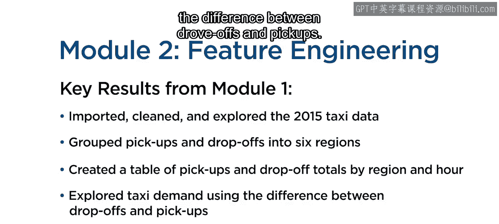

Now it's time to move from data analysis to feature engineering。

 where you will prepare your data for machine learning in moduleule 3。

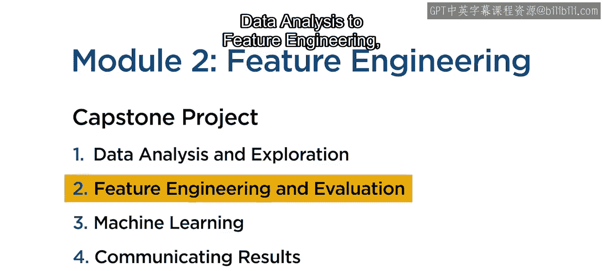

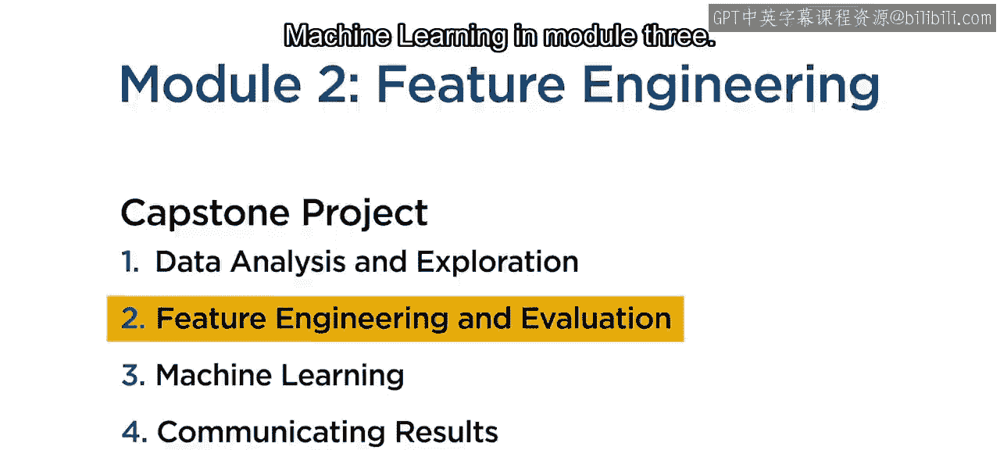

Let's take a moment to review the key steps in the feature engineering workflow。

Since feature engineering is part of the larger machine learning workflow。

The first step is to split your data into a training set and a test set。

Creating a test set now will enable you to better estimate model performance later on。

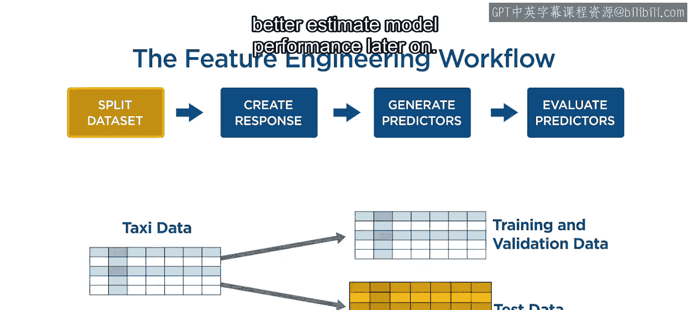

The next step is to create a response variable for your machine learning model。

The response can be an existing variable。A processed version of an existing variable。

Or function of two or more variables。The choice of the response is driven by the problem you are trying to solve。

Next， you can generate predictor features。As with the response。

 a predictor can be created from one or more variables with or without processing。

The number of predictors is limited only by the data you have available and your imagination。

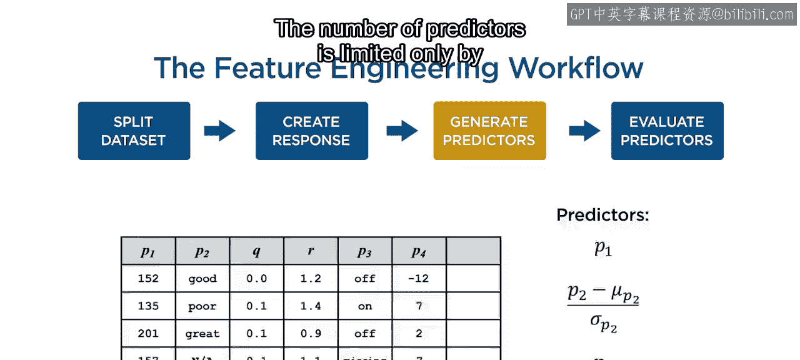

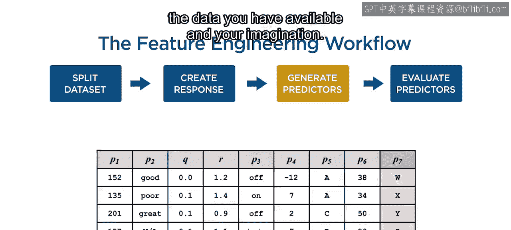

However， these features are only helpful if they add predictive power to your model。

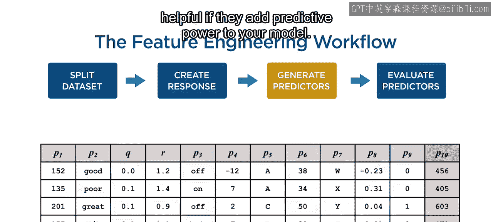

That brings us to the last step in the feature engineering workflow， evaluation。

This is where you'll use a combination of visual and statistical methods to understand the relationships between your predictors and your response feature。

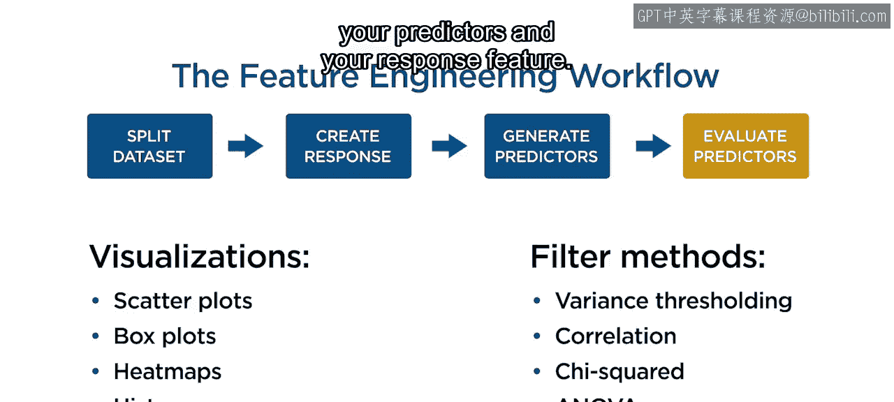

Understanding these relationships will help you identify features that are likely to help your model and discard those that aren't。

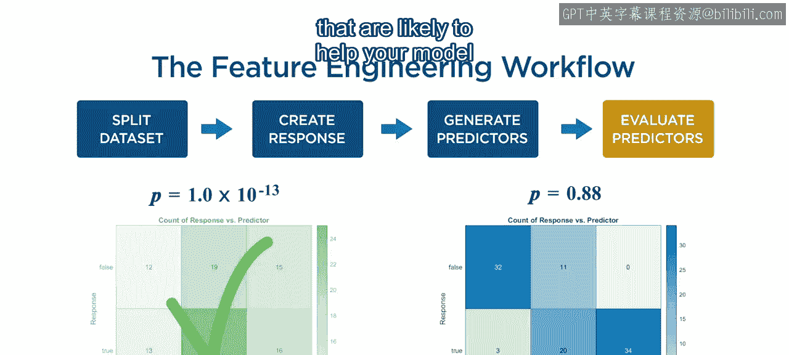

A better understanding of your feature set can also help you engineer new features。

Improve existing ones。

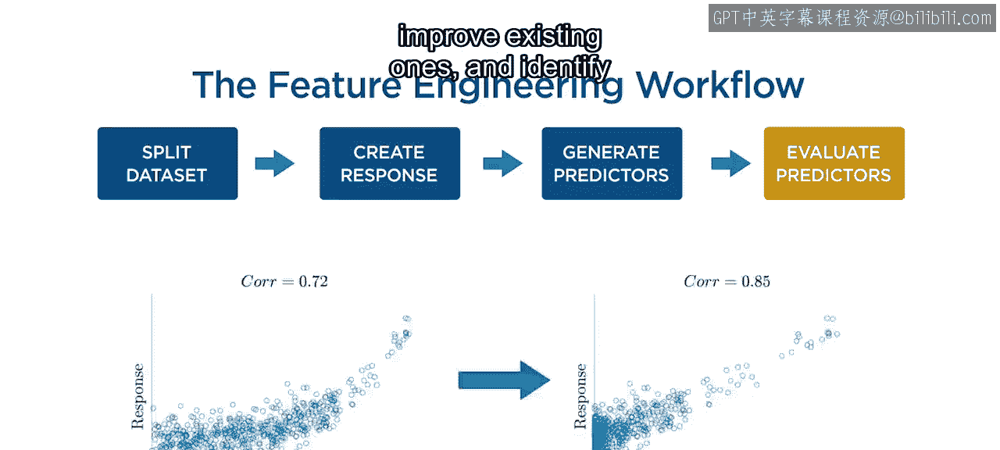

And identify potential issues so that you can address them before training your model。

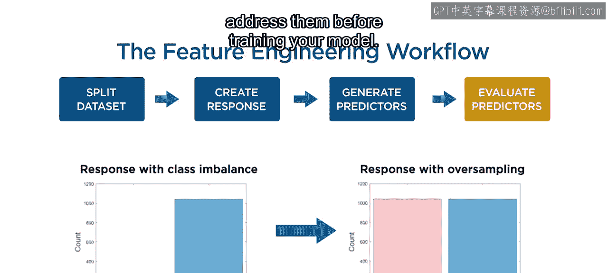

Now it's time to get started。Next， you'll be provided with a list of tasks to complete as you build your own feature set and a set of resources to help you along the way。

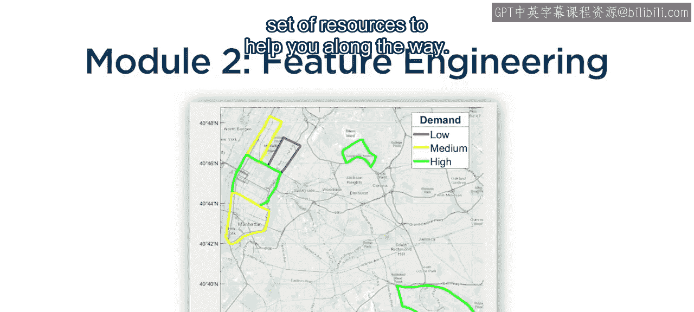

。