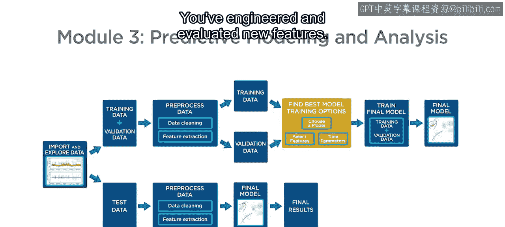
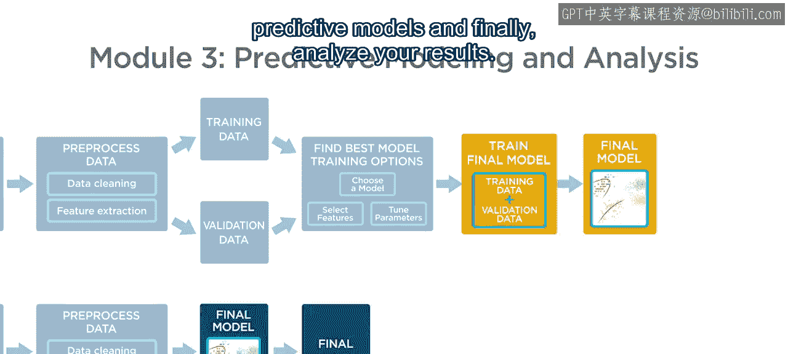
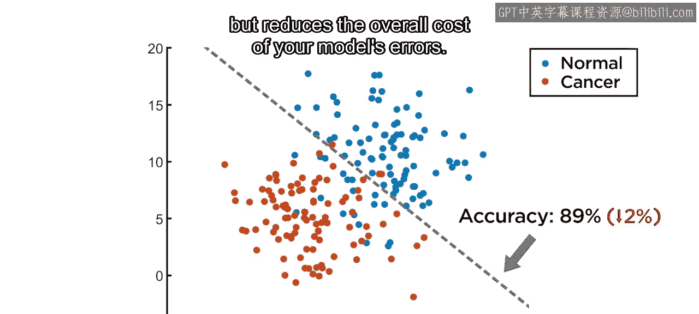
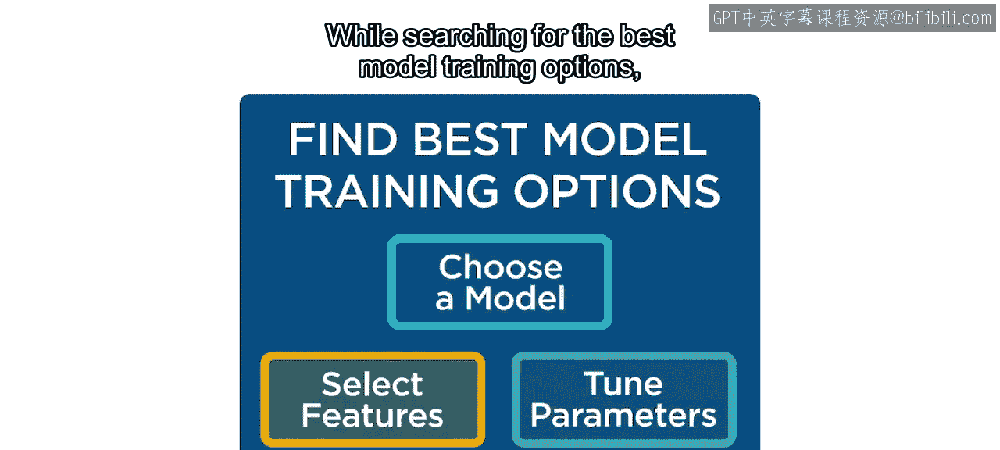
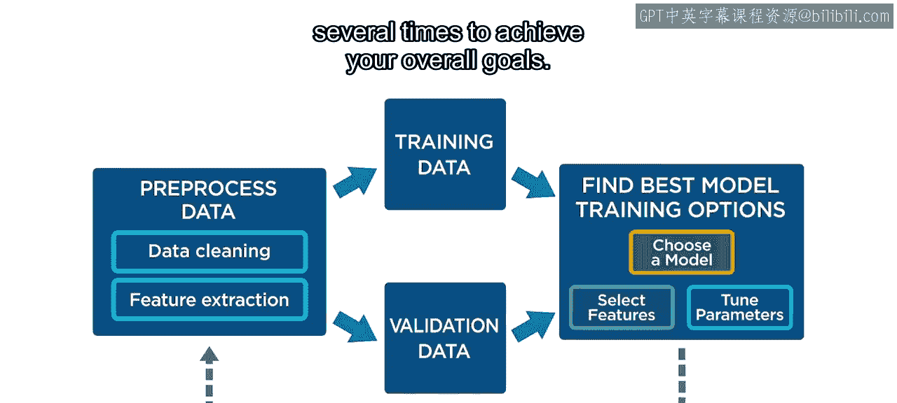
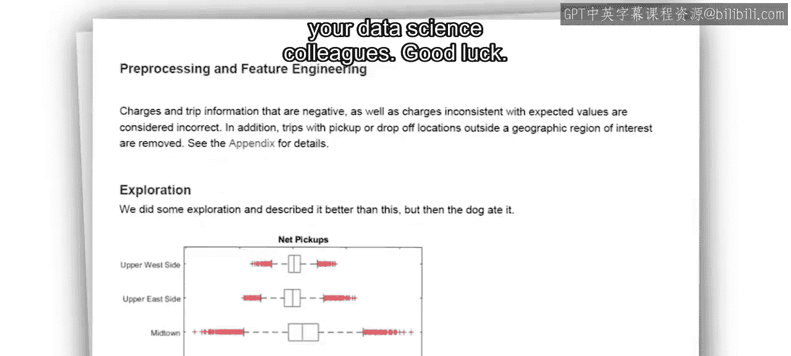

# Mathworks《实用数据科学与MATLAB（数据探索、特征工程、机器学习、毕业项目）｜Practical Data Science with MATLAB》 p123 6_模块3介绍.zh_en [BV1Jr421w7wL_p123]

🎼。

You've explored， clean， and restructured the taxi data。You've engineered and evaluated new features。

Now it is time to train predictive models and finally， analyze your results。

In this module。You'll train models to predict the demand for taxis in the New York City area using the data you previously prepared and analyzed That is。

 you'll classify each region's level of demand as high。

 medium or low in one hour intervals throughout the year。You'll start by treating each class equally。

 trying model types， optimizing hyperparameters， and testing features to find the model with the highest overall accuracy。

Then you'll address a more detailed scenario where real world behaviors and business concerns dictate prioritizing certain classification errors over others。

Remember， training classification models often involves considering multiple measures of performance。

As well as trade offs among them。For example， if reducing the false negative rate for one class is more important than others。

 you'd want to emphasize this type of error in your modeling to reduce it further than others。

This may cause overall accuracy to decrease， but reduces the overall cost of your model's errors。

While searching for the best model training options。

You may find that you need to iterate through steps in the workflow several times to achieve your overall goals。

Once you've finished modeling， you'll create a formal report of your result and analysis for review by your data science colleagues。

Good luck。Yeah。