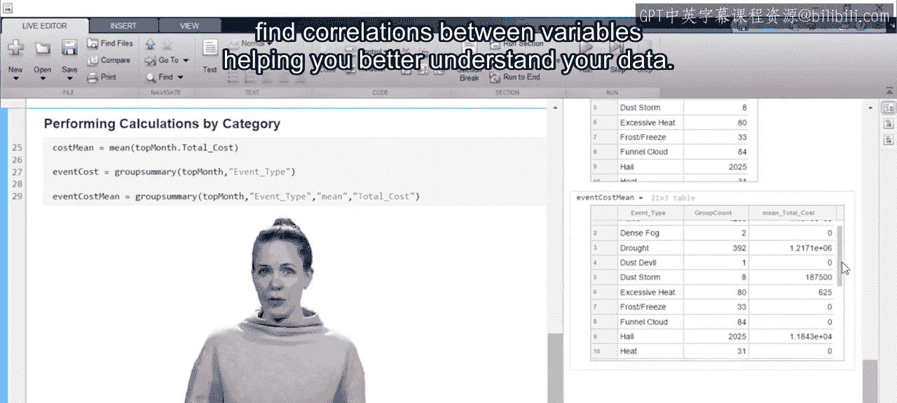
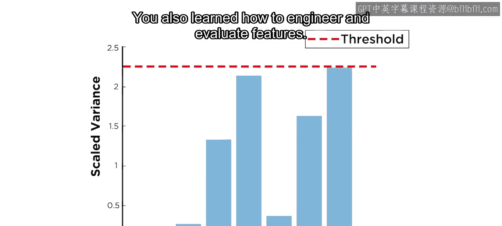
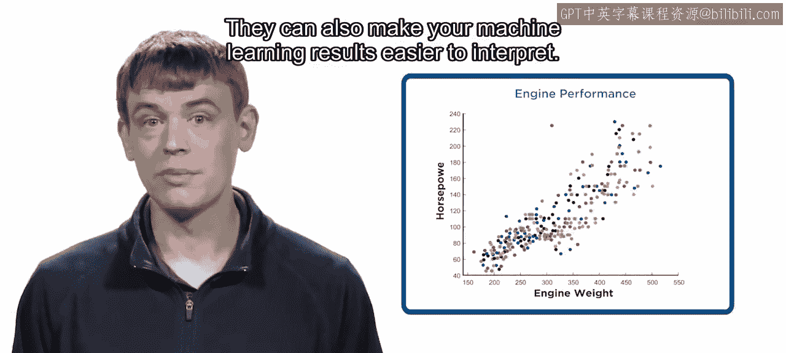
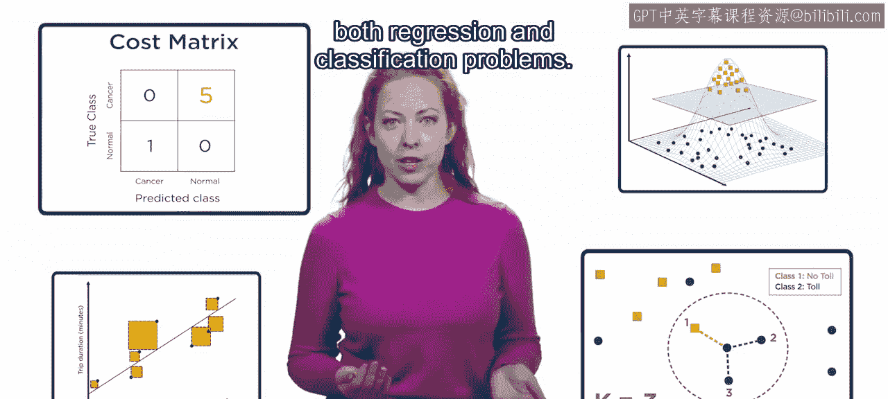
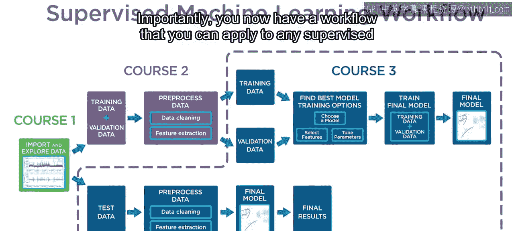
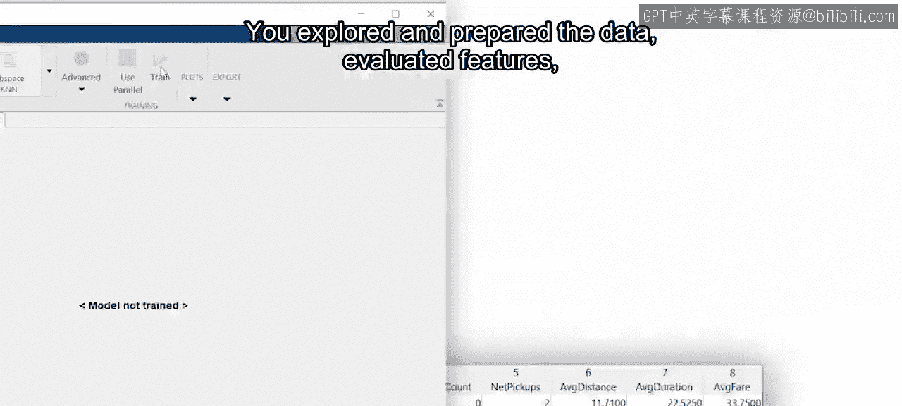
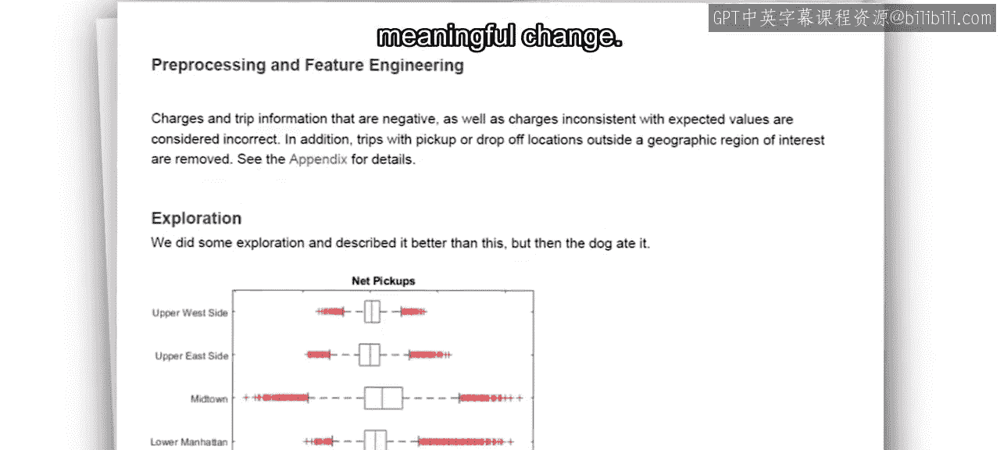
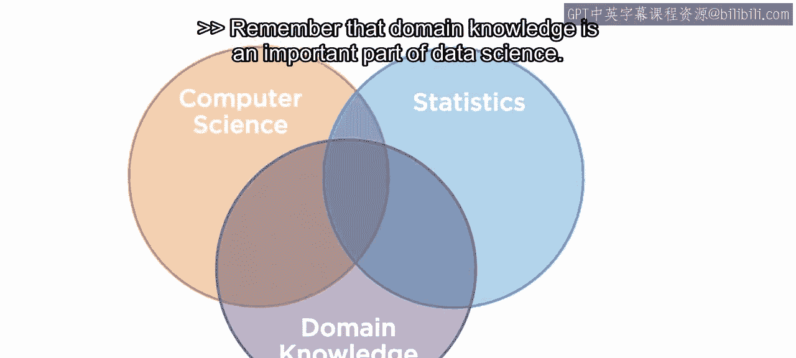

# Mathworks《实用数据科学与MATLAB（数据探索、特征工程、机器学习、毕业项目）｜Practical Data Science with MATLAB》 p126 9_实用数据科学与MATLAB总结.zh_en [BV1Jr421w7wL_p126]

🎼。

Congratulations congratulations congraulations congratulations on completing the capstone project data science techniques have become important to a wide range of applications。

 including autonomous systems， power generation， medical diagnosis， activity tracking and much more。

Across disciplines， the abundance of data is both a challenge。And an opportunity。

By learning how to apply data science practices， you put yourself in position to meet the challenge and seize the opportunity now and throughout your career。

You started by exploring and analyzing data， which is often quite challenging。In course one。

 you learned how to import。Visualize and filter your data so that you can quickly gain key insights。

You also learned how to calculate group summary statistics and find correlations between variables。

 helping you better understand your data。

Understanding your data， however， can be difficult when it contains lots of noise。

Missing entries or outliers。You can now efficiently preprocess your data using the skills you gained in course2。

You also learned how to engineer and evaluate features。

Useful features help with machine learning by improving training speed and model accuracy。

They can also make your machine learning results easier to interpret。

Getting started with machine learning can seem overwhelming at first。

 but you're ready for the challenge with the skills learning Course 3。

You learn how to apply a variety of approaches for both regression and classification problems。

Importantly， you now have a workflow that you can apply to any supervised machine learning project。

In most data science applications， there is no single correct answer。

 You worked through such a scenario in the capstone project using what you learned in the previous three courses。

You explored and prepared the data。Evaluated features。

Created machine learning models and evaluated the results。

Finally， you created reports tailored to both technical and non technical audiences。

This is a crucial skill to ensure your findings can be used to drive meaningful change。

Now it's time to start applying the skills learned in this specialization to your own work。

Remember that domain knowledge is an important part of data science。

The analysis you perform depends not just on the data， but on the questions you're trying to answer。

 The features you use and create for your machine learning models will depend on the response you're trying to predict。

The type of models you build depend not just on the data， but on your goals。

Keep this in mind as you start using MatTLb to tackle your own projects。

 we're confident you have the skills to succeed。Good luck。

